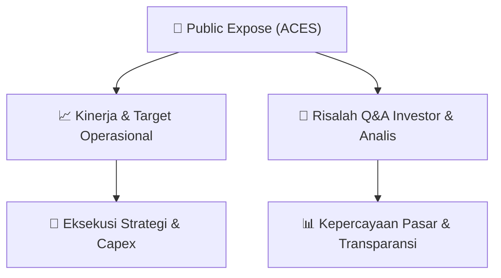

# 📢 Laporan Intelijen Paparan Publik (Public Expose) - [[ACES]]
🏢 **Emiten**: `[[ACES]]` | 📅 **Tanggal Pelaksanaan**: `2026-08-27` | 📑 **Dokumen**: `Public Expose lamp1`
⬅️ [[knowledge-base/daily-digests/Daily_Digest_20260827|Kembali ke Daily Digest]] | 🎛️ [[Dashboard|Ke Dashboard Utama]]

---

## 📌 1. Ringkasan Eksekutif & Paparan Direksi
> [!NOTE]
> PT Aspirasi Hidup Indonesia Tbk (ACES) menyampaikan pemberitahuan rencana partisipasi dalam Public Expose Live 2026 yang diselenggarakan PT Bursa Efek Indonesia secara virtual pada Kamis, 10 September 2026 pukul 14.00-15.00 WIB. Agenda utama adalah Laporan Kinerja Semester I Tahun 2026 serta Prospek dan Strategi Usaha. Perseroan diwakili oleh Direktur Gregory Sugyono Widjaja dan Head of Investor Relations Billy Utama Suria. Materi Public Expose akan disampaikan paling lambat Senin, 7 September 2026.

#### 🎯 Guidance Operasional & Target Strategis
- Dokumen ini belum memuat guidance kinerja, target ekspansi, atau rencana capex. Informasi tersebut diperkirakan akan disampaikan dalam materi Public Expose Live 2026 dan paparan pada 10 September 2026.

## 📊 2. Matriks Indikator Operasional & Parameter Kunci
| Parameter Utama | Nilai / Keterangan Resmi |
| :--- | :--- |
| **Emiten** | `PT Aspirasi Hidup Indonesia Tbk (ACES)` |
| **Nama Acara** | `Public Expose Live 2026 dalam Rangka 49 Tahun Diaktifkannya Kembali Pasar Modal Indonesia` |
| **Tanggal Penyelenggaraan** | `Kamis, 10 September 2026` |
| **Waktu** | `14.00 - 15.00 WIB` |
| **Tempat** | `Virtual melalui website idx.co.id` |
| **Agenda** | `1. Laporan Kinerja Semester I Tahun 2026; 2. Prospek dan Strategi Usaha` |
| **Pembicara** | `Gregory Sugyono Widjaja (Direktur) dan Billy Utama Suria (Head of Investor Relations)` |
| **Batas Penyampaian Materi** | `Senin, 7 September 2026` |

---

## 💬 3. Risalah Tanya Jawab (Q&A Session)
`Materi presentasi Public Expose / Risalah Q&A terlampir dalam dokumen resmi bursa.`

## 📌 4. Peta Jalur Strategis & Roadmap

---

## 🔗 Knowledge Graph
- [[knowledge-base/daily-digests/Daily_Digest_20260827|📄 Daily Digest 2026-08-27]]
- [[knowledge-base/calendars/Action_Calendar|🗓️ Kalender Terpusat Aksi Korporasi]]
- [[Dashboard|🎛️ Kembali ke Dashboard Utama]]