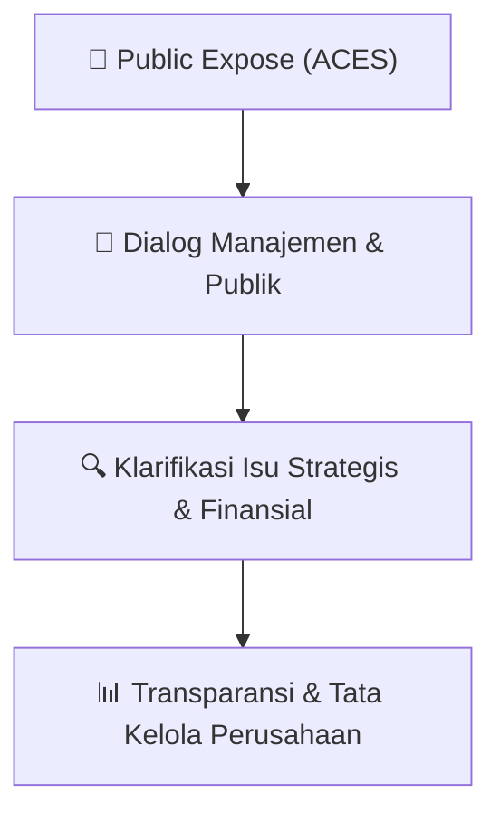

# 🎤 Laporan Hasil Public Expose: [ACES]

🏢 **Emiten**: `ACES` | 📅 **Tanggal Pelaksanaan**: `2026-09-11` | ❓ **Total Pertanyaan**: `1 Pertanyaan`
⬅️ [[knowledge-base/daily-digests/ACES_20260911|Kembali ke Daily Digest]] | 🎛️ [[Dashboard/ACES|Ke Dashboard Emiten]]

> [!IMPORTANT]
> Dokumen ini memuat seluruh risalah hasil pelaksanaan dan sesi tanya jawab (Q&A) Public Expose ACES. Informasi dicatat secara verbatim guna memberikan analisis sentimen dan arah kebijakan manajemen bagi investor.

---

## ℹ️ 1. Informasi Penyelenggaraan & Kehadiran

| Parameter | Detail Pelaksanaan |
|---|---|
| **Nomor Surat** | 046/IR-FIN/AHI/9/26 |
| **Perihal** | Laporan Hasil Public Expose Tahunan |
| **Waktu Pengumuman** | 11-09-2026 14:40 |
| **Jumlah Kehadiran Peserta** | Penyampaian Hasil Public Expose |
| **Lampiran Berkas** | `1` |

---

## 💬 2. Risalah Tanya Jawab Manajemen & Investor (1 Pertanyaan)

### ❓ Pertanyaan #1

> **Penanya**: Pemutaran video Company Profile Perseroan — Penyampaian materi dan pemaparan kinerja Perseroan

```text
Pertanyaan:
Pembukaan acara oleh BEI
```

💡 **Jawaban & Klarifikasi Manajemen**:

> Sesi tanya dan jawab  
> e. 
> Penutupan 
>  
> 3. 
> Peserta 
> Perwakilan Perseroan dalam Public Expose Live 2026:

---

## 📌 3. Peta Jalur Transparansi & Kepercayaan Pasar



---

*Dokumen diolah otomatis oleh **Swarm Intelijen Pasar Modal Indonesia** pada 2026-10-12 16:41 WIB.*