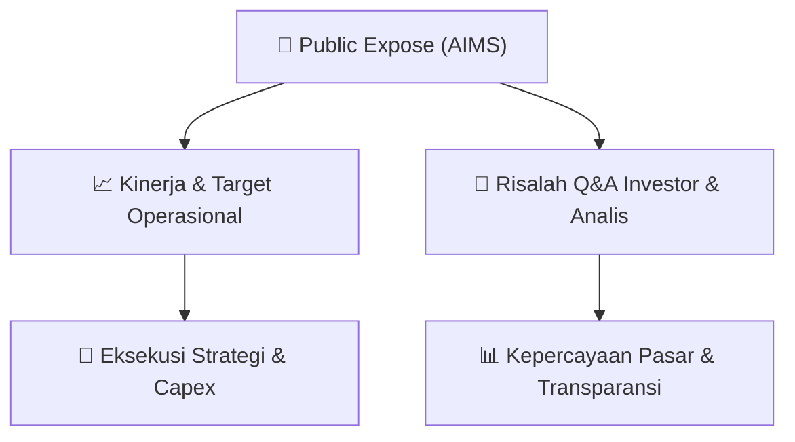

# 📢 Laporan Intelijen Paparan Publik (Public Expose) - [[AIMS]]
🏢 **Emiten**: `[[AIMS]]` | 📅 **Tanggal Pelaksanaan**: `2026-09-03` | 📑 **Dokumen**: `Public Expose lamp1`
⬅️ [[knowledge-base/daily-digests/Daily_Digest_20260903|Kembali ke Daily Digest]] | 🎛️ [[Dashboard|Ke Dashboard Utama]]

---

## 📌 1. Ringkasan Eksekutif & Paparan Direksi
> [!NOTE]
> PT Artha Mahiya Investama Tbk (AIMS) menyampaikan pemberitahuan rencana penyelenggaraan Public Expose yang akan diadakan pada Kamis, 17 September 2026 pukul 11:00 WIB s/d selesai. Acara diselenggarakan secara hybrid di Chora 1 & 2, Level 2 The Tribrata, Darmawangsa, Jakarta Selatan, dan melalui video conference aplikasi eASY.KSEI. Agenda public expose mencakup kinerja keuangan dan kondisi bisnis Perseroan, rencana bisnis ke depan, serta analisa manajemen terkait pergerakan harga saham Perseroan. Acara rencananya dihadiri oleh jajaran Komisaris dan Direksi Perseroan.

#### 🎯 Guidance Operasional & Target Strategis
- Dokumen yang tersedia hanya merupakan surat pemberitahuan rencana Public Expose dan belum memuat rincian target kinerja, ekspansi, capex, atau guidance operasional. Informasi katalis dan guidance baru akan tersedia pada saat pelaksanaan Public Expose tanggal 17 September 2026.

## 📊 2. Matriks Indikator Operasional & Parameter Kunci
| Parameter Utama | Nilai / Keterangan Resmi |
| :--- | :--- |
| **Nama Emiten** | `PT Artha Mahiya Investama Tbk (AIMS)` |
| **Tanggal Public Expose** | `Kamis, 17 September 2026` |
| **Waktu Acara** | `Pukul 11:00 WIB s/d selesai` |
| **Lokasi Fisik** | `Chora 1 & 2, Level 2 The Tribrata, Darmawangsa, Jakarta Selatan` |
| **Lokasi Daring** | `Video Conference melalui aplikasi eASY.KSEI` |
| **Agenda Public Expose** | `Kinerja keuangan dan kondisi bisnis Perseroan; Rencana bisnis ke depan; Analisa manajemen terkait pergerakan harga saham Perseroan` |
| **Pihak yang Direncanakan Hadir** | `Jajaran Komisaris dan Direksi Perseroan` |
| **Corporate Secretary** | `Anton Hidayat` |

---

## 💬 3. Risalah Tanya Jawab (Q&A Session)
`Materi presentasi Public Expose / Risalah Q&A terlampir dalam dokumen resmi bursa.`

## 📌 4. Peta Jalur Strategis & Roadmap

---

## 🔗 Knowledge Graph
- [[knowledge-base/daily-digests/Daily_Digest_20260903|📄 Daily Digest 2026-09-03]]
- [[knowledge-base/calendars/Action_Calendar|🗓️ Kalender Terpusat Aksi Korporasi]]
- [[Dashboard|🎛️ Kembali ke Dashboard Utama]]