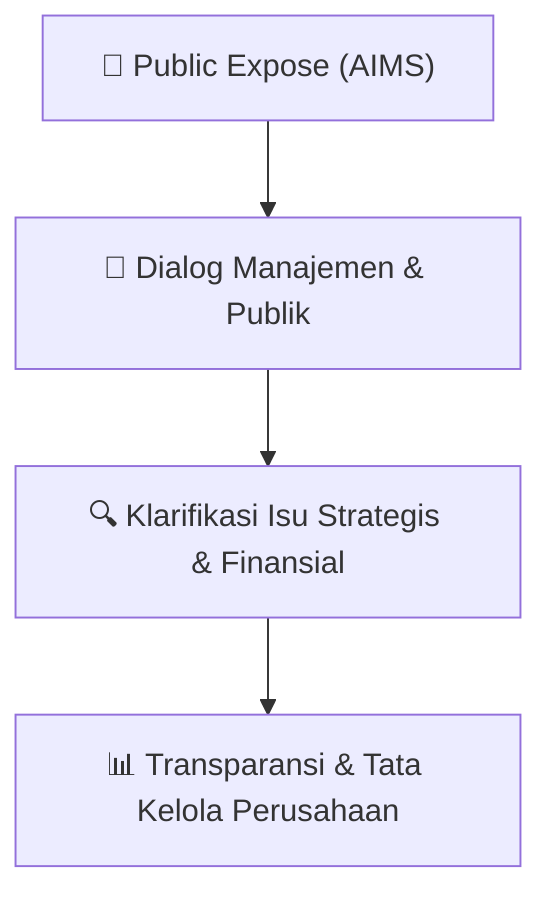

# 🎤 Laporan Hasil Public Expose: [AIMS]

🏢 **Emiten**: `AIMS` | 📅 **Tanggal Pelaksanaan**: `2026-09-21` | ❓ **Total Pertanyaan**: `2 Pertanyaan`
⬅️ [[knowledge-base/daily-digests/AIMS_20260921|Kembali ke Daily Digest]] | 🎛️ [[Dashboard/AIMS|Ke Dashboard Emiten]]

> [!IMPORTANT]
> Dokumen ini memuat seluruh risalah hasil pelaksanaan dan sesi tanya jawab (Q&A) Public Expose AIMS. Informasi dicatat secara verbatim guna memberikan analisis sentimen dan arah kebijakan manajemen bagi investor.

---

## ℹ️ 1. Informasi Penyelenggaraan & Kehadiran

| Parameter | Detail Pelaksanaan |
|---|---|
| **Nomor Surat** | 003/AIMS-PUBEX/IX/2026 |
| **Perihal** | Laporan Hasil Public Expose Tahunan |
| **Waktu Pengumuman** | 21-09-2026 17:00 |
| **Jumlah Kehadiran Peserta** | Penyampaian Hasil Public Expose |
| **Lampiran Berkas** | `1` |

---

## 💬 2. Risalah Tanya Jawab Manajemen & Investor (2 Pertanyaan)

### ❓ Pertanyaan #1

> **Penanya**: *Investor / Analis Publik*

```text
Pertanyaan:
1. Perseroan basicnya Perseroan batubara, pada tahun 2025 perseroan sudah mineout 
pada saat itu melakukan trading. Disisi lain regulasi yang menyebabkan Perusahaan 
tambang terganjal karna RKAB sehingga usaha trading Perseroan sangat pelan sekali. 
Oleh sebab itu Perseroan pada akhir tahun lalu, mencoba mengambil sisi lain yaitu 
manajemen tambang dan manajemen eksplorasi. Melihat belum adanya perubahan 
regulasi yang signifikan, manajemen melihat periode 2026 dan 2027 sebagai periode 
penting bagi Perseroan untuk memperkuat fondasi bisnis dan mempersiapkan 
pertumbuhan selanjutnya. Perseroan akan tetap berhati-hati dan selektif dalam 
menentukan peluang usaha yang akan dikembangkan. Prioritas kami adalah 
memastikan setiap langkah bisnis memiliki dasar yang kuat, terukur, serta dapat 
memberikan manfaat jangka panjang bagi Perseroan dan seluruh pemegang saham. 
 
b. Santi Palupi, @Chora
Pertanyaan :  
1. Perseroan akan melakukan eksplorasi atau mengaitkan Perusahaan dengan 
konsolidasi ke alam dan lingkungan, itu maksudnya seperti apa?  
2. Apakah disana ada untuk CSR, dan dengan fasilitas yang bapak punya bagaimana 
dengan penduduk sekitar, apakah dibantu untuk Kesehatan, Pendidikan terutama 
anak-anak yang disabilitas? 
 
Jawaban : 
 
1. Perseroan saat ini tidak memiliki izin usaha pertambangan maupun area tambang 
sendiri. Oleh karena itu, dalam melaksanakan kegiatan eksplorasi, Perseroan bekerja 
sama dengan perusahaan-perusahaan tambang rekanan berdasarkan surat 
penunjukan dan/atau kerja sama dari pemegang izin pertambangan yang sah. Dalam 
pelaksanaannya, Perseroan melakukan kegiatan antara lain pemetaan area serta 
pemanfaatan teknologi drone untuk memperoleh dan mengolah data yang 
selanjutnya dapat digunakan untuk kepentingan internal Perseroan sesuai dengan 
ruang lingkup kegiatan yang disepakati.
Jakarta Selatan 12170 
www.aimsinvestama.com
```

💡 **Jawaban & Klarifikasi Manajemen**:

> Jl. Cipaku 1, No.3  
> Petogogan, Kebayoran Baru

---

### ❓ Pertanyaan #2

> **Penanya**: *Investor / Analis Publik*

```text
Pertanyaan:
2. Sehubungan dengan Perseroan yang tidak memiliki dan tidak mengoperasikan 
tambang sendiri, saat ini Perseroan belum memiliki program CSR yang secara langsung 
melekat pada pengelolaan suatu wilayah pertambangan. Namun demikian, dalam 
pelaksanaan kegiatan eksplorasi bersama mitra, Perseroan turut melibatkan dan 
mempekerjakan tenaga kerja lokal secara harian sesuai dengan kebutuhan kegiatan di 
lapangan. Pola tersebut dilakukan karena kegiatan Perseroan pada masing-masing 
lokasi masih bersifat berdasarkan penugasan atau kerja sama tertentu dan belum 
didasarkan pada kontrak jangka panjang atas suatu wilayah pertambangan. 
 
c. Arianto, @Chora
Pertanyaan :  
1. Kenapa Perseroan pendapatannya turun menjadi 93.000.000, sehingga Perseroan jadi 
rugi banyak alasannya apa karena liabilitas meningkat tajam serta ekuitasnya turun 
tajam juga. Ada persoalan apa pada Perseroan?  
 
Jawaban : 
 
1. Pada tahun 2025, kegiatan usaha Perseroan menghadapi kendala yang berkaitan 
dengan Rencana Kerja dan Anggaran Biaya (RKAB) dari perusahaan tambang rekanan. 
Kondisi tersebut menyebabkan Perseroan tidak dapat melakukan pembelian stok 
komoditas dari rekanan sebagaimana yang telah direncanakan. Akibatnya, Perseroan 
kehilangan kesempatan untuk menjalankan aktivitas perdagangan (trading) yang 
sebelumnya diharapkan dapat memberikan kontribusi terhadap pendapatan 
Perseroan. Kondisi tersebut menyebabkan kegiatan usaha Perseroan mengalami 
periode waiting time, di mana Perseroan belum dapat menjalankan aktivitas 
perdagangan secara optimal. Hal ini berdampak pada kinerja keuangan Perseroan, 
termasuk timbulnya kerugian yang pada akhirnya berpengaruh terhadap penurunan 
ekuitas Perseroan. Dengan mempertimbangkan kendala regulasi yang memengaruhi 
keberlangsungan kegiatan usaha tersebut, Perseroan kemudian melakukan evaluasi 
terhadap strategi bisnis dan memutuskan untuk mengembangkan serta menjalankan 
alternatif rencana bisnis lainnya yang diharapkan dapat mendukung keberlangsungan 
usaha dan memperbaiki kinerja Perseroan ke depan.
Jakarta Selatan 12170 
www.aimsinvestama.com
DAFTAR TAMU HADIR & ZOOM MEETING
PUBLIC EXPOSE 2026
PT ARTHA MAHIYA INVESTAMA TBK
Daftar Tamu Hadir
NO 
NAMA 
NO
1 
Agus Susanto 
16 
Bimo Arioseno 
2 
M. Ichsan Rais 
17 
Abel Ignatius Aurey 
3 
Elisabeth Abidien 
18 
Christ Jonatan Daely 
4 
Jordan Novey  
19 
Santi Palupi 
5 
Wilian Sutanti 
20 
Prasetyo 
6 
PT Delta Wibawa Bersama 
21 
Romi Wahyu Irawan 
7 
Liqin Ling 
22 
Hanno Arif Wirawan 
8 
Kwok Michael Kwantara 
23 
Noviandi Ichsan 
9 
Suman Tirta 
24 
Eko Nugroho 
10 
Alberto Renaldo 
25 
Hadi Wijaya 
11 
Wong Tjhiong Shen 
26 
Panji Yudhistira 
12 
Hendra Susanto 
27 
Harianto Ling 
13 
Hugo Andhika 
28 
Santo 
14 
Priyandana 
29 
Arianto
15 
Dedy Lian – PT AIMS Indo 
Investama 
30 
Panca Ristiantoro
Daftar Hadir Zoom
NO 
NAME ORIGINAL 
EMAIL 
1 
Aulia Eka Ayu Ningrum 
auliaekan@gmail.com 
2 
Arfan Nur Rasyidi - AIMS 
arfan.nr@gmail.com 
3 
Alvian Faza 
alvianfaza1@gmail.com 
4 
Maggie Widjanarko 
maggie.widjanarko@gmail.com 
5 
Nacky Suryanto 
27nacky11@gmail.com 
6 
Akmal Riansyah 
akmalriansyah4@gmail.com 
7 
Robby Sulistio 
robbysulistio008@gmail.com 
8 
Halimah H 
Halimah.siti@asvajourney.com
```

💡 **Jawaban & Klarifikasi Manajemen**:

> Jl. Cipaku 1, No.3  
> Petogogan, Kebayoran Baru

---

## 📌 3. Peta Jalur Transparansi & Kepercayaan Pasar



---

*Dokumen diolah otomatis oleh **Swarm Intelijen Pasar Modal Indonesia** pada 2026-10-12 16:41 WIB.*