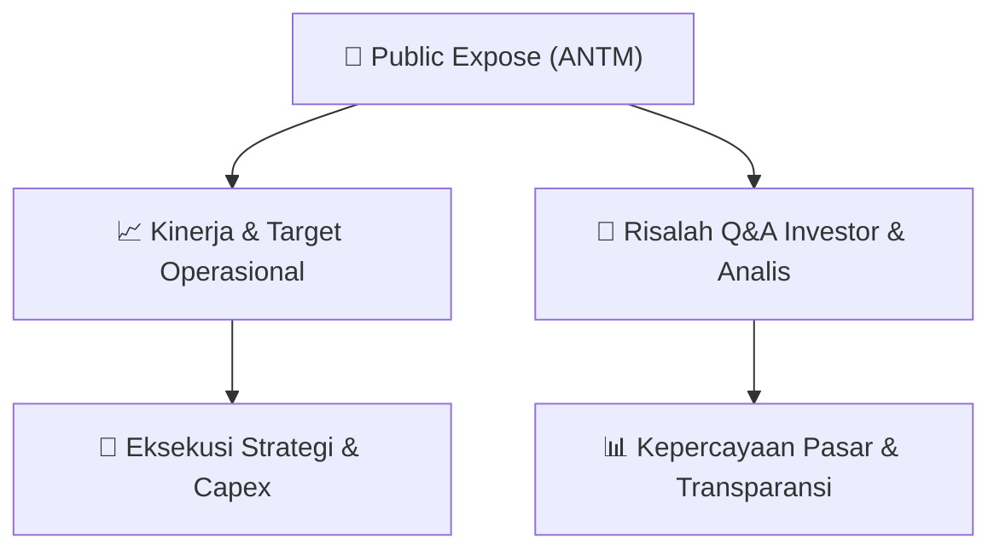

# 📢 Laporan Intelijen Paparan Publik (Public Expose) - [[ANTM]]
🏢 **Emiten**: `[[ANTM]]` | 📅 **Tanggal Pelaksanaan**: `2026-08-27` | 📑 **Dokumen**: `Public Expose lamp1`
⬅️ [[knowledge-base/daily-digests/Daily_Digest_20260827|Kembali ke Daily Digest]] | 🎛️ [[Dashboard|Ke Dashboard Utama]]

---

## 📌 1. Ringkasan Eksekutif & Paparan Direksi
> [!NOTE]
> Dokumen merupakan surat pemberitahuan resmi dari Corporate Secretary PT ANTAM (Persero) Tbk kepada Direksi PT Bursa Efek Indonesia mengenai rencana penyelenggaraan Public Expose Tahunan Tahun 2026. Surat bernomor 5103/692/DCS/2026 tertanggal 26 Agustus 2026 ini menginformasikan bahwa Public Expose akan dilaksanakan pada Kamis, 10 September 2026 pukul 16.00 WIB sampai selesai, tergabung dalam acara Public Expose Live 2026 yang diselenggarakan BEI. Agenda utama adalah paparan kinerja Semester I Tahun 2026 dan press conference, dengan pembicara perwakilan manajemen perusahaan. Dokumen tidak memuat rincian kinerja keuangan, target operasional, atau tanya jawab investor.

#### 🎯 Guidance Operasional & Target Strategis
- Tidak terdapat informasi target kinerja, ekspansi, capex, atau guidance operasional dalam dokumen ini. Dokumen hanya mengumumkan rencana penyelenggaraan Public Expose Tahunan 2026, di mana manajemen akan memaparkan kinerja Semester I Tahun 2026. Detail kinerja dan guidance baru akan disampaikan pada saat acara berlangsung.

## 📊 2. Matriks Indikator Operasional & Parameter Kunci
| Parameter Utama | Nilai / Keterangan Resmi |
| :--- | :--- |
| **Nomor Surat** | `5103/692/DCS/2026` |
| **Tanggal Surat** | `26 Agustus 2026` |
| **Perihal** | `Rencana Penyelenggaraan Public Expose Tahunan PT ANTAM (Persero) Tbk Tahun 2026` |
| **Hari/Tanggal Public Expose** | `Kamis / 10 September 2026` |
| **Waktu** | `Pukul 16.00 WIB – selesai` |
| **Tempat** | `Public Expose Live 2026, tercantum pada website www.idx.co.id` |
| **Agenda** | `1. Paparan Kinerja Semester I Tahun 2026; 2. Press Conference` |
| **Pembicara** | `Perwakilan Manajemen Perusahaan` |
| **Nama Pengirim** | `Wisnu Danandi Haryanto, Corporate Secretary Division Head` |

---

## 💬 3. Risalah Tanya Jawab (Q&A Session)
`Materi presentasi Public Expose / Risalah Q&A terlampir dalam dokumen resmi bursa.`

## 📌 4. Peta Jalur Strategis & Roadmap

---

## 🔗 Knowledge Graph
- [[knowledge-base/daily-digests/Daily_Digest_20260827|📄 Daily Digest 2026-08-27]]
- [[knowledge-base/calendars/Action_Calendar|🗓️ Kalender Terpusat Aksi Korporasi]]
- [[Dashboard|🎛️ Kembali ke Dashboard Utama]]