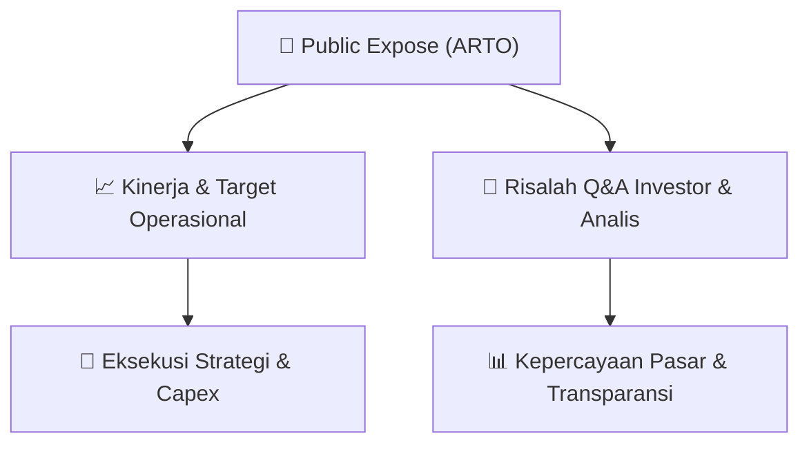

# 📢 Laporan Intelijen Paparan Publik (Public Expose) - [[ARTO]]
🏢 **Emiten**: `[[ARTO]]` | 📅 **Tanggal Pelaksanaan**: `2026-08-27` | 📑 **Dokumen**: `Public Expose lamp1`
⬅️ [[knowledge-base/daily-digests/Daily_Digest_20260827|Kembali ke Daily Digest]] | 🎛️ [[Dashboard|Ke Dashboard Utama]]

---

## 📌 1. Ringkasan Eksekutif & Paparan Direksi
> [!NOTE]
> PT Bank Jago Tbk (ARTO) menyampaikan pemberitahuan rencana penyelenggaraan Public Expose Tahunan 2026 kepada Bursa Efek Indonesia. Acara akan diselenggarakan pada Kamis, 10 September 2026 pukul 11.00-12.00 WIB melalui platform Public Expose Live 2026 di https://www.idx.co.id/id/investor/public-expose-live/. Agenda mencakup paparan kinerja keuangan per Juni 2026 dan perkembangan bisnis perseroan. Narasumber adalah Direktur Finance & Operations Supranoto Prajogo dan Investor Relations & Market Intelligence Theodore Siregar. Dokumen ini hanya merupakan pengumuman rencana, bukan materi paparan publik.

#### 🎯 Guidance Operasional & Target Strategis
- Tidak tersedia dalam dokumen ini karena dokumen hanya berisi pemberitahuan rencana Public Expose, tanpa rincian target kinerja, ekspansi, atau capex.

## 📊 2. Matriks Indikator Operasional & Parameter Kunci
| Parameter Utama | Nilai / Keterangan Resmi |
| :--- | :--- |
| **Emiten** | `PT Bank Jago Tbk (ARTO)` |
| **Nomor Surat** | `S.526/JAGO-COMP/VIII/2026` |
| **Tanggal Surat** | `27 Agustus 2026` |
| **Perihal** | `Rencana Penyelenggaraan Public Expose Tahunan 2026` |
| **Hari/Tanggal Public Expose** | `Kamis, 10 September 2026` |
| **Waktu** | `11.00 - 12.00 WIB` |
| **Tempat** | `Public Expose Live 2026, https://www.idx.co.id/id/investor/public-expose-live/` |
| **Agenda 1** | `Kinerja Keuangan Juni 2026` |
| **Agenda 2** | `Perkembangan Bisnis Perseroan` |
| **Narasumber 1** | `Direktur Finance & Operations Supranoto Prajogo` |
| **Narasumber 2** | `Investor Relations & Market Intelligence Theodore Siregar` |
| **Penandatangan** | `Tjit Siat Fun, Direktur Kepatuhan/Corporate Secretary` |

---

## 💬 3. Risalah Tanya Jawab (Q&A Session)
`Materi presentasi Public Expose / Risalah Q&A terlampir dalam dokumen resmi bursa.`

## 📌 4. Peta Jalur Strategis & Roadmap

---

## 🔗 Knowledge Graph
- [[knowledge-base/daily-digests/Daily_Digest_20260827|📄 Daily Digest 2026-08-27]]
- [[knowledge-base/calendars/Action_Calendar|🗓️ Kalender Terpusat Aksi Korporasi]]
- [[Dashboard|🎛️ Kembali ke Dashboard Utama]]