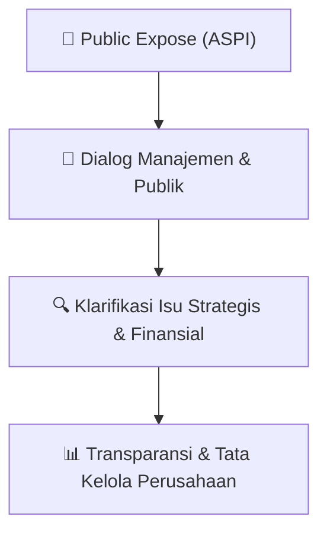

# 🎤 Laporan Hasil Public Expose: [ASPI]

🏢 **Emiten**: `ASPI` | 📅 **Tanggal Pelaksanaan**: `2026-09-30` | ❓ **Total Pertanyaan**: `3 Pertanyaan`
⬅️ [[knowledge-base/daily-digests/ASPI_20260930|Kembali ke Daily Digest]] | 🎛️ [[Dashboard/ASPI|Ke Dashboard Emiten]]

> [!IMPORTANT]
> Dokumen ini memuat seluruh risalah hasil pelaksanaan dan sesi tanya jawab (Q&A) Public Expose ASPI. Informasi dicatat secara verbatim guna memberikan analisis sentimen dan arah kebijakan manajemen bagi investor.

---

## ℹ️ 1. Informasi Penyelenggaraan & Kehadiran

| Parameter | Detail Pelaksanaan |
|---|---|
| **Nomor Surat** | 0358ASPI |
| **Perihal** | Laporan Hasil Public Expose Insidentil |
| **Waktu Pengumuman** | 30-09-2026 20:12 |
| **Jumlah Kehadiran Peserta** | Penyampaian Hasil Public Expose |
| **Lampiran Berkas** | `1` |

---

## 💬 2. Risalah Tanya Jawab Manajemen & Investor (3 Pertanyaan)

### ❓ Pertanyaan #1

> **Penanya**: *Investor / Analis Publik*

```text
Pertanyaan:
1. Tekait proses negosiasi pengambilalihan 
saham ASPI oleh GMP, sejauh mana proses 
due Diligence saat ini telah berjalan dan 
Apakah 
perseroan 
dapat 
memberikan 
estimasi timeline hingga proses tersebut 
selesai dan masuk ke tahap berikutnya ?
Saat ini , masih dalam tahap negosiasi dan proses 
due diligence .   Dimana, pihak KJPP dan Kuasa 
hukum  meminta untuk ada perpanjangan waktu 
dikarenakan 
masih 
butuh 
waktu 
dalam 
penelaahan dokumen dan  tahap –tahap nya.
From : Daniel Unan - Individu
```

💡 **Jawaban & Klarifikasi Manajemen**:

> *Teks tanggapan manajemen tidak tersedia*

---

### ❓ Pertanyaan #2

> **Penanya**: *Investor / Analis Publik*

```text
Pertanyaan:
2. 1. Data manajemen slide 21, 15, 17, 7 bahwa 
mengapa 
hasilnya 
belum 
terlihat 
memperhatikan 
beban 
penjualan 
naik 
hampir tiga kali lipat, tetapi pendapatan 
turun 16%, dan bagaimana perseroan 
memanfaatkan kebijakan pemerintah dan 
KPR agar rugi tidak melebar ? 
 
 
 
2.2. Data manajemen slide 22, 17, 6 bahwa 
bagaimana perseroan menjamin informasi 
sampai adil ke semua investor mengingat 
harga saham turun dari Rp680 ke Rp362 
sebelum keterbukaan informasi 10 Juli, dan 
bagaimana perlindungan pemegang saham 
publik jika ada pengambilalihan ? 
 
2.3.  Data   manajemen   slide  6, 22, 21, 20, 7, 19 
bahwa     mengapa    bisa   berbeda   jumlah 
saham   di   Slide   6   dan   Slide  22 berbeda 
sekitar    2   juta   lembar,   dan    bagaimana 
rencana   pendanaan   ke  depan   agar tidak 
membebani pemegang saham publik ?
```

💡 **Jawaban & Klarifikasi Manajemen**:

> *Teks tanggapan manajemen tidak tersedia*

---

### ❓ Pertanyaan #1

> **Penanya**: *Investor / Analis Publik*

```text
Pertanyaan:
1.  Dimana, Penyebab beban penjuala meningkat  
      dikarenakan  adanya insentif yang diberikan    
      kepada konsumen  meningkat.Perseroan ,
pastinya 
memanfaatkan 
kebijakan  
pemerintah dan meberikan KPR namun 
dikarenakan keadaan perekonomian yang 
tidakstabil dan era suku bunga yang tinggi  
yang menjadi tantangan tersendiri 
bagi 
perseroan.  
 
2.  Apabila  terjadi transaksi jual beli, maka 
perseroan akan mengikuti aturan yang 
berlaku 
terkait 
penawaran 
terhadap 
pemegang saham public. 
 
 
 
 
3. Pada Slide no 6 kami menjelaskan jumlah 
saham ASPI dan Masyarakat sesuai dengan 
jumlah saham yang tertera pada laporan 
keuangan sedangkan pada slide  no 22  
merupakan pergerakan  saham yang tercatat. 
 
 - Untuk rencana pendanaan ke depan saat ini
kami 
belum 
mendapatkan 
informasi 
dikarenakan masih dalam tahap negosiasi dan 
proses due diligence 
 
Terlampir  kami  sampaikan  daftar  hadir  paparan  publik.  
Demikian laporan pelaksanaan paparan publik kami.  Atas perhatiannya, kami mengucapkan terima 
kasih. 
 Hormat kami,  
 
 
 
ARnoldus Jansen Kustianto 
Corporate Secretary
```

💡 **Jawaban & Klarifikasi Manajemen**:

> *Teks tanggapan manajemen tidak tersedia*

---

## 📌 3. Peta Jalur Transparansi & Kepercayaan Pasar



---

*Dokumen diolah otomatis oleh **Swarm Intelijen Pasar Modal Indonesia** pada 2026-10-12 16:41 WIB.*