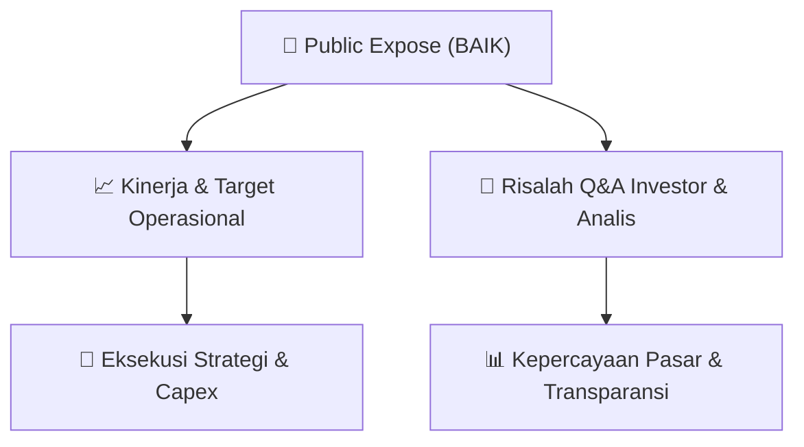

# 📢 Laporan Intelijen Paparan Publik (Public Expose) - [[BAIK]]
🏢 **Emiten**: `[[BAIK]]` | 📅 **Tanggal Pelaksanaan**: `2026-09-03` | 📑 **Dokumen**: `Public Expose lamp1`
⬅️ [[knowledge-base/daily-digests/Daily_Digest_20260903|Kembali ke Daily Digest]] | 🎛️ [[Dashboard|Ke Dashboard Utama]]

---

## 📌 1. Ringkasan Eksekutif & Paparan Direksi
> [!NOTE]
> Surat pemberitahuan rencana Public Expose Insidentil PT Bersama Mencapai Puncak Tbk (BAIK) yang ditujukan kepada PT Bursa Efek Indonesia. Public Expose diselenggarakan sebagai tindak lanjut atas penghentian sementara perdagangan saham BAIK dan permintaan Bursa terkait keterbukaan informasi. Acara akan dilaksanakan pada Senin, 07 September 2026 pukul 10.30 WIB secara online melalui Zoom dengan agenda penjelasan kinerja Perseroan Triwulan II Tahun Buku 2026. Materi Public Expose akan disampaikan paling lambat Jumat, 04 September 2026. Surat ditandatangani oleh Mahendra Kumala Adi selaku Corporate Secretary.

#### 🎯 Guidance Operasional & Target Strategis
- Dokumen ini tidak memuat rincian target kinerja, ekspansi, atau capex karena hanya merupakan surat pemberitahuan rencana Public Expose Insidentil, bukan materi paparan publik itu sendiri.

## 📊 2. Matriks Indikator Operasional & Parameter Kunci
| Parameter Utama | Nilai / Keterangan Resmi |
| :--- | :--- |
| **Emiten** | `PT Bersama Mencapai Puncak Tbk (BAIK)` |
| **Tanggal Surat** | `Malang, 03 September 2026` |
| **Nomor Surat** | `0118/SPn/BMP/09/2026` |
| **Perihal** | `Penyampaian Rencana Public Expose Insidentil PT Bersama Mencapai Puncak Tbk.` |
| **Hari/Tanggal Public Expose** | `Senin, 07 September 2026` |
| **Waktu Public Expose** | `10.30 WIB` |
| **Media Public Expose** | `Online (Zoom)` |
| **Agenda Public Expose** | `Penjelasan Kinerja Perseroan Triwulan II Tahun Buku 2026` |
| **Link Registrasi** | `https://bit.ly/registrasiPUBEXBAIK` |
| **Batas Penyampaian Materi Public Expose** | `Jumat, 04 September 2026` |
| **Penanggung Jawab Surat** | `Mahendra Kumala Adi, Corporate Secretary` |

---

## 💬 3. Risalah Tanya Jawab (Q&A Session)
`Materi presentasi Public Expose / Risalah Q&A terlampir dalam dokumen resmi bursa.`

## 📌 4. Peta Jalur Strategis & Roadmap

---

## 🔗 Knowledge Graph
- [[knowledge-base/daily-digests/Daily_Digest_20260903|📄 Daily Digest 2026-09-03]]
- [[knowledge-base/calendars/Action_Calendar|🗓️ Kalender Terpusat Aksi Korporasi]]
- [[Dashboard|🎛️ Kembali ke Dashboard Utama]]