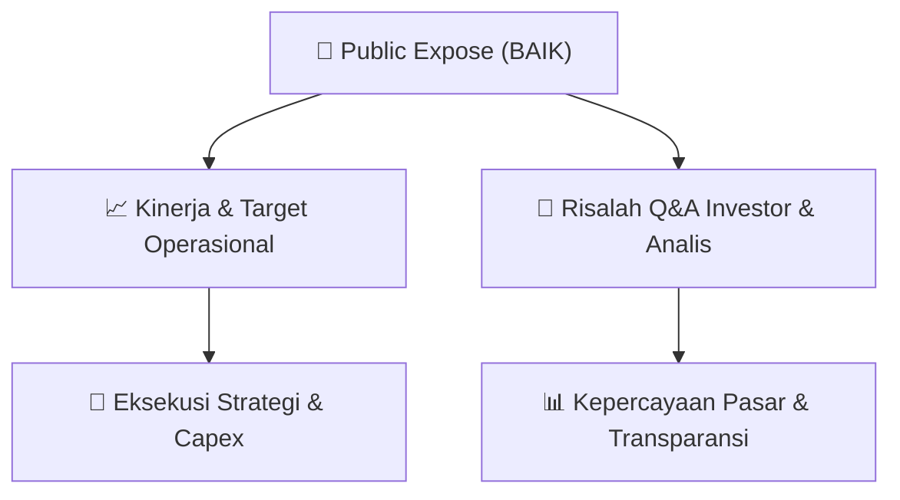

# 📢 Laporan Intelijen Paparan Publik (Public Expose) - [[BAIK]]
🏢 **Emiten**: `[[BAIK]]` | 📅 **Tanggal Pelaksanaan**: `2026-09-04` | 📑 **Dokumen**: `Public Expose lamp1`
⬅️ [[knowledge-base/daily-digests/Daily_Digest_20260904|Kembali ke Daily Digest]] | 🎛️ [[Dashboard|Ke Dashboard Utama]]

---

## 📌 1. Ringkasan Eksekutif & Paparan Direksi
> [!NOTE]
> Dokumen ini adalah surat penyampaian materi Public Expose Insidentil PT Bersama Mencapai Puncak Tbk (BAIK) kepada Bursa Efek Indonesia, beserta tata tertib pelaksanaannya. Tidak terdapat rincian kinerja keuangan, target, atau materi paparan publik dalam dokumen ini.

#### 🎯 Guidance Operasional & Target Strategis
- Tidak ada informasi mengenai target kinerja, ekspansi, atau capex dalam dokumen ini.

## 📊 2. Matriks Indikator Operasional & Parameter Kunci
| Parameter Utama | Nilai / Keterangan Resmi |
| :--- | :--- |
| **Tanggal Public Expose** | `Senin, 07 September 2026` |
| **Waktu** | `10.30 WIB` |
| **Media** | `Online (Zoom)` |
| **Agenda** | `Penjelasan Kinerja Perseroan Triwulan II Tahun Buku 2026` |
| **Panelis** | `Nanang Suherman (Direktur Utama), Ubaidillah (Direktur), Afanin Nur Raudhah (Direktur)` |
| **Link Registrasi** | `https://bit.ly/registrasiPUBEXBAIK` |

---

## 💬 3. Risalah Tanya Jawab (Q&A Session)
`Materi presentasi Public Expose / Risalah Q&A terlampir dalam dokumen resmi bursa.`

## 📌 4. Peta Jalur Strategis & Roadmap

---

## 🔗 Knowledge Graph
- [[knowledge-base/daily-digests/Daily_Digest_20260904|📄 Daily Digest 2026-09-04]]
- [[knowledge-base/calendars/Action_Calendar|🗓️ Kalender Terpusat Aksi Korporasi]]
- [[Dashboard|🎛️ Kembali ke Dashboard Utama]]