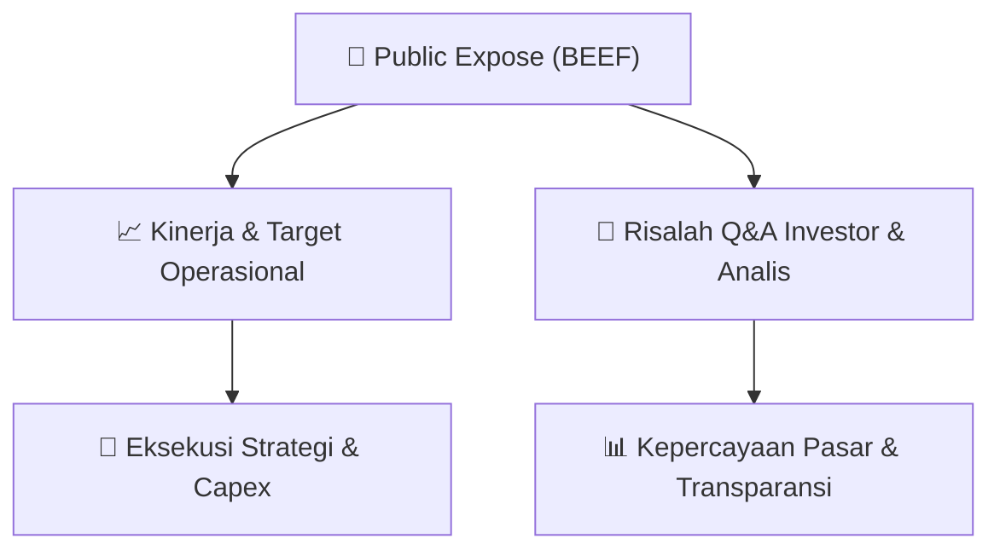

# 📢 Laporan Intelijen Paparan Publik (Public Expose) - [[BEEF]]
🏢 **Emiten**: `[[BEEF]]` | 📅 **Tanggal Pelaksanaan**: `2026-08-20` | 📑 **Dokumen**: `Public Expose lamp1`
⬅️ [[knowledge-base/daily-digests/Daily_Digest_20260820|Kembali ke Daily Digest]] | 🎛️ [[Dashboard|Ke Dashboard Utama]]

---

## 📌 1. Ringkasan Eksekutif & Paparan Direksi
> [!NOTE]
> PT Estika Tata Tiara Tbk (BEEF) menyampaikan pemberitahuan rencana Paparan Publik Insidentil/Public Expose Insidentil kepada PT Bursa Efek Indonesia pada 20 Agustus 2026. Public expose diselenggarakan pada Senin, 24 Agustus 2026 pukul 14:00 WIB melalui Google Meeting Online, dihadiri Dewan Direksi. Agenda acara adalah keterbukaan informasi terkait suspensi cooling down atas saham BEEF yang dilakukan BEI pada 19 Agustus 2026 berdasarkan surat No. Peng-SPT-00149/BEI.WAS/08-2026. Pendaftaran peserta ditutup 21 Agustus 2026 melalui email corporatesecretary@estikafood.com.

#### 🎯 Guidance Operasional & Target Strategis
- Dokumen ini tidak memuat target kinerja, ekspansi, capex, atau guidance operasional. Katalis utama yang dapat diperhatikan investor adalah rencana keterbukaan informasi manajemen terkait penyebab dan tindak lanjut suspensi cooling down saham BEEF pada public expose insidentil 24 Agustus 2026.

## 📊 2. Matriks Indikator Operasional & Parameter Kunci
| Parameter Utama | Nilai / Keterangan Resmi |
| :--- | :--- |
| **Nama Emiten** | `PT Estika Tata Tiara Tbk` |
| **Kode Saham** | `BEEF` |
| **Tanggal Surat Pemberitahuan** | `20 Agustus 2026` |
| **Nomor Surat Perseroan** | `B. 027 – Corpsec/ETT-BEEF/VIII/2026` |
| **Tanggal Public Expose Insidentil** | `Senin, 24 Agustus 2026` |
| **Waktu Public Expose** | `14:00 WIB - Selesai` |
| **Tempat** | `Aplikasi Google Meeting Online` |
| **Manajemen yang Hadir** | `Dewan Direksi Perseroan` |
| **Agenda Acara** | `Keterbukaan Informasi dari adanya Suspensi Cooling Down atas saham PT Estika Tata Tiara Tbk (BEEF)` |
| **Tanggal Suspensi Cooling Down** | `19 Agustus 2026` |
| **Nomor Surat BEI terkait Suspensi** | `No. Peng-SPT-00149/BEI.WAS/08-2026` |
| **Batas Akhir Pendaftaran** | `21 Agustus 2026 (1 hari kerja sebelum public expose)` |
| **Email Pendaftaran** | `corporatesecretary@estikafood.com` |
| **Pejabat Penandatangan** | `Ratna Sari, Sekretaris Perusahaan` |

---

## 💬 3. Risalah Tanya Jawab (Q&A Session)
`Materi presentasi Public Expose / Risalah Q&A terlampir dalam dokumen resmi bursa.`

## 📌 4. Peta Jalur Strategis & Roadmap

---

## 🔗 Knowledge Graph
- [[knowledge-base/daily-digests/Daily_Digest_20260820|📄 Daily Digest 2026-08-20]]
- [[knowledge-base/calendars/Action_Calendar|🗓️ Kalender Terpusat Aksi Korporasi]]
- [[Dashboard|🎛️ Kembali ke Dashboard Utama]]