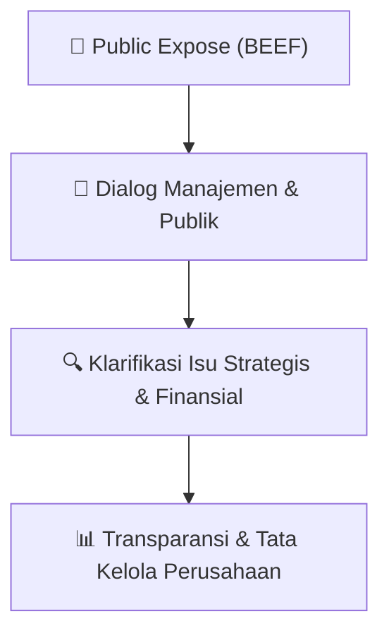

# 🎤 Laporan Hasil Public Expose: [BEEF]

🏢 **Emiten**: `BEEF` | 📅 **Tanggal Pelaksanaan**: `2026-08-24` | ❓ **Total Pertanyaan**: `6 Pertanyaan`
⬅️ [[knowledge-base/daily-digests/BEEF_20260824|Kembali ke Daily Digest]] | 🎛️ [[Dashboard/BEEF|Ke Dashboard Emiten]]

> [!IMPORTANT]
> Dokumen ini memuat seluruh risalah hasil pelaksanaan dan sesi tanya jawab (Q&A) Public Expose BEEF. Informasi dicatat secara verbatim guna memberikan analisis sentimen dan arah kebijakan manajemen bagi investor.

---

## ℹ️ 1. Informasi Penyelenggaraan & Kehadiran

| Parameter | Detail Pelaksanaan |
|---|---|
| **Nomor Surat** | B.029-Corpsec-ETT-BEEF-VIII-2026 |
| **Perihal** | Laporan Hasil Public Expose Insidentil |
| **Waktu Pengumuman** | 24-08-2026 22:12 |
| **Jumlah Kehadiran Peserta** | Penyampaian Hasil Public Expose |
| **Lampiran Berkas** | `1` |

---

## 💬 2. Risalah Tanya Jawab Manajemen & Investor (6 Pertanyaan)

### ❓ Pertanyaan #1

> **Penanya**: *Investor / Analis Publik*

```text
Pertanyaan:
1. Acara dibuka oleh Moderator yang kemudian dibacakan Agenda, dan 
Presentasi dibacakan yang telah disampaikan Perseroan pada tanggal 20 
Agustus 2026 melalui proses upload di IDX Report (Bursa Efek Indonesia). 
2. Dilanjutkan dengan Tanya Jawab (Q&A) 
 
E. Peserta yang telah registrasi melalui email 17 Peserta.
Paparan Public Expose Insidentil dihadiri oleh 11 Peserta secara daring.
Pertanyaan dan Tanggapan:
```

💡 **Jawaban & Klarifikasi Manajemen**:

> *Teks tanggapan manajemen tidak tersedia*

---

### ❓ Pertanyaan #1

> **Penanya**: *Investor / Analis Publik*

```text
Pertanyaan:
1. Bapak Daniel – Private Equity Fund 
1. Apakah ada informasi material atau rencana aksi korporasi yang belum diungkap terkait 
lonjakan harga saham BEEF? 
2. Bagaimana manajemen menjelaskan kesenjangan antara fundamental Perusahaan dengan 
lonjakan harga saham yang ekstrem? 
3. Apa Langkah konkret manajemen untuk mencegah spekulasi dan UMA berulang ke 
depan? 
 
Tanggapan: 
- 
Perseroan senantiasa memantau perkembangan perdagangan saham Perseroan dan 
memahami adanya peningkatan harga saham yang cukup signifikan dalam periode 
tertentu. Namun demikian, Perseroan tidak dapat memberikan kesimpulan maupun 
asumsi mengenai faktor spesifik yang menjadi penyebab kenaikan harga saham tersebut 
apabila tidak didukung oleh informasi dan data yang dapat diverifikasi. 
- 
Pada prinsipnya, harga saham terbentuk berdasarkan mekanisme pasar yang dipengaruhi 
oleh interaksi antara permintaan dan penawaran saham, serta dapat dipengaruhi oleh 
berbagai faktor, termasuk persepsi dan ekspektasi investor terhadap kondisi dan prospek 
Perseroan maupun faktor eksternal lainnya. Faktor-faktor tersebut berada di luar kendali 
Perseroan. 
- 
Perseroan juga tidak mengetahui adanya informasi atau fakta material yang belum 
disampaikan kepada publik yang dapat menjelaskan terjadinya lonjakan harga saham 
tersebut. Sepanjang pengetahuan Perseroan, seluruh informasi material yang wajib 
disampaikan kepada publik telah disampaikan sesuai dengan ketentuan peraturan 
perundang-undangan di bidang pasar modal yang berlaku. 
-
- 
Meskipun terdapat perbedaan antara pergerakan harga saham dengan indikator 
fundamental Perseroan, Perseroan tidak dalam posisi untuk menentukan atau 
mengarahkan harga saham di pasar. Manajemen tetap berkomitmen untuk menjalankan 
kegiatan usaha secara prudent, meningkatkan kinerja operasional dan keuangan, serta 
menjaga keterbukaan informasi kepada seluruh pemegang saham dan masyarakat sesuai 
dengan ketentuan yang berlaku. 
- 
Dengan demikian, Perseroan memandang bahwa pergerakan harga saham merupakan 
dinamika pasar yang tidak sepenuhnya dapat dijelaskan hanya berdasarkan kondisi 
fundamental Perseroan dan tidak berada dalam kendali manajemen.
```

💡 **Jawaban & Klarifikasi Manajemen**:

> *Teks tanggapan manajemen tidak tersedia*

---

### ❓ Pertanyaan #2

> **Penanya**: *Investor / Analis Publik*

```text
Pertanyaan:
2. Bryan Thandra – Individu (Masyarakat) 
1. Guidance revenue dan net profit untuk tahun FY2026 dan FY2027 di berapa? 
2. Apakah ada alasan mengapa salah satu pemegang saham terbesar (Bapak Dimas 
Wibowo) terus menambah kepemilikannya di BEEF? 
3. Terdapat Rumor bahwa Pereseroan akan diakuisisi oleh Perusahaan Korea, apakah masih 
dalam tahap negosiasi atau bagaimana? Mohon updatenya. 
 
Tanggapan: 
- 
Perseroan belum menetapkan dan/atau menyampaikan secara resmi guidance revenue 
dan net profit untuk tahun buku 2026 dan 2027. Oleh karena itu, Perseroan belum dapat 
memberikan angka proyeksi yang bersifat final untuk periode tersebut. 
- 
Perseroan tetap berkomitmen untuk meningkatkan kinerja operasional dan keuangan 
secara berkelanjutan dengan mempertimbangkan kondisi pasar, perkembangan industri, 
strategi usaha, efisiensi operasional, serta faktor ekonomi yang dapat memengaruhi 
kinerja Perseroan. Apabila di kemudian hari Perseroan telah menetapkan target atau 
guidance yang dapat disampaikan kepada publik, informasi tersebut akan disampaikan 
sesuai dengan ketentuan keterbukaan informasi yang berlaku. 
- 
Terkait dengan adanya penambahan kepemilikan saham BEEF oleh Bapak Dimas 
Wibowo, Perseroan menghormati keputusan investasi masing-masing pemegang saham. 
- 
Perseroan tidak dapat memberikan asumsi atau menyimpulkan alasan maupun tujuan 
investasi dari pemegang saham tertentu, karena keputusan tersebut merupakan 
keputusan masing-masing pemegang saham dan berada di luar kewenangan Perseroan. 
- 
Terkait dengan adanya rumor mengenai rencana akuisisi Perseroan oleh perusahaan asal 
Korea, rumot tersebut tidak terkonfirmasi dengan baik. Tidak terdapat adanya transaksi 
akuisisi tersebut.
```

💡 **Jawaban & Klarifikasi Manajemen**:

> *Teks tanggapan manajemen tidak tersedia*

---

### ❓ Pertanyaan #3

> **Penanya**: *Investor / Analis Publik*

```text
Pertanyaan:
3. Benyamin Mikael – Individu (Masyarakat) 
1. Capex 2026 dan rencana ekspansi Perseroan 
2. Apakah Perseroan mempunya rencana BuyBack kembali? 
3. Jumlah Penggemukan Sapi di Peternakan Perseroan yang dimiliki dan rencana 
penambahan di tahun ini. 
4. Dampak program MBG terhadap Perseoan. 
 
Tanggapan: 
- 
Untuk tahun 2026, Perseroan telah menyusun rencana belanja modal (capital 
expenditure/Capex) 
yang 
akan 
disesuaikan 
dengan 
kebutuhan 
operasional, 
pengembangan usaha, serta kondisi keuangan Perseroan. Alokasi Capex Perseroan 
terutama akan diarahkan untuk mendukung peningkatan kapasitas dan efisiensi 
operasional, pemeliharaan dan pengembangan fasilitas produksi, peternakan, cold 
storage, serta kebutuhan pendukung lainnya sesuai dengan skala prioritas Perseroan. 
Belum ada rencana ekspansi Perseoran, saat ini Perseroan masih mempunya skala 
prioritas yaitu di Usaha Trading, Penggemukan Sapi, Cold Storage, Food Processing dan 
mempelajari usaha dari Dairy Cow yang berada di Purwekerto. 
- 
Perseroan baru saja menyelesaikan periode BuyBack, sehingga rencana untuk 
melaksanakan BuyBack kembali apabila nilai saham di Pasar Uang kembali turun, 
Apabila Perseroan memutuskan untuk melaksanakan Buyback, Perseroan akan terlebih 
dahulu memenuhi seluruh persyaratan dan prosedur yang diwajibkan berdasarkan 
ketentuan peraturan perundang-undangan serta melakukan keterbukaan informasi 
kepada publik.  
- 
Saat ini jumlah Sapi untuk penggemukan yang masih dalam tahap penggemukan kurang 
lebih 3000 ekor, dimana tahun ini Perseroan mendapatkan kuota impor sejumlah 9000 
Sapi, dan Perseroan sedang berupaya kepada Pemerintah untuk dapat penambahan kuota 
sehingga Import Sapi Penggemukan dapat lebih maksimal. 
- 
Dampak MBG terhadap Perseroan sangat berpengaruh besar Potensi dampak positif 
bagi Perseroan antara lain berasal dari meningkatnya permintaan terhadap produk 
pangan dan protein hewani, termasuk daging sapi dan produk olahan yang sesuai dengan 
kebutuhan pasar. Peningkatan permintaan tersebut pada akhirnya dapat membuka 
peluang bagi Perseroan untuk meningkatkan utilisasi kapasitas produksi, memperluas 
jaringan distribusi, serta mengembangkan basis pelanggan.
```

💡 **Jawaban & Klarifikasi Manajemen**:

> *Teks tanggapan manajemen tidak tersedia*

---

### ❓ Pertanyaan #4

> **Penanya**: *Investor / Analis Publik*

```text
Pertanyaan:
4. Roi Nababan – Individu (Masyarakat): 
Siapa saja buyer terbesar Perseroan dan apakah akan ada kontrak besar dalam jangka waktu 
dekat ini? 
 
Tanggapan: 
Terkait dengan pelanggan atau pembeli terbesar Perseroan, Perseroan memiliki sejumlah 
pelanggan dari berbagai segmen usaha yang menjadi bagian dari jaringan distribusi dan 
penjualan Perseroan. Namun demikian, Perseroan tidak dapat mengungkapkan identitas 
pelanggan tertentu secara spesifik apabila informasi tersebut bersifat komersial dan/atau 
berdasarkan ketentuan kerahasiaan dalam hubungan bisnis dengan pelanggan.
```

💡 **Jawaban & Klarifikasi Manajemen**:

> *Teks tanggapan manajemen tidak tersedia*

---

### ❓ Pertanyaan #5

> **Penanya**: *Investor / Analis Publik*

```text
Pertanyaan:
5. Gidion Bernard Lubis – Individu (Masyarakat): 
1. Dengan pergantian Alamat kantor, apakah Perseoran mempunya rencana? 
2. Terkait konversi utang menjadi saham, apakah akan ada perubahan kepemilikan? 
Terutama PT Tigatunggal Adimulya memiliki hasil dilusi BMT membuat kehilangan 
kendali? 
 
Tanggapan: 
1. Pergantian Alamat kantor disebabkan masa sewa di Kantor sebelumnya telah selesai. 
Dan tidak Perseoran perpanjang masa sewanya.  
2. Rencana konversi utang menjadi saham kepada PT Tigatunggal Adimulya tidak masuk 
dalam agenda Perseroan. 
 
6. Ade Yuhendra – Individu (Masyarakat): 
Untuk Produk Susu, rencananya akan dipasarkan kemana dan kapasitas produksinya berapa? 
 
Tanggapan: 
Saat ini Perseroan masih mempelajari usaha baru khususnya Dairy Farm, saat ini pemasaran 
produksi susu yang telah Perseroan Kelola masih masuk ke dalam Koperasi setempat di area 
Farm yang dikelola dengan kapasita produksi setiap harinya saat ini mencapai 21 ton 
liter/hari.
Public Expose insidentil ditutup pada jam 14:35.
```

💡 **Jawaban & Klarifikasi Manajemen**:

> *Teks tanggapan manajemen tidak tersedia*

---

## 📌 3. Peta Jalur Transparansi & Kepercayaan Pasar



---

*Dokumen diolah otomatis oleh **Swarm Intelijen Pasar Modal Indonesia** pada 2026-10-12 16:42 WIB.*