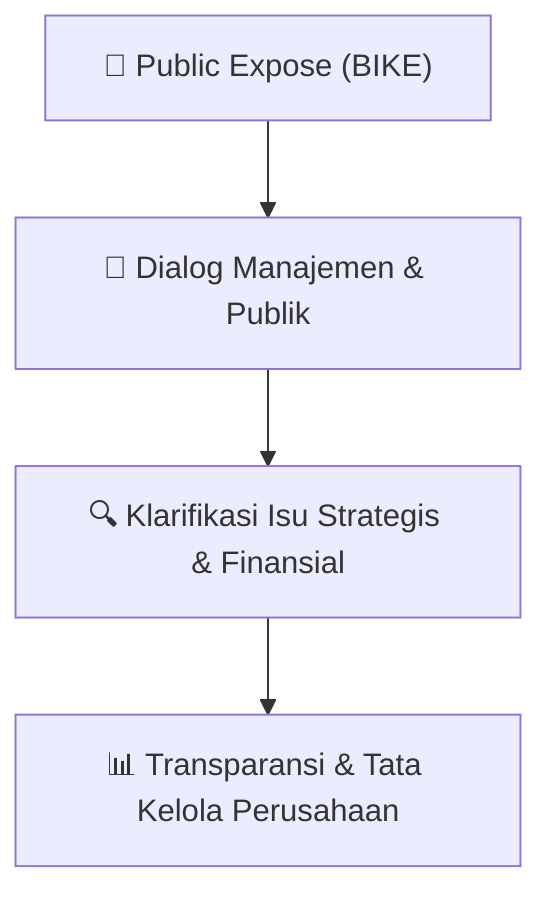

# 🎤 Laporan Hasil Public Expose: [BIKE]

🏢 **Emiten**: `BIKE` | 📅 **Tanggal Pelaksanaan**: `2026-09-25` | ❓ **Total Pertanyaan**: `3 Pertanyaan`
⬅️ [[knowledge-base/daily-digests/BIKE_20260925|Kembali ke Daily Digest]] | 🎛️ [[Dashboard/BIKE|Ke Dashboard Emiten]]

> [!IMPORTANT]
> Dokumen ini memuat seluruh risalah hasil pelaksanaan dan sesi tanya jawab (Q&A) Public Expose BIKE. Informasi dicatat secara verbatim guna memberikan analisis sentimen dan arah kebijakan manajemen bagi investor.

---

## ℹ️ 1. Informasi Penyelenggaraan & Kehadiran

| Parameter | Detail Pelaksanaan |
|---|---|
| **Nomor Surat** | 2026/265/IX/BIKE/EK |
| **Perihal** | Laporan Hasil Public Expose Insidentil |
| **Waktu Pengumuman** | 25-09-2026 14:40 |
| **Jumlah Kehadiran Peserta** | Penyampaian Hasil Public Expose |
| **Lampiran Berkas** | `1` |

---

## 💬 2. Risalah Tanya Jawab Manajemen & Investor (3 Pertanyaan)

### ❓ Pertanyaan #1

> **Penanya**: *Investor / Analis Publik*

```text
Pertanyaan:
1. Terkait adanya MOU perjanjian pelaksanaan pembangunan Pasar Minggu. Kapankah 
akan dimulai dan berapa lama proses pembangunan akan berlangsung?
Jawaban : Saat ini sedang menyusun perencanaan DED. Pekerjaan konstruksi 
akan dilaksanakan segera setelah selesai perencanaan dan pelaksanaan 
pembangunan selama 2 -  3 Tahun.
```

💡 **Jawaban & Klarifikasi Manajemen**:

> *Teks tanggapan manajemen tidak tersedia*

---

### ❓ Pertanyaan #2

> **Penanya**: *Investor / Analis Publik*

```text
Pertanyaan:
2. Mengapa Perseroan memilih ekspansi ke sektor tambang, energi, dan golf di tengah 
kondisi rugi bersih Rp19,18 M dan ekuitas yang terbatas ? 
 
Jawaban : Sektor tambang dan energi merupakan sektor strategis yang memiliki 
peluang pengembangan jangka panjang. Mengenai Permodalan ada rencana 
penguatan modal kerja yang telah ditawarkan oleh Pengendali kepada Perseroan 
yang masih dalam proses kajian KJPP. Keputusan Perseroan untuk melakukan 
diversifikasi dan ekspansi ke sektor tambang, energi, dan golf didasari oleh 
evaluasi komprehensif terhadap portofolio bisnis dan prospek pertumbuhan 
jangka Panjang. 
 
3. Bagaimana Perseroan menjamin proses akuisisi 6 anak usaha dan 3 lahan tambang 
seluas ±27.786 Ha berjalan wajar (arm's length), mengingat detail harga, sumber dana, 
dan pihak penjual belum diungkapkan ?
Jawaban : Perseroan berkomitmen penuh mengikuti ketentuan yang ditetapkan 
oleh Bursa dan OJK serta menerapkan tata kelola perusahaan yang baik (Good 
Corporate Governance).
```

💡 **Jawaban & Klarifikasi Manajemen**:

> *Teks tanggapan manajemen tidak tersedia*

---

### ❓ Pertanyaan #4

> **Penanya**: *Investor / Analis Publik*

```text
Pertanyaan:
4. Mengapa Perseroan menyatakan tidak ada informasi material yang belum diungkap, 
padahal rencana besar akuisisi tambang, energi, dan IT baru dipaparkan bersamaan 
dengan lonjakan harga saham yang memicu suspensi BEI ? 
 
Jawaban : Perseroan menyampaikan informasi sesuai dengan ketentuan 
keterbukaan informasi yang berlaku dan berdasarkan informasi yang telah 
tersedia pada saat penyampaian. Perseroan senantiasa kooperatif dan mematuhi 
ketentuan Bursa dan OJK.  
 
5. Bagaimana kesiapan legal dan perpajakan Perseroan dalam mengonsolidasi lini usaha 
yang sangat berbeda (tambang, energi, IT, golf) ke dalam satu entitas terbuka, 
termasuk perizinan IUP yang clean and clear serta kewajiban pajak dari transaksi 
akuisisi berskala besar ini ? 
 
Jawaban : Perseroan sedang mempersiapkan aspek legal, perpajakan, dan teknis 
dengan melibatkan profesional eksternal yang kompeten untuk memastikan 
proses dilakukan sesuai dengan ketentuan yang berlaku.
PESERTA YANG HADIR
No 
Peserta 
Insistusi 
1 
Aan 
Analyst 
2 
Daniel 
Analyst 
3 
Angela Grace Cahyani 
Investor 
4 
Bahar Zhang 
Investor 
5 
Chris Teena 
Investor 
6 
Dewi Wahidatul Karimah 
Investor 
7 
DS 
Investor 
8 
Firosa 
Investor 
9 
Kevin 
Investor 
10 
Lukmanul Hakim 
Investor 
11 
Neel 
Investor 
12 
William Giovanni 
 
Investor 
13 
Syafira Naila 
Investor 
14 
Rudy Tommy 
Investor 
15 
Vincent 
Investor 
16 
Xiao Qing 
Investor
```

💡 **Jawaban & Klarifikasi Manajemen**:

> *Teks tanggapan manajemen tidak tersedia*

---

## 📌 3. Peta Jalur Transparansi & Kepercayaan Pasar



---

*Dokumen diolah otomatis oleh **Swarm Intelijen Pasar Modal Indonesia** pada 2026-10-12 16:43 WIB.*