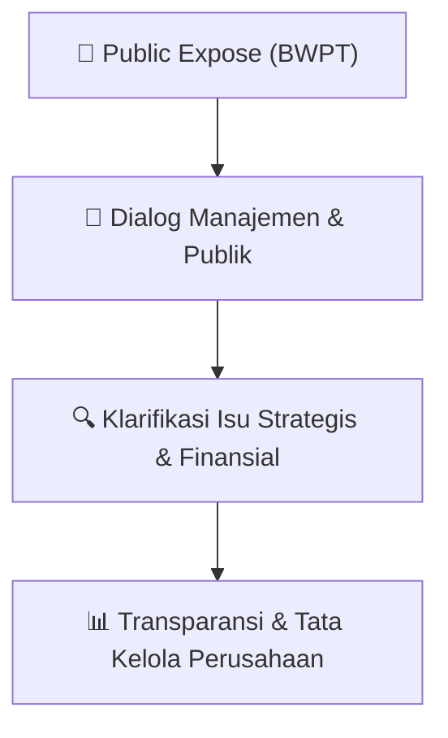

# 🎤 Laporan Hasil Public Expose: [BWPT]

🏢 **Emiten**: `BWPT` | 📅 **Tanggal Pelaksanaan**: `2026-08-31` | ❓ **Total Pertanyaan**: `1 Pertanyaan`
⬅️ [[knowledge-base/daily-digests/BWPT_20260831|Kembali ke Daily Digest]] | 🎛️ [[Dashboard/BWPT|Ke Dashboard Emiten]]

> [!IMPORTANT]
> Dokumen ini memuat seluruh risalah hasil pelaksanaan dan sesi tanya jawab (Q&A) Public Expose BWPT. Informasi dicatat secara verbatim guna memberikan analisis sentimen dan arah kebijakan manajemen bagi investor.

---

## ℹ️ 1. Informasi Penyelenggaraan & Kehadiran

| Parameter | Detail Pelaksanaan |
|---|---|
| **Nomor Surat** | 067/BWPT/Corsec/VIII/2026 |
| **Perihal** | Laporan Hasil Public Expose Insidentil |
| **Waktu Pengumuman** | 31-08-2026 04:07 |
| **Jumlah Kehadiran Peserta** | Penyampaian Hasil Public Expose |
| **Lampiran Berkas** | `4` |

---

## 💬 2. Risalah Tanya Jawab Manajemen & Investor (1 Pertanyaan)

### ❓ Pertanyaan #3

> **Penanya**: *Investor / Analis Publik*

```text
Pertanyaan:
3. Parluhutan Situmorang – Media Investor Trust
Pertanyaan: 
Selamat kepada BWPT yang telah mengantongi kuasi reorganisasi, kedepannya apakah Perseroan 
berencana membagikan dividen? Jika iya, berapa besarannya dan kapan akan dibagi? 
 
Jawaban: 
Choong Kam Loong - Direktur 
Perseroan sedang mengkaji untuk dapat melakukan pembagian dividen sebagai bentuk apresiasi 
kepada para pemegang saham. Langkah ini merupakan awal dari komitmen Perseroan untuk 
memberikan nilai tambah dan meningkatkan shareholder return ke depannya. Perseroan akan 
mengumumkan pemberitahuan lebih lanjut apabila sudah terdapat keputusan mengenai besaran dan 
waktu pembagian dividen. 
 
4. Andy Chandra – Pemegang Saham
Pertanyaan: 
Bagaimana perkembangan harga pupuk dan solar saat ini, serta strategi Perseroan dalam mengelola 
dinamika biaya tersebut? 
 
Jawaban: 
Choong Kam Loong - Direktur 
Harga solar saat ini sekitar Rp23.000/liter, dibandingkan level tertingginya sekitar Rp28.000/liter, 
meskipun masih lebih tinggi dibandingkan tahun lalu yang berada di kisaran Rp15.000/liter. Sementara 
itu, harga pupuk mulai mengalami normalisasi setelah sebelumnya berada pada level yang cukup 
tinggi mencapai dua kali lipat. Perseroan akan terus melakukan pengadaan pupuk secara prudent dan 
optimal, dengan mempertimbangkan kebutuhan operasional serta perkembangan harga pasar. 
 
 
5. Azis Husaini– Media RMOL
Pertanyaan:
a. Bagaimana skema Plasma Mandiri Perseroan dan manfaatnya terhadap keberlanjutan
pasokan TBS sekaligus kinerja operasional Perseroan? 
b. Apa target Perseroan terkait perluasan area Plasma Mandiri ke depan, dan bagaimana strategi
untuk mencapai target tersebut?
Jawaban: 
Andrew Haryono - Direktur 
Plasma Mandiri merupakan bentuk pemberdayaan petani melalui kerja sama dengan Perseroan, di 
mana Perseroan memberikan best agronomy practices, dukungan pupuk, serta dukungan operasional. 
Hasil panen kemudian diserap oleh Perseroan dengan harga sesuai ketentuan Disbun. Bagi petani, 
program ini mendukung peningkatan produktivitas kebun yang dimilikinya dan kesejahteraan yang 
lebih baik, sementara bagi Perseroan, peningkatan produktivitas kebun turut mendukung peningkatan 
yield dan ketersediaan TBS. 
 
Perseroan akan terus mengembangkan Plasma Mandiri dengan target penambahan sekitar 5.000 Ha 
per tahun, hingga mencapai sekitar 40.000 Ha pada 2030. Untuk mendukung target tersebut, 
Perseroan memiliki tim Plasma Mandiri yang secara aktif mengelola hubungan dengan petani dan 
koperasi, sehingga kerja sama dapat terus dijaga secara berkelanjutan dan berkembang. 
 
6. Bapak Lilo – Samuel Sekuritas 
 
Pertanyaan: 
Bagaimana prospek peringkat kredit Perseroan ke depan, khususnya setelah mempertahankan 
peringkat A- dari PEFINDO selama tiga tahun, di tengah rencana penerbitan PUB dan tingkat leverage 
Perseroan?  
 
Jawaban: 
Choong Kam Loong – Direktur 
Perseroan optimis terhadap prospek peringkat kredit ke depan. Selain mempertahankan peringkat A- 
dari PEFINDO, Perseroan juga telah memperoleh peringkat A dengan outlook Stabil dari PT Kredit 
Rating Indonesia (KRI). Perseroan memiliki pandangan bahwa penggunaan utang merupakan bagian 
dari strategi untuk mendukung pertumbuhan, namun dengan tetap menjaga leverage dan 
pengelolaan keuangan secara prudent.
```

💡 **Jawaban & Klarifikasi Manajemen**:

> *Teks tanggapan manajemen tidak tersedia*

---

## 📌 3. Peta Jalur Transparansi & Kepercayaan Pasar



---

*Dokumen diolah otomatis oleh **Swarm Intelijen Pasar Modal Indonesia** pada 2026-10-12 16:44 WIB.*