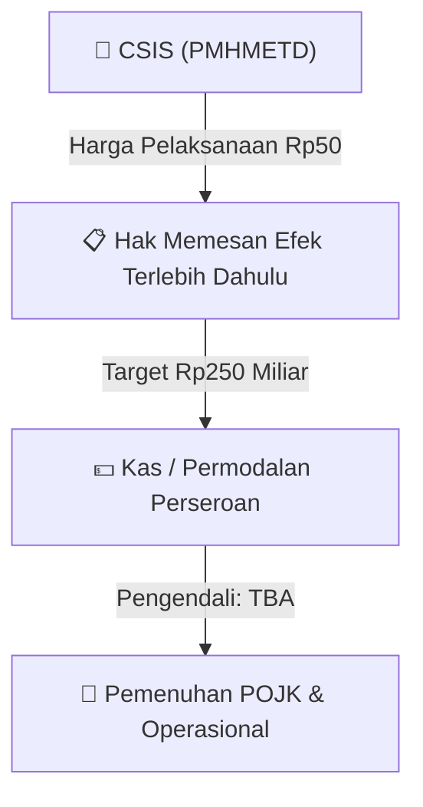

# ⚡ Laporan Intelijen Aksi Korporasi: [[CSIS]] - Aksi Korporasi

⬅️ [[knowledge-base/daily-digests/Daily_Digest_20260904|Kembali ke Daily Digest]] | 📅 **2026-09-04** | 🎛️ [[Dashboard|Ke Dashboard Utama]]

> [!IMPORTANT]
> Laporan ini disusun secara otomatis oleh **Corporate Action Intelligence Agent** untuk memetakan implikasi strategis, rasio keuangan, alokasi dana, jadwal penting, dan panduan investor.

---

## 📌 1. Ringkasan Eksekutif & Katalis Strategis
- **Kode & Nama Emiten**: `[[CSIS]]`
- **Kategori Aksi Korporasi**: `Aksi Korporasi`
- **Dokumen Resmi Bursa**: `Laporan Penggunaan Dana Hasil Penawaran Umum lamp1`
- **Ringkasan Inti Aksi**: Dokumen merupakan surat pengantar revisi laporan realisasi penggunaan dana hasil penawaran umum dengan HMETD per 30 Juni 2026. Lampiran tidak tersedia sehingga tidak ada fakta material yang dapat diekstrak.

---

## 📊 2. Matriks Parameter Material & Angka Kunci
- **Detail Dokumen**: Rincian angka terlampir pada dokumen resmi `20260904_CSIS_20260904_CSIS_Laporan Penggunaan Dana Hasil Penawaran Umum_32144945_lamp1.pdf`.

---

## 👥 3. Komposisi Pengendali & Pembeli Siaga (Standby Buyers)
- **Pengendali Utama**: `TBA`
- **Komitmen Pembeli Siaga (Standby Buyers)**: `TBA / Dalam Proses Penunjukan`
- **Batas Harga Pelaksanaan HMETD**: `Rp50`
- **Valuasi & PBV Perseroan**: `N/A`

## 🎯 4. Rencana Penggunaan Dana Hasil Rights Issue & Tujuan Strategis
- 📌 **Tujuan Inti**: Dokumen merupakan surat pengantar revisi laporan realisasi penggunaan dana hasil penawaran umum dengan HMETD per 30 Juni 2026. Lampiran tidak tersedia sehingga tidak ada fakta material yang dapat diekstrak.
- 💵 **Target Total Modal / Dana**: `Rp250 Miliar`
- 📅 **Batas Waktu Pemenuhan**: `Terjadwal (31 Des 2026)`

## 📈 5. Visualisasi Alur Rights Issue

## 💡 6. Panduan Strategi Investor & Arbitrase / Dilusi
- ⚠️ **Risiko Dilusi Kepemilikan**: Pemegang saham [[CSIS]] yang tidak meng-exercise HMETD berpotensi mengalami dilusi persentase kepemilikan maksimum **Hingga 41,67%**.
- 🎯 **Strategi TERP vs Harga Pasar**: Bandingkan harga pelaksanaan HMETD (`Rp50`) dengan harga pasar reguler. Tebus HMETD jika harga pasar berada di atas harga pelaksanaan untuk menghindari efek dilusi.

---

## 🔗 Hubungan Note Terkait (Knowledge Graph)
- [[knowledge-base/daily-digests/Daily_Digest_20260904|📄 Daily Digest 2026-09-04]]
- [[knowledge-base/trading-signals/Trading_Signals_20260904|🎯 Sinyal Cuan 2026-09-04]]
- [[Dashboard|🎛️ Kembali ke Dashboard]]