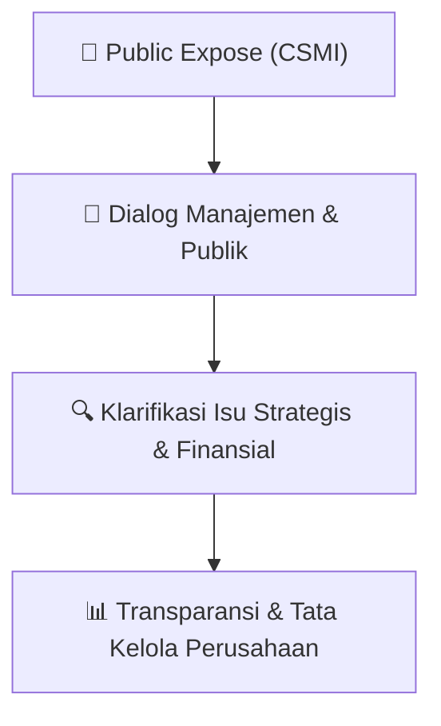

# 🎤 Laporan Hasil Public Expose: [CSMI]

🏢 **Emiten**: `CSMI` | 📅 **Tanggal Pelaksanaan**: `2026-08-31` | ❓ **Total Pertanyaan**: `4 Pertanyaan`
⬅️ [[knowledge-base/daily-digests/CSMI_20260831|Kembali ke Daily Digest]] | 🎛️ [[Dashboard/CSMI|Ke Dashboard Emiten]]

> [!IMPORTANT]
> Dokumen ini memuat seluruh risalah hasil pelaksanaan dan sesi tanya jawab (Q&A) Public Expose CSMI. Informasi dicatat secara verbatim guna memberikan analisis sentimen dan arah kebijakan manajemen bagi investor.

---

## ℹ️ 1. Informasi Penyelenggaraan & Kehadiran

| Parameter | Detail Pelaksanaan |
|---|---|
| **Nomor Surat** | 004/OL-CSM/DIR/VIII/2026 |
| **Perihal** | Laporan Hasil Public Expose Insidentil |
| **Waktu Pengumuman** | 31-08-2026 14:17 |
| **Jumlah Kehadiran Peserta** | Penyampaian Hasil Public Expose |
| **Lampiran Berkas** | `1` |

---

## 💬 2. Risalah Tanya Jawab Manajemen & Investor (4 Pertanyaan)

### ❓ Pertanyaan #1

> **Penanya**: *Investor / Analis Publik*

```text
Pertanyaan:
1. Pertanyaan: 
Apakah manajemen memper2mbangkan selain gerai tetap dengan bentuk model food 
truck atau booth drive thru untuk menekan biaya sewa dan memperluas eksposur NWS 
Chicken, serta bagaimana evaluasi memas2kan arah bisnis baru tetap sejalan dengan 
kompetensi in2 Perseroan?
Jawaban: 
Kami melihat format seper2 food truck, booth, maupun bentuk penjualan yang lebih 
ringan dari sisi investasi sebagai alterna2f yang menarik untuk diper2mbangkan.
Dalam pengembangan NWS Chicken, Perseroan ingin memiliki model bisnis yang lebih 
fleksibel dan adap2f. Karena itu, ekspansi ke depan 2dak harus selalu iden2k dengan 
pembukaan gerai konvensional dengan struktur biaya yang besar. Namun, se2ap format 
baru tetap perlu dievaluasi dari sisi potensi penjualan, kebutuhan investasi, biaya sewa, 
operasional, logis2k, perizinan, serta kemampuan menjaga kualitas produk dan 
pelayanan.
Prinsip kami, se2ap 22k penjualan baru harus memiliki unit economics yang sehat dan 
memberikan kontribusi yang sebanding dengan biaya yang dikeluarkan.
Untuk memas2kan arah bisnis tetap sejalan dengan kompetensi in2 Perseroan, kami tetap 
melihat pengalaman panjang Perseroan di bisnis restoran cepat saji, khususnya produk 
berbasis ayam goreng, sebagai fondasi utama. Jadi inovasi yang dievaluasi tetap diarahkan 
pada bagaimana kompetensi tersebut bisa dijalankan dengan format yang lebih efisien, 
lebih dekat dengan konsumen, dan lebih sesuai dengan kondisi pasar saat ini.
```

💡 **Jawaban & Klarifikasi Manajemen**:

> *Teks tanggapan manajemen tidak tersedia*

---

### ❓ Pertanyaan #2

> **Penanya**: *Investor / Analis Publik*

```text
Pertanyaan:
2. Pertanyaan: 
Bagaimana manajemen melihat pengaruh kondisi ekonomi dan kebijakan pajak serta 
kenaikan bahan baku ayam saat ini terhadap rencana pemulihan kinerja Perseroan?
Jawaban: 
Kondisi ekonomi, daya beli konsumen, perubahan kebijakan perpajakan, serta pergerakan 
harga bahan baku merupakan faktor eksternal yang kami perha2kan dalam proses 
pemulihan Perseroan.
Untuk kenaikan harga bahan baku, termasuk ayam seper2 yang disampaikan, dampaknya 
dapat memberikan tekanan terhadap biaya apabila kenaikan tersebut berlangsung cukup 
lama. Karena itu, strategi pemulihan kami 2dak hanya bergantung pada peningkatan 
penjualan, tetapi juga pada disiplin pengelolaan biaya dan efisiensi operasional.
Perseroan terus mengevaluasi struktur biaya agar lebih ramping dan adap2f. Dalam 
menghadapi tekanan bahan baku, beberapa aspek yang terus dievaluasi antara lain
strategi pengadaan, komposisi produk, efisiensi penggunaan bahan baku, serta kebijakan 
harga yang tetap memper2mbangkan daya beli konsumen.
Dari sisi pajak, Perseroan akan mengiku2 ketentuan yang berlaku dan se2ap perubahan 
yang berdampak terhadap struktur biaya maupun konsumsi masyarakat akan 
diperhitungkan dalam pengambilan keputusan bisnis.
Proses pemulihan ini harus tetap fleksibel. Jika tekanan eksternal meningkat, kecepatan 
ekspansi dan strategi komersial juga perlu disesuaikan agar pertumbuhan tetap berjalan 
secara sehat.
```

💡 **Jawaban & Klarifikasi Manajemen**:

> *Teks tanggapan manajemen tidak tersedia*

---

### ❓ Pertanyaan #3

> **Penanya**: *Investor / Analis Publik*

```text
Pertanyaan:
3. Pertanyaan: 
Apa yang membuat manajemen yakin brand NWS Chicken bisa tumbuh dan merebut 
pangsa pasar, mencerma2 bisnis kuliner ayam goreng di Indonesia saat ini sangat ramai, 
mulai dari brand nasional, waralaba asing, hingga UMKM lokal dengan harga yang sangat 
kompe22f?
Jawaban: 
Kami sepakat bahwa industri ayam goreng di Indonesia sangat kompe22f. Karena itu, 
keyakinan terhadap NWS Chicken 2dak didasarkan pada asumsi bahwa Perseroan dapat 
dengan cepat merebut pangsa pasar dari pemain-pemain yang sudah ada.
Yang menjadi dasar kami adalah pengalaman panjang Perseroan dalam industri restoran 
cepat saji dan khususnya kategori ayam goreng. Pengalaman tersebut memberikan 
pemahaman mengenai produk, operasional gerai, perilaku konsumen, serta dinamika 
bisnis di kategori ini.
NWS Chicken juga dikembangkan dengan konsep yang lebih fleksibel dan adap2f terhadap 
preferensi konsumen lokal. Karena itu, pendekatan kami adalah melakukan evaluasi 
terhadap performa outlet yang sudah berjalan terlebih dahulu, kemudian menggunakan 
hasil evaluasi tersebut sebagai dasar dalam menentukan format, lokasi, produk, dan 
tahapan ekspansi berikutnya.
Kami juga memahami bahwa kompe2si 2dak hanya berasal dari brand besar, tetapi juga 
UMKM yang mampu menawarkan harga sangat kompe22f. Oleh sebab itu, persaingan 
perlu dilihat dari kombinasi antara produk, value yang diterima konsumen, konsistensi 
kualitas, kemudahan akses, serta struktur biaya yang memungkinkan bisnis tetap sehat.
Fokus kami saat ini adalah memas2kan model bisnis yang dikembangkan dapat terbuk2 
terlebih dahulu dan kemudian direplikasi secara bertahap.
```

💡 **Jawaban & Klarifikasi Manajemen**:

> *Teks tanggapan manajemen tidak tersedia*

---

### ❓ Pertanyaan #4

> **Penanya**: *Investor / Analis Publik*

```text
Pertanyaan:
4. Pertanyaan: 
Sebagai langkah preven2f agar kepercayaan investor tetap solid, bolehkah manajemen
menceritakan dukungan apa, baik dari sisi permodalan, kemitraan strategis, maupun 
efisiensi operasional, yang paling dibutuhkan Perseroan saat ini agar momentum 
pemulihan ini bisa terus berlanjut?
Jawaban: 
Terdapat beberapa hal yang sama-sama pen2ng untuk menjaga momentum pemulihan 
Perseroan.
Yang pertama adalah penguatan operasional dan disiplin biaya. Perbaikan kinerja perlu 
didukung oleh struktur biaya yang semakin efisien sehingga pertumbuhan pendapatan 
nan2nya juga memberikan dampak yang lebih baik terhadap profitabilitas.
Yang kedua adalah kemitraan strategis. Kami terbuka terhadap kerja sama yang dapat 
memberikan nilai tambah bagi Perseroan, baik dalam bentuk perluasan pasar, penguatan 
distribusi, operasional, maupun bentuk kerja sama lain yang dapat mempercepat 
pengembangan bisnis dengan risiko yang tetap terukur.
Yang ke2ga adalah dukungan permodalan yang tepat apabila diperlukan. Bagi kami yang 
pen2ng bukan sekadar mendapatkan tambahan modal, tetapi memas2kan se2ap modal 
yang digunakan ditempatkan pada kegiatan yang memiliki prospek dan pengembalian 
yang dapat dipertanggungjawabkan.
Karena itu, pendekatan kami adalah memperkuat fundamental terlebih dahulu, 
mengevaluasi model bisnis yang berjalan, kemudian melakukan ekspansi secara lebih 
selek2f. Dengan cara tersebut, berbagai tantangan yang ada diharapkan dapat ditangani 
secara bertahap sekaligus menjaga kepercayaan investor dalam jangka panjang.
Da(ar Hadir
Nama Lengkap 
Organiza7on 
Zulfikar 
Investor 
Dewi Lestari 
Investor 
Daniel 
Analyst Private Equity Holdings 
Ryo Jons 
Pribadi 
Alianto Liau 
Pribadi 
Bondan Rajasya 
Kiwoom Sekuritas Indonesia 
Zsazya Senorita 
investortrust.id 
Priyanto Tony 
Investor 
Muhamad Ubaidillah 
SWA.co.id 
Putri Werdiningsih 
Kontan 
Magfirah Mayhendra 
Profindo Sekuritas 
Carlos Luther 
Profindo Sekuritas
```

💡 **Jawaban & Klarifikasi Manajemen**:

> *Teks tanggapan manajemen tidak tersedia*

---

## 📌 3. Peta Jalur Transparansi & Kepercayaan Pasar



---

*Dokumen diolah otomatis oleh **Swarm Intelijen Pasar Modal Indonesia** pada 2026-10-12 16:44 WIB.*