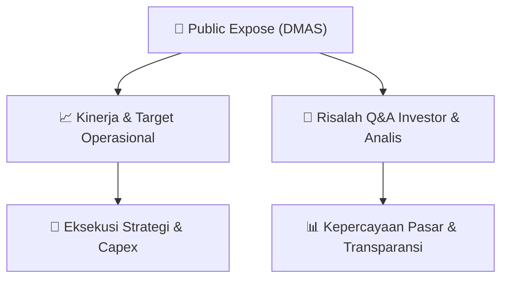

# 📢 Laporan Intelijen Paparan Publik (Public Expose) - [[DMAS]]
🏢 **Emiten**: `[[DMAS]]` | 📅 **Tanggal Pelaksanaan**: `2026-09-02` | 📑 **Dokumen**: `Public Expose lamp1`
⬅️ [[knowledge-base/daily-digests/Daily_Digest_20260902|Kembali ke Daily Digest]] | 🎛️ [[Dashboard|Ke Dashboard Utama]]

---

## 📌 1. Ringkasan Eksekutif & Paparan Direksi
> [!NOTE]
> Dokumen merupakan presentasi Public Expose PT Puradelta Lestari Tbk (DMAS) per Agustus 2026. Perusahaan adalah pengembang kawasan terpadu terintegrasi di timur Jakarta dengan proyek utama Kota Deltamas seluas ±3.185 hektar di Cikarang Pusat, Bekasi, di KM 37 Jalan Tol Jakarta-Cikampek. Perusahaan didirikan tahun 1993 dan melantai di bursa (IPO) tahun 2015. Presentasi mencakup agenda: company overview, operational updates, sustainable development, dan key financial information. Dokumen yang tersedia hanya memuat halaman awal dan belum mencakup rincian operasional, keuangan, atau tanya jawab.

#### 🎯 Guidance Operasional & Target Strategis
- Tidak diungkapkan dalam bagian dokumen yang tersedia. Halaman yang diberikan hanya mencakup disclaimer, agenda, dan company overview tanpa rincian target kinerja, ekspansi, atau belanja modal.

## 📊 2. Matriks Indikator Operasional & Parameter Kunci
| Parameter Utama | Nilai / Keterangan Resmi |
| :--- | :--- |
| **Nama Perusahaan** | `PT Puradelta Lestari Tbk (DMAS)` |
| **Proyek Utama** | `Kota Deltamas` |
| **Lokasi Proyek** | `Jalan Tol Jakarta-Cikampek KM 37, Cikarang Pusat, Bekasi` |
| **Total Area** | `±3.185 hektar` |
| **Tahun Pendirian** | `1993` |
| **Tahun IPO** | `2015` |
| **Jenis Pengembangan** | `Industrial-based Modern Integrated Township` |

---

## 💬 3. Risalah Tanya Jawab (Q&A Session)
`Materi presentasi Public Expose / Risalah Q&A terlampir dalam dokumen resmi bursa.`

## 📌 4. Peta Jalur Strategis & Roadmap

---

## 🔗 Knowledge Graph
- [[knowledge-base/daily-digests/Daily_Digest_20260902|📄 Daily Digest 2026-09-02]]
- [[knowledge-base/calendars/Action_Calendar|🗓️ Kalender Terpusat Aksi Korporasi]]
- [[Dashboard|🎛️ Kembali ke Dashboard Utama]]