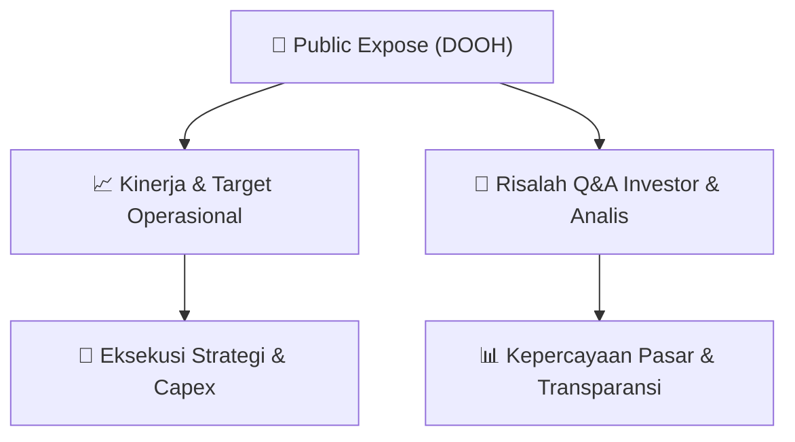

# 📢 Laporan Intelijen Paparan Publik (Public Expose) - [[DOOH]]
🏢 **Emiten**: `[[DOOH]]` | 📅 **Tanggal Pelaksanaan**: `2026-08-27` | 📑 **Dokumen**: `Public Expose lamp1`
⬅️ [[knowledge-base/daily-digests/Daily_Digest_20260827|Kembali ke Daily Digest]] | 🎛️ [[Dashboard|Ke Dashboard Utama]]

---

## 📌 1. Ringkasan Eksekutif & Paparan Direksi
> [!NOTE]
> PT Era Media Sejahtera Tbk (DOOH) menyampaikan pemberitahuan rencana penyelenggaraan Paparan Publik Insidentil (Public Expose) kepada PT Bursa Efek Indonesia melalui surat tertanggal 27 Agustus 2026. Acara akan dilaksanakan pada Jumat, 4 September 2026 pukul 15.00 WIB sampai selesai melalui media elektronik Zoom dengan Meeting ID 826 7833 6401 dan Passcode Pubex2026. Pihak manajemen yang akan hadir adalah Anggota Direksi Perseroan. Materi Public Expose akan disampaikan paling lambat pada Kamis, 3 September 2026.

#### 🎯 Guidance Operasional & Target Strategis
- Tidak terdapat guidance operasional, target kinerja, rencana ekspansi, atau alokasi belanja modal dalam dokumen ini. Dokumen hanya berisi pemberitahuan rencana penyelenggaraan Public Expose Insidentil, sehingga katalis dan guidance baru akan tersedia setelah materi Public Expose disampaikan pada 3 September 2026.

## 📊 2. Matriks Indikator Operasional & Parameter Kunci
| Parameter Utama | Nilai / Keterangan Resmi |
| :--- | :--- |
| **Nama Perseroan** | `PT Era Media Sejahtera Tbk` |
| **Kode Emiten** | `DOOH` |
| **Nomor Surat** | `024/CORSEC/EMS/PUBEX.I/VIII/2026` |
| **Tanggal Surat** | `27 Agustus 2026` |
| **Perihal** | `Pemberitahuan Rencana Penyelenggaraan Paparan Publik Insidentil (Public Expose) PT Era Media Sejahtera Tbk` |
| **Hari/Tanggal Public Expose** | `Jumat, 4 September 2026` |
| **Waktu Public Expose** | `15.00 WIB - Selesai` |
| **Sarana Media Elektronik** | `Zoom Meeting` |
| **Link Zoom** | `https://us06web.zoom.us/j/82678336401?pwd=ImT1jJ6Q43mNLRheWr2FIsSzQGdTxm.1` |
| **Meeting ID** | `826 7833 6401` |
| **Passcode** | `Pubex2026` |
| **Pihak Manajemen yang Hadir** | `Anggota Direksi PT Era Media Sejahtera Tbk` |
| **Batas Penyampaian Materi Public Expose** | `Kamis, 3 September 2026` |
| **Direktur Utama** | `Vicktor Aritonang` |

---

## 💬 3. Risalah Tanya Jawab (Q&A Session)
`Materi presentasi Public Expose / Risalah Q&A terlampir dalam dokumen resmi bursa.`

## 📌 4. Peta Jalur Strategis & Roadmap

---

## 🔗 Knowledge Graph
- [[knowledge-base/daily-digests/Daily_Digest_20260827|📄 Daily Digest 2026-08-27]]
- [[knowledge-base/calendars/Action_Calendar|🗓️ Kalender Terpusat Aksi Korporasi]]
- [[Dashboard|🎛️ Kembali ke Dashboard Utama]]