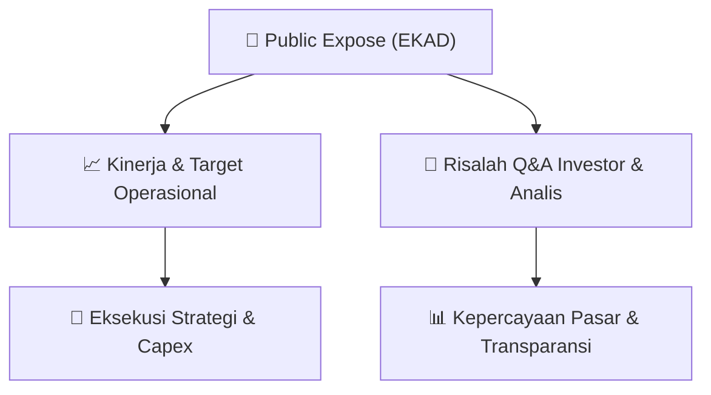

# 📢 Laporan Intelijen Paparan Publik (Public Expose) - [[EKAD]]
🏢 **Emiten**: `[[EKAD]]` | 📅 **Tanggal Pelaksanaan**: `2026-09-09` | 📑 **Dokumen**: `Public Expose lamp1`
⬅️ [[knowledge-base/daily-digests/Daily_Digest_20260909|Kembali ke Daily Digest]] | 🎛️ [[Dashboard|Ke Dashboard Utama]]

---

## 📌 1. Ringkasan Eksekutif & Paparan Direksi
> [!NOTE]
> Public Expose Insidentil PT Ekadharma International Tbk (EKAD) diselenggarakan pada 8 September 2026 di Jakarta. Paparan ini dihadiri oleh investor ritel, pemegang saham minoritas, perwakilan PT Mirae Asset Sekuritas Indonesia, dan individu lainnya. Agenda utama mencakup pemaparan kinerja terkini, strategi operasional, serta sesi tanya jawab dengan manajemen. Fokus utama adalah memberikan transparansi kepada pemegang saham mengenai kondisi fundamental dan prospek bisnis emiten di tengah dinamika pasar.

#### 🎯 Guidance Operasional & Target Strategis
- Berdasarkan dokumen yang tersedia, belum terdapat rincian eksplisit mengenai target kinerja, rencana ekspansi, atau belanja modal (capex) yang diumumkan dalam paparan. Namun, kehadiran manajemen dalam public expose insidentil mengindikasikan adanya isu atau perkembangan material yang perlu dikomunikasikan kepada publik. Investor disarankan untuk memantau keterbukaan informasi lanjutan dari emiten terkait guidance operasional dan strategi pertumbuhan ke depan.

## 📊 2. Matriks Indikator Operasional & Parameter Kunci
| Parameter Utama | Nilai / Keterangan Resmi |
| :--- | :--- |
| **Tanggal Pelaksanaan** | `8 September 2026` |
| **Jenis Acara** | `Public Expose Insidentil` |
| **Jumlah Peserta Tercatat** | `9 peserta (investor ritel, minoritas, dan institusi)` |
| **Perwakilan Institusi** | `PT Mirae Asset Sekuritas Indonesia` |
| **Kategori Peserta** | `Investor ritel, pemegang saham minoritas, individu, dan analis sekuritas` |

---

## 💬 3. Risalah Tanya Jawab (Q&A Session)
### ❓ Pertanyaan 1 (Taufan Rosyadi Yusuf (Pemegang Saham Minoritas))
**Pertanyaan**: Tidak ada rincian pertanyaan yang tercantum dalam dokumen daftar hadir.

**Jawaban Manajemen**: Tidak ada rincian jawaban yang tercantum dalam dokumen daftar hadir.

> [!TIP]
> **Implikasi Bagi Investor**: Belum dapat disimpulkan; diperlukan risalah resmi paparan untuk analisis lebih lanjut.

### ❓ Pertanyaan 2 (Fuat Hasym As'ari (PT Mirae Asset Sekuritas Indonesia))
**Pertanyaan**: Tidak ada rincian pertanyaan yang tercantum dalam dokumen daftar hadir.

**Jawaban Manajemen**: Tidak ada rincian jawaban yang tercantum dalam dokumen daftar hadir.

> [!TIP]
> **Implikasi Bagi Investor**: Belum dapat disimpulkan; diperlukan risalah resmi paparan untuk analisis lebih lanjut.

### ❓ Pertanyaan 3 (Selvy Margareta (Investor Retail))
**Pertanyaan**: Tidak ada rincian pertanyaan yang tercantum dalam dokumen daftar hadir.

**Jawaban Manajemen**: Tidak ada rincian jawaban yang tercantum dalam dokumen daftar hadir.

> [!TIP]
> **Implikasi Bagi Investor**: Belum dapat disimpulkan; diperlukan risalah resmi paparan untuk analisis lebih lanjut.

## 📌 4. Peta Jalur Strategis & Roadmap

---

## 🔗 Knowledge Graph
- [[knowledge-base/daily-digests/Daily_Digest_20260909|📄 Daily Digest 2026-09-09]]
- [[knowledge-base/calendars/Action_Calendar|🗓️ Kalender Terpusat Aksi Korporasi]]
- [[Dashboard|🎛️ Kembali ke Dashboard Utama]]