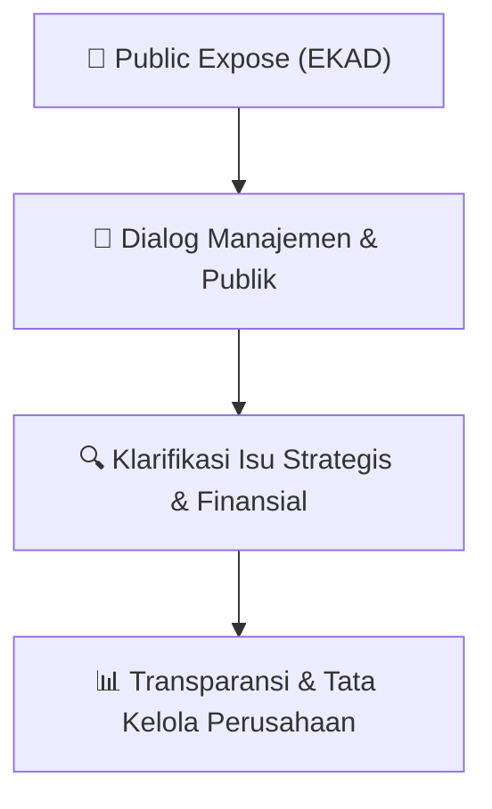

# 🎤 Laporan Hasil Public Expose: [EKAD]

🏢 **Emiten**: `EKAD` | 📅 **Tanggal Pelaksanaan**: `2026-09-09` | ❓ **Total Pertanyaan**: `0 Pertanyaan`
⬅️ [[knowledge-base/daily-digests/EKAD_20260909|Kembali ke Daily Digest]] | 🎛️ [[Dashboard/EKAD|Ke Dashboard Emiten]]

> [!IMPORTANT]
> Dokumen ini memuat seluruh risalah hasil pelaksanaan dan sesi tanya jawab (Q&A) Public Expose EKAD. Informasi dicatat secara verbatim guna memberikan analisis sentimen dan arah kebijakan manajemen bagi investor.

---

## ℹ️ 1. Informasi Penyelenggaraan & Kehadiran

| Parameter | Detail Pelaksanaan |
|---|---|
| **Nomor Surat** | LP-EI/047/IX/2026 |
| **Perihal** | Laporan Hasil Public Expose Insidentil |
| **Waktu Pengumuman** | 09-09-2026 15:51 |
| **Jumlah Kehadiran Peserta** | Penyampaian Hasil Public Expose |
| **Lampiran Berkas** | `1` |

---

## 💬 2. Risalah Tanya Jawab Manajemen & Investor (0 Pertanyaan)

*Sesi tanya jawab tidak memuat pertanyaan tertulis atau materi dipaparkan secara langsung.*

## 📌 3. Peta Jalur Transparansi & Kepercayaan Pasar

---

*Dokumen diolah otomatis oleh **Swarm Intelijen Pasar Modal Indonesia** pada 2026-10-12 16:44 WIB.*