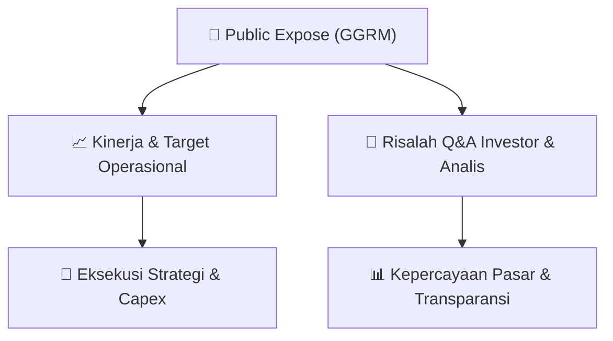

# 📢 Laporan Intelijen Paparan Publik (Public Expose) - [[GGRM]]
🏢 **Emiten**: `[[GGRM]]` | 📅 **Tanggal Pelaksanaan**: `2026-09-15` | 📑 **Dokumen**: `Public Expose lamp1`
⬅️ [[knowledge-base/daily-digests/Daily_Digest_20260915|Kembali ke Daily Digest]] | 🎛️ [[Dashboard|Ke Dashboard Utama]]

---

## 📌 1. Ringkasan Eksekutif & Paparan Direksi
> [!NOTE]
> Public Expose GGRM (PT Gudang Garam Tbk) dihadiri oleh 129 peserta yang terdiri dari analis, investor ritel, dan perwakilan media. Paparan publik ini merupakan forum komunikasi antara manajemen emiten dengan pemangku kepentingan untuk membahas kinerja perusahaan, strategi bisnis, serta menjawab pertanyaan seputar operasional dan prospek ke depan. Daftar hadir menunjukkan partisipasi dari berbagai institusi dan individu, termasuk notetaker dari platform otomatis seperti Fireflies.ai dan Otter.ai, mengindikasikan adanya pencatatan resmi jalannya acara.

#### 🎯 Guidance Operasional & Target Strategis
- Berdasarkan dokumen yang tersedia, tidak terdapat rincian spesifik mengenai target kinerja, ekspansi, atau capex karena dokumen hanya berisi daftar peserta (attendance list) tanpa transkrip materi presentasi atau sesi tanya jawab. Informasi lebih lanjut mengenai guidance operasional dan katalis perusahaan tidak dapat diekstraksi dari data yang diberikan.

## 📊 2. Matriks Indikator Operasional & Parameter Kunci
| Parameter Utama | Nilai / Keterangan Resmi |
| :--- | :--- |
| **Jumlah Peserta** | `129 orang` |
| **Tanggal Acara** | `Tidak tercantum dalam dokumen` |
| **Kategori Peserta** | `Analis, investor ritel, media (investor.id), dan notetaker otomatis` |
| **Perwakilan Manajemen** | `Tidak tercantum secara eksplisit dalam dokumen` |

---

## 💬 3. Risalah Tanya Jawab (Q&A Session)
### ❓ Pertanyaan 1 (Tidak tercantum)
**Pertanyaan**: Tidak ada pertanyaan yang terdokumentasi dalam file yang diberikan

**Jawaban Manajemen**: Tidak ada jawaban yang terdokumentasi dalam file yang diberikan

> [!TIP]
> **Implikasi Bagi Investor**: Tidak dapat ditentukan karena tidak ada sesi tanya jawab yang terekam dalam dokumen

## 📌 4. Peta Jalur Strategis & Roadmap

---

## 🔗 Knowledge Graph
- [[knowledge-base/daily-digests/Daily_Digest_20260915|📄 Daily Digest 2026-09-15]]
- [[knowledge-base/calendars/Action_Calendar|🗓️ Kalender Terpusat Aksi Korporasi]]
- [[Dashboard|🎛️ Kembali ke Dashboard Utama]]