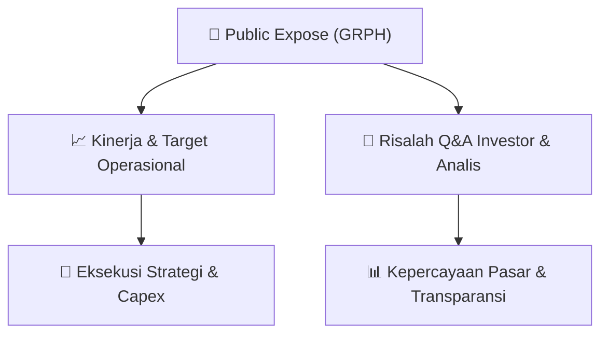

# 📢 Laporan Intelijen Paparan Publik (Public Expose) - [[GRPH]]
🏢 **Emiten**: `[[GRPH]]` | 📅 **Tanggal Pelaksanaan**: `2026-09-09` | 📑 **Dokumen**: `Public Expose lamp1`
⬅️ [[knowledge-base/daily-digests/Daily_Digest_20260909|Kembali ke Daily Digest]] | 🎛️ [[Dashboard|Ke Dashboard Utama]]

---

## 📌 1. Ringkasan Eksekutif & Paparan Direksi
> [!NOTE]
> PT Griptha Putra Persada Tbk (GRPH) menyelenggarakan Public Expose Insidentil pada 15 September 2026 secara online melalui Zoom, sebagai tindak lanjut atas permintaan Bursa Efek Indonesia (BEI) terkait suspensi cooling down yang diberlakukan pada 8 September 2026 berdasarkan Pengumuman BEI Nomor Peng-SPT-00169/BEI.WAS/09-2026. Public expose ini bertujuan untuk memberikan klarifikasi dan informasi terkini kepada investor dan publik mengenai kondisi perseroan pasca-suspensi. Materi paparan akan tersedia pada 14 September 2026 melalui situs web perseroan dan BEI.

#### 🎯 Guidance Operasional & Target Strategis
- Tidak terdapat informasi mengenai target kinerja, ekspansi, atau capex dalam dokumen ini. Dokumen hanya berisi pemberitahuan administratif mengenai penyelenggaraan Public Expose Insidentil sebagai respons terhadap suspensi BEI. Katalis utama yang perlu diperhatikan adalah hasil paparan pada 15 September 2026 yang diharapkan memberikan kejelasan mengenai alasan suspensi dan prospek perseroan.

## 📊 2. Matriks Indikator Operasional & Parameter Kunci
| Parameter Utama | Nilai / Keterangan Resmi |
| :--- | :--- |
| **Tanggal Public Expose** | `15 September 2026` |
| **Waktu Pelaksanaan** | `14.00 - 15.00 WIB` |
| **Metode Pelaksanaan** | `Online melalui Zoom` |
| **Nomor Pengumuman Suspensi BEI** | `Peng-SPT-00169/BEI.WAS/09-2026` |
| **Tanggal Suspensi** | `8 September 2026` |
| **Jenis Public Expose** | `Insidentil` |
| **Alamat Kantor** | `Jl. AKBP R. Agil Kusumadya No. 100, Jati Wetan, Kudus, Jawa Tengah` |
| **Sekretaris Perusahaan** | `Fransiska Bella Yunita` |

---

## 💬 3. Risalah Tanya Jawab (Q&A Session)
`Materi presentasi Public Expose / Risalah Q&A terlampir dalam dokumen resmi bursa.`

## 📌 4. Peta Jalur Strategis & Roadmap

---

## 🔗 Knowledge Graph
- [[knowledge-base/daily-digests/Daily_Digest_20260909|📄 Daily Digest 2026-09-09]]
- [[knowledge-base/calendars/Action_Calendar|🗓️ Kalender Terpusat Aksi Korporasi]]
- [[Dashboard|🎛️ Kembali ke Dashboard Utama]]