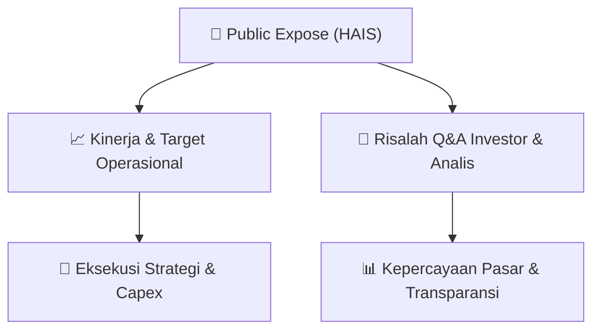

# 📢 Laporan Intelijen Paparan Publik (Public Expose) - [[HAIS]]
🏢 **Emiten**: `[[HAIS]]` | 📅 **Tanggal Pelaksanaan**: `2026-09-11` | 📑 **Dokumen**: `Public Expose lamp2`
⬅️ [[knowledge-base/daily-digests/Daily_Digest_20260911|Kembali ke Daily Digest]] | 🎛️ [[Dashboard|Ke Dashboard Utama]]

---

## 📌 1. Ringkasan Eksekutif & Paparan Direksi
> [!NOTE]
> Public Expose PT Hasnur Internasional Shipping Tbk (HAIS) Tahun 2026 yang diselenggarakan pada 9 September 2026 dihadiri oleh 26 peserta, termasuk investor ritel dan analis. Paparan ini merupakan forum komunikasi manajemen dengan pemegang saham dan publik untuk menyampaikan kinerja, strategi, dan rencana perseroan ke depan. Sayangnya, dokumen yang tersedia hanya berisi daftar hadir peserta dan tidak memuat materi presentasi, laporan kinerja, atau sesi tanya jawab. Oleh karena itu, informasi mengenai kinerja keuangan, target operasional, dan strategi ekspansi tidak dapat diekstraksi dari dokumen ini.

#### 🎯 Guidance Operasional & Target Strategis
- Tidak tersedia dalam dokumen. Dokumen hanya berisi daftar hadir peserta Public Expose dan tidak memuat informasi mengenai target kinerja, ekspansi, capex, atau panduan operasional lainnya dari manajemen HAIS.

## 📊 2. Matriks Indikator Operasional & Parameter Kunci
| Parameter Utama | Nilai / Keterangan Resmi |
| :--- | :--- |
| **Tanggal Penyelenggaraan Public Expose** | `9 September 2026` |
| **Jumlah Peserta** | `26 orang` |
| **Kategori Peserta** | `Investor ritel, analis, dan perwakilan institusi` |
| **Kantor Pusat** | `Office 8 Building, 3rd floor, Jl. Senopati No. 8B, Jakarta Selatan, DKI Jakarta 12190` |
| **Kantor Cabang** | `Jl. Berangas Timur No. 121, Alalak, Banjarmasin, Kalimantan Selatan 70582` |
| **Website Perusahaan** | `pthis.id` |

---

## 💬 3. Risalah Tanya Jawab (Q&A Session)
### ❓ Pertanyaan 1 (Tidak tersedia)
**Pertanyaan**: Tidak tersedia. Dokumen tidak memuat sesi tanya jawab antara manajemen dengan peserta.

**Jawaban Manajemen**: Tidak tersedia. Dokumen tidak memuat jawaban manajemen atas pertanyaan peserta.

> [!TIP]
> **Implikasi Bagi Investor**: Tidak dapat ditentukan karena tidak ada informasi mengenai sesi tanya jawab dalam dokumen.

## 📌 4. Peta Jalur Strategis & Roadmap

---

## 🔗 Knowledge Graph
- [[knowledge-base/daily-digests/Daily_Digest_20260911|📄 Daily Digest 2026-09-11]]
- [[knowledge-base/calendars/Action_Calendar|🗓️ Kalender Terpusat Aksi Korporasi]]
- [[Dashboard|🎛️ Kembali ke Dashboard Utama]]