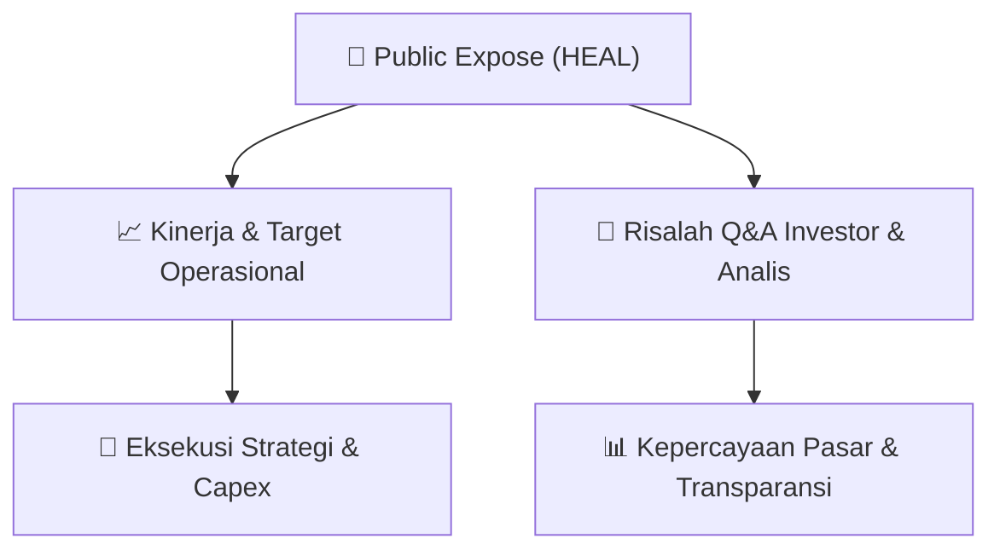

# 📢 Laporan Intelijen Paparan Publik (Public Expose) - [[HEAL]]
🏢 **Emiten**: `[[HEAL]]` | 📅 **Tanggal Pelaksanaan**: `2026-09-11` | 📑 **Dokumen**: `Public Expose lamp1`
⬅️ [[knowledge-base/daily-digests/Daily_Digest_20260911|Kembali ke Daily Digest]] | 🎛️ [[Dashboard|Ke Dashboard Utama]]

---

## 📌 1. Ringkasan Eksekutif & Paparan Direksi
> [!NOTE]
> PT Medikaloka Hermina Tbk (HEAL) menyelenggarakan Public Expose Tahunan 2026 pada Selasa, 08 September 2026 secara webinar, dihadiri 68 peserta sesi Public Expose dan 58 peserta Press Conference. Manajemen yang hadir terdiri dari Direktur Utama Dr. Yulisar Khiat, Direktur Operasional & Komersial drg. Susi Setyawati, Direktur Keuangan Yustinus Immanuel Herawan, dan Sekretaris Korporasi ling Ichsan Hanafi. Paparan mencakup profil perusahaan, model bisnis, layanan unggulan, jaringan rumah sakit, serta tinjauan kinerja keuangan semester pertama 2026 (1H26) yang meliputi pertumbuhan pendapatan, kenaikan EBITDA, laba bersih, peningkatan kunjungan pasien rawat inap dan rawat jalan (umum dan JKN), perputaran modal kerja, rasio utang yang terjaga, serta arus kas dan belanja modal untuk ekspansi.

#### 🎯 Guidance Operasional & Target Strategis
- Perseroan melanjutkan ekspansi melalui belanja modal (capex) yang digunakan untuk pembukaan rumah sakit baru, penambahan tempat tidur di rumah sakit yang ada, dan penambahan peralatan medis. Kinerja 1H26 menunjukkan pertumbuhan pendapatan, kenaikan EBITDA, dan kenaikan laba bersih setelah pajak (PAT) serta PATMI. Jumlah kunjungan pasien rawat inap dan rawat jalan meningkat baik dari segmen pasien umum maupun JKN. Rasio utang dan solvabilitas berada pada level yang terjaga baik.

## 📊 2. Matriks Indikator Operasional & Parameter Kunci
| Parameter Utama | Nilai / Keterangan Resmi |
| :--- | :--- |
| **Pertumbuhan Pendapatan 1H26** | `Mengalami pertumbuhan (angka spesifik tidak disebutkan dalam dokumen)` |
| **EBITDA 1H26** | `Mengalami kenaikan (angka spesifik tidak disebutkan dalam dokumen)` |
| **Laba Bersih Setelah Pajak (PAT) 1H26** | `Mengalami kenaikan (angka spesifik tidak disebutkan dalam dokumen)` |
| **Laba Bersih Setelah Pajak & Kepentingan Non-Pengendali (PATMI) 1H26** | `Mengalami kenaikan (angka spesifik tidak disebutkan dalam dokumen)` |
| **Kunjungan Pasien Rawat Inap & Rawat Jalan 1H26** | `Mengalami kenaikan pada segmen pasien umum dan JKN` |
| **Rasio Utang & Solvabilitas** | `Berada pada level yang terjaga dengan baik` |
| **Belanja Modal (Capex)** | `Digunakan untuk pembukaan rumah sakit baru, penambahan tempat tidur, dan peralatan medis` |
| **Jumlah Peserta Public Expose** | `68 peserta` |
| **Jumlah Peserta Press Conference** | `58 peserta` |

---

## 💬 3. Risalah Tanya Jawab (Q&A Session)
### ❓ Pertanyaan 1 (Anonymous)
**Pertanyaan**: Terkait kebakaran hutan di Kalimantan dan meletusnya Anak Krakatau, apakah ada dampak pada peningkatan kasus di Hermina?

**Jawaban Manajemen**: Rumah sakit Hermina yang berada di wilayah Sumatera dan Kalimantan mengalami penambahan kasus Infeksi Saluran Pernapasan Akut (ISPA) yang berkaitan dengan kondisi kabut/asap akibat kebakaran hutan. Namun, peningkatan kasus tersebut belum terlalu signifikan, baik dari sisi pasien rawat jalan maupun rawat inap. Untuk dampak erupsi Anak Krakatau, Perseroan telah mempersiapkan penanganan terhadap pasien yang mengalami dampak kesehatan, khususnya kasus sesak napas dan gangguan atau keluhan pada mata.

> [!TIP]
> **Implikasi Bagi Investor**: Dampak kebakaran hutan dan erupsi terhadap volume pasien masih terbatas dan tidak signifikan, sehingga tidak berdampak material pada kinerja keuangan. Manajemen telah menyiapkan langkah antisipasi untuk menangani potensi peningkatan kasus.

### ❓ Pertanyaan 2 (Katadata)
**Pertanyaan**: Bagaimana sinergi dengan Astra dan Jarum? Berapa persen kontribusi mereka terhadap pendapatan?

**Jawaban Manajemen**: Jawaban manajemen tidak tersedia dalam dokumen karena terpotong (dokumen berakhir pada 'Kont').

> [!TIP]
> **Implikasi Bagi Investor**: Informasi mengenai sinergi dan kontribusi pendapatan dari Astra dan Jarum belum dapat diketahui dari dokumen ini. Investor disarankan menunggu publikasi resmi atau menghubungi investor relations.

## 📌 4. Peta Jalur Strategis & Roadmap

---

## 🔗 Knowledge Graph
- [[knowledge-base/daily-digests/Daily_Digest_20260911|📄 Daily Digest 2026-09-11]]
- [[knowledge-base/calendars/Action_Calendar|🗓️ Kalender Terpusat Aksi Korporasi]]
- [[Dashboard|🎛️ Kembali ke Dashboard Utama]]