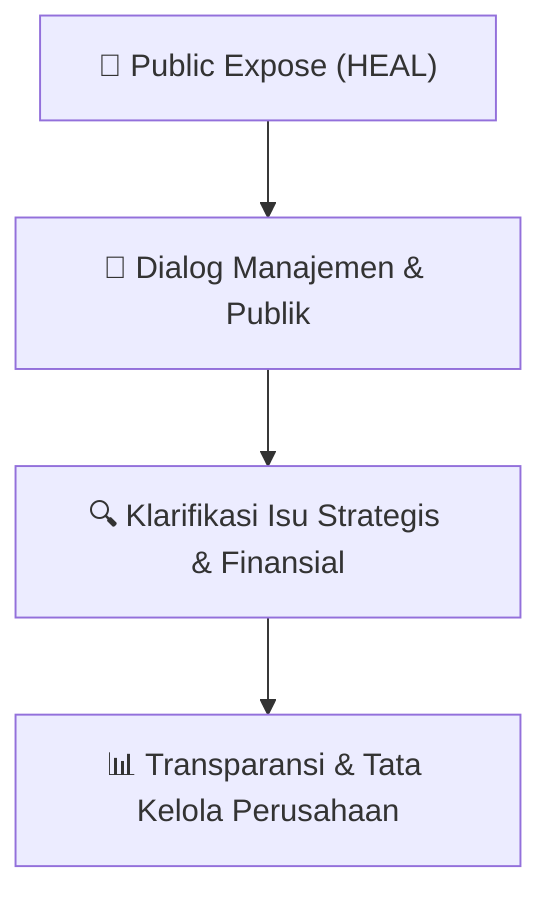

# 🎤 Laporan Hasil Public Expose: [HEAL]

🏢 **Emiten**: `HEAL` | 📅 **Tanggal Pelaksanaan**: `2026-09-11` | ❓ **Total Pertanyaan**: `6 Pertanyaan`
⬅️ [[knowledge-base/daily-digests/HEAL_20260911|Kembali ke Daily Digest]] | 🎛️ [[Dashboard/HEAL|Ke Dashboard Emiten]]

> [!IMPORTANT]
> Dokumen ini memuat seluruh risalah hasil pelaksanaan dan sesi tanya jawab (Q&A) Public Expose HEAL. Informasi dicatat secara verbatim guna memberikan analisis sentimen dan arah kebijakan manajemen bagi investor.

---

## ℹ️ 1. Informasi Penyelenggaraan & Kehadiran

| Parameter | Detail Pelaksanaan |
|---|---|
| **Nomor Surat** | 479/DIR/MH/IX/2026 |
| **Perihal** | Laporan Hasil Public Expose Tahunan |
| **Waktu Pengumuman** | 11-09-2026 16:28 |
| **Jumlah Kehadiran Peserta** | Penyampaian Hasil Public Expose |
| **Lampiran Berkas** | `1` |

---

## 💬 2. Risalah Tanya Jawab Manajemen & Investor (6 Pertanyaan)

### ❓ Pertanyaan #1

> **Penanya**: *Investor / Analis Publik*

```text
Pertanyaan:
1. 
Anonymous
Pertanyaan:
Terkait kebakaran hutan di kalimantan dan meletusnya anak krakatau, apakah ada 
dampak pada peningkatan kasus di Hermina?
Tanggapan Manajemen:
Baik, terima kasih atas pertanyaannya.
Rumah sakit Hermina yang berada di wilayak Sumatera dan Kalimantan. Di beberapa 
lokasi tersebut terdapat penambahan kasus Infeksi Saluran Pemapasan Akut (ISPA) 
yang berkaitan dengan kondisi kabut/asap akibat kebakaran hutan.
Namun, manajemen menyampaikan bahwa peningkatan kasus tersebut belum terlalu
signifikan, baik dari sisi pasien rawat jalan maupun rawat inap.
SJntuk dampak erupsi Anak Krakatau, Perseroan telah mempersiapkan penanganan 
terhadap pasien yang mengalami dampak kesehatan, khususnya kasus sesak napas,
dan gangguan atau keluhan pada mata. Terima kasih
```

💡 **Jawaban & Klarifikasi Manajemen**:

> *Teks tanggapan manajemen tidak tersedia*

---

### ❓ Pertanyaan #2

> **Penanya**: *Investor / Analis Publik*

```text
Pertanyaan:
2. Katadata
Pertanyaan:
Bagaimana sinergi dengan Astra dan Jarum? Berapa persen kontribusi mereka terhadap 
pendapatan?
Tanggapan Manajemen:
Baik, terima kasih.
Kontribusi kerja sama dengan Astra dan Djarum berada di kisaran 10%. Kontribusi 
tersebut berasal dari kombinasi beberapa bentuk keija sama, antara lain: Medical Check- 
Up (MCU); dan keija sama layanan kesehatan lainnya.
```

💡 **Jawaban & Klarifikasi Manajemen**:

> *Teks tanggapan manajemen tidak tersedia*

---

### ❓ Pertanyaan #3

> **Penanya**: *Investor / Analis Publik*

```text
Pertanyaan:
3. Anonymous
Pertanyaan:
Mengapa Hermina membuka di Kepanjen dan Bali tahun ini? Apakah potensinya baik?
Tanggapan Manajemen:
Terima kasih atas pertanyaan,
Untuk yang di Bali memang sudah beberapa tahun terakhir penawaran-penawaran dari 
dokter-dokter setempat untuk membuka di wilayah Bali. Setelah dilakukan survei 
feasibility study, temyata Badung potensinya yang tertinggi di antara hasil survei.
Kantor Pusat: Jl. Raya Jatinegara Barat No. 126 Jatinegara, Jakarta Timur 13320 
Kantor Cabang : Hermina Tower I Lt. 10 Jl. Selangit Blok B-10 Kav. 04, Kemayoran, Jakarta Pusat 10610
Telp. 021-39702255 Website : www.herminahospitals.com
PT MEDIKALOKA HERMINA Tbk
Sehingga kami membuka di Badung dengan harapan membantu akses dan pemerataan 
dalam pelayanan kesehatan, baik yang BPJS maupun yang non-BPJS.
Demikian pun strategi kami untuk yang di Kepanjen. Dokter-dokter yang di Kota 
Malang, pada amumnya mereka punya juga SIP yang berbeda dan mereka mengusulkan 
untuk Kabupaten Malang dengan ibu kota Kepanjen. Ini juga membutuhkan fasilitas 
yang lebih baik di samping RSUD dan RS swasta yang ada. Nah berdasarkan hasil dari 
survei dan feasibility study, termasuk undangan dari dokter-dokter putra daerah spesialis 
tempat, kami memutuskan membangun di dua lokasi tersebut.
```

💡 **Jawaban & Klarifikasi Manajemen**:

> *Teks tanggapan manajemen tidak tersedia*

---

### ❓ Pertanyaan #4

> **Penanya**: *Investor / Analis Publik*

```text
Pertanyaan:
4. Anonymous
Pertanyaan:
Bagaimana kinerja PIK 2 dan IKN hingga saat ini?
Tanggapan Manajemen:
Terima kasih,
Pertumbuhan pendapatan Hermina PIK 2 telah melampaui target yang ditetapkan.
Selain dari sisi pendapatan, kineija PIK 2 juga menunjukkan perkembangan positif dari 
sisi profitabilitas, dengan EBITDA yang telah positif.
Sementara itu, Hermina Nusantara di IKN masih mencatat EBITDA negatif. Hal ini 
terutama disebabkan oleh keterbatasan ketersediaan unit/volume layanan dan biaya. 
Namun dalam beberapa bulan terakhir, pertambahan revenue terus meningkat dan kami 
yakin dalam akhir tahun ini IKN juga bisa menghasilkan EBITDA positif.
Jadi dua rumah sakit tersebut kami yakin akan tumbuh dan berkontribusi baik terhadap 
revenue maupun EBITDA, di akhir tahun ini dan tahun depan.
```

💡 **Jawaban & Klarifikasi Manajemen**:

> *Teks tanggapan manajemen tidak tersedia*

---

### ❓ Pertanyaan #5

> **Penanya**: *Investor / Analis Publik*

```text
Pertanyaan:
5. Rama - Bisnis Indonesia
Pertanyaan:
1) Selain pembangunan 2 RS, apa saja realisasi ekspansi Hermina sepanjang semester I? 
Alokasi Capex masih tersedia sekitar Rp500 m, apa saja rencana ekspansi lain yang 
disiapkan Hermina di sisa tahun?
2) Seberapa besar pelemahan rupiah mempengaruhi prospek kineija HEAL sepanjang 2026?
Jawaban:
Terima kasih atas pertanyaan,
1) Kepada Pak Yustinus, untuk menjawab pertanyaan yang diajukan,
Dengan capex yang tersisa di tahun ini, fokus kami bukan pada pembangunan rumah 
sakit lagi, tapi lebih pada pengembangan dari rumah sakit yang kami mili'ki. 
Pengembangannya yakni dalam bentuk satu pembelian alat-alat medis untuk 
memperlengkapi center o f excellence di rumah sakit yang kami miliki. Misalnya di 
Bekasi ada Center of Oncology dan juga di rumah sakit-rumah sakit lainnya. Jadi kami 
akan membeli alat-alat medis untuk memperlengkapi pelayanan kami dan juga menarik
Kantor Pusat: Jl. Raya Jatinegara Barat No. 126 Jatinegara, Jakarta Timur 13320 
Kantor Cabang : Hermina Tower! Lt. 10 Jl. Selangit Blok B-10 Kav. 04, Kemayoran, Jakarta Pusat 10610
Telp. 021-39702255 Website : www.herminahospitals.com
PT MEDIKALOKA HERMINA Tbk
dokter-dokter, baik dokter spesialis maupun subspesialis untuk bisa berpraktik di 
Hermina.
Kemudian vang berikutnya adaiah untuk renovasi rumah sakit kami. Sebagaimana kita 
ketahui, kami mencoba memberikan pelayanan yang lebib maksimal bagi para pasien 
kami, terutama pasien-pasien yang BPJS dan juga non-BPJS. Kami hendak memisahkan 
flow pasien tersebut sehingga baik pasien maupun BPJS maupun non-BPJS memiliki 
pelayanan yang maksimal dan juga memiliki customer satisfaction yang maksimal untuk 
kedua layanan tersebut yang berada di dalam satu rumah sakit yang sama.
Sehingga fokusnya lebih ke renovasi rumah sakit yang existing dan juga pembelian alat- 
alat medis untuk melengkapi lini layanan yang kami miliki.
2) Pelemahan rupiah diperkirakan memberikan dampak yang relatif terbatas terhadap biaya 
pengadaan (procurement) Perseroan.
Perseroan telah membuat komitmen pengadaan untuk perioae satu tahun penuh pada 
2026, sehingga sebagian besar biaya procurement telah terlindungi dari fluktuasi nilai 
tukar.
Dampak kenaikan biaya yang berasal dari komponen di luar komitmen procurement, 
seperti transportasi dan komponen lain yang dipengaruhi kebijakan pemerintah, 
diperkirakan tidak meningkatkan COGS lebih dari sekitar 0,5%.
Dengan demikian, COGS Perseroan relatif stabil sepanjang 2026. Dari sisi pendanaan, 
seluruh pinjaman Perseroan menggunakan mata uang rupiah, sehingga Perseroan tidak 
memiliki eksposur langsung terhadap pelemahan rupiah terhadap mata uang asing. Biaya 
pinjaman diperkirakan tetap stabil sepanjang tahun.
```

💡 **Jawaban & Klarifikasi Manajemen**:

> *Teks tanggapan manajemen tidak tersedia*

---

### ❓ Pertanyaan #6

> **Penanya**: *Investor / Analis Publik*

```text
Pertanyaan:
6. Nana - Suar.id
Pertanyaan:
1) Di tengah tingginya risiko bencana dan penyakit tropis di Indonesia, bagaimana HEAL 
melihat prospek bisnis rumah sakit dan kebutuhan layanan kesehatan, khususnya di 
wilayah yang memiliki risiko tinggi?
2) Apakah HEAL melihat wilayah rawan bencana sebagai peluang ekspansi layanan 
kesehatan, mengingat kebutuhan fasilitas kesehatan tetap tinggi setelah terjadi bencana?
Jawaban:
Terima kasih atas pertanyaannya,
l) Untuk strategi Hermina tentu kami peduli dan komit terhadap masyarakat dan pemerintah.
Apabila ada peluang untuk mendukung pemerintah dalam pemerataan akses dari 
pelayanan kesehatan, tentu dengan model bisnis Hermina bersama dokter-dokter spesialis, 
kami tetap membuka peluang untuk mendukung pelayanan kesehatan.
Kami berkomitmen meningkatkan pelayanan Center o f Excellence dan ke depan apabila
sudah berlaku PMK 6 Juni 2026, kami pun akan mengoptimalkan hospital berbasis 
kompetensi base dengan mempelajari kekurangan-kekurangan dalam pelayanan paripuma
Kantor Pusat: Jl. Raya Jatinegara Barat No. 126 Jatinegara, Jakarta Timur 13320 
Kantor Cabang : Hermina Tower I Lt. 10 Jl. Selangit Blok B-10 Kav. 04, Kemayoran, Jakarta Pusat 10610
Telp. 021-39702255 Website : www.herminahosDitals.com
PT MEDIKALOKA HERMINA Tbk
atau utama. Di mana rata-rata, kalau kami mengukur dari kompetensi base rumah sakit 
yang Hermina ada saat ini, rata-rata di Madya.
Sehingga, kami upayakan bisa mendukung dengan utama maupun paripurna, tentunya 
dengan persaingan yang sehat. Jadi strategi kami mendukung kebutuhan masyarakat, 
berdampak dengan pemerintah dan meningkatkan kualitas pelayanan agar masyarakat 
menengah ke atas percaya berobat di Hermina maupun di Indonesia.
2) Kami tetap dalam membangun membutuhkan feasibility study di samping kebutuhan 
masyarakat dan pemerintah. Apabila pemerintah mendorong kami untuk berkontribusi, 
misalnya waktu di IKN pertama kali kami dihubungi, kami siap. Begitu pun di daerah- 
daerah rawan bencana. Apabila pemerintah mengajak Hermina untuk berkontribusi, kami 
siap dan mendukung program pemerintah.
R M /
Kantor Pusat: Jl. Raya Jatinegara Barat No. 126 Jatinegara, Jakarta Timur 13320 
Kantor Cabang : Hermina Tower I Lt. 10 Jl. Selangit Blok B-10 Kav. 04, Kemayoran, Jakarta Pusat 10610
Telp. 021-39702255 Website : www.herminahospitals.com
PT MEDIKALOKA HERMINA Tbk
LAMPIRAN: DAFTAR HADIR
SESI PUBLIC EXPOSE 2026
!
I 
|
No
Nama Pengguna (Nama Asli)
i
Daniel Surjadi
56
2
Ferdinan_S_[Participant]
60
3
Erwin Tanaka
54
4
Daniel.
60
5
Kholid Rafsanjani
60
6
Doddi Tampubolon
55
7
Tan Richard Tanjung
41
8
Tan Richard Tanjung
10
9
Stephen Susilo
45
10
Everson Sugianto
60
11
Bayu Santoso
50
12
Bagus Prayitno
57
13
Eka Rahmawati Rahman
57
14
Kesa Mutia Dara
60
15
Mick Basa
59
16
Rizki Fayad Pratama
60
17
Nabilla Almi
22
18
Rama Paramahamsa
59
19
SJ FJanso
58
20
kasmudim kas
60
21
Erdji Herlando
22
22
AGUS LIYANTO
42
23
Jimmy Ananda
60
24
PETRUS GUNADI
59
25
Ircham Faozi
53
26
Fitrahadi Bulana
29
27
Bobby -
22
28
Nanda Surya
59
29
Alief Andri
59
30
Biily WIJAYA
60
31
Ahmad Mubarok
15
32
Tanayastri Dini Isna
59
33
Galih q
60
34
william adriel
60
35
rafdi prima
44
36
Santa Siagian
16
37
Santa Siagian
13
38
gilang adam
43
39
Medina Aryanti
1
40
Nana Aghitsna
56
Kantor Pusat: Jl. Raya Jatinegara Barat No. 126 Jatinegara, Jakarta Timur 13320 
Kantor Cabang : Hermina Tower I Lt. 10 Jl. Selangit Blok B-10 Kav. 04, Kemayoran, Jakarta Pusat 10610
Telp. 021-39702255 Website : www.herminahospitals.com
PT MEDIKALOKA HERMINA Tbk
41
Ghafur Investor Daily
59
42
Michael Hadylaya
60
43
Ahmad Musawir
60
44
Anita Rachmandani
60
45
Gilbert Kresna Sammen
60
46
Lidya Sopamena
59
47
Andrew Yap
58
48
Ferdinan Andreas
59
49
Mohammad Saifullah
60
50
Fireflies.ai Notetaker Mohamma
60
51
Thurfah Mahira Ahnaf
47
52
adam yunus
60
53
Eva Liu
60
54
Yanto Kus
60
55
Nurwachiaah _
14
56
Nurwachidah _
38
57
Kenny Marcellino
59
58
soeyantho lim
54
59
Sri Niken Flandayani
53
60
Andryanto Eko Nugroho
54
61
Ilham Darmawan
10
62
erina septiane
46
63
Bima Aryasena
43
64
Koly Rezeki
39
65
ABDUL RASYID
1
66
Weerada Cnuncuansugkom
18
67
Willy Sutopo
14
68
Ali Alimin
8
Kantor Pusat: Jl. Raya Jatinegara Barat No. 126 Jatinegara, Jakarta Timur 13320 
Kantor Cabang : Hermina Tower! Lt. 10 Jl. Selangit Blok B-10 Kav. 04, Kemayoran, Jakarta Pusat 10610
Telp. 021-39702255 Website : www.herminahospitals.com
PT MEDIKALOKA HERMINA Tbk
LAMPIRAN: DAFTAR HADIR
SESI PRESS CONFERENCE PUBEX 2026
No.
Nama Pengguna (Nama Asli)
1
Annisa Saumi
23
2
Rama Paramahamsa
26
3
Ade Feri Priyatin
14
4
Satya Budi
15
5
Belva Safina
13
6
Rifki Al Wafi
22
7
Tanayastri Dini Isna
22
8
Sivana Zahla
24
9
Monic Validnews
10
10
Khoirifa Argisa
25
11
Putu Indah Savitri
25
12
Ahmad Sahid
22
13
Heri Antara
25
14
Yuliana Hema
22
15
Karunia Putri
23
16
Rahayu Subekti
23
17
Thurfah Mahira Ahnaf
23
18
Fandra Hardiyon
21
19
Rashif Usman
23
20
SWA.co.id Arie Liliyah
24
21
Sulthan HanifWicakso.no
25
22
AKR Head Office
25
23
Komang Ary
25
24
Arief Rahman
16
25
Hana nabila
25
26
Erika Kurnia
25
27
Koiy Rezeki
23
28
Komarudin Muchtar
25
29
Ade Ardi Muslim
25
30
Akbar Maulana
23
31
Achmad Fadli
12
32
M. Daelami
20
33
Kelvin Aditya
1
34
Yoanes Mbaling
25
35
taufan sukma
10
36
Romys Binekasri
10
37
Erlinda Puspita Wardani
10
38
Thresa Sandra
25
Kantor Pusat: Jl. Raya Jatinegara Barat No. 126 Jatinegara, Jakarta Timur 13320 
Kantor Cabang : Hermina Tower I Lt. 10 Jl. Selangit Blok B-10 Kav. 04, Kemayoran, Jakarta Pusat 10610
Telp. 021-39702255 Website : www.herminahospitals.com
PT MEDIKALOKA HERMINA Tbk
39
Gofur Fadillah
25
40
Ghafur Investor Daily
20
41
Ahmad Sahid
15
42
Eko Wahyudi
17
43
Akhmad Jiharka
15
44
Yanto Kus
25
45
meika ardhianto
25
46
Sri Niken Handayani
25
47
Nana Aghitsna
25
48
Irawan Hadi
28
49
Annisa Nurfitri
25
50
Fadil Djailani
25
51
Ismi Damayanti
25
52
Novi Maryanti
23
53
hana nabila
23
54
Vadhia Lidyana
23
55
Dionisio Damara
22
56
Pulina Nitya
16
57
Vicky Rachman
15
58
Nadia K Putri
11
```

💡 **Jawaban & Klarifikasi Manajemen**:

> W aktu daiam Sesi
> 
> (menit)
> 
> W aktu dalam Sesi
> 
> (menit)

---

## 📌 3. Peta Jalur Transparansi & Kepercayaan Pasar



---

*Dokumen diolah otomatis oleh **Swarm Intelijen Pasar Modal Indonesia** pada 2026-10-12 16:45 WIB.*