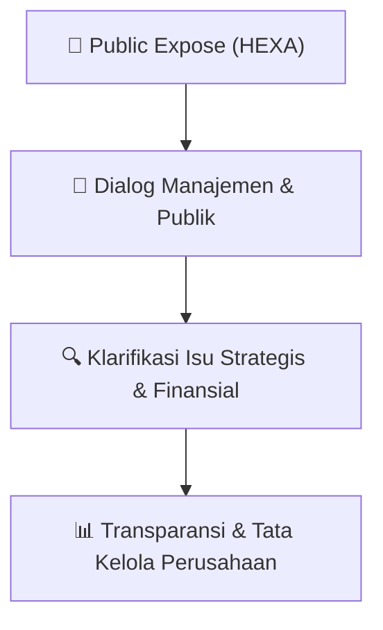

# 🎤 Laporan Hasil Public Expose: [HEXA]

🏢 **Emiten**: `HEXA` | 📅 **Tanggal Pelaksanaan**: `2026-09-22` | ❓ **Total Pertanyaan**: `12 Pertanyaan`
⬅️ [[knowledge-base/daily-digests/HEXA_20260922|Kembali ke Daily Digest]] | 🎛️ [[Dashboard/HEXA|Ke Dashboard Emiten]]

> [!IMPORTANT]
> Dokumen ini memuat seluruh risalah hasil pelaksanaan dan sesi tanya jawab (Q&A) Public Expose HEXA. Informasi dicatat secara verbatim guna memberikan analisis sentimen dan arah kebijakan manajemen bagi investor.

---

## ℹ️ 1. Informasi Penyelenggaraan & Kehadiran

| Parameter | Detail Pelaksanaan |
|---|---|
| **Nomor Surat** | 052/HEXA/9034/IX/2026 |
| **Perihal** | Laporan Hasil Public Expose Tahunan |
| **Waktu Pengumuman** | 22-09-2026 10:35 |
| **Jumlah Kehadiran Peserta** | Penyampaian Hasil Public Expose |
| **Lampiran Berkas** | `1` |

---

## 💬 2. Risalah Tanya Jawab Manajemen & Investor (12 Pertanyaan)

### ❓ Pertanyaan #1

> **Penanya**: *Investor / Analis Publik*

```text
Pertanyaan:
1. 
Ikhtisar kinerja operasional dan keuangan 
Perseroan
```

💡 **Jawaban & Klarifikasi Manajemen**:

> *Teks tanggapan manajemen tidak tersedia*

---

### ❓ Pertanyaan #1

> **Penanya**: *Investor / Analis Publik*

```text
Pertanyaan:
1. Bapak Dwi Swasono  
2. Bapak Yoshendri 
 
2. 
Tanya jawab 
1. Bapak Dwi Swasono  
2. Bapak Yoshendri
Hormat kami, 
PT Hexindo Adiperkasa Tbk
Listiana A. Kurniawati 
Corporate Secretary
DAFTAR HADIR  
PUBLIC EXPOSE  
PT HEXINDO ADIPERKASA TBK (HEXA)  
MS TEAMS/ VIRTUAL 
KAMIS, 17 SEPTEMBER 2026
Participants
No 
Name 
Instansi 
Nama Negara / Wilayah
1 
Listiana Kurniawati 
Corporate Sectetary HEXA
2 
Dwi Swasono 
Presiden Direktur HEXA
Indonesia 
 
3 
Yoshendri 
Direktur HEXA
4 
Nobuyasu Hagiwara 
Direktur HEXA
5 
Deni Pratama 
HEXA 
Indonesia
6 
Danang Nurdianjar 
HEXA 
Indonesia 
 
7 
Ine Noviane Asmara 
HEXA 
Indonesia 
 
8 
Daniel Lunan 
Analys 
Indonesia
9 
Willian Giovanni 
Investor Individu 
Indonesia
10 
Abhishek Sahoo 
Investor Individu 
Indonesia
11 
Daniel 
Investor Individu 
Indonesia
12 
Handiman Soetoyo 
Investor Individu 
Indonesia
13 
Arif Budhiyanto 
Investor Individu 
Indonesia 
 
14 
Phong Timothy Tanamal 
Investor Individu 
Indonesia
15 
Anitana Widya 
Media (Bisnis Indonesia) 
Indonesia 
 
16 
Vina Elvira 
Media (KONTAN) 
Indonesia
Dokumentasi saat Public Expose berlangsung
Dokumentasi saat Public Expose berlangsung
PT HEXINDO ADIPERKASA TBK
Public 
Expose
Day/Date: Thursday, 17 September 2026 
Venue  : Training Centre, Hexindo HO 
Speaker:
```

💡 **Jawaban & Klarifikasi Manajemen**:

> Indonesia
> 
> Indonesia
> 
> Indonesia

---

### ❓ Pertanyaan #1

> **Penanya**: *Investor / Analis Publik*

```text
Pertanyaan:
1. Dwi Swasono 
President Director 
2. Yoshendri 
Finance Director 
Moderator 
Listiana A. K 
Corporate Secretary 
 
Sesi Tanya Jawab (Q & A Session)
seberapa besar pengaruh nilai tukar, 
kebijakan pajak, dan kondisi harga 
komoditas  terhadap  tren ini,  serta 
strategi  apa  yang  disiapkan  untuk 
membalikkan 
tren 
tersebut 
mencermati marjin laba Perseroan 
terus 
menurun 
beberapa 
tahun 
terakhir 
dan 
berlanjut 
di 
kuartal 
pertama tahun buku 2026?
Please give us the management 
explanation in regards of how much the 
exchange rate, tax policies, and 
commodity 
price 
conditions 
are 
affecting this trend, and what strategies 
are being prepared to reverse it, 
considering 
the 
Company's 
profit 
margins have been declining over the 
past few years and continued into the 
first quarter of FY2026?
```

💡 **Jawaban & Klarifikasi Manajemen**:

> Perseroan menggunakan USD$ sebagai 
> Official 
> Currency 
> dalam 
> Laporan 
> Keuangan dan sesuai dengan regulasi 
> yang berlaku di Indonesia bahwa transaksi 
> yang 
> dilakukan 
> di 
> Indonesia 
> harus 
> menggunakan mata uang rupiah (IDR), 
> Perseroaan 
> melakukan 
> transaksi 
> pembelian inventori dengan mata uang 
> US$, Apabila nilai tukar mata uang IDR 
> melemah 
> maka 
> akan 
> berpengaruh 
> terhadap nilai transaksi yang dilakukan 
> Perseroan. Dalam kondisi seperti ini 
> apabila 
> Perseroan 
> mempertahankan 
> margin 
> yang 
> sama, 
> maka 
> harus 
> menaikkan harga jual. Perseroan tidak 
> mungkin serta merta langsung menaikkan 
> harga jual kepada pelanggan karena juga 
> harus mempertimbangkan faktor lain 
> seperti 
> tingkat 
> persaingan 
> dengan 
> kompetitor dan harga jual yang ditawarkan 
> . Ada kalanya Perseroan juga melakukan 
> penyesuaian pada harga jual yang mana 
> berefek langsung pada pengurangan 
> margin penjualan yang akan didapat oleh 
> Perseroan.
> 
> The Company uses USD$ as the official 
> currency in its financial statements, and 
> according to regulations in Indonesia, 
> transactions conducted in Indonesia must 
> use the rupiah (IDR). The company carries 
> out inventory purchase transactions in 
> US$. If the IDR exchange rate weakens, it 
> will affect the value of the transactions 
> made by the Company. In such a situation, 
> if the company wants to maintain the same 
> margin, it will need to raise the selling 
> price. However, the company cannot 
> immediately raise prices for customers 
> because it also needs to consider other 
> factors like competition and the selling 
> prices offered. Sometimes the company 
> also adjusts selling prices, which directly 
> affects the reduction of sales margins.
> 
> Saat ini Perseroan sedang mempelajari 
> apakah  penggunaan  mata  uang US$ 
> dalam transaksi dinilai cukup efektif dan 
> dapat 
> dilanjutkan 
> atau 
> sebaliknya 
> merubah menggunakan mata uang IDR
> 
> Currently, 
> the 
> company 
> is 
> studying 
> whether using US dollars in transactions is 
> considered effective enough to continue or 
> if it should switch to using IDR currency.
> 
> Terkait dengan kebijakan pajak saat ini 
> Pemerintah sedang menaruh perhatian 
> terhadap implementasi transfer pricing. 
> Aktivitas utama Perseroan adalah menjual 
> produk dalam negeri dan saat ini kebijakan 
> pajak belum berpengaruh banyak pada 
> aktiviats Perseroan.
> 
> Regarding the current tax policy, the 
> government is paying attention to the 
> implementation of transfer pricing. The 
> company's main activity is selling domestic 
> products, and now, tax policies haven’t 
> had much impact on the company’s 
> activities.
> 
> Terkait dengan harga komoditas, terutama 
> tambang; batubara, juga agro palm oil 
> (CPO), kerta (pulp) memang sangat 
> berpengaruh terhadap perusahaan yang 
> bergerak di bisnis alat berat seperti 
> Perseroan. Perseroan terus mencermati 
> tren penurunan ataupu peningkatan harga 
> harga komoditas.
> 
> Related to issue of commodity prices, 
> especially mining commodities like coal, 
> as well as agro products like palm oil 
> (CPO) 
> and 
> pulp. 
> Any 
> changes 
> of 
> commodities price will affect to the 
> company that operates in the heavy 
> equipment business like Hexindo. The 
> company continues to monitor trends in 
> the rise or fall of commodity prices

---

### ❓ Pertanyaan #2

> **Penanya**: *Investor / Analis Publik*

```text
Pertanyaan:
Q2. 
Bagaimana kepentingan pemegang Pak Dwi Swasono
saham 
publik 
dilibatkan 
dalam 
keputusan besar seperti ini, dan 
bagaimana kesiapan hukum serta 
kontraktualnya 
mengingat 
dengan 
mayoritas 
saham 
dikuasai 
afiliasi 
Jepang, 
dan 
adanya 
rencana 
perubahan 
nama 
merek 
Hitachi 
menjadi LANDCROS di 2027?
How are the interests of public 
shareholders involved in big decisions 
like this, and how ready are the legal 
and contractual aspects, considering 
that majority of shares are controlled 
by Japanese affiliates, and there’s a 
plan to change the Hitachi brand name 
to LANDCROS in 2027?
```

💡 **Jawaban & Klarifikasi Manajemen**:

> Perubahan nama LANDCROS ini adalah 
> langkah baru dalam menghadirkan inovasi 
> baru dalam industri alat berat, awalnya 
> Hitachi (dalam hal ini HCM Japan) fokus 
> hanya pada ekskavator dan kedepan akan 
> ekspansi ke produk produk alat berat 
> lainnya selain ekskavator, wheel loader & 
> rigid dump truck. Secara resmi perubahan 
> nama ini baru akan dimulai pada 1 April 
> 2027, dan sebelum kesana, dalam hal ini 
> HCM Jepang telah melakukan banyak 
> persiapan baik dilakukan ke pihak pihak 
> eksternal 
> dengan 
> mempublikasikan 
> melalui berbagai media publik, juga ke 
> internal – ke anak anak perusahaannya 
> seperti halnya ke pihak Hexindo. 
> Secara 
> produk 
> dan 
> kualitas, 
> dapat 
> dipastikan tidak ada yang berubah dengan 
> perubahan nama ini.
> 
> The name change to LANDCROS is a new 
> step in bringing fresh innovations to the HE 
> industry. Initially, Hitachi (in this case HCM 
> Japan) focused only on excavators, wheel 
> loader & rigid dump truck. but 
> moving forward, it will expand to other
> 
> heavy equipment products. Officially, this 
> name change will be effective on April 1, 
> 2027, and before that, HCM Japan has 
> already done a lot of preparations, both 
> externally by publishing through various 
> media and internally to its subsidiaries, 
> including Hexindo.
> 
> In terms of products and quality, it’s 
> guaranteed that nothing will change with 
> this name change.

---

### ❓ Pertanyaan #3

> **Penanya**: *Investor / Analis Publik*

```text
Pertanyaan:
Q3. 
Apa evaluasi manajemen atas hal ini, Pak Yoshendri
dan perbaikan apa yang dilakukan 
agar proyeksi ke depan lebih akurat 
dan andal bagi investor mengingat 
realisasi tahun buku 2025 cukup jauh 
meleset dari target internal Perseroan 
sendiri ?
What is management's assessment of 
this, and what improvements are being 
made to ensure future projections are 
more 
accurate 
and 
reliable 
for 
investors, considering that the FY2025 
actual results are quite far off the 
company's own internal targets?
```

💡 **Jawaban & Klarifikasi Manajemen**:

> Terkait prroyeksi 2026 yang tidak tercapai 
> lebih banyak dipengaruhi oleh faktor 
> foaktor eksternal seperti situasi global 
> yang memanas yang ikut mempengaruhi 
> harga 
> komoditas 
> seperti 
> batubara, 
> kebijakan Pemerintah terkait industri alat 
> berat, termasuk perubahan nilai tukar 
> yang sulit terprediksi oleh perseroaan. 
> Kedepan, Perseroan akan lebh berhati 
> hati dalam membuat proyeksi kinerja 
> keuangan agar tidak terlalu jatuh dari 
> aktual pencapaiannya.
> 
> The 2026 projection not being achieved 
> was mostly influenced by external factors, 
> such as the heated global situation 
> affecting commodity prices like coal, 
> government policies related to the heavy 
> equipment industry, and unpredictable 
> exchange rate changes. Moving forward, 
> the company will be more careful in 
> making financial performance projections, 
> so the forecast don’t fall too far from actual 
> achievements.

---

### ❓ Pertanyaan #4

> **Penanya**: *Investor / Analis Publik*

```text
Pertanyaan:
Q4. 
Bagaimana manajemen memastikan 
ekspansi ini tidak mengalihkan fokus 
dan sumber daya dari bisnis inti yang 
saat 
ini 
sedang 
membutuhkan 
penguatan 
mencermati 
Perseroan 
tengah merambah beberapa lini baru 
seperti WIXIM, truk Foton, dan aplikasi 
berbasis AI.
How does management make sure this 
expansion doesn’t divert focus and 
resources from the core business, 
which 
currently 
needs 
some 
strengthening, considering the company 
is venturing into several new lines like 
WIXIM, Foton trucks, and AI-based 
applications?
Pak Timothy –Individual Investor 
Q5. 
Dengan 
adanya 
kenaikan 
harga 
komoditas CPO dan batubara yang 
dipengaruhi dampak El Nino, apakah 
besar dampak ini ke peningkatan 
penjualan unit di sector agro dan 
mining sampai dengan akhir tahun 
2026?
With the rise in CPO and coal prices 
influenced by the impact of El Nino, 
how big will the impact be on the 
increase in unit sales in the agro and 
mining sectors until the end of 2026?
```

💡 **Jawaban & Klarifikasi Manajemen**:

> Pak Dwi Swasono 
> Diharapkan 
> sejalan 
> dengan 
> adanya 
> rebranding LANDCROS,maka Hexindo 
> terus berkembang dengan bertambahnya 
> portfolio produk produk yang dijualnya, 
> dapat lebih memenuhi permintaan pasar 
> yang makin beragam dan terjangkau oleh 
> pelanggan. Untuk memenuhi kebutuhan
> 
> pelanggan tersebut, kita juga melengkapi 
> dengan sumber daya manusia yang 
> mumpuni.
> 
> It is hoped that along with the rebranding 
> of LANDCROS, Hexindo will continue to 
> grow with an increasing portfolio of 
> products it sells, being able to better meet 
> the increasingly diverse market demands 
> and be more accessible to customers. To 
> meet these customer needs, we also 
> equip ourselves with competent human 
> resources.
> 
> Pak Dwi Swasono 
> Kontributor terbesar bagi Hexindo adalah 
> sektor agro , Sejauh ini sektor agro tidak 
> melakukan revisi yang cukup siginifikan 
> atas proyeksi produksi sepanjang 2026 ini, 
> sehingga asumsinya nilai investasi pada 
> alat berat tidak mengalami perubahan dan 
> itu terbukti pada peluncuran produk foton 
> 4x2 beberapa waktu yang lalu, sektor agro 
> yang 
> terlebih 
> dulu 
> menyerap 
> untuk 
> kebutuhan ini, lumayan signifikan.
> 
> The biggest contributor to Hexindo is the 
> agro sector. So far, the agro sector hasn’t 
> made any significant revisions to the 
> production projections for 2026, so the 
> assumption is that the investment value in 
> heavy equipment hasn’t changed, and this 
> was evident from the launch of the Foton 
> 4x2 product a while ago, which the agro 
> sector, that had previously absorbed it for 
> this need, took up quite significantly.

---

### ❓ Pertanyaan #6

> **Penanya**: *Investor / Analis Publik*

```text
Pertanyaan:
Q6. 
Meskipun saat ini, perusahaan sedang 
mencari peluang di luar mining, namun 
dengan adanya revisi RKAB batubara 
yang sedang difinalisasi saat ini, 
apakah sudah diperhitungkan dampak
dari perubahan ini ke penjualan unit melakukan proyeksi inventori sepresisi
khususnya di sector mining?
Even though right now the company is 
looking for opportunities outside of 
mining, with the current revision of the 
coal RKAB being finalized, has the 
impact of this change on unit sales, 
especially in the mining sector, been 
considered?
```

💡 **Jawaban & Klarifikasi Manajemen**:

> Pak Dwi Swasono: 
> Sementara itu untuk kondisi di sektor 
> tambang, di beberapa tambang sudah 
> melakukan penyesuaian RAKB, memang 
> masih ada yang stagnan, ada juga yang 
> sudah kearah membaik, yang pasti kami 
> harus   berhati-hati   karena   untuk
> 
> mungkin, hal ini karena ini adalah pos 
> yang terbesar bagi Hexindo, yang apabila 
> salah 
> perhitungan 
> maka 
> dapat 
> membebani perseroaan. Sejauh ini sudah 
> dilakukan sesi dengar pendapat dengan 
> asosiasi pertambangan dan pelanggan 
> besar di sektor tambang, asosiasi alat 
> berat juga sudah melakukan analisa, yang 
> pada 
> intinya 
> diketahui 
> mana 
> yang 
> memerlukan investasi, mana yang hanya 
> cukup 
> dengan 
> melakukan 
> refurbish 
> terhadap alat yang ada. sudah dilakukan 
> kalkulasi terkait hal ini.
> 
> Meanwhile, regarding the conditions in the 
> mining sector, some mines have already 
> adjusted their RAKB. There are still some 
> that are stagnant, and some are starting to 
> improve. One thing's for sure; we must be 
> careful when projecting inventory as 
> accurately as possible, because this is the 
> biggest portion for Hexindo, and any 
> miscalculation could become a burden for 
> the company. So far, we've held hearing 
> sessions with associations and major 
> customers. Heavy equipment associations 
> have also analysed what counts as an 
> investment 
> and 
> what 
> is 
> just 
> a 
> refurbishment, and calculations have 
> already been done to cover this issue.

---

### ❓ Pertanyaan #7

> **Penanya**: *Investor / Analis Publik*

```text
Pertanyaan:
Q7. 
Bagaimana cara HAP memastikan Pak Dwi Swasono:
market 
share 
termaintain 
ke 
depannya, yang turun dari 19.3% 
(tahun buku 2020) ke 16.7% di tahun 
buku 2025?
How does HAP make sure its market 
share stays maintained in the future, 
which dropped from 19.3% in FY2020 
to 16.7% in FY2025?
Handiman - Investor 
Q8 
Tahun ini manajemen menargetkan 
revenue USD589juta dan net profit 
USD18,4juta, sementara kuartal satu 
pendapatan baru mencapai USD 113,8 
juta dan net profit USD4,9 juta. Apa 
faktor pendorong akselerasi pada sisa 
tahun ini? Berapa persen target 
revenue 
yang 
sudah 
didukung 
order/backlog, khususnya untuk unit 
sales, 
dan 
berapa 
yang 
masih 
bergantung pada market recovery?
This year, management is targeting 
revenue of USD589 million and net 
profit of USD18.4 million, while Q1 
revenue 
only 
reached 
USD113.8 
million and net profit USD4.9 million. 
What are the driving factors for 
acceleration for the rest of this year? 
What percentage of the revenue target 
is already backed by orders/backlog, 
especially for the sales unit, and how 
much is still dependent on market 
recovery?
```

💡 **Jawaban & Klarifikasi Manajemen**:

> Untuk saat ini, Market share terbesar 
> memang berasal dari agro, Adapun urutan 
> 3 besar pangsa pasar adalah sektor : 
> Agro, 
> Konstruksi 
> dan 
> Kehutanan, 
> perhitungan pangsa pasar didapat dari 
> perbandingan kuantiti penjualan terhadap 
> permintaan pasar, kalau sektor tambang 
> secara volume cukup besar tapi bukan 
> menjadi faktor utama penentu besaran 
> pangsa pasar, tahun ini kami tetap optimis 
> pangsa  pasar  kami  diangka  18%. 
> Memang sedikit menurun dibandingkan
> 
> tahun 2023 tetapi meningkat dibanding 
> 2024 dan 2025 lalu, hal ini sejalan makin 
> banyaknya pemain baru dari luar Jepang 
> atau OEM Cina yang bermain di bisnis ini. 
> Dengan ceruk kue yang tetap sama, maka 
> tingkat persaingan dalam pangsa pasar 
> makin ketat. Namun 
> Hexindo 
> tetap 
> optimis bahwa kontribusi pangsa pasar 
> terbesar kami adalah adalah sektor agro.
> 
> The largest market share does indeed 
> come from the agro sector, with the 
> biggest contributions coming from three 
> sectors: agro, forestry, and mining. The 
> market share calculation comes from 
> comparing sales quantity against demand. 
> For the mining sector, the volume is quite 
> large, but it’s not the determining factor for 
> the size of market share. This year, we’re 
> still optimistic that our market share will be 
> around 18%. It did decrease a bit 
> compared 
> to 
> 2023 
> but 
> increased 
> compared to 2024 and 2025 which aligns 
> with the increasing number of new players 
> from outside Japan or Chinese OEMs 
> entering this business. With the pie still the 
> same size, so the level of competition for 
> market share is getting tighter. But 
> Hexindo remains optimistic that our 
> biggest market share contribution is from 
> the agro sector.
> 
> Pak Yoshendri (added by Pak Dwi 
> Swasono): 
> Manajemen 
> optimis 
> dapat 
> mencapai 
> target penjualan sebesar USD589juta, 
> saat ini ada beberapa backlog order yang 
> masih terpending pengirimannya – dari 
> mining customer, yang masih menunggu 
> keluarnya RAKB. Saat ini RAKB juga 
> sudah 
> keluar, 
> harapannya 
> aktivitas 
> tambang 
> akan 
> segera 
> membaik. 
> Perseroan juga mengantisipasi kenaikan 
> permintaan 
> pasar 
> di 
> sektor 
> agro 
> sejalannya 
> kenaikan 
> harga
> 
> CPO,harapannya 
> Perseroan 
> dapat 
> mengambil kesempatan dari kenaikan 
> demand ini. Di kuartal satu yang berakhir 
> Jun i 2026 lalu, memang kami belum 
> berhasil mengirimkan ekskavator jenis 
> Giant Machine karena isu RAKB yang 
> baru rilis di kuartal dua.Dengan telah 
> dirilisnya RAKB, maka outstanding order 
> kami sampai dengan Februari 2027 akan 
> segera direalisasikan utamanya kelas 120 
> Ton & 200 Ton.
> 
> Management is optimistic about reaching 
> a sales target of USD 589 million. 
> Currently, there are some backlog orders 
> still pending shipment – mainly from 
> mining customers who have been waiting 
> for the release of RAKB. Now that RAKB 
> has been released, hopefully mining 
> activities will soon improve. The company 
> is also anticipating increased demand in 
> the agro sector along with the rise in CPO 
> prices and hopes to take advantage of this 
> demand surge. In the first quarter ending 
> June 2026, we were not delivering our 
> giant Machine excavators due to RAKB 
> issues, which were only resolved in 
> second quarter. With RAKB now out, our 
> outstanding orders up to February 2027 
> will be fulfilled soon, mainly the 120 Ton & 
> 200 Ton classes.

---

### ❓ Pertanyaan #9

> **Penanya**: *Investor / Analis Publik*

```text
Pertanyaan:
Q9. 
Bagaimana economics dari Foton dan 
WIXIM dibandingkan merek Hitachi 
secara gross margin, working capital 
requirement, after sales revenue, dan 
return on capital? 
Apakah ini lebih ditujukan untuk 
meningkatkan volume / pangsa pasar 
atau kontributor profitabilitas yang 
setara?
How do the economics of Foton and 
WIXIM compare to Hitachi in terms of 
gross   margin,   working   capital
requirement, after-sales revenue, and 
return on capital? 
Is this aimed at boosting volume / 
market 
share 
or 
contributing 
to 
profitability on an equal level?
```

💡 **Jawaban & Klarifikasi Manajemen**:

> Pak Dwi Swasono: 
> Perseroan 
> mengharapkan 
> adanya 
> peningkatan baik dari sisi kuantiti dan 
> volume yang dapat berdampak pada 
> peningkatan 
> pangsa 
> pasar 
> maupun 
> menyumbangkan 
> profitabilitas 
> tinggi 
> selain produk utama Hitachidari semua lini 
> termasuk Foton & besutan terbaru WIXIM. 
> Contohnya bulldozer tidak dimiliki oleh 
> Hitachi, jadi dengan adanya WIXIM 
> bulldozer melengkapi jajaran alat berat 
> yang kami milki, demikian pula dengan 
> truk Foton 4x2. Sebelumnya kami banyak
> 
> kehilangan kesempatan di pasar ini 
> karena tidak memilki jajaran di product line 
> kami. Respon pasar cukup baik dengan 
> kedua produk dan persaingan dikedua 
> pasar ini makin bergairah. Harapannya 
> target market share dan kontribusi dari sisi 
> profit menjadi harapan Perseroan.
> 
> The company expects an increase both in 
> terms of volume, which will impact market 
> share, 
> as 
> well 
> as 
> contribute 
> high 
> profitability from all lines, including Foton 
> and the latest WIXIM products. Up to now, 
> Hitachi is not producing bulldozers, so 
> having WIXIM bulldozers complements 
> the HE lineup we have, as does the Foton 
> 4x2 truck. Previously, we lost many 
> opportunities in this market because we 
> didn’t have certain products in our line. 
> The market response has been quite good 
> for both products, and competition in these 
> two markets is heating up. The target 
> market share and profitability contribution 
> will meet the company’s expectations.

---

### ❓ Pertanyaan #9

> **Penanya**: *Investor / Analis Publik*

```text
Pertanyaan:
Q9. 
Penurunan cash flow operasional di 
kuartal satu apakah menandakan 
penurunan aktivitas bisnis atau hanya 
perbedaan waktu penerimaan dan 
pembayaran?
Does the drop in operational cash flow 
in first quarter indicate a slowdown in 
business activity or just a timing 
difference 
between 
receipts 
and 
payments??
Aritana – Bisnis Indonesia 
Q10. Bagaimana 
pelemahan 
kinerja 
semester satu 2026 apakah ada revisi 
u penjualan dan laba bersih? Ke level 
berapa dan bagaimana target akhir 
tahun?
How is the performance decline for first 
semester 
2026? 
Are 
there 
any 
revisions to sales and net profit? To 
what level, and what is the year-end 
target?
```

💡 **Jawaban & Klarifikasi Manajemen**:

> Pak Yoshendri: 
> Penurunan cash flow operasional di 
> kuartal satu dari tahun sebelumnya 
> sebesar USD 6juta menjadi USD 5juta, 
> dikarernakan adanya penurunan aktivitas 
> bisnis utamanya di rental sales, yang turun 
> sebesar 8%. Perseroan tetap optimis 
> target tahun fiscal 2026 akan tercapai 
> sesuai target yang ditetapkan.
> 
> The decrease in operational cash flow in 
> the first quarter from the previous year 
> from USD6 million to USD5 million was 
> due to a drop in main business activities 
> during first quarter compared to the same 
> period last year in rental sales, which fell 
> by 8%. The company remains optimistic 
> that the fiscal year 2026 target will be 
> achieved as planned.
> 
> Pak Yoshendri: 
> Kinerja yang telah kami laporkan ke 
> regulator adalah baru kuartal1 tahun buku 
> 2026. 
> Adanya 
> penurunan 
> dari 
> sisi 
> penjualan USD9,5 juta ( +8%) dan gross 
> profir sebesar 19%. Mengenai target akhir 
> tahun, Perseroan tetap optimis akan 
> tercapai diakhir tahun, salah satu karena 
> alasan yang telah dijelaskan sebelumnya
> 
> The performance we have reported to the 
> regulator is for the first quarter of the 2026 
> fiscal year. There has been a decrease in 
> sales of USD 9.5 million (+8%) and a gross 
> profit of 19%. Regarding the year-end 
> target, the company remains optimistic 
> that it will be achieved by the end of the 
> year, partly for the reasons previously 
> explained.

---

### ❓ Pertanyaan #11

> **Penanya**: *Investor / Analis Publik*

```text
Pertanyaan:
Q11. Berapa 
capex 
tahun 
ini 
dan 
realisasinya untuk apa saja?
What's this year's capex and what has 
it been used for?
```

💡 **Jawaban & Klarifikasi Manajemen**:

> Kami 
> mealokasikan 
> anggaran 
> capex 
> sebesar USD10,9juta, dengan alokasi 
> USD3,3juta untuk investasi rental mesin, 
> alokasi USD2,7juta untuk peremajaan 
> fixed asset- operational vehicle. Sejauh ini 
> penggunaan capex baru 20% dari total 
> anggaran yang dibuat. Untuk rental 
> machine sejauh ini belum terealisasi, saat 
> ini, 
> Perseroan 
> sedang 
> melakukan 
> negosiasi untuk rental machine dan 
> diharapkan dapat direalisasikan di paruh 
> semester dua mendatang.
> 
> We’ve budgeted capex of USD 10.9 
> million, with USD 3.3 million allocated for 
> machine rentals and USD 2.7 million for 
> rejuvenating 
> fixed 
> assets 
> such 
> as 
> operational vehicles. So far, only 20% of 
> the total budgeted capex has been used. 
> As for the machine rentals, nothing has 
> been realized yet; currently, the company 
> is negotiating for the rentals, and it’s 
> expected to be carried out in the second 
> half of the year.

---

### ❓ Pertanyaan #12

> **Penanya**: *Investor / Analis Publik*

```text
Pertanyaan:
Q12. Apakah kinerja juga mendapat tekanan
dari penjualan alat berat China? 
Bagaimana menyiasatinya?
Is performance also under pressure 
from Chinese heavy equipment sales? 
How can it be managed?
Bagaimana strategi akhir tahun ini 
untuk memulihkan tekanan kinerja dan 
mengurangi 
ketergantungan 
dari 
tambang? Apakah ada diversifikasi 
portofolio 
ke 
hybrid 
untuk 
mengantisipasitekanan 
operasional 
dari kenaikan BBM?
What's 
the 
year-end 
strategy to 
recover performance pressure and 
reduce dependence on mines? Is there 
any portfolio diversification into hybrids 
to anticipate operational pressure from 
fuel price increases?
manufacturers will head in that direction to 
create heavy equipment of these types. 
Vina - Kontan 
Q13. Bagaimana 
update 
kinerja 
HEXA 
hingga 
September 
2026 
dan 
bagaimana 
pencapaiannya 
dibandingkan target tahun buku2026?
How's HEXA's performance update 
until September 2026, and how does it 
compare  to  the  FY2026  targets?
Dengan sisa waktu hingga Maret 2027, 
bagaimana proyeksi pendapatan dan 
laba HEXA untuk tahun buku 2026? 
Apakah target masih on track?
With the remaining time until March 
2027, what are the revenue and profit 
projections for HEXA for FY2026? Are 
the targets still on track?
Bagaimana perkembangan penjualan 
dan permintaan rental machine hingga 
saat ini, termasuk kontribusi dari sektor 
pertambangan, 
konstruksi, 
dan 
perkebunan?
How are the sales and demand for 
heavy 
equipment 
going 
so 
far, 
including contributions from the mining, 
construction, and plantation sectors?
Apa tantangan utama yang dihadapi 
HEXA 
pada 
paruh 
kedua 
tahun 
buku2026, terutama terkait harga 
komoditas, permintaan alat berat, dan 
persaingan?
What are the main challenges HEXA 
will face in the second half of FY2026, 
especially regarding commodity prices, 
demand for heavy equipment, and 
competition?
Bagaimana 
perkembangan 
rental, 
spare parts, dan after-sales service 
hingga saat ini, serta kontribusinya 
terhadap 
kinerja 
HEXA?
How are the rental, spare parts, and 
after-sales services developing so far, 
and how do they contribute to HEXA's 
performance?
Berapa realisasi dan sisa capex tahun 
buku 2026, serta apa saja fokus 
penggunaan 
capex 
hingga 
Maret 
2027?
How much of the FY2026 capex has 
been realized and what's left, and what 
are the main focuses for using capex 
until March 2027?
Untuk tahun buku 2027, bagaimana 
gambaran awal manajemen terkait 
prospek bisnis, permintaan alat berat, 
dan strategi pertumbuhan HEXA? 
For FY2027, what's the management's 
initial outlook on business prospects, 
demand for heavy equipment, and 
HEXA's growth strategy?
William, Publik 
Berapakah 
besaran 
dividen 
yang 
dibagikan 
dan 
pertimbangan 
manajemen 
dalam 
menentukan 
dividend payout ratio?
How much dividend is being distributed 
and what are the management's 
considerations in deciding the dividend 
payout ratio?
### 
###
PT Hexindo Adiperkasa Tbk - Corporate Secretary
US$0,013319 per Saham
Jakarta, 17 September 2026. PT Hexindo Adiperkasa Tbk, perusahaan publik yang 
bergerak di bidang perdagangan alat berat dan layanan purna jual untuk merek utama 
Hitachi, dalam Rapat Umum Pemegang Saham Tahunan (RUPST) telah menyetujui 
penyaluran dividen tunai kepada Pemegang Saham sebesar US$0,013319 per saham 
dari Laba Bersih tahun buku yang berakhir pada 31 Maret 2026 yang rencananya akan 
dibayarkan selambat lambatnya pada tanggal 21 Oktober 2026. Pada RUPST yang 
diselenggarakan sebelum Paparan Publik, persetujuan penggunaan laba bersih 
tahun buku yang berakhir pada 31 Maret 2026 sebesar KUS$$15.983 untuk 
penyaluran dividen tunai sebesar KUS$11.188 (70%) akan dibagikan sebagai 
dividen tunai, kepada para pemegang saham, yaitu sebanyak 840.000.000 saham.
Seperti dilansir dalam Paparan Publik, per Maret 2026 Hexindo berhasil melakukan 
penjualan sebesar KUS$515.423., sebagian besar berasal dari penjualan dan 
penyewaan alat berat sebesar KUS$348.915 (68%). Tercatat, 3.880 unit telah 
dikirimkan ke pelanggan dengan penjualan ekskavator sebanyak 3.164 unit dimana 
sektor pertanian diberikan kontribusi kuantitas penjualan tertinggi sebesar 1.409unit 
(44,5%) kemudian diikuti oleh sektor konstruksi sebesar 544unit (17.2%), sektor 
kehutanan dengan kontribusi 528unit (16.7%), sektor pertambangan dengan 
kontribusi 299unit (9.5%) dan lainnya dengan 384unit (12.1%). Hexindo 
memperkirakan jumlah penjualan unit ekskavator di atas 6 ton sebesar 3.094unit 
untuk tahun fiskal ini dan hingga Juni 2026 telah terjual total 905-unit dengan 863 unit 
ekskavator termasuk 42-unit Mini ekskavator. Sementara itu, penjualan hingga Juni 
2025 mencapai KUS$113.797, laba kotor hingga Juni 2026 mencapai KUS$21.177 
dan laba bersih mencapai KUS$4.915. 
Ringkasan kinerja keuangan Hexindo dari bulan April hingga Juni 2026, sebagai 
berikut:
DESCRIPTION
FY2025 
1stQ FY2026 
FY2026 
PROJECTION 
Target 
Audited Result
Unaudited
Net Revenues 
549.512
515.423
113.797
589.375
Gross Profit 
101.827
90.183
21.117
95.082
Operating Profit 
37.954
27.649
6.870
28.841
Profit of the year 
22.549
15.983
4.915
18.384
CAPITAL STRUCTURE
Current Liabilities 
253.120
221.698
219.078
226.619
Non Current Liabitlities 
17.947
20.334
20.757
20.016
Total Liabilties 
271.067
242.032
239.835
246.635
Total Equity 
183.785
165.000
169.915
171.871
Total Liabiltieis & Equity 
454.852
407.032
409.750
418.506
```

💡 **Jawaban & Klarifikasi Manajemen**:

> Pak Dwi Swasono: 
> Penguatan after sales service (purna jual) 
> menjadi salah satu kunci terpenting bagi 
> Perseroan 
> untuk 
> unggul 
> dari 
> para 
> kompetitornya. Disamping itu, adanya 
> network outlet yang yang tersebar lebih 
> dari 50 lokasi di seluruh Indonesia,adalah 
> nilai lebih. Dengan makin banyaknya OEM 
> Cina 
> yang 
> masuk 
> ke 
> Indoensia, 
> penguatan-penguatan 
> terus 
> dilakukan 
> agar produk prroduk besutan Perseroan 
> semakin diakui di pasaran, dengan 
> dukungan purna jual yang kuat. Demikian 
> halnya dengan peluncuran produk baru - 
> WIXIM yang harganya sejauh ini dapat 
> diterima pasar, harapannya dapat turut 
> memperkuat jajaran produk Hexindo dan 
> meningkatkan penjualan kami. 
> Saat ini pabrikan kami sedang bekerja 
> terkait produk hybrid dan E&V, sejalannya 
> dengan konisi sumber daya fosil yang 
> makin terbatas tentu saja mau tidak mau 
> semua pabrikan akan mengarah kesana 
> untuk menciptakan alat berat dengan jenis 
> tersebut.
> 
> Strengthening 
> after-sales 
> service 
> is 
> becoming one of the most important keys 
> for the company to excel over its 
> competitors. In addition, having a network 
> of outlets spread over more than 50 
> locations across Indonesia is a plus. With 
> more Chinese OEMs entering Indonesia, 
> continuous strengthening is carried out so 
> that 
> the 
> company’s 
> products 
> are 
> increasingly recognized in the market, 
> supported by strong after-sales service. 
> Likewise, with the launch of the new 
> product - WIXIM, which so far has been 
> accepted by the market, it is hoped that it 
> can also strengthen Hexindo' s product 
> lineup and boost our sales. 
> Currently, our manufacturer is working on 
> hybrid and E&V products. Alongside the 
> condition  of  increasingly  limited  fossil 
> resources, of course sooner or later all
> 
> Pak Yoshendri: 
> Saat ini Perseroaan baru mem-publish 
> kuartal satu fiskal 
> Penjelasan pencapaian kuartal pertama 
> sebagaimana disampaikan pada materi 
> PE yang telah dilaporkan ke regulator 
> yakni
> 
> Perseroan tetap opimis dapat mencapat 
> target yang te;ah ditetapkan untuk tahun 
> Proyeksi di akhir agustus masih sangat 
> positif – sama dengan FY2025sedikit lebih 
> lebih baik dari sisi demand, optimis 
> dengan demand yang baik ini Di semester 
> dua ini perseroaan terus melakukan 
> perbaikan dan memanfaat setipa peluang 
> bisnis yang ada.
> 
> Currently, the Company has just published 
> its first fiscal quarter.
> 
> The 
> explanation 
> of 
> the 
> first-quarter 
> achievements, as presented in the PE 
> material submitted to the regulator, is that 
> the Company remains optimistic about 
> reaching the targets set for the year. The 
> projections at the end of August are still 
> very positive – like FY2025, slightly better 
> in terms of demand, and optimistic with 
> this strong demand. In the second half of 
> the year, the company continues to make 
> improvements and take advantage of 
> every business opportunity available.
> 
> DESCRIPTION
> 
> 1stQ FY2026 
> FY2026 
> PROJECTION 
> % 
> Unaudited
> 
> Net Revenues 
> 113.797 
> 589.375 
> 19%
> 
> Gross Profit 
> 21.117 
> 95.082 
> 22%
> 
> Operating Profit 
> 6.870 
> 28.841 
> 24%
> 
> Profit of the year 
> 4.915 
> 18.384 
> 27%
> 
> Prospek bisnis rental masih ada, dan kami 
> lebih selektif dalam bisnis ini juga terus 
> melakukan analisa terhadap demand yang 
> ada untuk kuartal dua & tiga dan 
> memanfaatkan setiap peluang yang ada.
> 
> Kontribusi terbesar untuk bisnis suku 
> cadang dan servis adalah dari sektor 
> mining. 
> RAKB 
> baru 
> saja 
> baru 
> disesuaikan– ada yang sudah release ada 
> juga yang masih suspend. Pasar dari 
> sektor ini memang lebih menantang di 
> tahun 
> 2026 
> ini. 
> Sejalannya 
> dengan 
> peluncuran 
> produk 
> baru, 
> Perseroan 
> berharap penjualan suku cadang & servis 
> dari produk baru ikut berkontribusi banyak 
> bagi Perseroan. Sementara jasa servis, 
> yang 
> kontriusinya 
> terbesarnya 
> juga 
> berasal dari sektor tambang yang mana 
> banyak kontraktor tambang besar dengan 
> RAKB yang sudah dikeluarkan yang mela 
> kukan evaluasi memperpanjang lifetime 
> maintenance 
> mesin 
> mesinnya, 
> yang 
> berefek pada penurunan penggunaan jasa 
> servis Perseroan.
> 
> The prospect of rental business is still 
> ongoing, and we’re being more selective in 
> this business while continuing to analyse 
> the existing demand for the second and 
> third quarters and taking advantage of 
> every opportunity available.
> 
> The biggest contribution to the spare parts 
> and service business comes from the 
> mining sector. RAKB has just been 
> adjusted – some have been released while 
> others are still suspended. The market in 
> this sector is indeed more challenging in 
> 2026. Along with the launch of new 
> products, the company hopes that sales of 
> spare parts & services from the new 
> products will also contribute significantly to 
> the Company.
> 
> Meanwhile, for service, which also gets its 
> biggest contribution from the mining 
> sector, many large mining contractors with 
> released RAKB are evaluating extending 
> the 
> lifetime 
> maintenance 
> of 
> their 
> machines, which affects the decrement of 
> the company's service offerings
> 
> Sudah 
> dijelaskan 
> sebelumnya 
> pada 
> pertanyaan sebelumnya.. 
> already explained before on the previous 
> question.
> 
> Pak Dwi Swasono: 
> Pembahasan mengenai proyeksi untuk 
> outlook 2027 biasanya baru kami bahas 
> pada akhir kuartal ketiga mendatang. 
> Namun kalau kita lihat permintaan pasar 
> akan ekskavator masih menunjukkan 
> peningkatan dan trend positif artinya 
> parameter positif masih bisa dicapai oleh 
> Perseroan sejalan dengan permintaan 
> pasar tersebut.
> 
> Discussion about projections for outlook 
> 2027 is usually something we only go over 
> in the next third Quarter. But if we look at 
> market demand for excavators, it’s still 
> showing an increase, and the demand for 
> wheel loaders is the same, which means 
> positive parameters can still be achieved 
> by the company in line with that market 
> demand.
> 
> Pak Yoshendri: 
> Sebagaimana telah diputuskan dalam 
> RUPS Tahunan 2026 tadi pagi sebesar 
> KUSD11.188 (70%) dari net profit sebesar
> 
> KUSD.15.893., untuk dividend payoutnya 
> adalah USD0.013319/share 
> Yang 
> menjadi 
> dasar 
> pertimbangan 
> berdasarkan 
> kondisi 
> cash 
> flow 
> perseroaan, dan rencana investasi dan 
> kebutuhan 
> modal 
> kerja, 
> manajemne 
> menngusulakna pdividend payour ratio 
> sebagaiman yang dibayarkan pada tahun 
> fiscal 2024 lalu.
> 
> As decided in the 2026 Annual GMS this 
> morning, KUSD 11,188 (70%) of the net 
> profit of KUSD 15,893 will be used for the 
> dividend payout, which amounts to USD 
> 0.013319 per share.
> 
> The consideration is based on the 
> company's cash flow situation, investment 
> plans, and working capital needs, and for 
> that 
> purpose 
> the 
> management 
> is 
> proposing a dividend payout ratio like what 
> was paid in fiscal year 2024.

---

## 📌 3. Peta Jalur Transparansi & Kepercayaan Pasar



---

*Dokumen diolah otomatis oleh **Swarm Intelijen Pasar Modal Indonesia** pada 2026-10-12 16:45 WIB.*