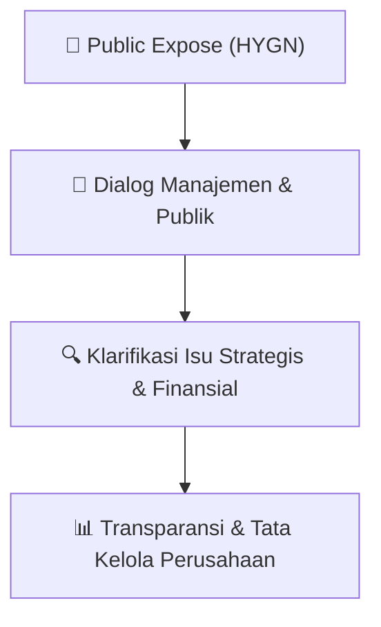

# 🎤 Laporan Hasil Public Expose: [HYGN]

🏢 **Emiten**: `HYGN` | 📅 **Tanggal Pelaksanaan**: `2026-09-23` | ❓ **Total Pertanyaan**: `1 Pertanyaan`
⬅️ [[knowledge-base/daily-digests/HYGN_20260923|Kembali ke Daily Digest]] | 🎛️ [[Dashboard/HYGN|Ke Dashboard Emiten]]

> [!IMPORTANT]
> Dokumen ini memuat seluruh risalah hasil pelaksanaan dan sesi tanya jawab (Q&A) Public Expose HYGN. Informasi dicatat secara verbatim guna memberikan analisis sentimen dan arah kebijakan manajemen bagi investor.

---

## ℹ️ 1. Informasi Penyelenggaraan & Kehadiran

| Parameter | Detail Pelaksanaan |
|---|---|
| **Nomor Surat** | 103/Corsec/09/2026/Pubex |
| **Perihal** | Laporan Hasil Public Expose Tahunan |
| **Waktu Pengumuman** | 23-09-2026 21:02 |
| **Jumlah Kehadiran Peserta** | Penyampaian Hasil Public Expose |
| **Lampiran Berkas** | `1` |

---

## 💬 2. Risalah Tanya Jawab Manajemen & Investor (1 Pertanyaan)

### ❓ Pertanyaan #3

> **Penanya**: *Investor / Analis Publik*

```text
Pertanyaan:
3. 
Indah – Investor 
Umum
Apakah dalam waktu 
dekat ini ada inovasi 
produk?
```

💡 **Jawaban & Klarifikasi Manajemen**:

> Pada tahun ini kita sudah 
> menciptakan beberapa unit 
> ada scent nano dengan 
> konsep tidak mengeluarkan 
> suara, dan kedua dengan

---

## 📌 3. Peta Jalur Transparansi & Kepercayaan Pasar



---

*Dokumen diolah otomatis oleh **Swarm Intelijen Pasar Modal Indonesia** pada 2026-10-12 16:45 WIB.*