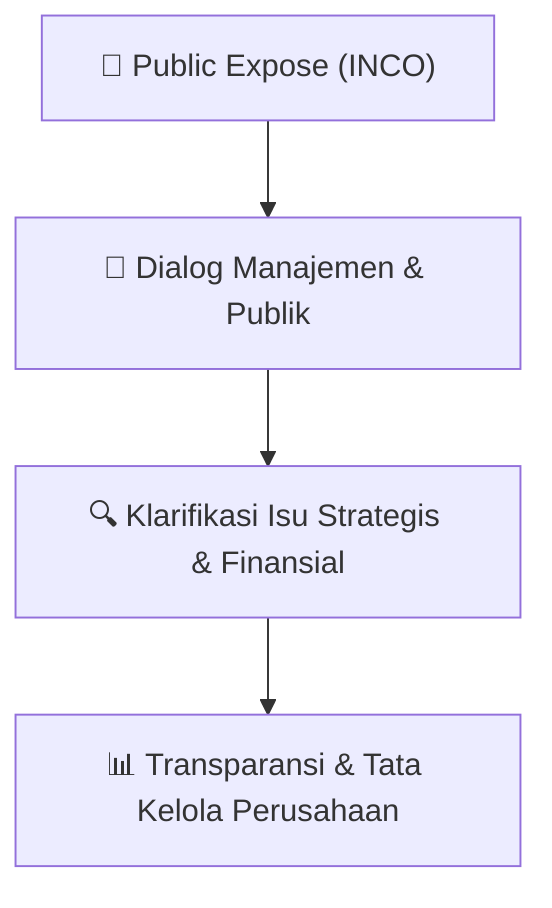

# 🎤 Laporan Hasil Public Expose: [INCO]

🏢 **Emiten**: `INCO` | 📅 **Tanggal Pelaksanaan**: `2026-09-16` | ❓ **Total Pertanyaan**: `1 Pertanyaan`
⬅️ [[knowledge-base/daily-digests/INCO_20260916|Kembali ke Daily Digest]] | 🎛️ [[Dashboard/INCO|Ke Dashboard Emiten]]

> [!IMPORTANT]
> Dokumen ini memuat seluruh risalah hasil pelaksanaan dan sesi tanya jawab (Q&A) Public Expose INCO. Informasi dicatat secara verbatim guna memberikan analisis sentimen dan arah kebijakan manajemen bagi investor.

---

## ℹ️ 1. Informasi Penyelenggaraan & Kehadiran

| Parameter | Detail Pelaksanaan |
|---|---|
| **Nomor Surat** | 01855/IR-J/IX/2026 |
| **Perihal** | Laporan Hasil Public Expose Tahunan |
| **Waktu Pengumuman** | 16-09-2026 15:46 |
| **Jumlah Kehadiran Peserta** | Penyampaian Hasil Public Expose |
| **Lampiran Berkas** | `1` |

---

## 💬 2. Risalah Tanya Jawab Manajemen & Investor (1 Pertanyaan)

### ❓ Pertanyaan #1

> **Penanya**: PT Vale Indonesia Tbk 
Jakarta: Sequis Tower, 20th Floor, Unit 6 & 7 - Jl. Jen

```text
Pertanyaan:
T. (62) 21 524 9000 F. (62) 21 524 9020 
Makassar: Jl. Somba Opu No. 281, Makassar 90113, Indonesia. T. (62) 411 366 9000  F. (62) 411 366 9020  
Sorowako: Main Office Plant Site Sorowako, Luwu Timur 92984, Indonesia. T. (62) 475 332 9100  F. (62) 475 332 9575 
www.vale.com/indonesia 
PT Vale Indonesia Tbk 
Public Expose Live 2026 & Konferensi Pers 
Jakarta, 10 September 2026 
 
Daftar Hadir: 
 
 
Direksi PT Vale 
 
 
Bernardus Irmanto 
 
Presiden Direktur & Chief Executive Officer 
Abu Ashar 
 
Wakil Presiden Direktur & Chief Operation and Infrastructure 
Officer 
Muhammad Asril 
 
Direktur & Chief Project Officer  
Rizky Andhika Putra 
 
Direktur & Chief Financial Officer 
 
 
 
Tim Pubex PT Vale 
 
 
Ranty Astari Rachman 
 
Chief of CEO Office and Corporate Secretary 
Andaru Adi 
 
Head of Corporate Finance & Investor Relations 
Lydia Yohana 
 
Senior Analyst Investor Relations 
Suwarny Dammar 
 
Senior Coordinator Communications 
Muhammad Evan Alwin 
 
Corp. Communications Officer 
Anggun Devaga 
 
Finance Intern 
 
Konferensi Pers: 
- 
Sesi pemaparan Public Expose Live 2026 dan konferensi pers PT Vale Indonesia Tbk (“PT 
Vale”) dibuka pada pukul 11.00 WIB oleh Moderator dari IDX, dilanjutkan dengan sesi tanya 
jawab (lampiran 1). 
 
- 
Setelah sesi tanya jawab selesai, Moderator kemudian menutup sesi Public Expose dan 
konferensi pers pada pukul 12.00 WI
```

💡 **Jawaban & Klarifikasi Manajemen**:

> Sudirman Kav. 71, Jakarta 12190, Indonesi

---

## 📌 3. Peta Jalur Transparansi & Kepercayaan Pasar



---

*Dokumen diolah otomatis oleh **Swarm Intelijen Pasar Modal Indonesia** pada 2026-10-12 16:45 WIB.*