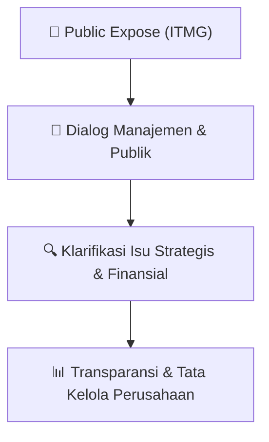

# 🎤 Laporan Hasil Public Expose: [ITMG]

🏢 **Emiten**: `ITMG` | 📅 **Tanggal Pelaksanaan**: `2026-09-14` | ❓ **Total Pertanyaan**: `6 Pertanyaan`
⬅️ [[knowledge-base/daily-digests/ITMG_20260914|Kembali ke Daily Digest]] | 🎛️ [[Dashboard/ITMG|Ke Dashboard Emiten]]

> [!IMPORTANT]
> Dokumen ini memuat seluruh risalah hasil pelaksanaan dan sesi tanya jawab (Q&A) Public Expose ITMG. Informasi dicatat secara verbatim guna memberikan analisis sentimen dan arah kebijakan manajemen bagi investor.

---

## ℹ️ 1. Informasi Penyelenggaraan & Kehadiran

| Parameter | Detail Pelaksanaan |
|---|---|
| **Nomor Surat** | 2900/L/ITM/CorSec/9/2026 |
| **Perihal** | Laporan Hasil Public Expose Tahunan |
| **Waktu Pengumuman** | 14-09-2026 11:50 |
| **Jumlah Kehadiran Peserta** | Penyampaian Hasil Public Expose |
| **Lampiran Berkas** | `1` |

---

## 💬 2. Risalah Tanya Jawab Manajemen & Investor (6 Pertanyaan)

### ❓ Pertanyaan #1

> **Penanya**: *Investor / Analis Publik*

```text
Pertanyaan:
1. Bagus Prayitno – Investor Retail 
Pertanyaan: 
a. Berapa persen payload tongkang dari Bunyut yang saat ini turun akibat low water level Mahakam,
dan berapa kenaikan logistics cost per ton yang sudah terjadi? 
b. Dengan ekspansi Bunyut, apakah bottleneck sekarang justru kapasitas Sungai Mahakam?
Berapa Mtpa kapasitas Bunyut yang secara efektif tidak bisa dimanfaatkan apabila draft 
Mahakam turun? 
c. Apabila Mahakam makin surut, berapa Mt volume Melak yang bisa dialihkan melalui jalur
alternatif dan berapa tambahan cost per ton-nya?
Jawaban: 
Pertanyaan dijawab bersama-sama oleh anggota Direksi Perseroan yaitu Bapak Mulianto dan Bapak 
Yulius Kurnawan Gozali sebagai berikut:
Kami (Perseroan) melihat kondisi penurunan debit dan permukaan air di Sungai Mahakam sebagai 
salah satu tantangan yang sedang dihadapi oleh banyak tambang di Kalimantan, terutama yang 
berada di area hulu. Beberapa tambang kami di Melak juga terdampak oleh kondisi tersebut, 
sehingga kapasitas pemuatan tongkang perlu kami sesuaikan untuk mengurangi risiko kandas.
Kapasitas pemuatan berkurang sekitar 30% - 40% tergantung pada tinggi permukaan air. Kondisi ini 
berpotensi sedikit memengaruhi pencapaian target penjualan tahunan, namun kami telah melakukan 
berbagai upaya untuk mengatasi kondisi tersebut sehingga kami berharap target penjualan di tahun 
ini dapat tercapai. 
 
Dari sisi biaya, penyesuaian kapasitas pemuatan dapat meningkatkan biaya per ton karena volume 
yang dapat dimuat dalam setiap perjalanan tongkang menjadi lebih rendah. Namun, di sisi lain, 
keterbatasan pengiriman akibat kondisi sungai juga dapat membatasi pasokan batubara di pasar dan 
mendukung harga batubara yang lebih tinggi. Secara keseluruhan, dampak terhadap biaya 
Perseroan diperkirakan tetap terbatas karena kegiatan operasi di area Melak yang menggunakan 
jalur Sungai Mahakam hanya mencakup sebagian dari total volume penjualan Perseroan. Sementara 
itu, untuk tambang Indominco yang terletak di Bontang tidak terdampak oleh kondisi tersebut karena 
lokasinya yang dekat dengan laut.
```

💡 **Jawaban & Klarifikasi Manajemen**:

> *Teks tanggapan manajemen tidak tersedia*

---

### ❓ Pertanyaan #2

> **Penanya**: *Investor / Analis Publik*

```text
Pertanyaan:
2. William Adriel – Investor Retail 
Pertanyaan: 
Apakah perseroan saat ini berpikiran akan stock split?
Jawaban: 
Pertanyaan dijawab secara tertulis oleh Ibu Monika Ida Krisnamurti selaku perwakilan Manajemen 
Perseroan sebagai berikut:
Terima kasih atas pertanyaannya. Terkait dengan kemungkinan pelaksanaan stock split, saat ini 
Perseroan belum memiliki rencana untuk melakukan aksi korporasi tersebut. Namun demikian, 
Perseroan akan terus mencermati kondisi pasar dan mengevaluasi berbagai opsi aksi korporasi 
dengan tetap mempertimbangkan kepentingan Perseroan dan para pemegang saham.
```

💡 **Jawaban & Klarifikasi Manajemen**:

> *Teks tanggapan manajemen tidak tersedia*

---

### ❓ Pertanyaan #3

> **Penanya**: *Investor / Analis Publik*

```text
Pertanyaan:
3. Weerada Chuncuansugkom – Investor Retail 
Pertanyaan: 
Bagaimana strategi Perusahaan dalam mengelola dampak kenaikan harga bahan bakar solar pada 
semester II-2026, dan apakah target Strip Ratio rata-rata untuk keseluruhan tahun FY26 dapat dijaga 
pada level 10,3x?
Jawaban: 
Pertanyaan dijawab oleh anggota Direksi Perseroan yaitu Bapak Yulius Kurnawan Gozali sebagai 
berikut:
Perseroan terus melakukan berbagai upaya untuk meningkatkan efisiensi operasional, terutama 
melalui konsumsi bahan bakar yang lebih efisien. Selain itu, ketersediaan pasokan bahan bakar juga 
menjadi salah satu hal yang kami perhatikan untuk memastikan kelancaran operasional di tengah 
kenaikan harga bahan bakar yang cukup signifikan. Selanjutnya, mengenai strip ratio, kami 
menargetkan strip ratio Perseroan berada di kisaran 10,3x -10,5x. Saat ini, kami melihat bahwa strip 
ratio Perseroan relatif stabil. 
 
4. Riyadus ID – Investor Retail 
Pertanyaan: 
a. Terkait RKAB 2026, bagaimana update terbaru dari sisi persetujuan, realisasi, dan pelaksanaan
di lapangan? Apakah terdapat perubahan terhadap target produksi dan penjualan untuk Full Year 
2026? 
b. Terkait kebijakan dividen tahun buku 2026, apakah manajemen memiliki rencana untuk kembali
membagikan dividen interim seperti tahun tahun sebelumnya?
Jawaban: 
Pertanyaan dijawab oleh anggota Direksi Perseroan yaitu Bapak Mulianto sebagai berikut: 
 
Untuk informasi mengenai revisi RKAB, kami (Perseroan) merujuk pada pemberitahuan resmi dari 
Pemerintah. Fokus kami saat ini adalah menjalankan kegiatan operasional sesuai dengan ketentuan 
yang berlaku dan berupaya untuk mencapai target tahunan yang sebagaimana kami telah 
disampaikan dalam materi presentasi.
Perseroan senantiasa berkomitmen untuk memberikan nilai tambah kepada para pemegang saham. 
Pembagian dividen merupakan salah satu hal yang selalu kami pertimbangkan, dengan besaran 
dividen yang akan disesuaikan dengan kebutuhan pengembangan bisnis dan rencana investasi 
Perseroan ke depan.
```

💡 **Jawaban & Klarifikasi Manajemen**:

> *Teks tanggapan manajemen tidak tersedia*

---

### ❓ Pertanyaan #5

> **Penanya**: *Investor / Analis Publik*

```text
Pertanyaan:
5. Andrew Yap – Investor Retail 
Pertanyaan: 
Izin bertanya apakah ITMG akan merambah ke bisnis Nikel melihat tahun lalu ITMG masuk ke emiten 
NICE? Apakah porsi kepemilikan saham akan bertambah di saham NICE kedepan dan Kedepan 
apakah emiten akan merambah ke sektor komoditas lain? Terimakasih
Jawaban: 
Pertanyaan dijawab oleh anggota Direksi Perseroan yaitu Bapak Mulianto sebagai berikut:
Perseroan sudah mulai masuk ke bisnis nikel karena kami melihat bahwa arah transisi energi ke 
depan akan semakin mendukung proses elektrifikasi, dan nikel merupakan salah satu mineral yang 
berperan penting dalam proses tersebut. Fokus kami pada tahun-tahun mendatang tidak hanya pada 
nikel, tetapi kami juga terbuka terhadap peluang di strategic mineral lainnya yang memiliki peran 
penting dalam mendukung proses elektrifikasi dan memenuhi kebutuhan energi di masa mendatang.
Terkait dengan potensi peningkatan kepemilikan di PT Adhi Kartiko Pratama Tbk (NICE), kami selalu 
terbuka dengan opsi tersebut sepanjang dapat menciptakan nilai bagi pemegang saham dan sejalan 
dengan strategi jangka panjang Perseroan. 
 
E. Ringkasan Pertanyaan dan Jawaban Press Conference Public Expose 2026
```

💡 **Jawaban & Klarifikasi Manajemen**:

> *Teks tanggapan manajemen tidak tersedia*

---

### ❓ Pertanyaan #1

> **Penanya**: *Investor / Analis Publik*

```text
Pertanyaan:
1. Hana – Kata Data 
Pertanyaan: 
a. berapa capex yang dianggarkan 2026 dan hingga pertengahan tahun sudah berapa besar yang
terserap? lalu bagaimana dengan proyeksi rasio pembagian dividen untuk tahun buku 2026 
b. Kitadin telah masuk fase penutupan tambang, sementara cadangan Jorong tercatat tinggal sekitar
2 juta ton dan kontrak PKP2B Indominco akan berakhir pada 2028. Bagaimana strategi ITMG 
menjaga produksi grup dalam tiga hingga lima tahun ke depan? 
c. Apakah ITMG sedang menjajaki akuisisi tambang batu bara baru untuk menggantikan cadangan
dari tambang eksisting? 
d. Di luar batu bara, apakah ITMG tengah mengevaluasi akuisisi atau investasi baru di sektor mineral
dan energi? dan apa komoditasnya? 
 
Jawaban: 
Pertanyaan dijawab oleh anggota Direksi Perseroan yaitu Bapak Mulianto dan Bapak Yulius 
Kurniawan Gozali sebagai berikut: 
 
Perusahaan telah menggunakan belanja modal sebesar US$ 21 juta sampai dengan Juni 2026. 
Realisasi tersebut setara sekitar 42% dari anggaran capex ITMG tahun ini. Sebagian besar capex 
yang telah dikeluarkan hingga Juni 2026 digunakan untuk kebutuhan ekspansi guna mendukung 
peningkatan produksi batubara guna mengantisipasi kenaikan kebutuhan batubara ke depan 
 
Terkait pembagian dividen, Perusahaan senantiasa berkomitmen untuk memberikan nilai tambah 
kepada para pemegang saham. Pembagian dividen merupakan salah satu hal yang selalu kami 
pertimbangkan, dengan besaran dividen yang akan disesuaikan dengan kebutuhan pengembangan 
bisnis dan rencana investasi Perseroan ke depan. 
 
Sementara untuk pengembangan portofolio bisnis, Perusahaan sudah mulai masuk ke bisnis nikel. 
Ke depan, kami terbuka terhadap peluang di strategic mineral lainnya yang memiliki peran penting 
dalam memenuhi kebutuhan energi di masa mendatang.
```

💡 **Jawaban & Klarifikasi Manajemen**:

> *Teks tanggapan manajemen tidak tersedia*

---

### ❓ Pertanyaan #2

> **Penanya**: *Investor / Analis Publik*

```text
Pertanyaan:
2. Leni – Kontan 
Pertanyaan: 
a. Apakah ITMG sedang menjajaki akuisisi tambang batu bara baru untuk menggantikan cadangan
dari tambang eksisting ? 
b. Di luar batu bara, apakah ITMG tengah mengevaluasi akuisisi atau investasi baru di sektor
mineral dan energi? dan apa komoditasnya? 
 
Jawaban: 
Pertanyaan dijawab oleh anggota Direksi Perseroan yaitu Bapak Mulianto sebagai berikut: 
 
Untuk pengembangan portofolio bisnis, Perusahaan sudah mulai masuk ke bisnis nikel. Ke depan, 
kami terbuka terhadap peluang di strategic mineral lainnya yang memiliki peran penting dalam 
memenuhi kebutuhan energi di masa mendatang. 
 
3. Annisa Saumi – Bisnis Indonesia 
Pertanyaan: 
Bagaimana prospek harga dan permintaan batu bara pada semester II/2026?
Jawaban: 
Pertanyaan dijawab oleh anggota Direksi Perseroan yaitu Bapak Warut Waramit sebagai berikut: 
 
Pada semester I/2026, harga jual rata-rata batubara ITM tercatat sebesar US$81,0 per ton, dengan 
volume penjualan mencapai 12,3 juta ton. Permintaan batubara termal secara umum diperkirakan 
tetap ditopang oleh kebutuhan listrik, terutama di tengah potensi peningkatan konsumsi energi akibat 
gelombang panas serta adanya ketidakpastian pasokan LNG. Dengan dinamika tersebut, kami 
melihat pasar batubara masih memiliki sejumlah faktor pendukung, meskipun tetap terdapat 
tantangan dari sisi tingginya pasokan dan volatilitas harga komoditas. Pergerakan harga akan sangat 
bergantung pada keseimbangan pasokan dan permintaan global serta perkembangan pasar energi 
secara keseluruhan. 
Demikian disampaikan, atas perhatiannya, kami ucapkan terima kasih 
 
Hormat kami, 
PT Indo Tambangraya Megah Tbk 
 
 
 
 
 
 
Monika I. Krisnamurti 
Corporate Secretary
No 
Nama  
Tipe Pengunjung
1 
Fabio Rizki 
Investor
2 
Daniel . 
Media
3 
maya oktavia 
Investor
4 
Antonius Budianto 
Investor
5 
Vinko Satrio Pekerti 
Investor
6 
Wimpy Rangkuti 
Investor
7 
Yangki Prayogi 
Investor
8 
Yonatan Wijaya 
Investor
9 
Arif Fikri 
Investor
10 
Halim Gunawan 
Investor
11 
Iman Firmansyah 
Umum
12 
Nik En 
Investor
13 
Victor Gouanda 
Investor
14 
Kholid Rafsanjani 
Media
15 
Cindy Cindy 
Investor
16 
Anthony Djauw 
Investor
17 
Toto Setiawan 
Umum
18 
Abdal Syafei 
Investor
19 
Randy N 
Umum
20 
Azkalinsyah Yuda 
Umum
21 
Vinna Rachmawati 
Investor
22 
eva fitriani 
Media
23 
Al Azizurrahim Mb 
Investor
24 
Dala F 
Investor
25 
Jason Ariyanto 
Investor
26 
Muhammad Alan Nur 
Investor
27 
timothy wijaya 
Umum
28 
Ricky Suwadi 
Investor
29 
Adolf Richardo Bagus S 
Umum
30 
Eka Rahmawati Rahman 
Investor
31 
Bagus Prayitno 
Investor
32 
Rizki Fayad Pratama 
Umum
33 
Dody yat 
Investor
34 
Weerada Chuncuansugkom 
Umum
35 
David Lo 
Investor
No 
Nama  
Tipe Pengunjung
36 
Richard Christian 
Investor
37 
Ramlan Gustian 
Investor
38 
Ilham Nugroho 
Investor
39 
servi mareta 
Umum
40 
Ferry Hermawan 
Umum
41 
SWA.co.id Arie Liliyah 
Media
42 
K M 
Umum
43 
William H 
Investor
44 
Adhi Widyarta Putra 
Investor
45 
kasmudim kas 
Investor
46 
Syafi'i K 
Umum
47 
rukibah . 
Investor
48 
Kasrim AMTrU,SE,MMTr,MBA 
Investor
49 
Azam Basyarahil Hawari 
Investor
50 
Yongkie Purnomo 
Investor
51 
Billy Christopher 
Investor
52 
nicolas jordi 
Investor
53 
Deffandi Nasrul 
Investor
54 
ANDY ANDY 
Investor
55 
bayu nugroho 
Investor
56 
Heri Widiarso 
Investor
57 
Mick Basa 
Umum
58 
Benyamin Mikael 
Umum
59 
John L 
Investor
60 
Veron Losa 
Umum
61 
Natsumi Kawasaki 
Media
62 
Tondy Suwanto 
Umum
63 
puji nugroho 
Umum
64 
Lenia Lenia 
Umum
65 
EDBERT EDBERT 
Umum
66 
Bobby - 
Umum
67 
susan margaret 
Investor
68 
Rayyan Firjatullah 
Investor
69 
Adianto Simamora 
Media
70 
Adhitya Himawan 
Media
71 
Edward Winata Gunawan 
Investor
72 
Fandra Hardiyon 
Media
73 
Riyadus ID 
Investor
74 
Rifki Al Wafi 
Media
No 
Nama  
Tipe Pengunjung
75 
william adriel 
Investor
76 
Andrew Yap 
Investor
77 
Dewi Sartika Taulabi 
Umum
78 
Tanayastri Dini Isna 
Media
79 
Ryan F 
Investor
80 
ABDUL RASYID 
Umum
81 
Erika Kurnia 
Media
82 
Erwin Vitrianudin 
Investor
83 
Henry H 
Investor
84 
Kurniawan Yunanto 
Umum
85 
Nisrina Firmansyah 
Umum
86 
Thresa Sandra 
Media
87 
Lucky Ginting 
Media
88 
london charlie 
Umum
89 
Vla Sibarani 
Umum
90 
Erwin Tanaka 
Investor
91 
Ars q 
Umum
92 
Iskandar - 
Investor
93 
Alan Budiandri 
Investor
94 
Gilbert Kresna Sammen 
Investor
95 
Thurfah Mahira Ahnaf 
Media
96 
Yanto Kus 
Umum
97 
Moh Fajar Hadi Salim 
Investor
98 
Yudistira Eka Putra 
Investor
99 
Annisa Saumi 
Media
100 
Paulus Lie 
Investor
101 
Sulthan Wicaksono 
Umum
102 
Hani Sabrina 
Umum
103 
Hana nabila 
Media
104 
erina septiane 
Umum
105 
Rahmat Fiansyah 
Investor
106 
Muhammad Fikri 
Media
107 
Muhammad Al Aghniya 
Investor
108 
Iqbal Dwi 
Media
109 
cepi setiadi 
Media
110 
Mavis MA 
Umum
111 
Yuliana Hema 
Media
112 
Kelvin Aditya 
Investor
113 
Charles Chandra 
Investor
No 
Nama  
Tipe Pengunjung
114 
Aji Setiawan 
Investor
115 
Diaz Pramana 
Investor
116 
Zsazya Senorita 
Media
117 
AGUS LIYANTO 
Investor
118 
Andryanto EN 
Media
119 
sodikin sodikin 
Investor
120 
ica alysa 
Umum
121 
irfan fadilah 
Investor
122 
Galuh Ressa Mahardika 
Investor
123 
WilLiam . 
Investor
124 
Ilham Darmawan 
Umum
125 
Yoan F 
Investor
126 
Bima Aryasena 
Investor
127 
Rendy S 
Investor
128 
Afif Lukfi 
Umum
129 
Yuki Herawan 
Umum
130 
Hengky Tan 
Investor
131 
GRACE JAYANTHI 
Investor
132 
Punto Wicaksono 
Umum
133 
oktario pratama 
Investor
134 
Kartika Aji 
Investor
135 
aaa eee 
Investor
136 
Thomas Harmono 
Investor
137 
Senay id 
Umum
138 
Melia Mail 
Investor
139 
Sarwo Salim 
Investor
140 
Nanda Rosyid 
Umum
141 
Rendy 
Investor
142 
kartika 
Investor
143 
Kevin 
Investor
144 
ifham 
Investor
145 
Vinna 
Investor
146 
Hendra 
Investor
147 
Yurika 
Media
148 
Nicholas Calvin 
Investor
149 
jovi 
Investor
150 
Doddi 
Investor
151 
Dzulfan 
Investor
152 
Franciska Margareta 
Investor
No 
Nama  
Tipe Pengunjung
153 
Stephen 
Investor
154 
LAELI 
Investor
155 
Ismi 
Media
156 
Matthew 
Investor
157 
Faqih 
Umum
158 
Syarif  
Investor
159 
Olga 
Umum
160 
Roy 
Investor
161 
Edward 
Investor
162 
Rut Yesika 
Investor
163 
Steven 
Investor
164 
Ibnu 
Investor
165 
Sianggono 
Investor
166 
Nuki 
Media
167 
Natalia 
Investor
168 
YULISTIKA 
Investor
169 
Achmad 
Media
170 
Andy 
Investor
171 
Harta 
Investor
172 
Zul 
Investor
173 
Raka 
Investor
174 
Hendy 
Investor
175 
Aldebaran Martimo 
Investor
176 
jusak  
Investor
177 
Dinul 
Investor
178 
Jocelyn 
Umum
179 
Darynn 
Umum
180 
Arsita 
Investor
181 
Cliff 
Investor
182 
Novi 
Investor
183 
Hafid Bayu  
Umum
184 
Aurelia 
Umum
185 
Fitrahadi 
Investor
186 
Dandy 
Investor
187 
Reza 
Umum
188 
Rhezaldian 
Investor
189 
Marlon 
Investor
190 
Anita 
Umum
No 
Nama  
Tipe Pengunjung
191 
Veronika 
Umum
192 
Jonathan Toni 
Umum
193 
PT. Aldo Inovasi  
Umum
194 
indah suci 
Media
195 
Raka 
Umum
```

💡 **Jawaban & Klarifikasi Manajemen**:

> *Teks tanggapan manajemen tidak tersedia*

---

## 📌 3. Peta Jalur Transparansi & Kepercayaan Pasar



---

*Dokumen diolah otomatis oleh **Swarm Intelijen Pasar Modal Indonesia** pada 2026-10-12 16:45 WIB.*