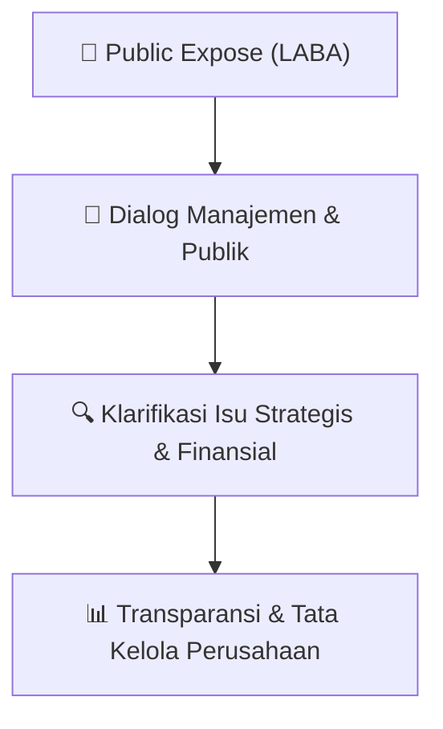

# 🎤 Laporan Hasil Public Expose: [LABA]

🏢 **Emiten**: `LABA` | 📅 **Tanggal Pelaksanaan**: `2026-08-04` | ❓ **Total Pertanyaan**: `34 Pertanyaan`
⬅️ [[knowledge-base/daily-digests/LABA_20260804|Kembali ke Daily Digest]] | 🎛️ [[Dashboard/LABA|Ke Dashboard Emiten]]

> [!IMPORTANT]
> Dokumen ini memuat seluruh risalah hasil pelaksanaan dan sesi tanya jawab (Q&A) Public Expose LABA. Informasi dicatat secara verbatim guna memberikan analisis sentimen dan arah kebijakan manajemen bagi investor.

---

## ℹ️ 1. Informasi Penyelenggaraan & Kehadiran

| Parameter | Detail Pelaksanaan |
|---|---|
| **Nomor Surat** | 044/GPG-OJK/VIII/2026 |
| **Perihal** | Laporan Hasil Public Expose Tahunan |
| **Waktu Pengumuman** | 04-08-2026 13:08 |
| **Jumlah Kehadiran Peserta** | Penyampaian Hasil Public Expose |
| **Lampiran Berkas** | `1` |

---

## 💬 2. Risalah Tanya Jawab Manajemen & Investor (34 Pertanyaan)

### ❓ Pertanyaan #1

> **Penanya**: *Investor / Analis Publik*

```text
Pertanyaan:
1. Media 
 
Q 
Berapa Capex tahun 2026 dan digunakan untuk apa saja?
Belanja modal atau Capital Expenditure (CapEx) Perseroan pada tahun 2026 diperkirakan 
sebesar Rp6 miliar. Belanja modal digunakan untuk pembelian mesin injeksi dan moulding, 
serta peralatan pendukung operasional.
```

💡 **Jawaban & Klarifikasi Manajemen**:

> *Teks tanggapan manajemen tidak tersedia*

---

### ❓ Pertanyaan #2

> **Penanya**: *Investor / Analis Publik*

```text
Pertanyaan:
2. Shareholders 
 
Q 
Strategi apa yang digunakan oleh Perseroan dalam menghadapi tahun 2026?
Pada tahun 2026, dengan terus bertumbuhnya sektor industri energi baru dan terbarukan, hal 
tersebut membuka peluang bagi Perseroan untuk memperkuat perannya dalam industri 
baterai. Menyikapi peluang tersebut, manajemen Perseroan mengambil langkah strategis 
untuk melakukan penguatan lini usaha. Melalui anak Perusahaan PT Green Power Battery, 
Perseroan akan memperkuat peran di sektor industri energi baru dan terbarukan pada tahun 
2026. Selain itu, melalui anak usaha PT Green Power Precision Indonesia, Perseroan akan 
memperkuat lini usaha di bidang molding dengan memperluas kerja sama strategis dengan 
berbagai mitra.
```

💡 **Jawaban & Klarifikasi Manajemen**:

> *Teks tanggapan manajemen tidak tersedia*

---

### ❓ Pertanyaan #3

> **Penanya**: *Investor / Analis Publik*

```text
Pertanyaan:
3. Media 
 
Q
Bagaimana hasil kinerja Perseroan hingga 2025?
​PT Green Power Group Tbk
Jl. Raya Imam Bonjol RT.08 / RW.13, Sukadanau, Kec. Cikarang Barat, Kab. Bekasi, ​
 Jawa Barat, 17530 Phone (021) 89533205  
 
 
 
 
A
Pada tahun 2025, beberapa target Perseroan belum dapat tercapai sebagai dampak dari 
perubahan kebijakan pemerintah, sebagai contoh terkait penyesuaian dan tertundanya 
implementasi program insentif sepeda motor listrik, mempengaruhi pencapaian target usaha 
Perseroan di lini usaha penyewaan sepeda motor listrik. Meskipun demikian, Perseroan juga 
pada tahun 2025 juga banyak mencapai target yang memuaskan, seperti berhasil 
menginstalasi kabinet penukaran baterai/battery swap cabinet yang tersebar di Jabodetabek, 
menjalin kerja sama dengan perusahaan drone untuk memasok baterai, dan berhasil 
memperluas kerja sama dengan berbagai pihak di sektor molding.
```

💡 **Jawaban & Klarifikasi Manajemen**:

> *Teks tanggapan manajemen tidak tersedia*

---

### ❓ Pertanyaan #4

> **Penanya**: *Investor / Analis Publik*

```text
Pertanyaan:
4. Shareholders 
 
Q 
Berapa pendapatan dan laba yang dibidik perusahaan tahun 2026?
Perseroan menetapkan target kinerja pada tahun 2026 dengan pendapatan sebesar Rp40 
miliar dan laba bersih sebesar Rp5 miliar. Proyeksi tersebut bersumber dari dua segmen 
utama, yakni penjualan molding dan aktivitas trading, serta lini usaha baterai beserta 
ekosistem pendukungnya seperti kabinet penukaran baterai/battery swap cabinet.
```

💡 **Jawaban & Klarifikasi Manajemen**:

> *Teks tanggapan manajemen tidak tersedia*

---

### ❓ Pertanyaan #5

> **Penanya**: *Investor / Analis Publik*

```text
Pertanyaan:
5. Media
Q 
Ketika terjadi pemadaman massal PLN beberapa waktu lalu, apakah mempengaruhi 
bisnis Perseroan di bidang kendaraan listrik roda dua dan roda tiga?
Bisnis Perseroan di bidang kendaraan listrik roda dua dan roda tiga sama sekali tidak 
terdampak atas pemadaman massal PLN yang terjadi beberapa waktu lalu. Hal ini termasuk 
bisnis yang ada di pabrik.
Demikian yang dapat disampaikan, terima kasih atas perhatiannya.  
 
Hormat kami,  
 
 
 
 
 
 
Alifa Nurshilla 
Corporate Secretary
​PT Green Power Group Tbk
Jl. Raya Imam Bonjol RT.08 / RW.13, Sukadanau, Kec. Cikarang Barat, Kab. Bekasi, ​
 Jawa Barat, 17530 Phone (021) 89533205
​
Daftar hadir Public Expose berupa screen capture dari aplikasi Zoom dan list nama peserta
Nama 
Instansi/Media/Perorangan 
Domisili
```

💡 **Jawaban & Klarifikasi Manajemen**:

> *Teks tanggapan manajemen tidak tersedia*

---

### ❓ Pertanyaan #1

> **Penanya**: *Investor / Analis Publik*

```text
Pertanyaan:
1. 
Chen Xiaoxiao 
PT Green Power Group Tbk 
Indonesia
```

💡 **Jawaban & Klarifikasi Manajemen**:

> *Teks tanggapan manajemen tidak tersedia*

---

### ❓ Pertanyaan #2

> **Penanya**: *Investor / Analis Publik*

```text
Pertanyaan:
2. 
Wahyu Eka Saputra 
PT Green Power Group Tbk 
Indonesia
```

💡 **Jawaban & Klarifikasi Manajemen**:

> *Teks tanggapan manajemen tidak tersedia*

---

### ❓ Pertanyaan #3

> **Penanya**: *Investor / Analis Publik*

```text
Pertanyaan:
3. 
Alifa Nurshilla 
PT Green Power Group Tbk 
Indonesia
```

💡 **Jawaban & Klarifikasi Manajemen**:

> *Teks tanggapan manajemen tidak tersedia*

---

### ❓ Pertanyaan #4

> **Penanya**: *Investor / Analis Publik*

```text
Pertanyaan:
4. 
Alqindi Patriana 
PT Green Power Group Tbk 
Indonesia
```

💡 **Jawaban & Klarifikasi Manajemen**:

> *Teks tanggapan manajemen tidak tersedia*

---

### ❓ Pertanyaan #5

> **Penanya**: *Investor / Analis Publik*

```text
Pertanyaan:
5. 
Edo H. 
Media 
Indonesia
```

💡 **Jawaban & Klarifikasi Manajemen**:

> *Teks tanggapan manajemen tidak tersedia*

---

### ❓ Pertanyaan #6

> **Penanya**: *Investor / Analis Publik*

```text
Pertanyaan:
6. 
Aryanto 
Media 
Indonesia
```

💡 **Jawaban & Klarifikasi Manajemen**:

> *Teks tanggapan manajemen tidak tersedia*

---

### ❓ Pertanyaan #7

> **Penanya**: *Investor / Analis Publik*

```text
Pertanyaan:
7. 
Ando 
Media 
Indonesia
```

💡 **Jawaban & Klarifikasi Manajemen**:

> *Teks tanggapan manajemen tidak tersedia*

---

### ❓ Pertanyaan #8

> **Penanya**: *Investor / Analis Publik*

```text
Pertanyaan:
8. 
Yamin 
Media 
Indonesia
```

💡 **Jawaban & Klarifikasi Manajemen**:

> *Teks tanggapan manajemen tidak tersedia*

---

### ❓ Pertanyaan #9

> **Penanya**: *Investor / Analis Publik*

```text
Pertanyaan:
9. 
Erwin 
Media 
Indonesia
```

💡 **Jawaban & Klarifikasi Manajemen**:

> *Teks tanggapan manajemen tidak tersedia*

---

### ❓ Pertanyaan #10

> **Penanya**: *Investor / Analis Publik*

```text
Pertanyaan:
10.
Deasy A. 
Media 
Indonesia
```

💡 **Jawaban & Klarifikasi Manajemen**:

> *Teks tanggapan manajemen tidak tersedia*

---

### ❓ Pertanyaan #11

> **Penanya**: *Investor / Analis Publik*

```text
Pertanyaan:
11. 
T. M. Yon 
Media 
Indonesia
```

💡 **Jawaban & Klarifikasi Manajemen**:

> *Teks tanggapan manajemen tidak tersedia*

---

### ❓ Pertanyaan #12

> **Penanya**: *Investor / Analis Publik*

```text
Pertanyaan:
12.
Djoni 
Media 
Indonesia
```

💡 **Jawaban & Klarifikasi Manajemen**:

> *Teks tanggapan manajemen tidak tersedia*

---

### ❓ Pertanyaan #13

> **Penanya**: *Investor / Analis Publik*

```text
Pertanyaan:
13.
Dadang 
Media 
Indonesia
```

💡 **Jawaban & Klarifikasi Manajemen**:

> *Teks tanggapan manajemen tidak tersedia*

---

### ❓ Pertanyaan #14

> **Penanya**: *Investor / Analis Publik*

```text
Pertanyaan:
14.
Rendi 
Media 
Indonesia
```

💡 **Jawaban & Klarifikasi Manajemen**:

> *Teks tanggapan manajemen tidak tersedia*

---

### ❓ Pertanyaan #15

> **Penanya**: *Investor / Analis Publik*

```text
Pertanyaan:
15.
Lucky 
Media 
Indonesia
```

💡 **Jawaban & Klarifikasi Manajemen**:

> *Teks tanggapan manajemen tidak tersedia*

---

### ❓ Pertanyaan #16

> **Penanya**: *Investor / Analis Publik*

```text
Pertanyaan:
16.
Maun 
Media 
Indonesia
```

💡 **Jawaban & Klarifikasi Manajemen**:

> *Teks tanggapan manajemen tidak tersedia*

---

### ❓ Pertanyaan #17

> **Penanya**: *Investor / Analis Publik*

```text
Pertanyaan:
17.
Harto 
Media 
Indonesia
```

💡 **Jawaban & Klarifikasi Manajemen**:

> *Teks tanggapan manajemen tidak tersedia*

---

### ❓ Pertanyaan #18

> **Penanya**: *Investor / Analis Publik*

```text
Pertanyaan:
18.
Maya 
Media 
Indonesia
```

💡 **Jawaban & Klarifikasi Manajemen**:

> *Teks tanggapan manajemen tidak tersedia*

---

### ❓ Pertanyaan #19

> **Penanya**: *Investor / Analis Publik*

```text
Pertanyaan:
19.
Akbar 
Media 
Indonesia
```

💡 **Jawaban & Klarifikasi Manajemen**:

> *Teks tanggapan manajemen tidak tersedia*

---

### ❓ Pertanyaan #20

> **Penanya**: *Investor / Analis Publik*

```text
Pertanyaan:
20.
Efendie 
Media 
Indonesia
```

💡 **Jawaban & Klarifikasi Manajemen**:

> *Teks tanggapan manajemen tidak tersedia*

---

### ❓ Pertanyaan #21

> **Penanya**: *Investor / Analis Publik*

```text
Pertanyaan:
21.
Ryo 
Media 
Indonesia
```

💡 **Jawaban & Klarifikasi Manajemen**:

> *Teks tanggapan manajemen tidak tersedia*

---

### ❓ Pertanyaan #22

> **Penanya**: *Investor / Analis Publik*

```text
Pertanyaan:
22.
Lianna 
Media 
Indonesia
```

💡 **Jawaban & Klarifikasi Manajemen**:

> *Teks tanggapan manajemen tidak tersedia*

---

### ❓ Pertanyaan #23

> **Penanya**: *Investor / Analis Publik*

```text
Pertanyaan:
23.
Supiyan 
Media 
Indonesia
​PT Green Power Group Tbk
Jl. Raya Imam Bonjol RT.08 / RW.13, Sukadanau, Kec. Cikarang Barat, Kab. Bekasi, ​
 Jawa Barat, 17530 Phone (021) 89533205
```

💡 **Jawaban & Klarifikasi Manajemen**:

> *Teks tanggapan manajemen tidak tersedia*

---

### ❓ Pertanyaan #24

> **Penanya**: *Investor / Analis Publik*

```text
Pertanyaan:
24.
Rudi S 
Media 
Indonesia
```

💡 **Jawaban & Klarifikasi Manajemen**:

> *Teks tanggapan manajemen tidak tersedia*

---

### ❓ Pertanyaan #25

> **Penanya**: *Investor / Analis Publik*

```text
Pertanyaan:
25.
Daniel 
Analyst 
Indonesia
```

💡 **Jawaban & Klarifikasi Manajemen**:

> *Teks tanggapan manajemen tidak tersedia*

---

### ❓ Pertanyaan #26

> **Penanya**: *Investor / Analis Publik*

```text
Pertanyaan:
26.
Dewi Ramita 
Shareholders 
Indonesia
```

💡 **Jawaban & Klarifikasi Manajemen**:

> *Teks tanggapan manajemen tidak tersedia*

---

### ❓ Pertanyaan #27

> **Penanya**: *Investor / Analis Publik*

```text
Pertanyaan:
27.
Muhammad Turmudi 
Shareholders 
Indonesia
```

💡 **Jawaban & Klarifikasi Manajemen**:

> *Teks tanggapan manajemen tidak tersedia*

---

### ❓ Pertanyaan #28

> **Penanya**: *Investor / Analis Publik*

```text
Pertanyaan:
28.
Chen Chaoying 
Shareholders 
Indonesia
```

💡 **Jawaban & Klarifikasi Manajemen**:

> *Teks tanggapan manajemen tidak tersedia*

---

### ❓ Pertanyaan #29

> **Penanya**: *Investor / Analis Publik*

```text
Pertanyaan:
29.
Wang Ke 
Shareholders 
Indonesia
​PT Green Power Group Tbk
Jl. Raya Imam Bonjol RT.08 / RW.13, Sukadanau, Kec. Cikarang Barat, Kab. Bekasi, ​
 Jawa Barat, 17530 Phone (021) 89533205
6/6
```

💡 **Jawaban & Klarifikasi Manajemen**:

> *Teks tanggapan manajemen tidak tersedia*

---

## 📌 3. Peta Jalur Transparansi & Kepercayaan Pasar



---

*Dokumen diolah otomatis oleh **Swarm Intelijen Pasar Modal Indonesia** pada 2026-10-12 16:46 WIB.*