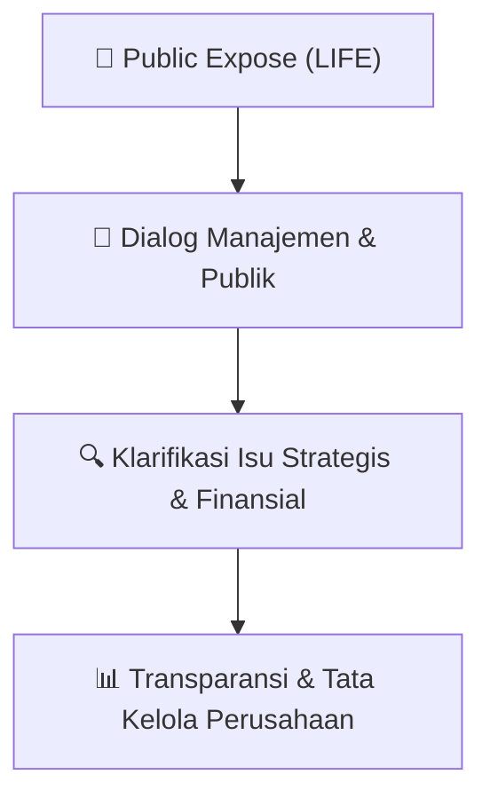

# 🎤 Laporan Hasil Public Expose: [LIFE]

🏢 **Emiten**: `LIFE` | 📅 **Tanggal Pelaksanaan**: `2026-09-09` | ❓ **Total Pertanyaan**: `7 Pertanyaan`
⬅️ [[knowledge-base/daily-digests/LIFE_20260909|Kembali ke Daily Digest]] | 🎛️ [[Dashboard/LIFE|Ke Dashboard Emiten]]

> [!IMPORTANT]
> Dokumen ini memuat seluruh risalah hasil pelaksanaan dan sesi tanya jawab (Q&A) Public Expose LIFE. Informasi dicatat secara verbatim guna memberikan analisis sentimen dan arah kebijakan manajemen bagi investor.

---

## ℹ️ 1. Informasi Penyelenggaraan & Kehadiran

| Parameter | Detail Pelaksanaan |
|---|---|
| **Nomor Surat** | - |
| **Perihal** | Laporan Hasil Public Expose |
| **Waktu Pengumuman** | 2026-09-09 |
| **Jumlah Kehadiran Peserta** | Sesuai daftar hadir bursa |
| **Lampiran Berkas** | `Risalah Tanya Jawab Resmi` |

---

## 💬 2. Risalah Tanya Jawab Manajemen & Investor (7 Pertanyaan)

### ❓ Pertanyaan #1

> **Penanya**: *Investor / Analis Publik*

```text
Pertanyaan:
1.
Public Expose PT MSIG Life Insurance Indonesia Tbk diselenggarakan secara Zoom Meeting (Online );
```

💡 **Jawaban & Klarifikasi Manajemen**:

> *Teks tanggapan manajemen tidak tersedia*

---

### ❓ Pertanyaan #2

> **Penanya**: *Investor / Analis Publik*

```text
Pertanyaan:
2. 
Pelaksanaan Public Expose Insidental dilakukan secara online dengan menggunakan media “Zoom 
Meeting”. Mohon agar peserta menggunakan nama akun Zoom yang jelas dan tidak mengubah nama atau 
identitas sepanjang acara berlangsung;
```

💡 **Jawaban & Klarifikasi Manajemen**:

> *Teks tanggapan manajemen tidak tersedia*

---

### ❓ Pertanyaan #3

> **Penanya**: *Investor / Analis Publik*

```text
Pertanyaan:
3.
Selama acara berlangsung, microphone Zoom Meeting peserta akan dinonaktifkan oleh administrator kami. 
Peserta dapat menggunakan fitur chat untuk bertanya atau menyampaikan pendapat;
```

💡 **Jawaban & Klarifikasi Manajemen**:

> *Teks tanggapan manajemen tidak tersedia*

---

### ❓ Pertanyaan #4

> **Penanya**: *Investor / Analis Publik*

```text
Pertanyaan:
4. 
Public Expose diselenggarakan dalam Bahasa Indonesia dan terbagi menjadi 2 bagian acara, yaitu:
 a) Bagian Pertama: Sambutan dan Paparan Materi Presentasi dari jajaran Direksi; serta
 b) Bagian Kedua: Sesi Tanya Jawab
```

💡 **Jawaban & Klarifikasi Manajemen**:

> *Teks tanggapan manajemen tidak tersedia*

---

### ❓ Pertanyaan #5

> **Penanya**: *Investor / Analis Publik*

```text
Pertanyaan:
5.  
Peserta yang hadir secara online dapat mengajukan pertanyaan dengan cara menuliskan pertanyaan pada 
link yang telah disediakan;
```

💡 **Jawaban & Klarifikasi Manajemen**:

> *Teks tanggapan manajemen tidak tersedia*

---

### ❓ Pertanyaan #6

> **Penanya**: *Investor / Analis Publik*

```text
Pertanyaan:
6.
Moderator akan membacakan pertanyaan pada link;
```

💡 **Jawaban & Klarifikasi Manajemen**:

> *Teks tanggapan manajemen tidak tersedia*

---

### ❓ Pertanyaan #7

> **Penanya**: *Investor / Analis Publik*

```text
Pertanyaan:
7. 
Acara Public Expose Insidental akan diakhiri pada pukul 16.00 WIB atau dapat diakhiri lebih awal dengan 
informasi terlebih dahulu dari Moderator.
Public Expose 
Insidental
PT MSIG Life Insurance Indonesia Tbk 
(d/h PT Asuransi Jiwa Sinarmas MSIG Tbk)
Jakarta, 10 September 2026
© 2026 PT MSIG Life Insurance Indonesia Tbk. Seluruh hak cipta dilindungi. Presentasi ini beserta isinya bersifat rahasia dan kepemilikan. Reproduksi, distribusi, atau pengungkapan tanpa izin dilarang.
Kinerja Keuangan
Bapak Herman Soelistyo, Direktur
Agenda
Kinerja Bisnis dan Operasional Perusahaan
Bapak Herman Soelistyo, Direktur
Rencana Usaha Perusahaan
Ibu Elly Susanti, Direktur
Informasi Material Lainnya
Bapak Herman Soelistyo, Direktur
Q&A
Latar Belakang
Public Expose Insidental
Berdasarkan persetujuan Bursa Efek Indonesia (BEI) untuk penyampaian Informasi kepada pemegang saham
1 Sep 2026
Surat Penghentian Sementara 
Perdagangan Saham dari BEI
Surat Nomor Peng-SPT-00161/BEI.WAS/09-
2026
TAHAPAN PUBLIC EXPOSE INSIDENTAL
3 Sep 2026
Penyampaian Rencana
9 Sep 2026
Penyampaian Materi
•
Akibat kenaikan kumulatif yang signifikan pada harga saham LIFE, BEI menghentikan sementara perdagangan saham LIFE sebagai
langkah cooling-down dalam rangka perlindungan investor.
•
Penghentian sementara perdagangan ini diberlakukan di Pasar Reguler dan Pasar Tunai.
•
Public Expose Insidental memberikan kesempatan bagi LIFE untuk memaparkan kinerjanya serta memberikan waktu lebih bagi
investor untuk mempertimbangkan seluruh informasi yang tersedia dalam pengambilan keputusan investasi mereka.
INFORMASI MATERIAL LAINNYA
Pergerakan Harga Saham
PERNYATAAN PERSEROAN
01
Fluktuasi pasar
Pergerakan harga saham merupakan hasil dari dinamika pasar.
02
Tidak ada informasi material lain yang belum diungkapkan
Hingga pelaksanaan Public Expose Insidentil, tidak terdapat informasi atau fakta material lain yang belum
diungkapkan kepada publik dan dapat memengaruhi kegiatan usaha, kondisi keuangan, atau kelangsungan
usaha Perseroan dan anak perusahaan.
03
Komitmen keterbukaan informasi
Perseroan menerapkan prinsip keterbukaan sesuai peraturan yang berlaku dan menyampaikan setiap
informasi material secara tepat waktu kepada publik.
Seluruh informasi material telah dan akan disampaikan secara tepat waktu kepada publik.
Kinerja Bisnis dan Operasional 
Perusahaan
Bapak Herman Soelistyo, Direktur
MSIG Life Terus Bertumbuh dan Berevolusi
GREAT 2025 Memperkuat Landasan Pertumbuhan Berkelanjutan
736 
691
H1 2025
H1 2026
-6%
KINERJA BISNIS
Rp miliar
APE
Premi Lanjutan 
CSM Balance
KINERJA OPERASIONAL
AI ADOPTION & CUSTOMER EXPERIENCE
Source: Laporan AAJI per Juni 2026
*) termasuk premi lanjutan Syariah
Produktivitas meningkat dengan tetap menjaga kualitas layanan dan komitmen kepada nasabah.
+23%
Produktivitas*
naik dari Juni 2025
+19
Fokus pelanggan (NPS Score)
*) Rasio polis/karyawan
Naik +2 poin dari Juni 2025
KINERJA KEUANGAN
Berbasis IFRS 17
Kinerja Positif, Tumbuh Berkualitas
Efisiensi dan Optimalisasi Meningkatkan Profitabilitas Berkelanjutan
15,0 
15,1
H1 2025
H1 2026
+1%
Aset
Rp Triliun
8,3
8,2
H1 2025
H1 2026
-2%
Ekuitas
Rp Triliun
Rencana Usaha Perusahaan dan 
Anak Perusahaan
Ibu Elly Susanti, Direktur
Strategi Pertumbuhan Berkualitas
Tiga prioritas untuk menciptakan nilai jangka panjang
SCALE
Memperluas jangkauan
distribusi
SIMPLIFY
Kemudahan
bagi nasabah
SUSTAIN
Menjaga penciptaan nilai
Fokus pelaksanaan: disiplin risiko, ketahanan operasional, kesiapan talenta, teknologi, dan tata kelola.
Informasi Material Lainnya
Bapak Herman Soelistyo, Direktur
INFORMASI MATERIAL LAINNYA
Pemisahan Spin-off Syariah
31 Maret 2026
Perubahan Peraturan 
BEI No. I-A mulai 
berlaku efektif.
Perusahaan berkomitmen memenuhi persyaratan free float dan ketentuan
terkait lainnya sesuai masa transisi yang ditetapkan.
Penyampaian Rencana 
Kerja Permisahan ke 
OJK
23 SEP 2025
Disetujui RUPSLB
SEP 2023
2 Sep 2026
Rencana Pemenuhan Free Float
Thank 
You
```

💡 **Jawaban & Klarifikasi Manajemen**:

> 2 Sep 2026
> Tanggal Efektif Penghentian 
> Perdagangan Sementara BEI
> 
> Email from the Indonesia Stock Exchange
> 
> 2 Sep 2026
> Permintaan BEI
> 
> LIFE diminta untuk mengadakan Public Expose 
> Insidental
> 
> Email dari IDX
> 
> 10 Sep 2026
> Pelaksanaan Public Expose
> 
> Insidental
> 
> 11 Sep 2026
> Penyampaian Hasil Pelaksanaan
> 
> 793 
> 1.004
> 
> H1 2025
> H1 2026
> 
> +27%
> 847 
> 913
> 
> H1 2025
> H1 2026
> 
> +8%
> 
> Rp545 Miliar
> 
> Pembayaran klaim
> 
> Kesehatan & Meninggal Dunia per Juni 2026
> 
> Source: Laporan AAJI per Juni 2026
> 
> 0,9
> 
> 1,0
> 
> H1 2025
> H1 2026
> 
> +9%
> 
> Pendapatan
> 
> Asuransi
> 
> Rp Triliun
> 
> 107
> 
> 181
> 
> H1 2025
> H1 2026
> 
> +69%
> 
> Laba 
> Bersih
> Rp Milyar
> 
> 1,3%
> 
> 2,2%
> 
> H1 2025
> H1 2026
> 
> +71%
> 
> Return of Equity
> 
> (ROE)*
> 
> 1.004
> 993
> 
> H1 2025
> H1 2026
> 
> -1%
> 
> Beban Jasa
> 
> Asuransi
> 
> Rp Milyar
> 
> *) Realisasi 6 bulan yang disetahunkan
> 
> •
> Ekspansi dan optimalisasi distribusi multi-kanal
> 
> •
> Fokus pada target pasar terpilih
> 
> •
> Pemanfaatan integrasi platform berbasis digital
> 
> •
> Produk dan layanan berpusat pada nasabah
> 
> •
> Otomatisasi dan pemanfaatan AI
> 
> •
> Perbaikan layanan klaim
> 
> •
> Peningkatan proses Underwriting dan Investasi bijak
> 
> •
> Penguatan budaya kepatuhan dalam setiap proses bisnis
> 
> •
> Merek yang kuat dan tepercaya.
> 
> 22 JUL 2026
> 
> Izin usaha OJK terbit
> 
> 3 AGT 2026
> 
> Resmi beroperasi
> 
> Izin Pengalihan 
> Portofolio OJK terbit

---

## 📌 3. Peta Jalur Transparansi & Kepercayaan Pasar



---

*Dokumen diolah otomatis oleh **Swarm Intelijen Pasar Modal Indonesia** pada 2026-10-12 16:46 WIB.*