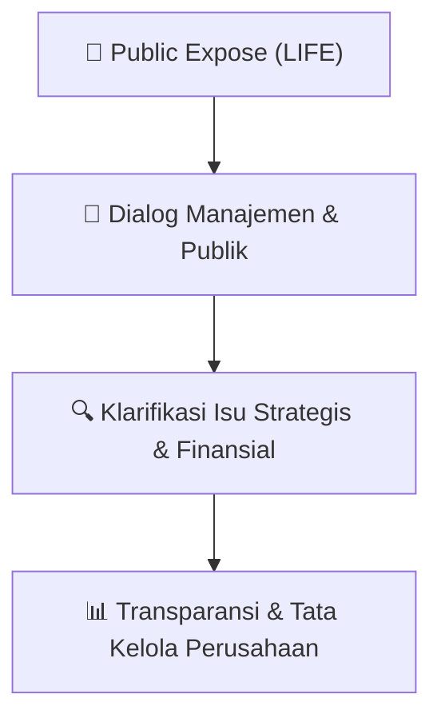

# 🎤 Laporan Hasil Public Expose: [LIFE]

🏢 **Emiten**: `LIFE` | 📅 **Tanggal Pelaksanaan**: `2026-09-11` | ❓ **Total Pertanyaan**: `5 Pertanyaan`
⬅️ [[knowledge-base/daily-digests/LIFE_20260911|Kembali ke Daily Digest]] | 🎛️ [[Dashboard/LIFE|Ke Dashboard Emiten]]

> [!IMPORTANT]
> Dokumen ini memuat seluruh risalah hasil pelaksanaan dan sesi tanya jawab (Q&A) Public Expose LIFE. Informasi dicatat secara verbatim guna memberikan analisis sentimen dan arah kebijakan manajemen bagi investor.

---

## ℹ️ 1. Informasi Penyelenggaraan & Kehadiran

| Parameter | Detail Pelaksanaan |
|---|---|
| **Nomor Surat** | 58/MSL-CSEC/IX/2026 |
| **Perihal** | Laporan Hasil Public Expose Insidentil |
| **Waktu Pengumuman** | 11-09-2026 10:34 |
| **Jumlah Kehadiran Peserta** | Penyampaian Hasil Public Expose |
| **Lampiran Berkas** | `1` |

---

## 💬 2. Risalah Tanya Jawab Manajemen & Investor (5 Pertanyaan)

### ❓ Pertanyaan #1

> **Penanya**: *Investor / Analis Publik*

```text
Pertanyaan:
1.  AZKA ELFRIZA [WARTA EKONOMI]  
 
Pertanyaan:
● 
Apa saja faktor penyebab laba bersih perusahaan tumbuh?  
● 
⁠Bagaimana prospek tahun ini? Berapa target pertumbuhan yang perusahaan incar? 
 
Jawaban:
● 
Profitabilitas produk meningkat. Peningkatan ini merupakan hasil dari proses seleksi risiko 
dan penetapan premi yang diterapkan secara disiplin sejak awal penutupan. Hal ini ditandai 
oleh 2 hal:
```

💡 **Jawaban & Klarifikasi Manajemen**:

> *Teks tanggapan manajemen tidak tersedia*

---

### ❓ Pertanyaan #1

> **Penanya**: *Investor / Analis Publik*

```text
Pertanyaan:
1. Contractual Service Margin (CSM) yang diakui atas jasa yang diberikan meningkat.   
2. Kerugian yang diakui di muka atas kontrak baru yang merugi lebih kecil. Beban 
tersebut tercatat lebih kecil dibandingkan periode yang sama tahun lalu. 
● 
Dalam hal target pertumbuhan, kami tetap yakin terhadap prospek perusahaan di tahun 
mendatang. 
 
2. BUDI [INDOPREMIER.COM/IPOTNEWS] 
 
Pertanyaan:
● 
Dapatkah dijelaskan bagaimana penerapan IFRS 17 memengaruhi laporan keuangan 
Perseroan? 
 
Jawaban:
● 
IFRS 17 mengubah waktu pengakuan dan penyajian kinerja keuangan, tetapi tidak mengubah 
fundamental ekonomi dari bisnis Perseroan. 
● 
Pendapatan asuransi kini mencerminkan jasa asuransi yang diberikan selama periode 
berjalan, dengan mengecualikan komponen investasi, sementara estimasi laba masa depan 
diakui secara bertahap selama periode pertanggungan. 
● 
IFRS 17 memberikan transparansi yang lebih baik mengenai sumber laba, estimasi laba masa 
depan, serta eksposur terhadap risiko asuransi dan risiko keuangan.
```

💡 **Jawaban & Klarifikasi Manajemen**:

> *Teks tanggapan manajemen tidak tersedia*

---

### ❓ Pertanyaan #3

> **Penanya**: *Investor / Analis Publik*

```text
Pertanyaan:
3. JAKFAR [EMITENNEWS.COM] 
Pertanyaan:
● 
Bagaimana Perseroan menerapkan AI dalam operasionalnya? 
 
Jawaban:
● 
Penerapan. Kami telah menerapkan AI pada pengelolaan klaim asuransi kesehatan, dengan 
kemampuan mengumpulkan seluruh informasi klaim dan menganalisisnya berdasarkan 
ketentuan polis serta kondisi medis. 
● 
Peran teknologi dalam proses klaim. AI membantu tim analis klaim kami mengambil 
keputusan klaim yang lebih cepat, lebih akurat, dan lebih konsisten. 
● 
Manfaat dan arah ke depan. Analisis ini membantu kami mendeteksi potensi Fraud, Waste, 
dan Abuse, mulai dari pemalsuan dokumen hingga indikasi pemberian pengobatan yang 
berlebihan.  
● 
Penerapannya kami lakukan bertahap, dan akurasinya akan semakin baik seiring 
bertambahnya cakupan data dan pengalaman penggunaan.
```

💡 **Jawaban & Klarifikasi Manajemen**:

> *Teks tanggapan manajemen tidak tersedia*

---

### ❓ Pertanyaan #4

> **Penanya**: *Investor / Analis Publik*

```text
Pertanyaan:
4. ADE FERI PRIYATIN [KONTAN] 
Pertanyaan:
▪ 
Seperti apa kinerja pendapatan premi dari kanal kelompok di MSIG hingga semester I-2026? 
 
Jawaban:
▪ 
Pada semester I 2026, pendapatan premi yang disetahunkan (APE) kanal Corporate MSIG Life 
tumbuh +15% YoY.
```

💡 **Jawaban & Klarifikasi Manajemen**:

> *Teks tanggapan manajemen tidak tersedia*

---

### ❓ Pertanyaan #5

> **Penanya**: *Investor / Analis Publik*

```text
Pertanyaan:
5.  DANIEL, ANALYST  
Pertanyaan:
● 
Data manajemen laporan keuangan  Juni 2026 halaman 62, 69, 73, 78-80, 85, bagaimana 
proses kelayakan dan penentuan harga wajarnya dibanding, jika ditempatkan ke pihak ketiga 
independen berprasangka, kami lihat cukup banyak kas, deposito, dan obligasi Perseroan 
ditempatkan di entitas Grup Sinar Mas? 
 
Jawaban:
● 
Penentuan harga wajar untuk obligasi dalam unit link akan mengikuti sumber harga referensi 
pasar seperti yang disediakan oleh Penilai Harga Efek Indonesia (PHEI). Adapun penentuan 
pemilihan obligasi dan deposito akan mempertimbangkan profil dan outlook risiko dan 
tingkat imbal hasil yang ditawarkan dan memperhatikan ketentuan batasan investasi yang 
berlaku.
LAMPIRAN II 
LAPORAN HASIL PUBLIC EXPOSE INSIDENTAL 2026
PT MSIG LIFE INSURANCE INDONESIA TBK
DAFTAR HADIR
No 
Nama 
Kategori Peserta
1 
Dimas 
Jawapos.com (media) 
2 
Nanang Wijayanto 
Sindonews.com  (media) 
3 
Heryadi 
Media Indonesia (media) 
4 
Friska 
Republika (media) 
5 
Irma Yulia 
Rm.id (media) 
6 
Didi Kurniawan 
Voi.id (media) 
7 
Azka Elfriza 
Wartaekonomi.co.id (media) 
8 
Ari Astriawan 
Infobank (media) 
9 
Jakfar 
Emitennews.com (media) 
10 
Sandy 
Idxchannel.com (media) 
11 
Budi 
Indopremier/ipotnews.com (media) 
12 
Dicky Prasetya 
Suara.com (media) 
13 
Ade Feri Priyatin 
Kontan (media) 
14 
Daiz La Ode 
Stockwatch.id (media) 
15 
Daniel 
Analyst MSIG 
16 
Aura Putri Antari 
Publik 
17 
Rika Asari 
Publik
```

💡 **Jawaban & Klarifikasi Manajemen**:

> *Teks tanggapan manajemen tidak tersedia*

---

## 📌 3. Peta Jalur Transparansi & Kepercayaan Pasar



---

*Dokumen diolah otomatis oleh **Swarm Intelijen Pasar Modal Indonesia** pada 2026-10-12 16:46 WIB.*