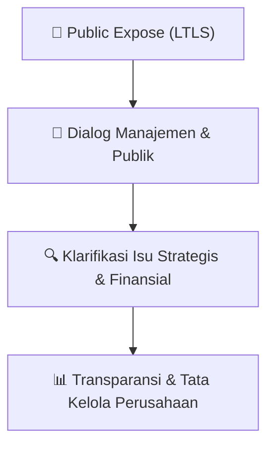

# 🎤 Laporan Hasil Public Expose: [LTLS]

🏢 **Emiten**: `LTLS` | 📅 **Tanggal Pelaksanaan**: `2026-09-10` | ❓ **Total Pertanyaan**: `1 Pertanyaan`
⬅️ [[knowledge-base/daily-digests/LTLS_20260910|Kembali ke Daily Digest]] | 🎛️ [[Dashboard/LTLS|Ke Dashboard Emiten]]

> [!IMPORTANT]
> Dokumen ini memuat seluruh risalah hasil pelaksanaan dan sesi tanya jawab (Q&A) Public Expose LTLS. Informasi dicatat secara verbatim guna memberikan analisis sentimen dan arah kebijakan manajemen bagi investor.

---

## ℹ️ 1. Informasi Penyelenggaraan & Kehadiran

| Parameter | Detail Pelaksanaan |
|---|---|
| **Nomor Surat** | 117/LTL-LCS/IX/2026 |
| **Perihal** | Laporan Hasil Public Expose Tahunan |
| **Waktu Pengumuman** | 10-09-2026 16:42 |
| **Jumlah Kehadiran Peserta** | Penyampaian Hasil Public Expose |
| **Lampiran Berkas** | `2` |

---

## 💬 2. Risalah Tanya Jawab Manajemen & Investor (1 Pertanyaan)

### ❓ Pertanyaan #1

> **Penanya**: Bisnis Fokus — Ikhtisar Keuangan

```text
Pertanyaan:
Ikhtisar Perusahaan
```

💡 **Jawaban & Klarifikasi Manajemen**:

> Komitmen Keberlanjutan Perusahaan 
> e. QnA 
>  
> 3. Q&A 
>  
> 1) Bapak William Adriel – Investor Retail 
> Berapa kira-kira kontribusi pendapatan di semester II-2026 segmen bisnis air? 
> Ibu Elly Mariana Tansil – Direktur Keuangan PT Lautan Luas Tbk 
> Pada semester I-2026, bisnis air memberikan kontribusi sekitar 12% terhadap total 
> pendapatan Perseroan. Untuk semester II-2026, kami memperkirakan kontribusinya 
> tidak akan jauh berbeda dari semester I, yaitu berada di kisaran 12–15%. Dalam jangka 
> panjang, kami menargetkan kontribusi bisnis air dapat mencapai di atas 15%, sejalan 
> dengan potensi dan kebutuhan air di Indonesi

---

## 📌 3. Peta Jalur Transparansi & Kepercayaan Pasar



---

*Dokumen diolah otomatis oleh **Swarm Intelijen Pasar Modal Indonesia** pada 2026-10-12 16:46 WIB.*