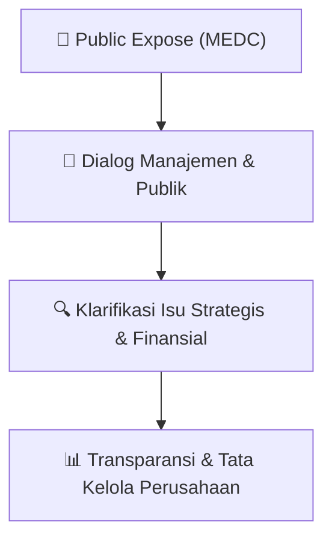

# 🎤 Laporan Hasil Public Expose: [MEDC]

🏢 **Emiten**: `MEDC` | 📅 **Tanggal Pelaksanaan**: `2026-09-11` | ❓ **Total Pertanyaan**: `2 Pertanyaan`
⬅️ [[knowledge-base/daily-digests/MEDC_20260911|Kembali ke Daily Digest]] | 🎛️ [[Dashboard/MEDC|Ke Dashboard Emiten]]

> [!IMPORTANT]
> Dokumen ini memuat seluruh risalah hasil pelaksanaan dan sesi tanya jawab (Q&A) Public Expose MEDC. Informasi dicatat secara verbatim guna memberikan analisis sentimen dan arah kebijakan manajemen bagi investor.

---

## ℹ️ 1. Informasi Penyelenggaraan & Kehadiran

| Parameter | Detail Pelaksanaan |
|---|---|
| **Nomor Surat** | EXT-003/LEGC/INA/MEDC/IX/2026 |
| **Perihal** | Laporan Hasil Public Expose Tahunan |
| **Waktu Pengumuman** | 11-09-2026 16:52 |
| **Jumlah Kehadiran Peserta** | Penyampaian Hasil Public Expose |
| **Lampiran Berkas** | `1` |

---

## 💬 2. Risalah Tanya Jawab Manajemen & Investor (2 Pertanyaan)

### ❓ Pertanyaan #3

> **Penanya**: *Investor / Analis Publik*

```text
Pertanyaan:
3. Pertanyaan ke 3: Bapak Yudi Pratama 
- 
Di kuartal pertama 2026, pendapatan Medco naik 19 persen dibandingkan tahun lalu, dan pendapatan dari 
bisnis Minyak dan Gas naik 21 persen. Nah, melihat produksi di semester pertama lebih tinggi 
dibandingkan kuartal pertama, ditambah harga minyak di kuartal kedua juga lebih tinggi, apakah kita bisa 
expect hasil keuangan Medco di semester pertama akan lebih baik lagi? 
 
- 
Dijawab oleh Bapak Benny Setiawan 
Terima kasih, Bapak Yudi. Saat ini kami belum dapat menyampaikan angka kinerja keuangan semester 
pertama karena hasilnya belum dipublikasikan. Namun, melihat produksi semester pertama yang lebih 
tinggi, harga minyak yang membaik di kuartal kedua, serta disiplin biaya yang tetap terjaga, kami cukup 
percaya diri bahwa hasil keuangan semester pertama akan lebih baik. Detailnya akan kami sampaikan 
setelah laporan keuangan resmi dipublikasikan. 
 
4. Pertanyaan ke 3: Bapak Irwan Kurniawan 
- 
Nilai kepemilikan Medco di Amman kurang lebih USD 2.6 billion. Apakah ada rencana dari Perusahaan 
untuk menjual kepemilikan saham Amman? 
 
- 
Dijawab oleh Bapak Benny Setiawan 
Terima kasih, Bapak Irwan. Kepemilikan kami di Amman merupakan investasi strategis yang selama ini 
memberikan kontribusi yang baik kepada MedcoEnergi, terutama karena prospek mineral emas dan 
tembaga di masa depan masih menjanjikan. Di sisi lain, opsi untuk memonetisasi sebagian atau seluruh 
kepemilikan tersebut selalu ada. Namun, opsi itu masih perlu kami kaji lebih lanjut, termasuk dari sisi 
valuasi, waktu yang tepat, dan manfaatnya bagi pemegang saham. Apabila nantinya terdapat keputusan 
yang bersifat material, tentu akan kami umumkan kepada publik. 
 
Mengingat keterbatasan waktu, maka MC mengakhiri acara presentasi Perseroan dan tanya jawab. Paparan Publik 
2026 ini berakhir pada pukul 11.00 WIB. 
 
 
Risalah Press Conference Paparan Publik 2026 
 
Setelah Paparan Publik selesai berlangsung, acara dilanjutkan ke Press Conference dimana Team MedcoEnergi 
diarahkan masuk ke dalam link Zoom khusus untuk wartawan yang dihadiri oleh 14 wartawan. Selama sesi Press 
Conference yang dibatasi selama 15 menit, Bapak Amri Siahaan membacakan Press Release Paparan Publik 
2026 yang bisa diakses di link ini, kemudian dilanjutkan dengan sesi tanya jawab.  
 
Berikut pertanyaan yang diajukan oleh wartawan yang hadir dan jawaban yang disampaikan oleh Pak Amri 
Siahaan:  
1. Pertanyaan ke 1 : Bapak Achmad Fauzi (Suara.com) 
Berapa target produksi dan belanja modal MedcoEnergi pada 2026? 
 
Jawaban disampaikan oleh Bapak Amri Siahaan: Terima kasih, Bapak Achmad Fauzi, atas pertanyaannya. 
Produksi Minyak & Gas 2026 ditargetkan sebesar 165–170 mboepd, sementara target penjualan 
ketenagalistrikan sebesar 4.550 GWh. Belanja modal Minyak & Gas sebesar US$415 juta dan 
ketenagalistrikan sebesar US$15 juta.
```

💡 **Jawaban & Klarifikasi Manajemen**:

> *Teks tanggapan manajemen tidak tersedia*

---

### ❓ Pertanyaan #2

> **Penanya**: *Investor / Analis Publik*

```text
Pertanyaan:
2. Pertanyaan ke 2: Bapak Muhammad Ghafur (Investor Daily) 
Bagaimana volatilitas harga minyak mempengaruhi kinerja Perseroan? 
 
Jawaban disampaikan oleh Bapak Amri Siahaan: Terima kasih, Bapak Muhammad Ghafur, atas 
pertanyaannya. Bauran harga produksi kami cukup seimbang, dengan sekitar 55% terekspos pada harga pasar 
dan 45% dijual dengan harga gas tetap domestik. Selain itu, PSC dengan skema cost recovery memberikan 
pemulihan penuh atas biaya sebelum bagi hasil, sehingga mengurangi dampak volatilitas harga. Jika harga 
minyak rendah berlanjut, kami juga memiliki fleksibilitas untuk mengurangi biaya produksi dan menyesuaikan 
kegiatan eksplorasi. 
 
3. Pertanyaan ke 3 : Pertanyaan dari Bapak Gilang Praditya (EconomixBuzz.com) 
- 
Apakah MedcoEnergi berencana melakukan akuisisi lagi?  
 
Jawaban disampaikan oleh Bapak Benny Setiawan: Terima kasih, Bapak Gilang Praditya, atas 
pertanyaannya. Kami terus melihat peluang di wilayah geografis pilihan kami, terutama Asia Tenggara dan 
Timur Tengah, dengan fokus pada negara yang stabil dan lingkungan regulasi yang kami pahami. Di saat 
yang sama, Perseroan memiliki jalur pertumbuhan organik yang sehat melalui pengembangan di Natuna, 
Corridor, Senoro dan Oman, yang akan mendukung penambahan cadangan dalam jangka pendek hingga 
menengah.
***
```

💡 **Jawaban & Klarifikasi Manajemen**:

> *Teks tanggapan manajemen tidak tersedia*

---

## 📌 3. Peta Jalur Transparansi & Kepercayaan Pasar



---

*Dokumen diolah otomatis oleh **Swarm Intelijen Pasar Modal Indonesia** pada 2026-10-12 16:46 WIB.*