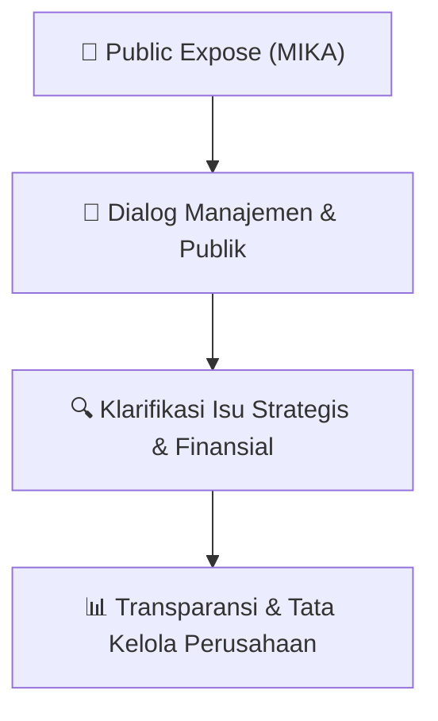

# 🎤 Laporan Hasil Public Expose: [MIKA]

🏢 **Emiten**: `MIKA` | 📅 **Tanggal Pelaksanaan**: `2026-09-15` | ❓ **Total Pertanyaan**: `27 Pertanyaan`
⬅️ [[knowledge-base/daily-digests/MIKA_20260915|Kembali ke Daily Digest]] | 🎛️ [[Dashboard/MIKA|Ke Dashboard Emiten]]

> [!IMPORTANT]
> Dokumen ini memuat seluruh risalah hasil pelaksanaan dan sesi tanya jawab (Q&A) Public Expose MIKA. Informasi dicatat secara verbatim guna memberikan analisis sentimen dan arah kebijakan manajemen bagi investor.

---

## ℹ️ 1. Informasi Penyelenggaraan & Kehadiran

| Parameter | Detail Pelaksanaan |
|---|---|
| **Nomor Surat** | 98/MIKA-IX/2026 |
| **Perihal** | Laporan Hasil Public Expose Tahunan |
| **Waktu Pengumuman** | 15-09-2026 11:27 |
| **Jumlah Kehadiran Peserta** | Penyampaian Hasil Public Expose |
| **Lampiran Berkas** | `3` |

---

## 💬 2. Risalah Tanya Jawab Manajemen & Investor (27 Pertanyaan)

### ❓ Pertanyaan #1

> **Penanya**: *Investor / Analis Publik*

```text
Pertanyaan:
1. 
Pertanyaan dari
 peserta yang Namanya tidak disebutkan
 dijawab oleh Ibu Joyce V. 
Handajani:
```

💡 **Jawaban & Klarifikasi Manajemen**:

> *Teks tanggapan manajemen tidak tersedia*

---

### ❓ Pertanyaan #1

> **Penanya**: *Investor / Analis Publik*

```text
Pertanyaan:
1.1 Bagaimana Perseroan melihat prospek industri rumah sakit ke depan?
Jika melihat dari 
micro statistics dari industri kesehatan, dari beberapa parameter yang bisa 
kita lihat diantaranya:
```

💡 **Jawaban & Klarifikasi Manajemen**:

> *Teks tanggapan manajemen tidak tersedia*

---

### ❓ Pertanyaan #1

> **Penanya**: *Investor / Analis Publik*

```text
Pertanyaan:
1. 
Berapa besar
 pengeluaran untuk 
kesehatan dan persentasenya terhadap 
GDP. Di 
Indonesia angka
 pengeluaran untuk Kesehehatan ada di angka 
3% dan jika 
dibandingkan dengan angka regional
 penge luaran untuk 
Kesehatan mencapai lebih 
dari 5% - 6%, hal ini menjelaskan bahwa
 Indonesia masih 
underserved .
```

💡 **Jawaban & Klarifikasi Manajemen**:

> *Teks tanggapan manajemen tidak tersedia*

---

### ❓ Pertanyaan #2

> **Penanya**: *Investor / Analis Publik*

```text
Pertanyaan:
2. Jumla h populasi dokter dan populasi tempat tidur, secara keseluruhan 
po pulasi dokter 
dan po pulasi tem pat tidur masih jauh dari angka regional. Di Indonesia rasio populasi 
dokter masih dibawah 1, sedangkan secara regional 
raiso populasi dokter
 di atas 4.
Hal ini menunjukkan bahwa prospek
 industri Kesehatan di Indonesia masih sangat baik.
```

💡 **Jawaban & Klarifikasi Manajemen**:

> *Teks tanggapan manajemen tidak tersedia*

---

### ❓ Pertanyaan #2

> **Penanya**: *Investor / Analis Publik*

```text
Pertanyaan:
2. Pertanyaan dari
 peserta yang Namanya tidak disebutkan 
dijawab oleh Ibu Joyce V. 
Handajani:
```

💡 **Jawaban & Klarifikasi Manajemen**:

> *Teks tanggapan manajemen tidak tersedia*

---

### ❓ Pertanyaan #2

> **Penanya**: *Investor / Analis Publik*

```text
Pertanyaan:
2.1 Bagaimana perkembangan ekspansi rumah sakit baru Perseroan?
Saat ini Mitra Keluarga sedang
 membangun 2 rumah sakit yang berlokasi di Jabodetabek 
tepatnya di BSD dan Jawa Timur tepatnya di Kota Malang. 
Kedua rumah sakit ini 
diharapkan akan dibulan di akhir tahun ini dan di awal tahun 2027
. Kedua rumah sakit ini 
diharapan bisa menopang pertumbuhan rumah sakit Mitra Keluarga Group di tahun 2027.
life.love.laughter
```

💡 **Jawaban & Klarifikasi Manajemen**:

> *Teks tanggapan manajemen tidak tersedia*

---

### ❓ Pertanyaan #3

> **Penanya**: *Investor / Analis Publik*

```text
Pertanyaan:
3. Pertanyaan dari
 peserta yang Namanya tidak disebutkan 
dijawab oleh Ibu Joyce V. 
Handajani:
```

💡 **Jawaban & Klarifikasi Manajemen**:

> *Teks tanggapan manajemen tidak tersedia*

---

### ❓ Pertanyaan #3

> **Penanya**: *Investor / Analis Publik*

```text
Pertanyaan:
3.1 Bagaimana Perseroan menghadapi persaingan yang semakin ketat di industri rumah 
sakit?
Yang kami lakukan untuk mengahadapi kompetisi dalam bisnis rumah sakit adalah kami 
terus melakukan peningkatan dalam
 layanan - layanan yang unggul salah satunya di 
center 
of excellence
, contohnya di area jantung 
di mana salah satu dokter kami 
berhasil 
mengembangkan satu layanan terbaru
 untuk Open Heart Surgery
 yaitu Minimally Invasive 
Cardiac Surgeries (MICS)
. Dengan menggunakan MICS, makan operasi hanya memerlukan 
sayatan kecil sehingga proses penyembuhan relatif cepat dengan hasil yang
 tentunya lebih 
baik. Selain itu kami juga berinvestasi pada teknologi roboti
k untuk total knee replacement
 
di 3 rumah sakit Mitra Keluarga. dengan adanya penambahan teknologi ini, kami harapkan 
bisa menjadi unique value proposition
 dari Mitra Keluarga.
Selain itu kami juga melakukan perbaikan fasilitas
- fasilitas di rumah sakit kami agar lebih 
modern sehingga dapat meningkatkan pelayan 
serta experience dari pasien kami
 me njadi 
semakin baik.
```

💡 **Jawaban & Klarifikasi Manajemen**:

> *Teks tanggapan manajemen tidak tersedia*

---

### ❓ Pertanyaan #4

> **Penanya**: *Investor / Analis Publik*

```text
Pertanyaan:
4. Pertanyaan dari Bapak 
William Adriel dijawab oleh Ibu Joyce V. Handajani:
```

💡 **Jawaban & Klarifikasi Manajemen**:

> *Teks tanggapan manajemen tidak tersedia*

---

### ❓ Pertanyaan #4

> **Penanya**: *Investor / Analis Publik*

```text
Pertanyaan:
4.1 Apakah perseroan akan mendapatkan laba selain dari kunjungan pasien?
Saat ini sebagian 
besar operasional kami atau laba kami berasal dari kunjungan pasien. 
Terdapat beberapa pendapatan di luar operasional diantaranya pendapatan keuangan dan 
pendapatan sewa. Namun jumlah pendapatan tersebut 
relatif kecil dibandingkan dengan 
pendapatan operasional kami.
```

💡 **Jawaban & Klarifikasi Manajemen**:

> *Teks tanggapan manajemen tidak tersedia*

---

### ❓ Pertanyaan #5

> **Penanya**: *Investor / Analis Publik*

```text
Pertanyaan:
5. Pertanyaan dari Bapak Bagus Prayitno dijawab oleh Ibu 
Tya Riana:
```

💡 **Jawaban & Klarifikasi Manajemen**:

> *Teks tanggapan manajemen tidak tersedia*

---

### ❓ Pertanyaan #5

> **Penanya**: *Investor / Analis Publik*

```text
Pertanyaan:
5.1 Berapa persentase revenue sampai d engan semester pertama tahun 
2026 ini , baik dari 
BPJS dan dari pasien umum termasuk asuransi?
Untuk persentase 
revenue dari pasien umum termasuk asuransi sejumlah 90% dari total 
revenue , sedangan persentase 
revenue dari pasien BPJS sejumlah 10% dari total 
revenue .
```

💡 **Jawaban & Klarifikasi Manajemen**:

> *Teks tanggapan manajemen tidak tersedia*

---

### ❓ Pertanyaan #6

> **Penanya**: *Investor / Analis Publik*

```text
Pertanyaan:
6. Pertanyaan dari Ibu Rahel Natalia dijawab oleh Ibu Tya Riana:
```

💡 **Jawaban & Klarifikasi Manajemen**:

> *Teks tanggapan manajemen tidak tersedia*

---

### ❓ Pertanyaan #6

> **Penanya**: *Investor / Analis Publik*

```text
Pertanyaan:
6.1 Berapa angka porsi 
free float Perusahaan saat ini?
```

💡 **Jawaban & Klarifikasi Manajemen**:

> *Teks tanggapan manajemen tidak tersedia*

---

### ❓ Pertanyaan #6

> **Penanya**: *Investor / Analis Publik*

```text
Pertanyaan:
6.2 Bagaimana rencana strategis korporasi yang disiapkan untuk menambah (atau 
mempertahankan) porsi saham publik dan untuk memenuhi target porsi 
free float 15% di 
31 Maret 2028? Apakah perseroan sudah memetakan 
timeline internal menuju tanggal 
tersebut?
Free float kami saat ini sejumlah 16,5% dan kami dalam posisi untuk mempertahankan 
angka free float kami, karena sampai saat ini kami masih memenuhi batas minimum yang 
ditetapkan , dimana batas free f loat yang d itetapkan adalah 15%.
life.love.laughter
D. Konferensi Pers
```

💡 **Jawaban & Klarifikasi Manajemen**:

> *Teks tanggapan manajemen tidak tersedia*

---

### ❓ Pertanyaan #1

> **Penanya**: *Investor / Analis Publik*

```text
Pertanyaan:
1. 
Pertanyaan dari peserta yang namanya tidak disebutkan dijawab oleh Ibu Joyce 
V.Handajani:
```

💡 **Jawaban & Klarifikasi Manajemen**:

> *Teks tanggapan manajemen tidak tersedia*

---

### ❓ Pertanyaan #1

> **Penanya**: *Investor / Analis Publik*

```text
Pertanyaan:
1.1 Apa fokus investasi atau belanja modal (
CAPEX ) Perseroan ke depan?
Untuk belanja modal atau CAPEX saat ini kami 
berfokus pada penambahan rumah sakit 
baru yang sedang kami bangun yaitu di daerah BSD dan Malang. Fokus belanja CAPEX 
kami lainnya yaitu untuk menambah dan atau memperbaharui alat
- alat medis kami, 
seperti melakukan upgrade untuk alat medis kami
, beberapa conto h yang sedang kami 
lakukan adalah dengan meng
- upgrade CT - Scan & MRI di beberapa rumah sakit
, sehingga 
kami selalu memili
ki tek nologi terkini dari alat
- alat medis tersebut
, selain itu kami juga 
terus menambah alat
- alat roboti k yang berhubungan dengan 
total knee replacement
.
```

💡 **Jawaban & Klarifikasi Manajemen**:

> *Teks tanggapan manajemen tidak tersedia*

---

### ❓ Pertanyaan #2

> **Penanya**: *Investor / Analis Publik*

```text
Pertanyaan:
2. Pertanyaan dari peserta yang namanya tidak disebutkan dijawab oleh Ibu Joyce 
V.Handajani:
```

💡 **Jawaban & Klarifikasi Manajemen**:

> *Teks tanggapan manajemen tidak tersedia*

---

### ❓ Pertanyaan #2

> **Penanya**: *Investor / Analis Publik*

```text
Pertanyaan:
2.1 Apa yang menjadi prioritas management dalam 12 bulan ke depan?
Revenue driver terbesar untuk Mitra Keluarga berasa
l dari : 
1. Volume pasien 
Baik dari rumah sakit kami yang sudah berdiri ya
itu sebanyak 32 rumah sakit juga dari 2 
rumah sakit baru yang sedang kami bangun
 yang kami harapkan dapat menjad
i growth 
driver baru untuk Mi tra Keluarga. 
2. Penin gkatan intensitas .  
Peningkatan intensitas ini kami lakukan 
bersama - sama dengan dukungan dari dokter 
spesialis untuk terus menambah layanan
- layan tidak hanya dari alat medis baru yang 
kami investasi
kan kami juga terus mengembangkan layanan
- layanan baru dari alat 
medis yang sudah kami miliki.
```

💡 **Jawaban & Klarifikasi Manajemen**:

> *Teks tanggapan manajemen tidak tersedia*

---

### ❓ Pertanyaan #3

> **Penanya**: *Investor / Analis Publik*

```text
Pertanyaan:
3. Pertanyaan dari peserta yang namanya tidak disebutkan dijawab oleh Ibu Joyce 
V.Handajani:
```

💡 **Jawaban & Klarifikasi Manajemen**:

> *Teks tanggapan manajemen tidak tersedia*

---

### ❓ Pertanyaan #3

> **Penanya**: *Investor / Analis Publik*

```text
Pertanyaan:
3.1 Dalam me mbangun rumah sakit baru apa tantangan terbesar yang diha
dapi Perseroan, 
dan banga imana st rategi untuk mengatasinya?
 
 
Bisnis rumah sakit merupakan bisnis yang 
highly regulate d, sehingga salah satu tantangan 
kami adalah bagaimana 
Perseroan dapat 
mematuhi peraturan
- peraturan terkait perizinan
 
terutama dalam membangun rumah sakit baru.
 
Selain itu karena 
delivery dari layanan kami berada di tangan sumber daya 
manusia yang 
kami mi liki seperti dokter spesialis , dokter umum, perawat
, radiogra fer dan apoteke r, kami 
melihat t antangan untuk hal ini adalah bagaimana kami bisa 
merekrut tenaga
- tenaga 
medis yang handal dan berpengalaman untuk mengisi posisi
- posisi ter sebut di rumah 
sakit kami.
```

💡 **Jawaban & Klarifikasi Manajemen**:

> *Teks tanggapan manajemen tidak tersedia*

---

### ❓ Pertanyaan #4

> **Penanya**: *Investor / Analis Publik*

```text
Pertanyaan:
4. Pertanyaan dari peserta yang namanya tidak disebutkan dijawab oleh Ibu Joyce 
V.Handajani:
```

💡 **Jawaban & Klarifikasi Manajemen**:

> *Teks tanggapan manajemen tidak tersedia*

---

### ❓ Pertanyaan #4

> **Penanya**: *Investor / Analis Publik*

```text
Pertanyaan:
4.1 Bagaimana kebijakan d
ividen Perseroan kedepan?
life.love.laughter
Terkait dengan kebijakan d
ividen , sesuai dengan kebijakan 
Perseroan , kami membagikan 
dividen paling sedikit 25% dari laba tahun lalu. Namun berda
sarkan dari track record , kami 
selalu membagikan dividen di atas 25% seperti pada tahun ini
, kami membagi kan dividen 
sekitar 43 % sampai 44% dari 
keuntungan yang kami peroleh dari tahun lalu. Angka 
tertinggi dari pembagian dividen yang pernah kami lakukan 
adalah lebih dari 
70% dari laba 
atau keuntungan yang kami perole
h di tahun sebelumnya.
```

💡 **Jawaban & Klarifikasi Manajemen**:

> *Teks tanggapan manajemen tidak tersedia*

---

### ❓ Pertanyaan #5

> **Penanya**: *Investor / Analis Publik*

```text
Pertanyaan:
5. Pertanyaan dari peserta yang namanya tidak disebutkan dijawab oleh Ibu Joyce 
V.Handajani:
```

💡 **Jawaban & Klarifikasi Manajemen**:

> *Teks tanggapan manajemen tidak tersedia*

---

### ❓ Pertanyaan #5

> **Penanya**: *Investor / Analis Publik*

```text
Pertanyaan:
5.1 Seiring adanya erupsi gunung berapi di beberapa wilayah Indonesia, apakah Perseroan 
melihat adanya peningkatan kasus penyakit tertentu, terutama gangguan pernapasan, dan 
apakah hal tersebut berdampak terhadap volume pasien?
Rumah sa kit kami berlokasi di Jab
od etabek dan Surabaya sebanyak 5 rumah sakit
. Terkait 
dengan eruspi 
jumlahnya tidak banyak, namun kami melihat adanya lonjakan pasien 
terkait perubahan cua
ca dimana kasus
- kasus seperti ISPA
 serta diare yang jumlahnya naik 
cukup signifikan dalam minggu ini.
```

💡 **Jawaban & Klarifikasi Manajemen**:

> *Teks tanggapan manajemen tidak tersedia*

---

### ❓ Pertanyaan #6

> **Penanya**: *Investor / Analis Publik*

```text
Pertanyaan:
6. Pertanyaan dari peserta yang namanya tidak disebutkan dijawab oleh Ibu Joyce 
V.Handajani:
```

💡 **Jawaban & Klarifikasi Manajemen**:

> *Teks tanggapan manajemen tidak tersedia*

---

### ❓ Pertanyaan #6

> **Penanya**: *Investor / Analis Publik*

```text
Pertanyaan:
6.1 Apakah perseroan berencana untuk membuka rumah sakit di IKN, atau di daerah
-
daerah dengan fasilitas Kesehatan yang masih minim, terutama di luar pulau Jawa?
Salah satu kunci keberhasilan dari 
kinerja dari sebuah rumah sakit
 adalah ketersediaan 
dokter terutama dokter spesialis di rumah saki
t. Hingga saat ini Mitra Keluarga masih fokus 
untuk membangun rumah sakit di 2 
kota besar di Pulau Ja
wa yaitu di area Jabodetabek 
dan Jawa Timur
. Kami ma sih belum memiliki rencana untuk 
pengembangan
 rumah sakit 
di daerah IKN maupun dae
rah lain nya mengingat keterbatasan 
tenaga medis yang ada 
seperti dokter dan perawat .
E. Penutup
Sesi tanya jawab ditutup ole
h moderator
Jakarta, 1 5 September 202
6
PT Mitra Keluarga Karyasehat Tbk
```

💡 **Jawaban & Klarifikasi Manajemen**:

> *Teks tanggapan manajemen tidak tersedia*

---

## 📌 3. Peta Jalur Transparansi & Kepercayaan Pasar



---

*Dokumen diolah otomatis oleh **Swarm Intelijen Pasar Modal Indonesia** pada 2026-10-12 16:47 WIB.*