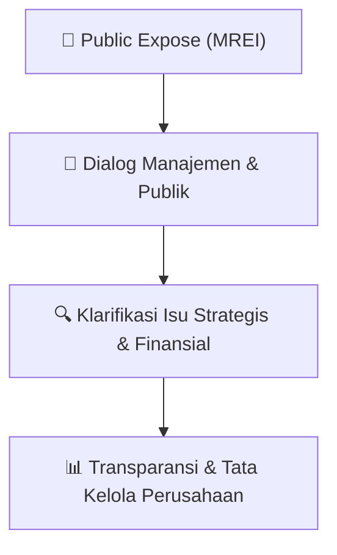

# 🎤 Laporan Hasil Public Expose: [MREI]

🏢 **Emiten**: `MREI` | 📅 **Tanggal Pelaksanaan**: `2026-07-31` | ❓ **Total Pertanyaan**: `3 Pertanyaan`
⬅️ [[knowledge-base/daily-digests/MREI_20260731|Kembali ke Daily Digest]] | 🎛️ [[Dashboard/MREI|Ke Dashboard Emiten]]

> [!IMPORTANT]
> Dokumen ini memuat seluruh risalah hasil pelaksanaan dan sesi tanya jawab (Q&A) Public Expose MREI. Informasi dicatat secara verbatim guna memberikan analisis sentimen dan arah kebijakan manajemen bagi investor.

---

## ℹ️ 1. Informasi Penyelenggaraan & Kehadiran

| Parameter | Detail Pelaksanaan |
|---|---|
| **Nomor Surat** | 124/SEKPER/RUPS/072026 |
| **Perihal** | Rencana Penyelenggaraan Public Expose Insidentil |
| **Waktu Pengumuman** | 31-07-2026 15:11 |
| **Jumlah Kehadiran Peserta** | Sesuai daftar hadir bursa |
| **Lampiran Berkas** | `1` |

---

## 💬 2. Risalah Tanya Jawab Manajemen & Investor (3 Pertanyaan)

### ❓ Pertanyaan #1

> **Penanya**: *Investor / Analis Publik*

```text
Pertanyaan:
1. 
Link meeting akan diberikan melalui email setelah proses pendaftaran dilakukan.
```

💡 **Jawaban & Klarifikasi Manajemen**:

> *Teks tanggapan manajemen tidak tersedia*

---

### ❓ Pertanyaan #2

> **Penanya**: *Investor / Analis Publik*

```text
Pertanyaan:
2. 
Bahan Public Expose akan tersedia di website Bursa Efek Indonesia dan situs web Perseroan 
paling lambat 3 (tiga) hah sebelum pelaksanaan Public 
Expose.
```

💡 **Jawaban & Klarifikasi Manajemen**:

> *Teks tanggapan manajemen tidak tersedia*

---

### ❓ Pertanyaan #3

> **Penanya**: *Investor / Analis Publik*

```text
Pertanyaan:
3. 
Pertanyaan lebih lanjut dapat menghubungi Unit Sekretaris Perusahaan melalui ema/7 
cosec@marein-re.com
Demikian disampaikan, atas perhatiannya kami ucapkan terima kasih.
Hormat kami,
ur PT Maskapai Reasuransi Indonesia Tbk.
Jl. Jend- Sudirman Kav. 76-78 
Plaza Marein, 18"' Floor 
Jakarta 12910 
P: +6221 579 36588 (hunting) 
E: cosec@marein-re,com 
www,marern-re.com
```

💡 **Jawaban & Klarifikasi Manajemen**:

> *Teks tanggapan manajemen tidak tersedia*

---

## 📌 3. Peta Jalur Transparansi & Kepercayaan Pasar



---

*Dokumen diolah otomatis oleh **Swarm Intelijen Pasar Modal Indonesia** pada 2026-10-12 16:47 WIB.*