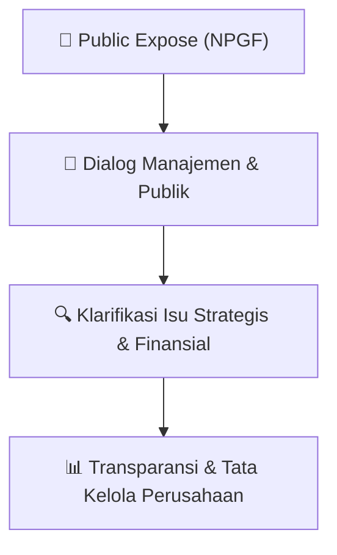

# 🎤 Laporan Hasil Public Expose: [NPGF]

🏢 **Emiten**: `NPGF` | 📅 **Tanggal Pelaksanaan**: `2026-08-04` | ❓ **Total Pertanyaan**: `2 Pertanyaan`
⬅️ [[knowledge-base/daily-digests/NPGF_20260804|Kembali ke Daily Digest]] | 🎛️ [[Dashboard/NPGF|Ke Dashboard Emiten]]

> [!IMPORTANT]
> Dokumen ini memuat seluruh risalah hasil pelaksanaan dan sesi tanya jawab (Q&A) Public Expose NPGF. Informasi dicatat secara verbatim guna memberikan analisis sentimen dan arah kebijakan manajemen bagi investor.

---

## ℹ️ 1. Informasi Penyelenggaraan & Kehadiran

| Parameter | Detail Pelaksanaan |
|---|---|
| **Nomor Surat** | 0437/CSC-NPG/VIII/2026 |
| **Perihal** | Laporan Hasil Public Expose Tahunan |
| **Waktu Pengumuman** | 04-08-2026 15:28 |
| **Jumlah Kehadiran Peserta** | Penyampaian Hasil Public Expose |
| **Lampiran Berkas** | `1` |

---

## 💬 2. Risalah Tanya Jawab Manajemen & Investor (2 Pertanyaan)

### ❓ Pertanyaan #2

> **Penanya**: *Investor / Analis Publik*

```text
Pertanyaan:
2. Peserta 
Peserta public expose perseroan adalah pemegang saham dan manajemen Perseroan (daftar hadir dan 
dokumentasi pelaksanaan public expose terlampir). 
 
3. Sesi Tanya Jawab 
Pada sesi tanya jawab public expose, tidak terdapat pertanyaan yang diajukan oleh peserta kepada Perseroan. 
Selanjutnya, telah disampaikan kepada peserta bahwa terhadap pertanyaan yang belum sempat diajukan dalam sesi 
tanya jawab dapat diajukan secara tertulis melalui email yang ditujukan kepada corporatesecretary@ptnpg.com. 
Namun, sampai dengan laporan ini disampaikan, tidak terdapat pertanyaan yang diajukan oleh peserta public 
expose kepada Perseroan.
Demikian surat pemberitahuan informasi ini disampaikan, atas perhatiannya diucapkan terima kasih.
Hormat Kami,  
PT Nusa Palapa Gemilang Tbk
Muchammad Atho’ur Rohman 
Sekretaris Perusahaan
Tembusan Yth.:
```

💡 **Jawaban & Klarifikasi Manajemen**:

> *Teks tanggapan manajemen tidak tersedia*

---

### ❓ Pertanyaan #1

> **Penanya**: *Investor / Analis Publik*

```text
Pertanyaan:
1. PT Kustodian Sentral Efek Indonesia 
2. PT Bima Registra
DOKUMENTASI PUBLIC EXPOSE 
PT NUSA PALAPA GEMILANG TBK
30 JULI 2026
Media : - Zoom Meeting
- Youtube Live (https://www.youtube.com/live/T9SxKbM3LMM?si=eIWnnPAeR8HxVkrf)
DAFTAR HADIR  
PUBLIC EXPOSE 
PT NUSA PALAPA GEMILANG TBK
30 JULI 2026
No
Nama Lengkap
Keterangan
Nama Institusi
1
Himawan Hartono
Individual
-
2
Deffandi Nasrul
Individual
-
```

💡 **Jawaban & Klarifikasi Manajemen**:

> *Teks tanggapan manajemen tidak tersedia*

---

## 📌 3. Peta Jalur Transparansi & Kepercayaan Pasar



---

*Dokumen diolah otomatis oleh **Swarm Intelijen Pasar Modal Indonesia** pada 2026-10-12 16:47 WIB.*