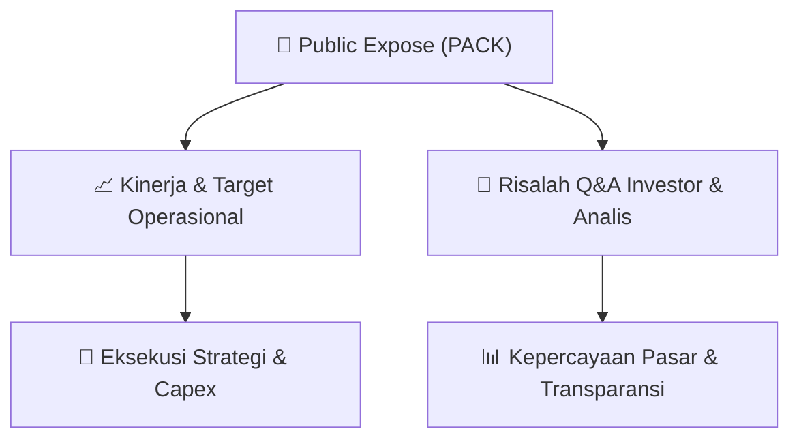

# 📢 Laporan Intelijen Paparan Publik (Public Expose) - [[PACK]]
🏢 **Emiten**: `[[PACK]]` | 📅 **Tanggal Pelaksanaan**: `2026-09-09` | 📑 **Dokumen**: `Public Expose lamp1`
⬅️ [[knowledge-base/daily-digests/Daily_Digest_20260909|Kembali ke Daily Digest]] | 🎛️ [[Dashboard|Ke Dashboard Utama]]

---

## 📌 1. Ringkasan Eksekutif & Paparan Direksi
> [!NOTE]
> PT Abadi Nusantara Hijau Investama Tbk (PACK) menyelenggarakan Paparan Publik Insidentil pada Jumat, 11 September 2026 pukul 10:00 WIB secara virtual melalui Zoom. Agenda utama meliputi: (1) pemaparan kinerja keuangan dan kondisi bisnis terkini, (2) rencana bisnis ke depan, serta (3) analisis manajemen terkait pergerakan harga saham dan suspensi bursa. Paparan ini diselenggarakan sebagai tindak lanjut atas Surat Keputusan Direksi BEI Nomor Kep-00087/BEI/12-2025 Pasal III.2 tentang Perubahan Peraturan Nomor I-E. Manajemen yang hadir diwakili oleh Direktur Donnie Holman Partogi Manurung. Materi paparan disampaikan ke BEI pada 10 September 2026.

#### 🎯 Guidance Operasional & Target Strategis
- Dokumen ini hanya berisi pemberitahuan rencana penyelenggaraan Public Expose Insidentil, belum memuat rincian target kinerja, ekspansi, atau capex spesifik. Namun, agenda paparan mengindikasikan bahwa manajemen akan memberikan guidance terkait: (1) kinerja keuangan dan kondisi bisnis terkini, (2) rencana bisnis masa mendatang, dan (3) penjelasan mengenai pergerakan harga saham serta suspensi bursa. Investor diharapkan menantikan pemaparan materi pada 11 September 2026 untuk mendapatkan detail katalis dan guidance operasional.

## 📊 2. Matriks Indikator Operasional & Parameter Kunci
| Parameter Utama | Nilai / Keterangan Resmi |
| :--- | :--- |
| **Nama Emiten** | `PT Abadi Nusantara Hijau Investama Tbk (PACK)` |
| **Jenis Paparan** | `Paparan Publik Insidentil (Insidentil Public Expose)` |
| **Tanggal Pelaksanaan** | `Jumat, 11 September 2026, 10:00 WIB – Selesai` |
| **Metode Pelaksanaan** | `Live Event via Zoom (https://us06web.zoom.us/j/81029043340)` |
| **Dasar Penyelenggaraan** | `Surat Keputusan Direksi BEI Nomor Kep-00087/BEI/12-2025 Pasal III.2` |
| **Manajemen Hadir** | `Donnie Holman Partogi Manurung (Direktur)` |
| **Tanggal Penyampaian Materi ke BEI** | `10 September 2026` |
| **Agenda 1** | `Kinerja keuangan dan kondisi bisnis terkini Perseroan` |
| **Agenda 2** | `Rencana bisnis Perseroan di masa mendatang` |
| **Agenda 3** | `Analisa Manajemen terkait pergerakan harga saham dan suspensi bursa` |

---

## 💬 3. Risalah Tanya Jawab (Q&A Session)
### ❓ Pertanyaan 1 (Belum tersedia (dokumen hanya berisi pemberitahuan rencana paparan))
**Pertanyaan**: Belum ada pertanyaan yang tercantum dalam dokumen ini.

**Jawaban Manajemen**: Belum ada jawaban yang tercantum dalam dokumen ini.

> [!TIP]
> **Implikasi Bagi Investor**: Investor perlu menunggu sesi tanya jawab pada saat Public Expose berlangsung tanggal 11 September 2026 untuk mendapatkan klarifikasi manajemen, terutama terkait kinerja keuangan, rencana bisnis, dan isu suspensi saham.

## 📌 4. Peta Jalur Strategis & Roadmap

---

## 🔗 Knowledge Graph
- [[knowledge-base/daily-digests/Daily_Digest_20260909|📄 Daily Digest 2026-09-09]]
- [[knowledge-base/calendars/Action_Calendar|🗓️ Kalender Terpusat Aksi Korporasi]]
- [[Dashboard|🎛️ Kembali ke Dashboard Utama]]