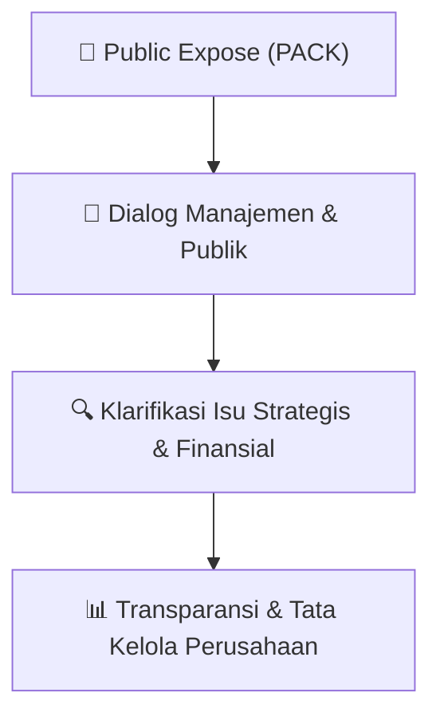

# 🎤 Laporan Hasil Public Expose: [PACK]

🏢 **Emiten**: `PACK` | 📅 **Tanggal Pelaksanaan**: `2026-09-12` | ❓ **Total Pertanyaan**: `7 Pertanyaan`
⬅️ [[knowledge-base/daily-digests/PACK_20260912|Kembali ke Daily Digest]] | 🎛️ [[Dashboard/PACK|Ke Dashboard Emiten]]

> [!IMPORTANT]
> Dokumen ini memuat seluruh risalah hasil pelaksanaan dan sesi tanya jawab (Q&A) Public Expose PACK. Informasi dicatat secara verbatim guna memberikan analisis sentimen dan arah kebijakan manajemen bagi investor.

---

## ℹ️ 1. Informasi Penyelenggaraan & Kehadiran

| Parameter | Detail Pelaksanaan |
|---|---|
| **Nomor Surat** | 004/CORSEC-ANHI/IX/2026 |
| **Perihal** | Laporan Hasil Public Expose Insidentil |
| **Waktu Pengumuman** | 12-09-2026 08:25 |
| **Jumlah Kehadiran Peserta** | Penyampaian Hasil Public Expose |
| **Lampiran Berkas** | `1` |

---

## 💬 2. Risalah Tanya Jawab Manajemen & Investor (7 Pertanyaan)

### ❓ Pertanyaan #4

> **Penanya**: *Investor / Analis Publik*

```text
Pertanyaan:
No. 004/CORSEC-ANHI/IX/2026
Jakarta, 12 September 2026
Untuk perhatian
:
Bapak Aditya Nugraha
Pelaksana Harian Kepada Divisi Penilaian Perusahaan 1 
 
Perihal
:
Penyampaian Hasil Paparan Publik Insidentil (“Paparan Publik”) PT Abadi 
Nusantara Hijau Investama Tbk
LAMPIRAN 1
A. Pendahuluan
Dalam rangka memenuhi peraturan PT Bursa Efek Indonesia ("BEI") No. I-E tentang Kewajiban 
Penyampaian Informasi jo. Surat Edaran BEI No. SE-00003/BEI/05-2020 tentang Tata Cara 
Pelaksanaan Public Expose Secara Elektronik, Perseroan telah melaksanakan Public Expose dengan 
detil dibawah ini:
Hari dan tanggal 
: Jumat, 11 September 2026
Waktu  
 
: 10.00 – 10.30 WIB
B. Perwakilan Manajemen, Pembawa Acara dan Peserta Acara Yang Hadir
 
Fu Pei Wen (Direktur Utama)  
 
Rendy Suryagama (Staff Khusus Direktur Utama)  
 
Calvin Setiawan (Corporate Secretary)
Salinan daftar hadir - terlampir.
C. Agenda Paparan Publik
```

💡 **Jawaban & Klarifikasi Manajemen**:

> *Teks tanggapan manajemen tidak tersedia*

---

### ❓ Pertanyaan #1

> **Penanya**: *Investor / Analis Publik*

```text
Pertanyaan:
1. Business Overview & Key Updates
```

💡 **Jawaban & Klarifikasi Manajemen**:

> *Teks tanggapan manajemen tidak tersedia*

---

### ❓ Pertanyaan #2

> **Penanya**: *Investor / Analis Publik*

```text
Pertanyaan:
2. Future Strategy
```

💡 **Jawaban & Klarifikasi Manajemen**:

> *Teks tanggapan manajemen tidak tersedia*

---

### ❓ Pertanyaan #3

> **Penanya**: *Investor / Analis Publik*

```text
Pertanyaan:
3. Financial Performance
D. Ringkasan Tanya Jawab
```

💡 **Jawaban & Klarifikasi Manajemen**:

> *Teks tanggapan manajemen tidak tersedia*

---

### ❓ Pertanyaan #1

> **Penanya**: *Investor / Analis Publik*

```text
Pertanyaan:
1.
Nama
:
Johannes
Pertanyaan
:
Sesuai dengan surat tanggapan Perseroan terhadap permintaan 
penjelasan dari bursa, Perseroan menuliskan bahwa Perseroan sedang 
mempertimbangkan untuk melakukan aksi korporasi dalam waktu 
dekat, aksi korporasi apa yang dimaksud
Jawaban
:
Betul Perseroan sedang mempertimbangkan untuk melakukan aksi 
korporasi. Dalam jangka pendek, Perseroan berencana meningkatkan 
kapasitas bijih nikel. Perseroan belum bisa memberikan informasi lebih 
lanjut terkait dengan aksi korporasi tersebut. Apabila Perseroan akan 
melakukan aksi korporasi dalam bentuk apapun, Perseroan akan 
mematuhi seluruh ketentuan peraturan perundang-undangan di bidang
pasar modal yang berlaku, termasuk melakukan keterbukaan informasi 
kepada publik dan memperoleh persetujuan pemegang saham sesuai 
ketentuan yang berlaku
```

💡 **Jawaban & Klarifikasi Manajemen**:

> *Teks tanggapan manajemen tidak tersedia*

---

### ❓ Pertanyaan #2

> **Penanya**: *Investor / Analis Publik*

```text
Pertanyaan:
2.
Nama
:
Tiffany Hartono
Pertanyaan
:
Bagaimana tanggapan manajemen terhadap kenaikan harga saham 
PACK? Apakah Manajemen memiliki strategi khusus dalam menjaga 
harga saham?
Jawaban
:
Perseroan tidak memiliki strategi khusus dalam menjaga harga saham. 
Pergerakan saham merupakan mekanisme dari pasar. Analisa 
manajemen terhadap kenaikan harga saham salah satunya diakibatkan 
oleh kinerja Perseroan yang baik dimana Perseroan mencatatkan net 
profit yang baik sebesar IDR 190,7 miliar sampai dengan periode yang 
berakhir 30 Juni 2026. Perseroan juga melihat bahwa EEP selaku 
pemegang saham pengendali Perseroan terus memberikan dukungan.
```

💡 **Jawaban & Klarifikasi Manajemen**:

> *Teks tanggapan manajemen tidak tersedia*

---

### ❓ Pertanyaan #3

> **Penanya**: *Investor / Analis Publik*

```text
Pertanyaan:
3.
Nama
:
Benjamin Bunggono
Pertanyaan
:
Apakah ada hubungan antara Haji Isam dengan CNGR melihat bahwa 
Haji Isam menjadi pemegang saham dari PACK? Sinergi apa yang 
diberikan oleh Haji Isam?
Jawaban
:
Berdasarkan informasi yang dimiliki oleh Perseroan, Haji Isam 
merupakan salah satu pemegang saham minoritas signifikan dari 
Perseroan dan bukan merupakan Pengendali. Sedangkan EEP adalah 
pemegang saham pengendali dari Perseroan.
LAMPIRAN 2
DAFTAR HADIR
No 
Public Expose Attendees 
1 
Corporate Secretary 
2 
Hans Sidharta 
3 
AngryTom Tom 
4 
ASC 
5 
Yogabuti Prasetio 
6 
Livia  
7 
darius gunawan 
8 
Presenter 
9 
daniel - analyst 
10 
Sunan 
11 
David 
12 
Presenter 
13 
Daniel Sunjaya 
14 
408 Rizki Ariansyah 
15 
E K 
16 
Rendy 
17 
denny kasim 
18 
Rendy 
19 
indracahyadi21 
20 
Kristopher Pinardy 
21 
Ronni Ganda Manullang 
22 
jendro 
23 
Iqbal Deogratias 
24 
Eddy 
25 
Johanes 
26 
Johanes 
27 
denny kasim 
28 
yuje 
29 
DEFFANDI NASRUL 
30 
jethro 
31 
Chris 
32 
Yud 
33 
BAN 
34 
William William 
35 
Nugrahitha Aditya 
36 
Rendra 
37 
Fred 
38 
Weezy. 
39 
Microsoft User 
40 
Ralaisya Hafizhatus Shabirah
41 
sugiman 
42 
Krisna Vienno 
43 
Reynaldi 
44 
Okky 
45 
dyota 
46 
rudi 
47 
Buana - Michal Nanere 
48 
irwan Suni 
49 
Sutono Ralf 
50 
mahoedara 
51 
R C O 
52 
Tiffany Hartono 
53 
Fernando Louis 
54 
Polnustar 
55 
Tiffany Hartono 
56 
Benjamin 
57 
Ivan S 
58 
Suyantono 
59 
akhi . 
60 
Ruliff 
61 
Neel 
62 
Ahmad rizki Aryadi 
63 
Benjamin 
64 
T1155 - David Gunawan 
65 
David Gunawan 
66 
M. Farel Rizky Akbar 
67 
Benson 
68 
Willy Fernando 
69 
Riki 
70 
Orlando Mikael 
71 
budi phe 
72 
Sandi Sanjaya Putra 
73 
Vincentius Reinaldi 
74 
Jonathan Jonathan 
75 
EJ 
76 
Benjamin Bunggono 
77 
Lukas Sitorus 
78 
BFJ 
79 
user 
80 
Kevin Wijaya 
81 
dimazzz 
82 
nada 
83 
Benjamin Bunggono 
84 
Yuza ( PT. TAN Logistics)
85 
Michelle 
86 
Algo Research_Shobi 
87 
Cuann 
88 
Merta Yasa 
89 
Nugrahitha Aditya 
90 
Reinaldo 
91 
Excel Faresi 
92 
eoado 
93 
mdgaming.id 
94 
Riki 
95 
Shiervine Angelica 
96 
Dewan Pengawas_Krisna Nugraha 
97 
Katamso N S 
98 
Benyamin Mikael 
99 
Yayandi 
100 
Weezy. 
101 
Theodorus Melvin 
102 
dimazzz 
103 
FinPair - Reinaldo Tendean 
104 
Okky Cahya 
105 
Yuza ( PT. TAN Logistics) 
106 
iPhone 
107 
rudy grey 
108 
Ari youngky Priyono 
109 
Excel Faresi 
110 
Sunan 
111 
Ruliff 
112 
David 
113 
Eddy 
114 
ken (mahoedara) 
115 
Benyamin Mikael 
116 
Michelle 
117 
Algo Research_Shobi 
118 
Livia  
119 
Sutono Ralf 
120 
Krisna Vienno 
121 
Fred 
122 
Ronni Ganda Manullang 
123 
William William 
124 
David Gunawan 
125 
Willy Fernando 
126 
BFJ 
127 
Iqbal Deogratias 
128 
Reynaldi (Reynaldi)
129 
Daniel Sunjaya 
130 
Ari youngky Priyono 
131 
Nugrahitha Aditya 
132 
eoado 
133 
sugiman 
134 
Sandy Thenardy 
135 
mdgaming.id 
136 
irwan Suni 
137 
Fernando Louis 
138 
indracahyadi21 
139 
Okky Cahya 
140 
BAN 
141 
Benson 
142 
Hans Sidharta 
143 
Vincentius Reinaldi 
144 
Jethro (jethro) 
145 
user 
146 
Yogabuti Prasetio 
147 
EJ 
148 
Ivan S 
149 
darius gunawan 
150 
nada 
151 
Neel 
152 
Lukas Sitorus 
153 
iPhone 
154 
Yuza ( PT. TAN Logistics) 
155 
Merta Yasa 
156 
M. Farel Rizky Akbar 
157 
Microsoft User 
158 
Ahmad rizki Aryadi 
159 
Yudi (Yud) 
160 
Nugrahitha Aditya 
161 
Krisna Nugraha (Dewan Pengawas_Krisna Nugraha) 
162 
Riki 
163 
DEFFANDI NASRUL 
164 
R C O 
165 
Polnustar 
166 
rudi 
167 
Weezy. 
168 
Jonathan Jonathan 
169 
Sandi Sanjaya Putra 
170 
Theodorus Melvin 
171 
yuje 
172 
Orlando Mikael
173 
Kristopher Pinardy 
174 
akhi . 
175 
ASC 
176 
Katamso N S 
177 
Shiervine Angelica 
178 
AngryTom Tom 
179 
Cuann 
180 
rudy grey 
181 
daniel - analyst 
182 
budi phe 
183 
Yayandi 
184 
Excel Faresi 
185 
dimazzz 
186 
Mr mizz 
187 
Suyantono 
188 
Chris 
189 
Candra y 
190 
Rendra 
191 
Robby Tanusenjaya 
192 
Mr mizz 
193 
Robby Tanusenjaya 
194 
Sandy Thenardy 
195 
Candra y 
196 
raymund.kewo 
197 
Zaidan Novari 
198 
denny kasim 
199 
Ralaisya Hafizhatus Shabirah 
200 
Alfa (Zaidan Novari) 
201 
raymund.kewo 
202 
1246_MT Barasakti 
203 
denny kasim 
204 
Andi Satriya K.P 
205 
Andi Satriya K.P 
206 
irwan Suni 
207 
Teddy 
208 
Pratama 
209 
Pratama 
210 
Kevin Wijaya 
211 
Teddy 
212 
Cahyadi Tanaya 
213 
Renaldy Effendy 
214 
Calon Investor 
215 
Calon Investor 
216 
ken (Kevin Wijaya)
217 
Renaldy E (Renaldy Effendy) 
218 
Cahyadi Tanaya 
219 
Richard tomang 
220 
nada 
221 
Hendri Effendi_UOB Kayhian Sekuritas 
222 
Alden 
223 
nada 
224 
DZAKI AHMAD 
225 
DZAKI AHMAD 
226 
Alden 
227 
Hendri Effendi_UOB Kayhian Sekuritas 
228 
Richard tomang 
229 
Shiervine Angelica 
230 
Shiervine Angelica 
231 
Syarief 
232 
Dede Rusmana 
233 
Zoom user 
234 
TECNO CM7 
235 
Natasha’s iphone (2) 
236 
fx 
237 
rexis ss 
238 
Xiaomi M2003J15SC 
239 
OPPO CPH2359 
240 
Yuantonius 
241 
Johanes 
242 
jendro 
243 
ARIZKY YANUAR RAMADHAN 
244 
Dede Rusmana 
245 
Juan 
246 
Aldi 
247 
Aldi 
248 
ARIZKY YANUAR RAMADHAN 
249 
STI Palembang 
250 
Harry Kotok 
251 
KC 
252 
Erika Oktaviani Tirtawidjaja 
253 
Rei Salim 
254 
408 Rizki Ariansyah 
255 
Huda 
256 
1246_MT Barasakti 
257 
KA SPPG Lamongan Lamongan Sukorejo - Mesra Amalia Ramadhani 
258 
jendro 
259 
KC 
260 
Aldi
```

💡 **Jawaban & Klarifikasi Manajemen**:

> *Teks tanggapan manajemen tidak tersedia*

---

## 📌 3. Peta Jalur Transparansi & Kepercayaan Pasar



---

*Dokumen diolah otomatis oleh **Swarm Intelijen Pasar Modal Indonesia** pada 2026-10-12 16:47 WIB.*