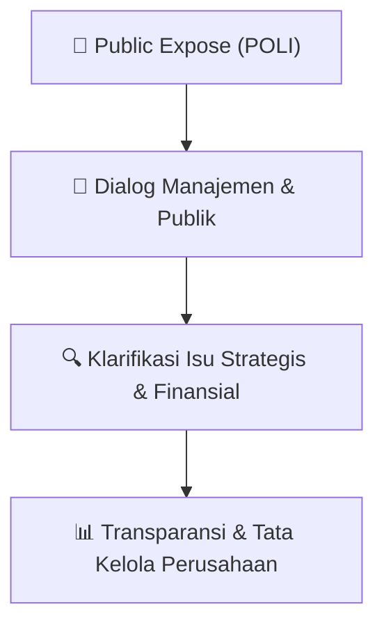

# 🎤 Laporan Hasil Public Expose: [POLI]

🏢 **Emiten**: `POLI` | 📅 **Tanggal Pelaksanaan**: `2026-10-05` | ❓ **Total Pertanyaan**: `5 Pertanyaan`
⬅️ [[knowledge-base/daily-digests/POLI_20261005|Kembali ke Daily Digest]] | 🎛️ [[Dashboard/POLI|Ke Dashboard Emiten]]

> [!IMPORTANT]
> Dokumen ini memuat seluruh risalah hasil pelaksanaan dan sesi tanya jawab (Q&A) Public Expose POLI. Informasi dicatat secara verbatim guna memberikan analisis sentimen dan arah kebijakan manajemen bagi investor.

---

## ℹ️ 1. Informasi Penyelenggaraan & Kehadiran

| Parameter | Detail Pelaksanaan |
|---|---|
| **Nomor Surat** | Nama Perusahaan |
| **Perihal** | 003/PHG-CS/OJK-IDX/X/2026 |
| **Waktu Pengumuman** | 05-10-2026 15:07 |
| **Jumlah Kehadiran Peserta** | Sesuai daftar hadir bursa |
| **Lampiran Berkas** | `Risalah Tanya Jawab Resmi` |

---

## 💬 2. Risalah Tanya Jawab Manajemen & Investor (5 Pertanyaan)

### ❓ Pertanyaan #1

> **Penanya**: *Investor / Analis Publik*

```text
Pertanyaan:
2018
7
Pollux Mall Cikarang
MallJl. Raya Cibarusah, Bekasi
Operasi
sejak
```

💡 **Jawaban & Klarifikasi Manajemen**:

> *Teks tanggapan manajemen tidak tersedia*

---

### ❓ Pertanyaan #2

> **Penanya**: *Investor / Analis Publik*

```text
Pertanyaan:
24

THE BEST CEO 2025 DARI SWA MEDIA GROUP
Pada bulan Maret tahun 2026 Bpk Handojo Koentoro Setyadi, Presiden Direktur
PT Pollux Hotels Group Tbk, meraih penghargaan “The Best CEO 2025” dari SWA
Media Group sebagai apresiasi atas kepemimpinannya dalam mentransformasi
perusahaan menjadi pemain hospitality yang adaptif, inovatif, dan berorientasi
masa
depan.
Di bawah arahannya, Pollux Hotels Group mencatatkan tonggak penting dengan
menjadi pelopor penerbitan Sustainability Linked Bond senilai Rp500 miliar yang
pertama di sektor perhotelan Indonesia. Langkah strategis ini menegaskan
komitmen
perusahaan
terhadap
pertumbuhan
berkelanjutan
sekaligus
memperkuat posisi Pollux di industri hospitality nasional.
```

💡 **Jawaban & Klarifikasi Manajemen**:

> *Teks tanggapan manajemen tidak tersedia*

---

### ❓ Pertanyaan #3

> **Penanya**: *Investor / Analis Publik*

```text
Pertanyaan:
26

PERKUAT EKOSISTEM INDUSTRI MEETING INCENTIVE CONVENTION AND EXHIBITION (MICE) BERSAMA MITRA STRATEGIS
```

💡 **Jawaban & Klarifikasi Manajemen**:

> *Teks tanggapan manajemen tidak tersedia*

---

### ❓ Pertanyaan #4

> **Penanya**: *Investor / Analis Publik*

```text
Pertanyaan:
Pollux Hotels Group dengan bangga menjalin kerja sama dengan iForte Energi
Nusantara melalui pemasangan Pembangkit Listrik Tenaga Surya (PLTS) di Pollux
Mall Paragon, salah satu properti Perseroan di Semarang, dengan kapasitas 522
kWp. Pada tahun pertama, inisiatif ini diproyeksikan setara dengan:
•Pengurangan emisi CO₂ sebesar 620 ton
•Pengurangan emisi yang setara dengan 264.000 liter bensin
•Setara dengan penanaman 28.500 pohon
•Produksi energi sebesar 730.276 kWh
Kerja sama ini menjadi salah satu langkah nyata dalam strategi keberlanjutan
Perseroan melalui pemanfaatan energi terbarukan pada properti Perseroan,
sekaligus mendukung operasional yang lebih efisien dan bertanggung jawab
terhadap lingkungan.
28

SIGNING CEREMONY HOTEL MANAGEMENT AGREEMENT 
BETWEEN 
POLLUX HOTELS GROUP AND ACCOR
```

💡 **Jawaban & Klarifikasi Manajemen**:

> *Teks tanggapan manajemen tidak tersedia*

---

### ❓ Pertanyaan #5

> **Penanya**: *Investor / Analis Publik*

```text
Pertanyaan:
PT Pollux Hotels Group Tbk resmi menandatangani kerja sama strategis
dengan Marriott International, membuka babak baru dalam perjalanan Pollux
Hotels Group untuk memperluas jejak hospitality Indonesia ke pasar global.
Kolaborasi ini menggabungkan local expertise dan global hospitality excellence
memperluas konektivitas, membuka akses ke jaringan global Marriott, serta
menghadirkan peluang pertumbuhan baru bagi bisnis hospitality Indonesia.
Bagi Pollux Hotels Group, langkah ini bukan hanya tentang bertumbuh lebih
besar, tetapi tentang membawa hospitality Indonesia melangkah lebih jauh,
dengan standar yang semakin tinggi dan jangkauan yang semakin luas.
30

SIGNING AGREEMENTS BAYMOND BY WYNDHAM
```

💡 **Jawaban & Klarifikasi Manajemen**:

> *Teks tanggapan manajemen tidak tersedia*

---

## 📌 3. Peta Jalur Transparansi & Kepercayaan Pasar



---

*Dokumen diolah otomatis oleh **Swarm Intelijen Pasar Modal Indonesia** pada 2026-10-12 16:12 WIB.*