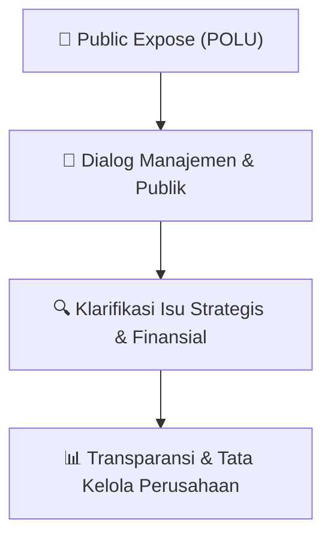

# 🎤 Laporan Hasil Public Expose: [POLU]

🏢 **Emiten**: `POLU` | 📅 **Tanggal Pelaksanaan**: `2026-10-09` | ❓ **Total Pertanyaan**: `1 Pertanyaan`
⬅️ [[knowledge-base/daily-digests/POLU_20261009|Kembali ke Daily Digest]] | 🎛️ [[Dashboard/POLU|Ke Dashboard Emiten]]

> [!IMPORTANT]
> Dokumen ini memuat seluruh risalah hasil pelaksanaan dan sesi tanya jawab (Q&A) Public Expose POLU. Informasi dicatat secara verbatim guna memberikan analisis sentimen dan arah kebijakan manajemen bagi investor.

---

## ℹ️ 1. Informasi Penyelenggaraan & Kehadiran

| Parameter | Detail Pelaksanaan |
|---|---|
| **Nomor Surat** | 83/LGL/GFU/X/2026 |
| **Perihal** | Laporan Hasil Public Expose Tahunan |
| **Waktu Pengumuman** | 09-10-2026 10:41 |
| **Jumlah Kehadiran Peserta** | Penyampaian Hasil Public Expose |
| **Lampiran Berkas** | `1` |

---

## 💬 2. Risalah Tanya Jawab Manajemen & Investor (1 Pertanyaan)

### ❓ Pertanyaan #1

> **Penanya**: *Investor / Analis Publik*

```text
Pertanyaan:
1. 
Bagaimana strategi Perseroan untuk meningkatkan profitabilitas? 
 
Jawaban: 
Perseroan berupaya meningkatkan penjualan dengan perluasan pasar di Asia Pasifik dan pasar 
domestik untuk mewujudkan diversifikasi pasar. Tentunya hal ini akan diikuti dengan 
peningkatan kapasitas produksi. 
 
2. 
Bagaimana langkah Perseroan untuk bersaing dengan berbagai kompetitor garmen terutama 
dari Vietnam dan Bangladesh? 
 
Jawaban: 
Tentunya Perseroan akan terus mengedepankan efisiensi di berbagai proses kerja. Efisiensi yang 
dilakukan dapat berupa mempersingkat lead time produksi dan memperluas otomasi, sehingga 
kualitas kinerja dapat dimaksimalkan. Selain itu Perseroan memandang pentingnya untuk 
melakukan diversifikasi terhadap pangsa pasar. 
 
Demikian informasi ini kami sampaikan. Atas perhatian dan kerjasamanya kami ucapkan 
terimakasih. 
 
Semarang, 9 Oktober 2026 
          
 
 
 
Teny Siti Febryani 
 
 
Direktur Utama
```

💡 **Jawaban & Klarifikasi Manajemen**:

> *Teks tanggapan manajemen tidak tersedia*

---

## 📌 3. Peta Jalur Transparansi & Kepercayaan Pasar



---

*Dokumen diolah otomatis oleh **Swarm Intelijen Pasar Modal Indonesia** pada 2026-10-12 16:47 WIB.*