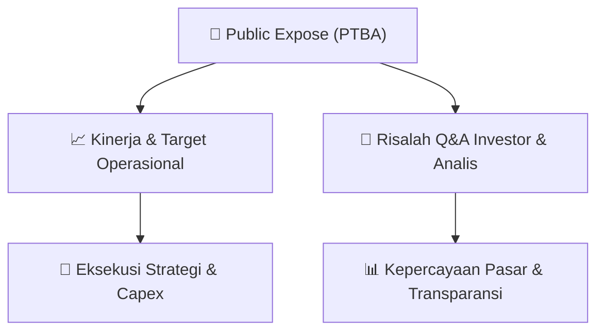

# 📢 Laporan Intelijen Paparan Publik (Public Expose) - [[PTBA]]
🏢 **Emiten**: `[[PTBA]]` | 📅 **Tanggal Pelaksanaan**: `2026-09-10` | 📑 **Dokumen**: `Public Expose lamp2`
⬅️ [[knowledge-base/daily-digests/Daily_Digest_20260910|Kembali ke Daily Digest]] | 🎛️ [[Dashboard|Ke Dashboard Utama]]

---

## 📌 1. Ringkasan Eksekutif & Paparan Direksi
> [!NOTE]
> Public Expose PT Bukit Asam Tbk (PTBA) dihadiri oleh 210 peserta dari kalangan analis, investor, dan 60 perwakilan media. Paparan publik ini berfokus pada penyampaian kinerja operasional dan keuangan perusahaan, strategi bisnis ke depan, serta sesi tanya jawab dengan manajemen. Sayangnya, teks mentah dokumen yang diberikan hanya berisi daftar hadir peserta dan media, tanpa memuat materi paparan, rincian kinerja, atau transkrip tanya jawab. Oleh karena itu, informasi mengenai ringkasan eksekutif, katalis, guidance, fakta material, dan risalah Q&A tidak dapat diekstraksi dari dokumen ini.

#### 🎯 Guidance Operasional & Target Strategis
- Tidak tersedia dalam dokumen. Dokumen yang diberikan hanya berisi daftar hadir peserta Public Expose dan daftar hadir press conference, tanpa memuat materi presentasi manajemen, target kinerja, rencana ekspansi, atau belanja modal (capex).

## 📊 2. Matriks Indikator Operasional & Parameter Kunci
| Parameter Utama | Nilai / Keterangan Resmi |
| :--- | :--- |
| **Jumlah Peserta Public Expose** | `210 orang (terdaftar dalam daftar hadir)` |
| **Jumlah Media yang Hadir** | `60 perwakilan dari berbagai media massa` |
| **Tanggal Pelaksanaan** | `Tidak tercantum dalam dokumen` |
| **Lokasi Pelaksanaan** | `Tidak tercantum dalam dokumen (diasumsikan virtual/online berdasarkan format daftar hadir)` |

---

## 💬 3. Risalah Tanya Jawab (Q&A Session)
### ❓ Pertanyaan 1 (Tidak tersedia)
**Pertanyaan**: Tidak ada pertanyaan yang tercatat dalam dokumen karena dokumen hanya berisi daftar hadir.

**Jawaban Manajemen**: Tidak ada jawaban manajemen yang tercatat dalam dokumen.

> [!TIP]
> **Implikasi Bagi Investor**: Tidak dapat ditentukan karena tidak ada informasi Q&A yang tersedia.

## 📌 4. Peta Jalur Strategis & Roadmap

---

## 🔗 Knowledge Graph
- [[knowledge-base/daily-digests/Daily_Digest_20260910|📄 Daily Digest 2026-09-10]]
- [[knowledge-base/calendars/Action_Calendar|🗓️ Kalender Terpusat Aksi Korporasi]]
- [[Dashboard|🎛️ Kembali ke Dashboard Utama]]