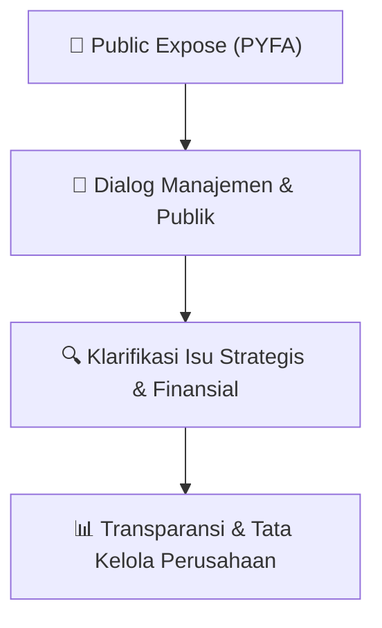

# 🎤 Laporan Hasil Public Expose: [PYFA]

🏢 **Emiten**: `PYFA` | 📅 **Tanggal Pelaksanaan**: `2026-08-06` | ❓ **Total Pertanyaan**: `1 Pertanyaan`
⬅️ [[knowledge-base/daily-digests/PYFA_20260806|Kembali ke Daily Digest]] | 🎛️ [[Dashboard/PYFA|Ke Dashboard Emiten]]

> [!IMPORTANT]
> Dokumen ini memuat seluruh risalah hasil pelaksanaan dan sesi tanya jawab (Q&A) Public Expose PYFA. Informasi dicatat secara verbatim guna memberikan analisis sentimen dan arah kebijakan manajemen bagi investor.

---

## ℹ️ 1. Informasi Penyelenggaraan & Kehadiran

| Parameter | Detail Pelaksanaan |
|---|---|
| **Nomor Surat** | 197/PYFA-CS/VIII/2026 |
| **Perihal** | Rencana Penyelenggaraan Public Expose Tahunan |
| **Waktu Pengumuman** | 06-08-2026 14:55 |
| **Jumlah Kehadiran Peserta** | Sesuai daftar hadir bursa |
| **Lampiran Berkas** | `1` |

---

## 💬 2. Risalah Tanya Jawab Manajemen & Investor (1 Pertanyaan)

### ❓ Pertanyaan #1

> **Penanya**: *Investor / Analis Publik*

```text
Pertanyaan:
1. Seluruh peserta wajib melakukan pendaftaran melalui tautan https://bit.ly/registrasi-pubexpyfa 
paling lambat pada hari Kamis, 20 Agustus 2026 pukul 10.00 WIB. 
2. Public Expose akan menggunakan aplikasi Zoom dengan tautan https://bit.ly/PYFA-PUBEX2026. 
3. Detail Meeting ID dan Passcode akan diberikan melalui alamat email yang didaftarkan melalui 
formulir registrasi pada poin 1 di atas. 
4. Tata cara pelaksanaan Public Expose secara elektronik termasuk tata cara penyampaian 
pertanyaan akan dikirimkan melalui email dan akan dibacakan kembali sebelum Public Expose 
dimulai. 
5. Untuk informasi lebih lanjut dapat menghubungi Perseroan melalui email corsec@pyfa.co.id.  
 
Public Expose akan dihadiri oleh Direksi Perseroan dan perwakilan Perseroan lainnya. Rencana 
penyampaian materi Public Expose adalah hari Selasa, 18 Agustus 2026.
```

💡 **Jawaban & Klarifikasi Manajemen**:

> *Teks tanggapan manajemen tidak tersedia*

---

## 📌 3. Peta Jalur Transparansi & Kepercayaan Pasar



---

*Dokumen diolah otomatis oleh **Swarm Intelijen Pasar Modal Indonesia** pada 2026-10-12 16:47 WIB.*