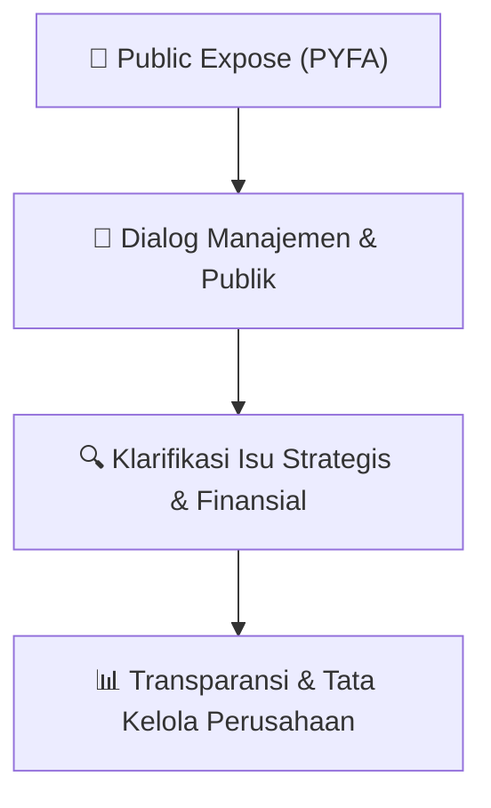

# 🎤 Laporan Hasil Public Expose: [PYFA]

🏢 **Emiten**: `PYFA` | 📅 **Tanggal Pelaksanaan**: `2026-08-27` | ❓ **Total Pertanyaan**: `4 Pertanyaan`
⬅️ [[knowledge-base/daily-digests/PYFA_20260827|Kembali ke Daily Digest]] | 🎛️ [[Dashboard/PYFA|Ke Dashboard Emiten]]

> [!IMPORTANT]
> Dokumen ini memuat seluruh risalah hasil pelaksanaan dan sesi tanya jawab (Q&A) Public Expose PYFA. Informasi dicatat secara verbatim guna memberikan analisis sentimen dan arah kebijakan manajemen bagi investor.

---

## ℹ️ 1. Informasi Penyelenggaraan & Kehadiran

| Parameter | Detail Pelaksanaan |
|---|---|
| **Nomor Surat** | 215/PYFA-CS/VIII/2026 |
| **Perihal** | Laporan Hasil Public Expose Tahunan |
| **Waktu Pengumuman** | 27-08-2026 14:24 |
| **Jumlah Kehadiran Peserta** | Penyampaian Hasil Public Expose |
| **Lampiran Berkas** | `1` |

---

## 💬 2. Risalah Tanya Jawab Manajemen & Investor (4 Pertanyaan)

### ❓ Pertanyaan #1

> **Penanya**: *Investor / Analis Publik*

```text
Pertanyaan:
1. 
Konteks pasar; 
2. 
Kinerja keuangan dan operasi terkini; 
3. 
Kendala-kendala yang dihadapi; 
4. 
Upaya peningkatan kinerja perseroan;  
5. 
Peluang pasar; dan 
6. 
Strategi bisnis perseroan tahun 2026. 
 
sesuai dengan materi yang telah disampaikan melalui Surat Perseroan No. 209/PYFA-CS/VIII/2026 
tentang Penyampaian Materi Public Expose Tahunan pada hari Selasa, 18 Agustus 2026. 
 
Setelah selesai dilakukannya penyampaian materi, dilanjutkan dengan sesi tanya-jawab dimana 
peserta diberikan kesempatan untuk mengajukan pertanyaan dan/atau pendapat kepada panelis Public 
Expose atau Direksi Perseroan.  
 
Berikut ini adalah pertanyaan peserta dan tanggapan dari anggota Direksi Perseroan dalam sesi tanya-
jawab:
Nama penanya:
```

💡 **Jawaban & Klarifikasi Manajemen**:

> *Teks tanggapan manajemen tidak tersedia*

---

### ❓ Pertanyaan #1

> **Penanya**: *Investor / Analis Publik*

```text
Pertanyaan:
1. Deffandi Nasrul – Investor 
2. Clementine - Investor
Pertanyaan:
```

💡 **Jawaban & Klarifikasi Manajemen**:

> *Teks tanggapan manajemen tidak tersedia*

---

### ❓ Pertanyaan #1

> **Penanya**: *Investor / Analis Publik*

```text
Pertanyaan:
1. Terkait dengan rencana Right Issue, mengingat 
statusnya ditunda dan bukan dibatalkan, apakah 
ada indikasi dari manajemen mengenai kapan 
pastinya rights issue PYFA akan direncanakan 
ulang? 
2. PYFA sudah mengumumkan akan melakukan 
Rights Issue dan sekarang ditunda, bagaimana 
statusnya sampai dengan saat ini? 
 
Tanggapan: 
 
Terkait PMHMETD II (Penambahan Modal dengan 
Memberikan Hak Memesan Efek Terlebih Dahulu II), 
Perseroan masih dalam tahap penundaan dan akan terus
memantau perkembangan pasar modal serta kondisi 
makro ekonomi. 
 
Jika kondisi pasar lebih kondusif dibandingkan dengan 
saat ini, maka Perseroan akan meneruskan kembali 
proses tersebut. Sebagai tambahan, Perseroan masih 
memiliki waktu sekitar dua belas bulan terhitung sejak 
RUPS terkait persetujuan PMHMETD II dilaksanakan, 
yakni tanggal 22 April 2026, sehingga Perseroan masih 
memiliki waktu sampai dengan tahun depan untuk 
melaksanakan kegiatan PMHMETD II.  
 
Nama Penanya: 
Julius Suteja - Investor
Pertanyaan: 
 
Mengapa 
fokus 
pada 
area 
terapi 
kardiovaskular, 
anestesiologi, dan metabolik/diabetes-obesitas? 
 
Tanggapan: 
 
Perseroan memilih enam therapeutic area dengan 
mempertimbangkan tren kesehatan di Indonesia dan 
global, termasuk priority diseases area yang menjadi 
perhatian WHO. Pemilihan tersebut bertujuan agar 
portofolio Perseroan tetap relevan dengan kebutuhan dan 
tantangan kesehatan masyarakat, baik saat ini maupun 
dalam jangka panjang. 
 
Di Indonesia, terdapat pergeseran dari communicable 
diseases (penyakit menular) ke non-communicable 
diseases (penyakit tidak menular), yang sejalan dengan 
fokus therapeutic area yang dikembangkan Perseroan. 
 
Selain itu, keenam therapeutic area tersebut memiliki 
kebutuhan (needs dan unmet needs) yang besar serta 
peluang pengembangan teknologi dan inovasi kesehatan. 
Mengingat proses pengembangan dan registrasi obat 
membutuhkan waktu yang panjang, Perseroan menyusun 
portofolio dengan mempertimbangkan relevansinya untuk 
5–10 tahun ke depan guna mendukung keberlanjutan 
bisnis Perseroan. 
Nama Penanya: 
Hendri Tjoe - Investor
Pertanyaan: 
 
Berapa besar potensi kapasitas tambahan dari Lini 3 dan 
akan impact nya terhadap perseroan seperti apa? 
 
Tanggapan: 
 
Line 3 telah dibangun sejak sekitar dua tahun lalu dan saat 
ini telah 100% terpasang serta diresmikan oleh Kepala 
BPOM pada Juni 2026. Dengan kapasitas sebesar 80 juta 
ampul, Line 3 meningkatkan total kapasitas produksi dari 
Line 1 dan Line 2 sebesar 80 juta ampul menjadi 160 juta 
ampul atau meningkat 100%.
Dari sisi nilai rupiah, kontribusi Line 3 belum dapat dihitung 
karena masih dalam proses perizinan BPOM, termasuk 
inspeksi dan audit. 
 
Saat ini, utilisasi Line 3 diperkirakan telah mencapai sekitar 
80%. 
Sejalan 
dengan 
tingginya 
utilisasi 
tersebut, 
Perseroan telah mempersiapkan Line 4 dan Line 5 yang 
secara fisik telah dibangun dan selanjutnya menunggu 
pemasangan mesin. 
Nama Penanya: 
DAUD HS - Investor
Tahun lalu PYFA telah melakukan konsolidasi beberapa 
fasilitas Probiotec di New South Wales (NSW) ke fasilitas 
baru di Kemps Creek.  
 
Seberapa besar kapasitas produksi/CDMO fasilitas NSW 
tersebut 
setelah 
konsolidasi, 
dan 
berapa 
tingkat 
utilisasinya per Q2 2026? Selain itu, berapa target utilisasi 
yang ingin dicapai PYFA dalam 1-2 tahun kedepan? 
 
 
Tanggapan: 
 
NSW 
merupakan 
konsolidasi 
dari 
empat 
fasilitas 
Perseroan di Australia dengan kapasitas sekitar dua kali 
lipat dibandingkan kapasitas sebelumnya. Sejak mulai 
beroperasi pada Q4 2025, utilisasi fasilitas NSW saat ini 
telah mencapai sekitar 50%, yang dinilai cukup baik dalam 
periode awal operasional. 
 
Perseroan juga masih terus memperoleh proyek-proyek 
baru yang diharapkan dapat meningkatkan utilisasi 
fasilitas NSW ke depannya.
LAMPIRAN II 
DAFTAR HADIR 
PUBLIC EXPOSE 
 PT PYRIDAM FARMA Tbk. 
 
1. DEWAN KOMISARIS 
No. 
Nama 
Jabatan 
1. 
Widjanarko Brotosaputro 
Komisaris Utama 
2. 
Maura Linda Sitanggang 
Komisaris Independen 
3. 
Charles D. Marpaung 
Komisaris Independen 
 
2. DIREKSI (PANELIS) 
No. 
Nama 
Jabatan 
1. 
Lee Yan Gwan 
Direktur Utama 
2. 
Bedjo Stefanus 
Direktur  
   3. 
Antes Eko Prasetio 
Direktur 
4. 
Sinta Lestari Ningsih 
Direktur 
 
5. PESERTA 
Peserta yang hadir dalam Public Expose Perseroan Tahun 2026 antara lain adalah sebagai berikut: 
 
No. 
Nama 
Perusahaan/Institusi 
1.  
PAUL YOUNG 
Investor 
2.  
Anak Agung Gede Agung Maha Putra 
Ritel 
3.  
Andry Hizkia 
Individu 
4.  
Wilson W 
Individu 
5.  
Alianto liau 
Individu 
6.  
David 
Investor retail 
7.  
Yanto Hidayat 
Individu 
8.  
Martin Wijaya 
Individu 
9.  
Valent Intan 
Individu 
10.  
Davin tandean 
Individu 
11.  
Michael Fedrix Ericho 
Investor Ritel 
12.  
SJ Hanso 
Individu 
13.  
Sibarani 
Individu 
14.  
William Giovanni 
Individu 
15.  
Deffandi Nasrul 
Individu 
16.  
Jeffri 
Individu 
17.  
William 
Individu 
18.  
Jeremy 
Individu 
19.  
Daniel 
(Analyst) private equity holdings  
20.  
Nicholas Lui 
Individu 
21.  
Rahman syah 
Perorangan 
22.  
Didi Russelven  
Investor Ritel 
23.  
Lisnawati 
Individu 
24.  
Daffa Ihza 
Pusdiklat PAL 
25.  
Melisa 
Individu 
26.  
Yuantonius 
Individu 
27.  
Hendy Agustinus 
Individu 
28.  
Jimmy Leonardo 
Individu 
29.  
Dwi Pujangga Ramadhan 
Carfela Graha Mulia 
30.  
Yuke Nur Fadhilah 
Kimia Farma 
31.  
Lius Buntaran 
Individu 
32.  
Daniel 
Individu
```

💡 **Jawaban & Klarifikasi Manajemen**:

> *Teks tanggapan manajemen tidak tersedia*

---

### ❓ Pertanyaan #33

> **Penanya**: *Investor / Analis Publik*

```text
Pertanyaan:
33.  
Tommy Wahongan 
Individu 
34.  
Michael sutoji 
Individu 
35.  
Alex Gunawan 
Individu 
36.  
Bilhaq Fajrinda 
XL 
37.  
Jeffry Kristiyanto 
BCA 
38.  
Yosua Sunarto 
Pribadi 
39.  
Lie jie lim 
Individu 
40.  
vina elvira 
KONTAN 
41.  
Calvin 
Individu 
42.  
Yustina Endang S 
Individu 
43.  
Rizaldy Nazrin 
retail 
44.  
William Antonius 
Individu 
45.  
Cindy Valerine 
Ina Sekuritas 
46.  
Daniel 
Analyst Private Equity Holdings  
47.  
Daniel  
Individu 
48.  
Alex gunawan 
Individu 
49.  
Martin Wijaya 
Individu 
50.  
Zidni Mubarok 
Individu
```

💡 **Jawaban & Klarifikasi Manajemen**:

> *Teks tanggapan manajemen tidak tersedia*

---

## 📌 3. Peta Jalur Transparansi & Kepercayaan Pasar



---

*Dokumen diolah otomatis oleh **Swarm Intelijen Pasar Modal Indonesia** pada 2026-10-12 16:48 WIB.*