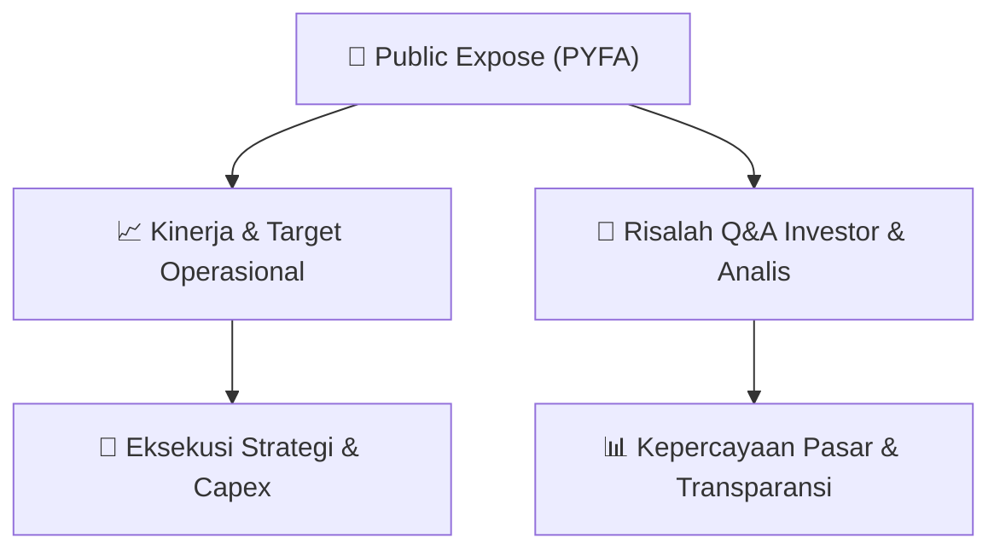

# 📢 Laporan Intelijen Paparan Publik (Public Expose) - [[PYFA]]
🏢 **Emiten**: `[[PYFA]]` | 📅 **Tanggal Pelaksanaan**: `2026-08-27` | 📑 **Dokumen**: `Public Expose lamp1`
⬅️ [[knowledge-base/daily-digests/Daily_Digest_20260827|Kembali ke Daily Digest]] | 🎛️ [[Dashboard|Ke Dashboard Utama]]

---

## 📌 1. Ringkasan Eksekutif & Paparan Direksi
> [!NOTE]
> PT Pyridam Farma Tbk menggelar Public Expose Tahunan pada Jumat, 21 Agustus 2026 pukul 15.15–16.05 WIB secara elektronik melalui Zoom dari kantor Perseroan di Sinar Mas Land Plaza Sudirman, Jakarta. Acara dihadiri Direktur Utama Lee Yan Gwan serta Direktur Bedjo Stefanus, Antes Eko Prasetio, dan Sinta Lestari Ningsih. Materi yang disampaikan mencakup konteks pasar, kinerja keuangan dan operasi terkini, kendala yang dihadapi, upaya peningkatan kinerja, peluang pasar, serta strategi bisnis 2026. Dalam sesi tanya jawab, manajemen menjelaskan status rights issue PMHMETD II yang masih ditunda, alasan fokus pada enam therapeutic area, dan perkembangan kapasitas produksi Line 3 serta persiapan Line 4 dan Line 5.

#### 🎯 Guidance Operasional & Target Strategis
- Katalis utama Perseroan meliputi potensi pelaksanaan rights issue PMHMETD II yang masih memiliki waktu sekitar 12 bulan sejak RUPS 22 April 2026, atau hingga sekitar April 2027, dengan keputusan bergantung pada kondisi pasar modal dan makro ekonomi. Dari sisi operasional, Line 3 telah 100% terpasang dan diresmikan Kepala BPOM pada Juni 2026 dengan kapasitas 80 juta ampul, sehingga total kapasitas produksi naik dari 80 juta ampul menjadi 160 juta ampul atau meningkat 100%. Utilisasi Line 3 diperkirakan telah mencapai sekitar 80%, namun kontribusi nilai rupiah belum dapat dihitung karena masih menunggu proses perizinan BPOM. Perseroan juga telah membangun fisik Line 4 dan Line 5 dan tinggal menunggu pemasangan. Strategi portofolio difokuskan pada enam therapeutic area, termasuk kardiovaskular, anestesiologi, dan metabolik/diabetes-obesitas, dengan pertimbangan relevansi kebutuhan kesehatan 5–10 tahun ke depan serta pergeseran tren penyakit dari menular ke tidak menular.

## 📊 2. Matriks Indikator Operasional & Parameter Kunci
| Parameter Utama | Nilai / Keterangan Resmi |
| :--- | :--- |
| **Tanggal pelaksanaan Public Expose Tahunan** | `Jumat, 21 Agustus 2026, pukul 15.15–16.05 WIB` |
| **Media pelaksanaan** | `Zoom dari kantor Perseroan, Sinar Mas Land Plaza Sudirman, Lantai 12, Jakarta` |
| **Direksi yang hadir** | `Lee Yan Gwan (Direktur Utama), Bedjo Stefanus (Direktur), Antes Eko Prasetio (Direktur), Sinta Lestari Ningsih (Direktur)` |
| **Status PMHMETD II / Rights Issue** | `Ditunda, bukan dibatalkan; Perseroan memantau perkembangan pasar modal dan kondisi makro` |
| **Batas waktu pelaksanaan PMHMETD II** | `Sekitar 12 bulan sejak RUPS persetujuan pada 22 April 2026, sehingga masih tersedia waktu hingga sekitar tahun depan` |
| **Fokus therapeutic area** | `Enam therapeutic area, termasuk kardiovaskular, anestesiologi, dan metabolik/diabetes-obesitas` |
| **Pertimbangan pemilihan therapeutic area** | `Tren kesehatan Indonesia dan global, priority diseases WHO, pergeseran dari penyakit menular ke penyakit tidak menular, kebutuhan dan unmet needs besar, serta relevansi 5–10 tahun ke depan` |
| **Kapasitas Line 3** | `80 juta ampul` |
| **Total kapasitas produksi setelah Line 3** | `160 juta ampul, naik 100% dari sebelumnya 80 juta ampul pada Line 1 dan Line 2` |
| **Status perizinan Line 3** | `Masih dalam proses perizinan BPOM, termasuk inspeksi dan audit; kontribusi nilai rupiah belum dapat dihitung` |
| **Utilisasi Line 3** | `Diperkirakan sekitar 80%` |
| **Peresmian Line 3** | `Diresmikan oleh Kepala BPOM pada Juni 2026` |
| **Status Line 4 dan Line 5** | `Secara fisik telah dibangun dan menunggu pemasangan` |

---

## 💬 3. Risalah Tanya Jawab (Q&A Session)
### ❓ Pertanyaan 1 (Deffandi Nasrul & Clementine - Investor)
**Pertanyaan**: Terkait rencana Rights Issue yang statusnya ditunda dan bukan dibatalkan, apakah ada indikasi dari manajemen mengenai kapan pastinya rights issue PYFA akan direncanakan ulang? PYFA sudah mengumumkan akan melakukan Rights Issue dan sekarang ditunda, bagaimana statusnya sampai dengan saat ini?

**Jawaban Manajemen**: Terkait PMHMETD II, Perseroan masih dalam tahap penundaan dan akan terus memantau perkembangan pasar modal serta kondisi makro ekonomi. Jika kondisi pasar lebih kondusif dibandingkan saat ini, Perseroan akan meneruskan kembali proses tersebut. Perseroan masih memiliki waktu sekitar dua belas bulan terhitung sejak RUPS persetujuan PMHMETD II pada 22 April 2026, sehingga masih memiliki waktu sampai dengan tahun depan untuk melaksanakan PMHMETD II.

> [!TIP]
> **Implikasi Bagi Investor**: Rights issue masih berpotensi dilaksanakan hingga sekitar April 2027, tetapi timing bergantung pada perbaikan kondisi pasar dan makro. Investor perlu memantau perkembangan pasar modal dan keputusan manajemen terkait eksekusi PMHMETD II.

### ❓ Pertanyaan 2 (Julius Suteja - Investor)
**Pertanyaan**: Mengapa fokus pada area terapi kardiovaskular, anestesiologi, dan metabolik/diabetes-obesitas?

**Jawaban Manajemen**: Perseroan memilih enam therapeutic area dengan mempertimbangkan tren kesehatan di Indonesia dan global, termasuk priority diseases area yang menjadi perhatian WHO. Pemilihan tersebut bertujuan agar portofolio Perseroan tetap relevan dengan kebutuhan dan tantangan kesehatan masyarakat, baik saat ini maupun jangka panjang. Di Indonesia terdapat pergeseran dari communicable diseases ke non-communicable diseases, sejalan dengan fokus therapeutic area Perseroan. Keenam therapeutic area tersebut memiliki kebutuhan dan unmet needs yang besar serta peluang pengembangan teknologi dan inovasi kesehatan. Mengingat proses pengembangan dan registrasi obat membutuhkan waktu panjang, Perseroan menyusun portofolio dengan mempertimbangkan relevansinya untuk 5–10 tahun ke depan guna mendukung keberlanjutan bisnis.

> [!TIP]
> **Implikasi Bagi Investor**: Fokus pada penyakit tidak menular dengan kebutuhan besar memberikan relevansi jangka panjang dan potensi pasar yang sejalan dengan tren kesehatan, mendukung keberlanjutan portofolio Perseroan.

### ❓ Pertanyaan 3 (Hendri Tjoe - Investor)
**Pertanyaan**: Berapa besar potensi kapasitas tambahan dari Lini 3 dan bagaimana dampaknya terhadap Perseroan?

**Jawaban Manajemen**: Line 3 telah dibangun sejak sekitar dua tahun lalu dan saat ini telah 100% terpasang serta diresmikan oleh Kepala BPOM pada Juni 2026. Dengan kapasitas sebesar 80 juta ampul, Line 3 meningkatkan total kapasitas produksi dari Line 1 dan Line 2 sebesar 80 juta ampul menjadi 160 juta ampul atau meningkat 100%. Dari sisi nilai rupiah, kontribusi Line 3 belum dapat dihitung karena masih dalam proses perizinan BPOM, termasuk inspeksi dan audit. Saat ini utilisasi Line 3 diperkirakan telah mencapai sekitar 80%. Sejalan dengan tingginya utilisasi tersebut, Perseroan telah mempersiapkan Line 4 dan Line 5 yang secara fisik telah dibangun dan selanjutnya menunggu pemasangan.

> [!TIP]
> **Implikasi Bagi Investor**: Kapasitas produksi berpotensi naik signifikan menjadi 160 juta ampul, namun kontribusi pendapatan masih menunggu perizinan BPOM. Ekspansi lanjutan Line 4 dan Line 5 menunjukkan komitmen Perseroan untuk meningkatkan kapasitas produksi lebih lanjut.

## 📌 4. Peta Jalur Strategis & Roadmap

---

## 🔗 Knowledge Graph
- [[knowledge-base/daily-digests/Daily_Digest_20260827|📄 Daily Digest 2026-08-27]]
- [[knowledge-base/calendars/Action_Calendar|🗓️ Kalender Terpusat Aksi Korporasi]]
- [[Dashboard|🎛️ Kembali ke Dashboard Utama]]