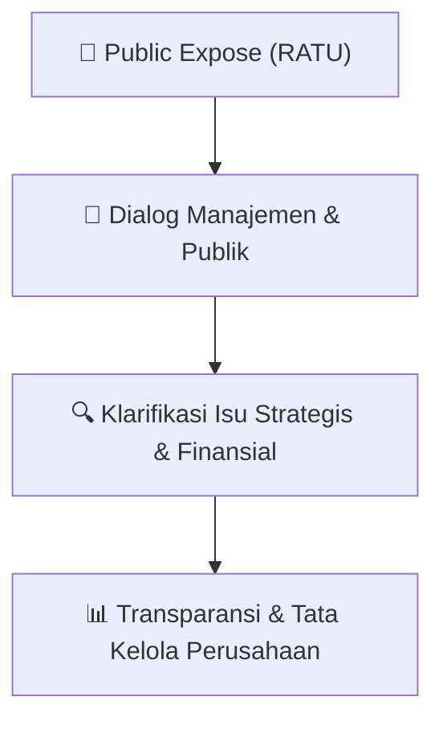

# 🎤 Laporan Hasil Public Expose: [RATU]

🏢 **Emiten**: `RATU` | 📅 **Tanggal Pelaksanaan**: `2026-09-15` | ❓ **Total Pertanyaan**: `1 Pertanyaan`
⬅️ [[knowledge-base/daily-digests/RATU_20260915|Kembali ke Daily Digest]] | 🎛️ [[Dashboard/RATU|Ke Dashboard Emiten]]

> [!IMPORTANT]
> Dokumen ini memuat seluruh risalah hasil pelaksanaan dan sesi tanya jawab (Q&A) Public Expose RATU. Informasi dicatat secara verbatim guna memberikan analisis sentimen dan arah kebijakan manajemen bagi investor.

---

## ℹ️ 1. Informasi Penyelenggaraan & Kehadiran

| Parameter | Detail Pelaksanaan |
|---|---|
| **Nomor Surat** | REC/CO/15.278/IX/2026 |
| **Perihal** | Laporan Hasil Public Expose Tahunan |
| **Waktu Pengumuman** | 15-09-2026 10:19 |
| **Jumlah Kehadiran Peserta** | Penyampaian Hasil Public Expose |
| **Lampiran Berkas** | `1` |

---

## 💬 2. Risalah Tanya Jawab Manajemen & Investor (1 Pertanyaan)

### ❓ Pertanyaan #1

> **Penanya**: Materi Paparan Publik (Public Expose) telah disampaikan secara lengkap dan 
terperinci oleh Manajemen Perseroan, meliputi lanskap bisnis migas 2026, 
profil perusahaan, ringkasan aset, pencapaian Perseroan, kinerja keuangan 
Semester I 2026, serta kinerja keberlanjutan. — Sesi tanya jawab dimulai pada pukul 14.41 WIB, dan acara ditutup pada 
pukul 14.51 WIB dengan closing statement dari Bpk. Sumantri Suwarno 
selaku Direktur Utama Perseroan. 
 
Sesi Tanya Jawab 
Keterangan: 
 
P – Pendapat 
T – Tanya 
J – Jawaban 
 
1.
Bpk. Alief Andri (Media Kontan) 
 
T1 
: 
Terkait rencana private placement hingga 10% saham, bagaimana 
rencana penggunaan dana tersebut dan proyek atau ekspansi apa 
yang menjadi prioritas Perseroan? 
 
J1 
: 
Pak Sumantri – Seperti yang telah kami umumkan dalam 
keterbukaan informasi dan kami sampaikan dalam pelaksanaan 
RUPS kemarin, dana dari private placement 10% ini terutama akan 
digunakan untuk mendukung modal kerja (working capital), karena 
setiap tahun kami mendapatkan cash call. Di sisi lain, kami juga 
akan terus menambah aset melalui akuisisi. Prioritas kami adalah

PT RAHARJA ENERGI CEPU
Office Park Thamrin Residence Blok A 01-05 
Jl. Thamrin Boulevard, Kel. Kebon Melati, Kec. Tanah Abang  
Jakarta Pusat 10220 - Indonesia
(62-21) 2357 9812
(62-21) 2357 9813
aset-aset yang sudah berproduksi, sehingga setidaknya dalam 2–3 
tahun ke depan kami masih akan terus mencari aset yang produktif.
Harapannya adalah mengurangi risiko eksplorasi dan secepat 
mungkin memperkuat kapabilitas keuangan perusahaan. Setelah 
keuangan perusahaan cukup kuat pada level tertentu, barulah kami 
akan mempertimbangkan untuk masuk ke aset-aset yang bersifat 
eksploratif. 
Pak Adrian – Kami tambahkan bahwa private placement ini sangat 
kami butuhkan karena, sesuai janji kami dalam prospektus, kami 
terus melakukan business development dan akuisisi, terutama atas 
aset-aset yang sudah producing, yang akan memberikan nilai 
tambah signifikan pada laporan laba rugi maupun neraca kami. 
Untuk tetap memenuhi janji dalam prospektus pada saat IPO, kami 
perlu memperkuat ekuitas sehingga Perseroan dapat kembali 
melakukan akuisisi ke depannya. 
2.
Ibu Lidya Sopamena (Investor) 
 
T1 
: 
Dengan adanya penambahan modal dan ekspansi non-organik ini, 
bagaimana arah kebijakan dividen (dividend payout ratio) RATU 
untuk tahun buku 2026? Apakah perusahaan akan menahan 
sebagian besar laba untuk ekspansi atau tetap berkomitmen 
membagikan dividen kepada pemegang saham publik? 
 
J1 
: 
Pak Sumantri – Secara umum, manajemen berkomitmen untuk 
selalu berupaya membayarkan dividen kepada pemegang saham. 
Namun, terkait rasionya, kami harus melihatnya secara case by case. 
Yang kami usahakan adalah selalu ada dividen yang dibayarkan 
kepada pemegang saham sebagai bentuk terima kasih kami kepada 
investor yang telah mendukung, baik dalam IPO maupun dalam 
proses corporate action berikutnya. 
Besaran dividend payout ratio baru dapat kami tentukan pada akhir 
tahun buku, karena kami perlu melihat anggaran tahun berikutnya 
dan kinerja akhir tahun buku. Oleh karena itu, kami belum dapat 
memberikan angka pasti mengenai dividend payout ratio. Kami selalu 
ingin menjaga agar tetap ada dividen, namun di sisi lain arus kas 
Perseroan 
harus 
tetap 
kuat 
untuk 
terus 
mengembangkan 
perusahaan. Jawaban ini memang bersifat normatif, sehingga kami 
belum dapat menyampaikan angkanya secara definitif. 
3.
Bpk. William Edric (Investor) 
 
T1 
: 
Apakah RATU masih akan memfinalisasi akuisisi sampai akhir 2026 
ini? Jika tidak, berapa akuisisi yang ditargetkan pada 2027? 
 
J1 
: 
Pak Adrian – Untuk tahun ini, kami masih memproses beberapa 
pipeline yang sudah masuk dan masih melakukan due diligence. 
Namun, dengan ekspektasi yang lebih konservatif, beberapa akuisisi

PT RAHARJA ENERGI CEPU
Office Park Thamrin Residence Blok A 01-05 
Jl. Thamrin Boulevard, Kel. Kebon Melati, Kec. Tanah Abang  
Jakarta Pusat 10220 - Indonesia
(62-21) 2357 9812
(62-21) 2357 9813
tersebut kemungkinan paling cepat akan terealisasi pada tahun 
2027. Saat ini sudah bulan September dan hanya tersisa tiga bulan 
di tahun 2026, sehingga waktunya cukup mepet untuk melakukan 
closing akuisisi. Oleh karena 
itu, 
secara konservatif kami 
menargetkan closing akuisisi tersebut pada tahun 2027. Pada tahun 
2027 kami juga berharap private placement untuk penambahan 
ekuitas, 
yang 
telah 
memperoleh 
persetujuan 
dalam 
RUPS 
Independen kemarin, sudah dapat dieksekusi. 
Target akuisisi pada tahun 2027 minimal satu akuisisi. Kami tidak 
melihat dari sisi kuantitas, melainkan kualitas aset yang akan 
diakuisisi. Aset dengan kualitas baik biasanya harganya juga tinggi, 
sehingga satu akuisisi saja sudah dapat memberikan dampak 
signifikan terhadap profitabilitas Perseroan. 
4.
Bpk. Richard (Investor) 
T1
:
Bagaimana RATU melihat kondisi harga minyak saat ini?
 
J1 
: 
Pak Sumantri – Seperti yang telah kami sampaikan dalam pemaparan 
lanskap bisnis 2026, Perseroan sangat diuntungkan oleh situasi 
geopolitik global yang terjadi saat ini. Meskipun berbagai sumber 
memperkirakan harga minyak pada kuartal IV akan turun ke kisaran 
USD 78–80 per barel, pada hari ini harga minyak masih menyentuh 
USD 90 per barel. Dengan demikian, kami melihat Perseroan 
kemungkinan akan menutup tahun 2026 dengan menikmati harga 
minyak yang relatif lebih tinggi dibandingkan tahun 2025. Tentu ini 
kabar baik bagi kami dan juga bagi para investor. 
 
Konferensi Pers

```text
Pertanyaan:
Acara Paparan Publik (Public Expose) dimulai pada pukul 14.00 WIB, dibuka 
oleh pembawa acara dari IDX Channel, dilanjutkan dengan sambutan yang 
disampaikan oleh Bpk. Sumantri selaku Direktur Utama Perseroan.
```

💡 **Jawaban & Klarifikasi Manajemen**:

> Setelah Paparan Publik, Perseroan mengikuti sesi Press Conference Public 
> Expose Live 2026 secara virtual pada sekitar pukul 15.06–15.25 WIB, yang 
> dihadiri oleh 12 jurnalis dari 10 medi

---

## 📌 3. Peta Jalur Transparansi & Kepercayaan Pasar



---

*Dokumen diolah otomatis oleh **Swarm Intelijen Pasar Modal Indonesia** pada 2026-10-12 16:48 WIB.*