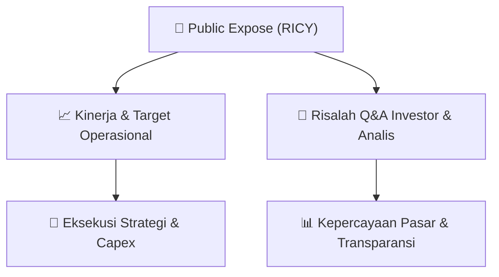

# 📢 Laporan Intelijen Paparan Publik (Public Expose) - [[RICY]]
🏢 **Emiten**: `[[RICY]]` | 📅 **Tanggal Pelaksanaan**: `2026-08-28` | 📑 **Dokumen**: `Public Expose lamp1`
⬅️ [[knowledge-base/daily-digests/Daily_Digest_20260828|Kembali ke Daily Digest]] | 🎛️ [[Dashboard|Ke Dashboard Utama]]

---

## 📌 1. Ringkasan Eksekutif & Paparan Direksi
> [!NOTE]
> PT Ricky Putra Globalindo Tbk (RICY) menggelar Public Expose FY 2025 Audited dengan fokus utama pada selesainya restrukturisasi utang melalui homologasi PKPU yang disahkan 15 Desember 2025. Homologasi memberikan kepastian hukum dan mengalihkan sebagian besar utang jangka pendek menjadi utang jangka panjang yang terjadwal, sehingga risiko kebangkrutan akut telah dilalui. Neraca perseroan bertransformasi signifikan: current ratio naik dari 0,87x menjadi 3,62x, modal kerja berbalik dari defisit Rp199 miliar menjadi surplus Rp682 miliar, dan ekuitas berubah dari defisit Rp86,6 miliar menjadi positif Rp269,8 miliar. Kinerja keuangan 2025 menunjukkan penurunan penjualan bersih sekitar 36% menjadi Rp565,6 miliar, laba kotor Rp75,3 miliar dengan gross margin 13,3%, EBITDA negatif Rp257,5 miliar, rugi bersih Rp366,4 miliar, dan EPS negatif Rp564. Manajemen menegaskan bahwa penurunan dan rugi yang melebar bersifat non-recurring, terutama didorong oleh proses PKPU sepanjang tahun, penyesuaian volume operasional, serta biaya restrukturisasi. Dampak positif homologasi baru efektif Desember 2025 dan belum tercermin penuh pada laporan keuangan 2025. Perseroan memiliki merek unggulan GT Man, Ricky, dan Ricsony, fasilitas terintegrasi di Bogor, Tangerang, dan Bandung, serta fokus pasar domestik dan ekspor. Tahun 2026 dinyatakan sebagai tahun awal pemulihan dengan target terukur dan prioritas eksekusi.

#### 🎯 Guidance Operasional & Target Strategis
- Katalis utama adalah homologasi PKPU 15 Desember 2025 yang memberikan kepastian hukum dan menghilangkan risiko PKPU berulang. Restrukturisasi mengalihkan utang jangka pendek menjadi utang jangka panjang terjadwal, sehingga likuiditas membaik signifikan: current ratio 0,87x menjadi 3,62x, modal kerja dari defisit Rp199 miliar menjadi surplus Rp682 miliar, dan ekuitas dari defisit Rp86,6 miliar menjadi positif Rp269,8 miliar. Guidance 2026 bersifat kualitatif: tahun 2026 merupakan tahun awal pemulihan dengan target yang dapat diverifikasi, fokus pada implementasi kewajiban restrukturisasi dan pemulihan operasional. Fondasi pemulihan ditopang merek GT Man sebagai underwear pria No.1, fasilitas terintegrasi, dan fokus pasar domestik. Dokumen tidak memuat angka target kuantitatif spesifik untuk pendapatan, laba, capex, atau ekspansi 2026; prioritas eksekusi ditekankan pada pemulihan operasional terukur pasca-homologasi.

## 📊 2. Matriks Indikator Operasional & Parameter Kunci
| Parameter Utama | Nilai / Keterangan Resmi |
| :--- | :--- |
| **Status restrukturisasi** | `Homologasi PKPU disahkan 15 Desember 2025 dan berkekuatan hukum tetap` |
| **Risiko PKPU** | `Selesai dan tidak akan berulang` |
| **Current ratio sebelum homologasi** | `0,87x` |
| **Current ratio setelah homologasi** | `3,62x` |
| **Modal kerja sebelum homologasi** | `Defisit sekitar Rp199 miliar` |
| **Modal kerja setelah homologasi** | `Surplus sekitar Rp682 miliar` |
| **Ekuitas sebelum homologasi** | `Defisit Rp86,6 miliar` |
| **Ekuitas setelah homologasi** | `Positif Rp269,8 miliar` |
| **Penjualan bersih 2025** | `Rp565,6 miliar` |
| **Penjualan bersih 2024** | `Rp885,5 miliar` |
| **Penjualan bersih 2023** | `Rp868,5 miliar` |
| **Laba kotor 2025** | `Rp75,3 miliar` |
| **Gross margin 2025** | `13,3%` |
| **EBITDA 2025** | `Rp(257,5) miliar` |
| **Rugi bersih 2025** | `Rp(366,4) miliar` |
| **EPS 2025** | `Rp(564)` |
| **Penurunan penjualan 2025** | `Sekitar 36%` |
| **Tahun berdiri** | `1987` |
| **Tercatat di BEI sejak** | `1998` |
| **Kode saham** | `RICY` |
| **Jumlah karyawan** | `2.678` |
| **Merek unggulan** | `GT Man, Ricky, Ricsony` |
| **Fasilitas produksi** | `Bogor, Tangerang, Bandung (rajut, dyeing, manufaktur garmen)` |
| **Pasar utama** | `Domestik + Ekspor` |
| **Industri** | `Garmen & Tekstil` |

---

## 💬 3. Risalah Tanya Jawab (Q&A Session)
`Materi presentasi Public Expose / Risalah Q&A terlampir dalam dokumen resmi bursa.`

## 📌 4. Peta Jalur Strategis & Roadmap

---

## 🔗 Knowledge Graph
- [[knowledge-base/daily-digests/Daily_Digest_20260828|📄 Daily Digest 2026-08-28]]
- [[knowledge-base/calendars/Action_Calendar|🗓️ Kalender Terpusat Aksi Korporasi]]
- [[Dashboard|🎛️ Kembali ke Dashboard Utama]]