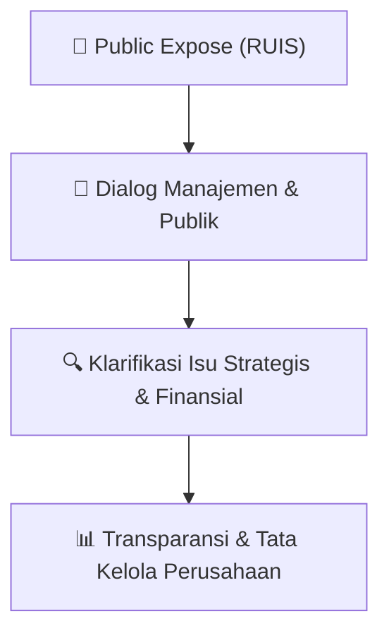

# 🎤 Laporan Hasil Public Expose: [RUIS]

🏢 **Emiten**: `RUIS` | 📅 **Tanggal Pelaksanaan**: `2026-08-28` | ❓ **Total Pertanyaan**: `2 Pertanyaan`
⬅️ [[knowledge-base/daily-digests/RUIS_20260828|Kembali ke Daily Digest]] | 🎛️ [[Dashboard/RUIS|Ke Dashboard Emiten]]

> [!IMPORTANT]
> Dokumen ini memuat seluruh risalah hasil pelaksanaan dan sesi tanya jawab (Q&A) Public Expose RUIS. Informasi dicatat secara verbatim guna memberikan analisis sentimen dan arah kebijakan manajemen bagi investor.

---

## ℹ️ 1. Informasi Penyelenggaraan & Kehadiran

| Parameter | Detail Pelaksanaan |
|---|---|
| **Nomor Surat** | 0056.RUI/CEO-LC-/VIII/2026 |
| **Perihal** | Rencana Penyelenggaraan Public Expose Tahunan |
| **Waktu Pengumuman** | 28-08-2026 23:51 |
| **Jumlah Kehadiran Peserta** | Sesuai daftar hadir bursa |
| **Lampiran Berkas** | `1` |

---

## 💬 2. Risalah Tanya Jawab Manajemen & Investor (2 Pertanyaan)

### ❓ Pertanyaan #1

> **Penanya**: Public Expose adalah suatu pemaparan 
umum kepada publik untuk menjelaskan 
mengenai 
kinerja 
Perusahaan 
Tercatat 
dengan tujuan agar informasi mengenai 
kinerja perusahaan tersebut tersebar secara 
merata; — Peraturan Nomor I-E sebagaimana dimaksud 
pada butir 1 huruf c Bagian III.3.1 disebutkan 
Setiap 
Perusahaan 
Tercatat 
yang 
mencatatkan Efek Bersifat Ekuitas wajib 
melakukan Public Expose tahunan paling 
kurang 1 (satu) kali dalam setahun yang 
dapat dilaksanakan pada hari yang sama 
dengan penyelenggaraan RUPS;

```text
Pertanyaan:
I. With reference to: 
1. Circular 
Letter 
No. 
SE-00003/BEI/05-2020 
concerning Procedures for Conducting Electronic 
Public Exposes; 
2. Financial Services Authority Regulation (“POJK”) 
No. 31/POJK.04/2015 concerning the Disclosure of 
Material Information or Facts by Issuers or Public 
Companies, as amended by Financial Services 
Authority Regulation No. 45 of 2024 concerning 
the Development and Strengthening of Issuers and 
Public Companies; 
3. Decree of the Board of Directors of Indonesia Stock 
Exchange 
No. 
Kep-00066/BEI/09-2022 
dated 
September 30, 2022 concerning the Amendment to 
Regulation No. I-E concerning the Obligation to 
Submit Information, Part III.3 concerning the Public 
Expose Obligation; 
4. Decree of the Board of Directors of Indonesia Stock 
Exchange 
No. 
Kep-00087/BEI/12-2025 
dated 
December 12, 2025, concerning Regulation No. I-E 
concerning the Obligation to Submit Information; 
5. Electronic correspondence from Indonesia Stock 
Exchange dated July 10, 2026 concerning the 
Confirmation of Interest in the Participation of 
Listed Companies in the Public Expose Live 2026 
(“Pubex Live 2026”) in Commemoration of the 49th 
Anniversary of the Reactivation of the Indonesian 
Capital Market; 
6. IDX 
Letter 
No. 
S-Und-10042/BEI.PLP/07-2026 
dated July 29, 2026 concerning the Request for the 
Selection of the Public Expose Live 2026 Schedule 
in Commemoration of the 49th Anniversary of the 
Reactivation of the Indonesian Capital Market. 
 
 
 
 
PT Radiant Utama Interinsco Tbk 
Radiant Group Building 
Jl. Kapten Tendean No. 24, Mampang Prapatan 
Jakarta 12720, Indonesia

II. Sehubungan dengan butir I (kesatu) di atas, 
dapat 
kami 
sampaikan 
hal-hal 
sebagai 
berikut: 
A. Informasi 
atau 
Fakta 
Material 
adalah 
informasi atau fakta penting dan relevan 
mengenai peristiwa, kejadian, atau fakta 
yang dapat mempengaruhi harga Efek pada 
Bursa Efek dan/atau keputusan pemodal, 
calon pemodal, atau Pihak lain yang 
berkepentingan atas informasi atau fakta 
tersebut;
```

💡 **Jawaban & Klarifikasi Manajemen**:

> Peraturan Nomor I-E sebagaimana dimaksud 
> pada butir 1 huruf c Bagian III.3.3.1 
> disebutkan 
> Perusahaan 
> Tercatat 
> wajib 
> menyampaikan 
> keterbukaan 
> informasi 
> mengenai rencana penyelenggaraan Public 
> Expose paling lambat 10 (sepuluh) Hari Bursa 
> sebelum penyelenggaraan Public Expose 
> dimaksud, dan informasi tersebut memuat 
> antara lain hal-hal sebagai berikut: 
> V.3.3.1.1. tanggal dan jam penyelenggaraan 
>                 Public Expose; 
> V.3.3.1.2. tempat penyelenggaraan Public 
> Expose; 
> V.3.3.1.3. Direktur yang akan hadir pada 
> Public Expose. 
>  
> II. In relation to the matters referred to in Section 
> I above, we hereby convey the following:

---

### ❓ Pertanyaan #2

> **Penanya**: A Public Expose is a public presentation 
intended to explain the performance of a 
Listed Company, with the objective of 
ensuring the equitable dissemination of 
information 
regarding 
the 
Company’s 
performance; — Regulation No. I-E, as referred to in Section I 
item 3 above, Part III.3.1, provides that every 
Listed Company listing Equity Securities is 
required to conduct a Public Expose at least 
once annually, which may be held on the 
same day as the General Meeting of 
Shareholders;

```text
Pertanyaan:
Material 
Information 
or 
Facts 
means 
important and relevant information or facts 
regarding events, occurrences, or facts that 
may affect the price of Securities on a Stock 
Exchange and/or the decisions of investors, 
prospective investors, or other interested 
parties in relation to such information or 
facts;
```

💡 **Jawaban & Klarifikasi Manajemen**:

> Regulation No. I-E, as referred to in Section I 
> item 3 above, Part III.3.3.1, provides that a 
> Listed Company is required to submit a 
> disclosure of information concerning the plan 
> to conduct a Public Expose no later than 10 
> (ten) 
> Exchange 
> Days 
> prior 
> to 
> the 
> implementation of such Public Expose, and 
> such information shall contain, among others, 
> the following: 
> V.3.3.1.1 the date and time of the Public 
> Expose; 
> V.3.3.1.3. the Director(s) who will attend the 
> Public Expose. 
>  
>  
>  
>  
>  
> PT Radiant Utama Interinsco Tbk 
> Radiant Group Building 
> Jl. Kapten Tendean No. 24, Mampang Prapatan 
> Jakarta 12720, Indonesia
> 
> E. Dalam pelaksanaan Public Expose, dapat 
> dilakukan secara elektronik, yaitu melalui 
> media telekonferensi, video konferensi, atau 
> sarana 
> media 
> elektronik 
> lainnya 
> yang 
> memungkinkan 
> pihak 
> manajemen 
> Perusahaan Tercatat dapat terlihat dan 
> terdengar secara langsung oleh peserta 
> Public Expose, dan peserta Public Expose 
> dapat berpartisipasi dalam Public Expose. 
> F. Para peserta Public Expose dapat memperoleh 
> dan mengakses tautan akses ke sarana media 
> elektronik yang akan digunakan untuk 
> mengikuti Public Expose, tanpa dikenakan 
> biaya dan informasi mengenai tautan akses 
> dari sarana media elektronik yang akan 
> digunakan oleh para peserta untuk dapat 
> mengikuti Public Expose dapat tersedia untuk 
> para peserta pada saat publikasi mengenai 
> rencana penyelenggaraan Public Expose 
> sebagaimana diatur dalam ketentuan pada 
> butir 1 huruf

---

## 📌 3. Peta Jalur Transparansi & Kepercayaan Pasar



---

*Dokumen diolah otomatis oleh **Swarm Intelijen Pasar Modal Indonesia** pada 2026-10-12 16:48 WIB.*