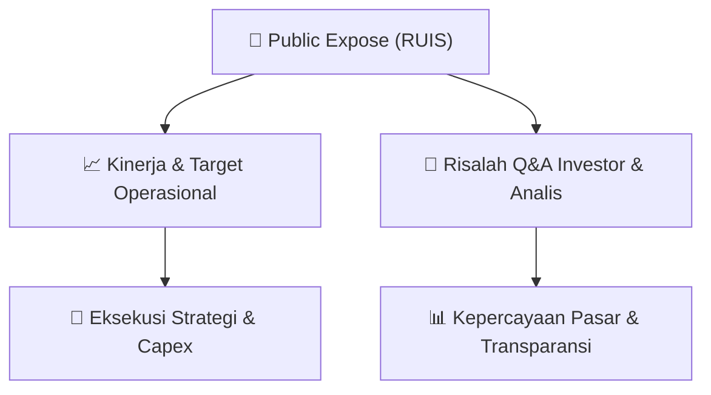

# 📢 Laporan Intelijen Paparan Publik (Public Expose) - [[RUIS]]
🏢 **Emiten**: `[[RUIS]]` | 📅 **Tanggal Pelaksanaan**: `2026-08-28` | 📑 **Dokumen**: `Public Expose lamp1`
⬅️ [[knowledge-base/daily-digests/Daily_Digest_20260828|Kembali ke Daily Digest]] | 🎛️ [[Dashboard|Ke Dashboard Utama]]

---

## 📌 1. Ringkasan Eksekutif & Paparan Direksi
> [!NOTE]
> PT Radiant Utama Interinsco Tbk (RUIS) menyampaikan surat pemberitahuan rencana penyelenggaraan Public Expose Tahun 2026 kepada PT Bursa Efek Indonesia pada 28 Agustus 2026. Surat ini merujuk pada SE BEI No. SE-00003/BEI/05-2020, POJK No. 31/POJK.04/2015 sebagaimana diubah dengan POJK No. 45 Tahun 2024, serta Peraturan BEI No. I-E. Perusahaan menyatakan akan mengikuti Public Expose Live 2026 dalam rangka 49 tahun diaktifkannya kembali pasar modal Indonesia. Dokumen ini merupakan pemberitahuan rencana Public Expose dan belum memuat pemaparan kinerja keuangan, target operasional, materi paparan, atau risalah tanya jawab.

#### 🎯 Guidance Operasional & Target Strategis
- Dokumen tidak memuat guidance operasional, target kinerja, rencana ekspansi, maupun alokasi belanja modal. Katalis yang dapat dicatat hanya rencana partisipasi PT Radiant Utama Interinsco Tbk dalam Public Expose Live 2026, yang berpotensi menjadi sarana keterbukaan informasi dan pemerataan informasi kinerja perusahaan kepada publik serta investor.

## 📊 2. Matriks Indikator Operasional & Parameter Kunci
| Parameter Utama | Nilai / Keterangan Resmi |
| :--- | :--- |
| **Nama Emiten** | `PT Radiant Utama Interinsco Tbk` |
| **Kode Saham** | `RUIS` |
| **Tanggal Surat** | `28 Agustus 2026` |
| **Perihal** | `Penyampaian Rencana Public Expose Tahun 2026 PT Radiant Utama Interinsco Tbk` |
| **Alamat Perusahaan** | `Radiant Group Building Jl. Kapten Tendean No. 24, Mampang Prapatan Jakarta 12720, Indonesia` |
| **Acuan Regulasi** | `SE-00003/BEI/05-2020; POJK 31/POJK.04/2015; POJK 45 Tahun 2024; Peraturan BEI No. I-E; SK BEI Kep-00066/BEI/09-2022; SK BEI Kep-00087/BEI/12-2025` |
| **Kewajiban Public Expose Tahunan** | `Minimal 1 kali dalam setahun dan dapat dilaksanakan pada hari yang sama dengan penyelenggaraan RUPS` |
| **Batas Waktu Keterbukaan Rencana Public Expose** | `Paling lambat 10 Hari Bursa sebelum penyelenggaraan Public Expose` |
| **Informasi Wajib dalam Rencana Public Expose** | `Tanggal dan jam penyelenggaraan, tempat penyelenggaraan, dan Direktur yang akan hadir` |
| **Partisipasi Public Expose Live 2026** | `Dalam rangka 49 tahun diaktifkannya kembali pasar modal Indonesia` |
| **Status Dokumen** | `Pemberitahuan rencana Public Expose; belum memuat materi paparan kinerja atau tanya jawab` |

---

## 💬 3. Risalah Tanya Jawab (Q&A Session)
`Materi presentasi Public Expose / Risalah Q&A terlampir dalam dokumen resmi bursa.`

## 📌 4. Peta Jalur Strategis & Roadmap

---

## 🔗 Knowledge Graph
- [[knowledge-base/daily-digests/Daily_Digest_20260828|📄 Daily Digest 2026-08-28]]
- [[knowledge-base/calendars/Action_Calendar|🗓️ Kalender Terpusat Aksi Korporasi]]
- [[Dashboard|🎛️ Kembali ke Dashboard Utama]]