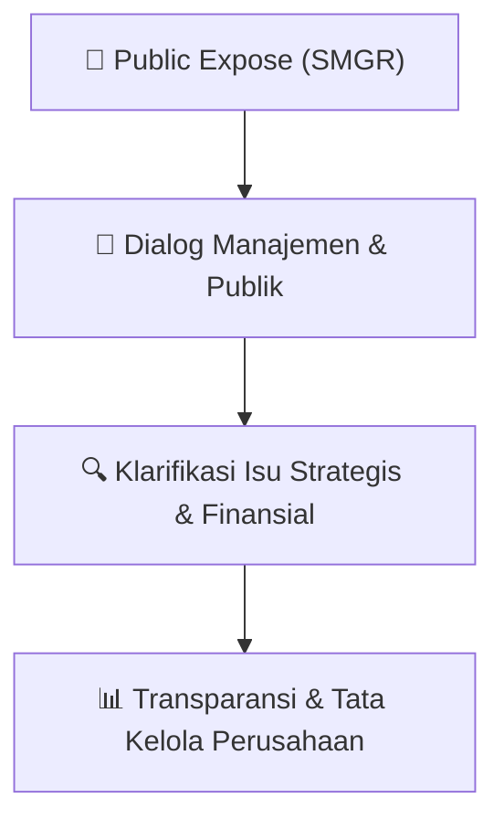

# 🎤 Laporan Hasil Public Expose: [SMGR]

🏢 **Emiten**: `SMGR` | 📅 **Tanggal Pelaksanaan**: `2026-09-11` | ❓ **Total Pertanyaan**: `5 Pertanyaan`
⬅️ [[knowledge-base/daily-digests/SMGR_20260911|Kembali ke Daily Digest]] | 🎛️ [[Dashboard/SMGR|Ke Dashboard Emiten]]

> [!IMPORTANT]
> Dokumen ini memuat seluruh risalah hasil pelaksanaan dan sesi tanya jawab (Q&A) Public Expose SMGR. Informasi dicatat secara verbatim guna memberikan analisis sentimen dan arah kebijakan manajemen bagi investor.

---

## ℹ️ 1. Informasi Penyelenggaraan & Kehadiran

| Parameter | Detail Pelaksanaan |
|---|---|
| **Nomor Surat** | 009711/KS.08/SUP/50056838/2000/09.2026 |
| **Perihal** | Laporan Hasil Public Expose Tahunan |
| **Waktu Pengumuman** | 11-09-2026 22:14 |
| **Jumlah Kehadiran Peserta** | Penyampaian Hasil Public Expose |
| **Lampiran Berkas** | `1` |

---

## 💬 2. Risalah Tanya Jawab Manajemen & Investor (5 Pertanyaan)

### ❓ Pertanyaan #1

> **Penanya**: *Investor / Analis Publik*

```text
Pertanyaan:
1. Pembukaan oleh moderator 
 V ita Mahreyni
Sesi Tanya Jawab 
4. Closing statement 
5. Acara dilanjutkan dengan Press Conference 
 
E. 
Ringkasan Tanya Jawab
```

💡 **Jawaban & Klarifikasi Manajemen**:

> *Teks tanggapan manajemen tidak tersedia*

---

### ❓ Pertanyaan #1

> **Penanya**: *Investor / Analis Publik*

```text
Pertanyaan:
1. Penanya: Bapak William 
Pertanyaan: 
Bagaimana SIG menjaga penjualan yang kuat untuk menghadapi persaingan dari 
semen-semen yang lebih murah di pasar?
Jawaban:  
Dijawab oleh Bapak Dicky Saelan 
Tentunya kita tahu bahwa segmen semen ini adalah bisnis yang sangat challenging 
tapi untuk menghadapi persaingan yang cukup intens tersebut kami punya beberapa 
strategi yang sudah menunjukan hasil yang sangat baik.
Yang pertama adalah penguatan ekuitas dari brand yang kami miliki di mana hampir 
semua brand kita memiliki kedekatan cultural yang sangat erat baik itu Semen 
Andalas, Semen Padang, Semen Baturaja, Semen Dynamix, Semen Kujang yang baru 
kita luncurkan dan Semen Tonasa. Ini akan terus menjadi salah satu strategi kami 
untuk memperkuat brand tersebut. 
 
Yang kedua, tentunya kami menghadapi gempuran dari pesaing kami yang 
memberikan kompetisi harga yang cukup kuat sehingga kami harus menghadapinya 
dengan cara yang sangat baik. Seperti yang telah disampaikan oleh Bapak Sigit 
Prastowo, bahwa kami berusaha untuk melakukan multi brand strategi di mana di 
masing-masing segmen kami memiliki produk dan brand yang kami gunakan untuk 
melawan kompetitor. Pada saat yang sama, kami juga tidak terjebak ke dalam 
persaingan 
harga 
saja, 
kami 
ingin 
memastikan 
tetap 
kompetitif 
dalam 
mempertahankan bisnis yang sehat. 
 
Kemudian yang ketiga, dari sisi availability kami juga memastikan ketersediaan produk 
kami di setiap toko bangunan yang ada di retail maupun di proyek-proyek. Dan yang 
terakhir kami ingin selalu dekat dengan konsumen-konsumen kami baik itu tukang 
dan toko bangunan. Jadi ke empat hal tersebut yang kami lakukan untuk terus 
menjaga competitiveness kami dan menjaga posisi kami di pasar.
```

💡 **Jawaban & Klarifikasi Manajemen**:

> *Teks tanggapan manajemen tidak tersedia*

---

### ❓ Pertanyaan #2

> **Penanya**: *Investor / Analis Publik*

```text
Pertanyaan:
2. Penanya: Bapak Ahmad 
Pertanyaan: 
Setelah pertumbuhan yang negatif pada tahun 2025, apa pendorong pertumbuhan 
volume penjualan Semen Indonesia pada tahun 2026 yang mencapai 9,7% dan 
bagaimana pandangan ke depan terkait industri semen di Indonesia?
Jawaban:  
Dijawab oleh Bapak Indrieffouny Indra
Faktor utama pendorong pertumbuhan volume penjualan SIG di tahun 2026 ini 
adalah hasil dari transformasi bisnis yang telah kami jalankan sejak juli 2025, di mana 
SIG mempertajam pola bisnis dan memperkuat penetrasi retail sales. Transformasi ini 
juga sekaligus merubah cara berjualan dari tim SIG di mana kami berfokus sampai 
kepada toko-toko bangunan, sehingga kita bisa memastikan bahwa produk SIG 
tersedia dan terjangkau di semua toko di jaringan distribusi yang kami miliki. Hal ini 
meningkatkan keefektifan penjualan produk-produk kami di seluruh Indonesia. 
 
Selain itu, kami lihat bahwa berbagai program yang dijalankan Pemerintah 
meningkatkan permintaan semen, seperti pembangunan Koperasi Merah Putih, 
pembangunan sekolah rakyat, pembangunan kampung nelayan dan program 3 juta 
rumah.  Ke depan, kami meyakini industri semen akan tumbuh positif sejalan dengan 
program-program dari Pemerintah dan juga proyek-proyek dari Swasta yang 
bergerak di tahun 2026 ini.
```

💡 **Jawaban & Klarifikasi Manajemen**:

> *Teks tanggapan manajemen tidak tersedia*

---

### ❓ Pertanyaan #3

> **Penanya**: *Investor / Analis Publik*

```text
Pertanyaan:
3. Penanya: Bapak Ade  
Pertanyaan: 
Bagaimana progres dari transformasi yang sedang berlangsung dan apa target 
pencapaian dalam jangka pendek?
Jawaban:  
Dijawab oleh Bapak Andriano Hosny Panangian 
Secara umum progres dari transformasi yang dilakukan oleh SIG berjalan cukup baik 
sampai dengan semester 1. Dari 4 pilar tersebut secara umum penataan model bisnis 
di bisnis retail dan juga commercial business to business kami sudah melakukan 
beberapa perubahan mendasar dari cara kita untuk bisa sampai kepada end customer 
untuk bisa melakukan approach dan market penetration.  
 
Kemudian dari sisi perbaikan supply chain dan logistic juga sudah kami sudah lakukan, 
membagi ke dalam 5 area operations di mana kami mengoptimalkan seluruh 
resources yang ada di grup SIG dengan memberikan peran kepada anak Perusahaan 
semen kami untuk membantu dalam hal melakukan aktifitas penjualan baik itu di 
segmen retail maupun business to business, sehingga ini bisa dilihat sudah terjadi 
perbaikan yang fundamental dari sisi pertumbuhan revenue dan perbaikan margin. 
 
Dari sisi cost efesiensi, kami telah melakukan beberapa insiatif untuk bisa 
mengoptimalkan biaya energi, biaya overhead maintenance pabrik yang secara 
umum bisa mengoptimalisasi cost of production secara keseluruhan. 
 
Dari sisi penataan struktur anak usaha, seperti yang sudah diketahui, kami sudah 
melakukan beberapa optimalisasi dari sisi penutupan anak usaha yang tidak 
memberikan hasil/dorman untuk bisa merampingkan struktur grup secara 
keseluruhan dan juga progres untuk melakukan merger dari anak usaha beton dan 
anak usaha distribusi yang juga kami sudah melakukan publikasi kepada publik. Kami 
harapkan ini bisa segera terealisasi untuk menciptakan pilar-pilar pendukung dari 
transformasi bisnis kami secara keseluruhan untuk bisa meningkatkan pertumbuhan 
revenue dan profitabilitas. 
 
Kemudian dari sisi pengembangan dan produk turunan semen dan bahan bangunan 
juga bisa kami sampaikan sudah terjadi progres yang cukup baik sampai dengan 
kuartal 3 dari sisi peningkatan volume dan market share kami di segmen readymix, 
mortar dan bata interlock presisi serta produk turunan lainnya. Dan untuk penguatan 
sumber daya dan governance, kami telah melakukan penguatan budaya berbasis 
kinerja yang turut mendorong pencapaian kinerja operasional dan keuangan kami. 
Secara overall, dalam jangka pendek kami mengharapkan adanya perbaikan top line 
secara bertahap, perbaikan pangsa pasar dan juga penguatan profitabilitas yang lebih 
sustainable ke depannya. 
 
4. Penanya: Bapak Syahputra  
Pertanyaan: 
Bagaimana kebijakan dividen ke depannya, setelah SMGR membagi 100% dividen 
dari laba bersih untuk tahun buku 2025?
Jawaban:  
Dijawab oleh Bapak Sigit Prastowo 
Sebagaimana kita ketahui beberapa waktu yang lalu kita membagikan dividen 100% 
dari laba bersih di tahun 2025, tentu ini adalah bagian dari upaya kita untuk 
memberikan satu imbal hasil yang optimal kepada seluruh pemegang saham. 
 
Di tahun 2026 tentu kita ingin melanjutkan bagaimana memberikan imbal hasil yang 
optimal bukan hanya dari sisi persentase tapi juga dari sisi nominal, oleh karenanya 
upaya kita untuk terus mendorong kinerja yang baik kita lakukan sehingga
harapannya nanti atas kinerja tahun 2026 akan dibagikan di tahun 2027, kita bisa 
terus memberikan result yang optimal bagi pemegang saham. Namun demikian, 
beberapa pertimbangan tentu harus kita lakukan antara lain bagaimana kita 
memastikan cash flow tersedia dengan baik, kebutuhan-kebutuhan untuk investasi 
juga terpenuhi dengan baik dan tentunya final nya menjadi ranah dari pemegang 
saham mayoritas, dalam hal ini adalah pemegang saham Seri A Dwiwarna dan 
pemegang saham seri B terbanyak.
```

💡 **Jawaban & Klarifikasi Manajemen**:

> *Teks tanggapan manajemen tidak tersedia*

---

### ❓ Pertanyaan #5

> **Penanya**: *Investor / Analis Publik*

```text
Pertanyaan:
5. Penanya: Bapak William Adriel 
Pertanyaan: 
Bagaimana cara menurunkan tingkat utang Perseroan?
Jawaban:  
Dijawab oleh Bapak Sigit Prastowo 
Di tahun 2026 ini, kita sudah memberikan satu pencapaian yang baik di mana kita 
mampu untuk meningkatkan volume penjualan dan juga meningkatkan harga jual 
semen, ini memberikan return yang positif terhadap kenaikan revenue. Kenaikan 
revenue ini tentu berdampak positif terhadap kemampuan kita untuk bisa 
menghasilkan operating cash flow yang terus tumbuh positif. Oleh karenanya, kita 
mampu menurunkan utang SIG dari Rp 11,4 triliun menjadi Rp 8,06 triliun di semester 
1 tahun 2026.  
 
Jadi, kemampuan kita untuk men-generate cash flow dari operating adalah salah satu 
kunci untuk menurunkan utang kita dan pada akhirnya ini juga akan terus 
memperbaiki rasio-rasio yang lain misalnya utang terhadap ekuitas yang membaik 
dari 0,26x menjadi 0,18x, yang saya rasa menjadi salah satu yang tersehat di dalam 
industri. Dan tentu penuruan utang secara absolut juga menurunkan beban yang 
harus dibayarkan kepada kreditur, dan ini secara langsung berdampak terhadap 
kemampuan kita untuk terus memperkuat bottom line dan profit. 
 
F. 
Closing Statement 
Bapak Indrieffouny Indra selaku Direktur Utama 
Kami melihat fundamental domestik tetap terjaga untuk mendukung aktifitas ekonomi 
termasuk permintaan semen di Indonesia. Dalam kondisi tersebut, dengan ekosistem 
bisnis terintegritasi, dan jaringan distribusi yang luas, SIG memiliki fondasi yang kuat untuk 
mendorong kinerja penjualan dan mencapai pertumbuhan bisnis yang profitable. 
 
Kemudian, transformasi SIG yang terus berjalan dan telah memberikan hasil positif akan 
terus diperkuat untuk meningkatkan kinerja dan menciptakan pertumbuhan yang 
berkelanjutan. SIG juga akan terus memperluas pengetahuan produk ke masyarakat luas 
agar dapat memperkuat posisi sebagai pilihan utama penyedia solusi bahan bangunan 
dan terus meningkatkan penerapan ESG untuk mendukung bisnis yang sustainable. Akhir 
kata, kami ucapkan terima kasih kepada Bursa Efek Indonesia yang telah 
menyelenggarakan Public Expose Live dan terima kasih atas kepercayaan serta 
dukungan Bapak/Ibu Investor. Maju terus Pasar Modal Indonesia.  
 
Setelah selesainya sesi tanya jawab dan closing statement, acara Pubex Live Tahun 2026 
Perseroan ditutup pada pukul 14.45 WIB.
DAFTAR PESERTA PUBLIC EXPOSE LIVE 2026
PT SEMEN INDONESIA (PERSERO) TBK
No 
Nama 
Tipe Pengunjung 
1 
Ahmad Musawir 
Investor 
2 
Bobby 
Umum 
3 
Daniel Surjadi 
Umum 
4 
Dionisio Damara 
Media 
5 
Febilicio Christian 
Umum 
6 
Ivan Sutheja 
Investor 
7 
Kasmudim Kas 
Investor 
8 
Khalisa Mumtasyfana 
Umum 
9 
Priyatna Yayat 
Umum 
10 
Sivana Zahla 
Media 
11 
Tanriana Rustandi 
Umum 
12 
Vla Sibarani 
Umum 
13 
Weerada Chuncuansugkom 
Umum 
14 
Andreas Saragih 
Investor 
15 
Andrew Yap 
Investor 
16 
Ade Cahya 
Umum 
17 
Antonius Bermana 
Umum 
18 
Audi Reza 
Investor 
19 
Bagus Prayitno 
Investor 
20 
Bogi Yudianto 
Umum 
21 
Syahputra 
Investor 
22 
Deffandi Nasrul 
Investor 
23 
Dody Sunata 
Umum 
24 
Dzulfan A 
Investor 
25 
Eka Rahmawati Rahman 
Investor 
26 
Erwin Tanaka 
Investor 
27 
Fuat Hasym Asari 
Investor 
28 
Hana Nabila 
Media 
29 
Ismi Damayanti 
Media 
30 
John L 
Investor 
31 
M Septiadi 
Umum 
32 
Melia Mail 
Investor 
33 
Muhammad Shidqi 
Umum 
34 
Septi Irsa 
Umum 
35 
Erta Darwati 
Media 
36 
Hary Haryono 
Investor 
37 
Kenny Ang 
Umum 
38 
Mayang Analisa 
Investor 
39 
Pulina Nitya 
Media 
40 
Ramdhani Pratama 
Media 
41 
Yonatan Wijaya 
Investor 
42 
Arga Raditya 
Investor
43 
Nadhilah Hasyim 
Umum 
44 
Raihana Tazkia 
Umum 
45 
Abdul Rasyid 
Umum 
46 
Elizabeth Noviana 
Umum 
47 
Azkalinsyah Yuda 
Umum 
48 
Danielisa Putriadita 
Media 
49 
Erlinda Puspita Wardani 
Media 
50 
Bhimo Ariwibowo 
Umum 
51 
Muhammad Fikri 
Media 
52 
Mentari Puspadini 
Media 
53 
Zulfikar Yahya 
Investor 
54 
Joe Kudo 
Umum 
55 
Maulandy Kencana 
Media 
56 
Rifki Al Wafi 
Media 
57 
Alexander Budianto 
Umum 
58 
Didiet Joko Susilo 
Investor 
59 
Januar Kristianto 
Investor 
60 
London Charlie 
Umum 
61 
Deri Aditya Nugraha 
Internal 
62 
Yogi Hasibuan 
Umum 
63 
Finandaru Guntur 
Umum 
64 
William Adriel 
Investor 
65 
Alri Alri 
Investor 
66 
Muawwan Daelami 
Media 
67 
Mohamad Andi Yustian 
Umum 
68 
Fireflies.Ai Notetaker Bima 
Investor 
69 
Filbert Soeryadi 
Umum 
70 
Firman Bahari 
Internal 
71 
Bayu Santoso 
Investor 
72 
Roza Wardhana 
Investor 
73 
Elfira Sari 
Investor 
74 
Rizal Rafly 
Umum 
75 
Rully Dermawan 
Umum 
76 
Helen 
Umum 
77 
Nanda Surya 
Media 
78 
Setyo Pambudi 
Umum 
79 
Muhamad Rahman 
Investor 
80 
Candra Jayadi 
Investor 
81 
Yanto Kus 
Umum 
82 
Irsyad Wibawa 
Investor 
83 
Yogi Prasetyo 
Umum 
84 
Fabio Rizki 
Investor 
85 
Erina Septiane 
Umum 
86 
Kurniasari Sukma Dewi 
Internal 
87 
Novi Maryanti 
Internal 
88 
Rendy S 
Investor
89 
Ifham Universe 
Investor 
90 
Akhyarul Rijal B 
Investor 
91 
Mick Basa 
Umum 
92 
Mr Paul 
Investor 
93 
Jonathan Toni Tjenggoro 
Umum 
94 
William H 
Investor 
95 
Yusuf Afandi 
Umum 
96 
Anita Rachmandani 
Umum 
97 
Coffee Addict 
Investor 
98 
Benyamin Mikael 
Umum 
99 
Muhammad Arizqi 
Investor 
100 
Riza Sugandhi 
Umum 
101 
Muhamad Ubaidillah 
Media 
102 
Ilham Akbar 
Investor 
103 
Aristyo Lim 
Umum 
104 
Ahmad Jauhary 
Umum 
105 
Decky Alatas 
Investor 
106 
Arif Nur Efendi 
Umum 
107 
Riyadus ID 
Investor 
108 
Suriyani Yusuf 
Internal 
109 
Moh Farid Rahman 
Investor 
110 
Yudistira Eka Putra 
Umum 
111 
Budy Budy 
Investor 
112 
Tania San 
Investor 
113 
Daniel 
Investor 
114 
Senay Id 
Umum 
115 
Marlon Suyanthio 
Investor 
116 
Toto Setiawan 
Umum 
117 
Reza Priyambada 
Investor 
118 
Andy Andy 
Investor 
119 
Nicholas Calvin Purwanto 
Investor 
120 
Wildan Maulana 
Umum 
121 
Ali S 
Umum 
122 
Amalia E 
Umum 
123 
Valentinus Alan Palumpun 
Investor 
124 
Azam Basyarahil Hawari 
Investor 
125 
Arief Rahman 
Umum 
126 
Tommi Sianturi 
Umum 
127 
Ade Satria Putra 
Umum 
128 
Fuad Wardhana 
Umum 
129 
Achmad Zainuddin 
Umum 
130 
Rivan Rinaldi 
Umum 
131 
Ferdinan Andreas 
Umum 
132 
Aqil Triyadi 
Investor 
133 
Dyah Madu Brancti 
Umum 
134 
Abdulah  
Investor
135 
Adhi 
Investor 
136 
Adi 
Investor 
137 
Aditya 
Investor 
138 
Agung 
Media 
139 
Ahmad  
Media 
140 
Alifah 
Umum 
141 
Alvin 
Investor 
142 
Amrina 
Investor 
143 
Andriyansyah 
Umum 
144 
Aprina  
Investor 
145 
Ardi 
Umum 
146 
Arvin Nuhandya 
Umum 
147 
Bryandhika 
Umum 
148 
Dandy 
Investor 
149 
Darynn 
Umum 
150 
Deri 
Umum 
151 
Dinul 
Investor 
152 
Dr. Kasrim 
Investor 
153 
Eko 
Media 
154 
Emilia 
Umum 
155 
Fikri 
Umum 
156 
Fitrahadi 
Investor 
157 
Galih 
Umum 
158 
Hafid Bayu  
Umum 
159 
Handoko 
Investor 
160 
Hari Surya  
Internal 
161 
Ika 
Umum 
162 
Ketut 
Investor 
163 
M. Zamzam  
Investor 
164 
Muhammad 
Investor 
165 
Muliani 
Investor 
166 
Naufal 
Investor 
167 
Nissa 
Umum 
168 
Obetnego 
Investor 
169 
Permata 
Umum 
170 
Punto 
Umum 
171 
Putut Hardi 
Umum 
172 
Rachel  
Media 
173 
Raka 
Investor 
174 
Ria  
Investor 
175 
Robby  
Investor 
176 
Roy 
Investor 
177 
Samuel 
Investor 
178 
Servi 
Umum 
179 
Sianggono 
Investor 
180 
Sie David 
Investor
181 
Stephen 
Investor 
182 
Steven 
Investor 
183 
Syafika 
Media 
184 
Wimpy 
Investor 
185 
Yasinta 
Umum 
186 
Yossi 
Umum 
187 
Yulistika 
Investor 
188 
Yusuf  
Umum 
189 
Zakky 
Umum
DOKUMENTASI PUBLIC EXPOSE LIVE 2026
PT SEMEN INDONESIA (PERSERO) TBK
```

💡 **Jawaban & Klarifikasi Manajemen**:

> *Teks tanggapan manajemen tidak tersedia*

---

## 📌 3. Peta Jalur Transparansi & Kepercayaan Pasar



---

*Dokumen diolah otomatis oleh **Swarm Intelijen Pasar Modal Indonesia** pada 2026-10-12 16:48 WIB.*