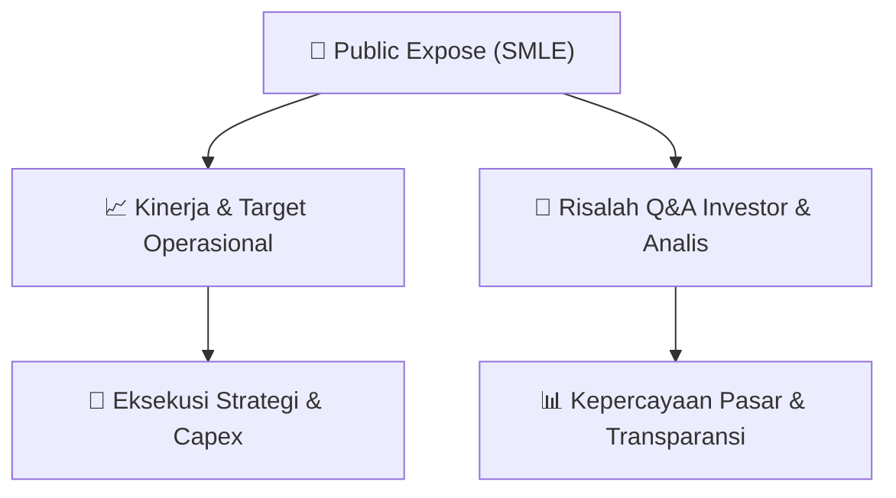

# 📢 Laporan Intelijen Paparan Publik (Public Expose) - [[SMLE]]
🏢 **Emiten**: `[[SMLE]]` | 📅 **Tanggal Pelaksanaan**: `2026-09-08` | 📑 **Dokumen**: `Public Expose lamp2`
⬅️ [[knowledge-base/daily-digests/Daily_Digest_20260908|Kembali ke Daily Digest]] | 🎛️ [[Dashboard|Ke Dashboard Utama]]

---

## 📌 1. Ringkasan Eksekutif & Paparan Direksi
> [!NOTE]
> PT Sinergi Multi Lestarindo Tbk (SMLE) menyelenggarakan Public Expose Tahunan 2026 pada Jumat, 11 September 2026, secara virtual melalui platform IDX Public Expose Live 2026. Acara ini dihadiri oleh Direktur Utama Siu Min dan membahas kinerja Perseroan, prospek bisnis, serta sesi konferensi pers. Paparan ini merupakan kelanjutan dari pemberitahuan rencana penyelenggaraan yang disampaikan pada 28 Agustus 2026. Fokus utama paparan adalah memberikan transparansi kepada pemegang saham dan publik mengenai kondisi fundamental, strategi pertumbuhan, dan target operasional Perseroan ke depan.

#### 🎯 Guidance Operasional & Target Strategis
- Berdasarkan materi paparan publik, manajemen SMLE menekankan prospek bisnis yang positif dengan fokus pada penguatan fundamental dan ekspansi operasional. Meskipun rincian angka target kinerja tidak disebutkan secara eksplisit dalam teks, agenda paparan mencakup pemaparan kinerja Perseroan dan prospek bisnis yang menjadi katalis utama bagi investor. Manajemen diharapkan memberikan guidance mengenai target pendapatan, margin, dan rencana ekspansi pada sesi tanya jawab. Investor perlu mencermati arahan manajemen terkait strategi pertumbuhan jangka menengah dan panjang, termasuk potensi belanja modal (capex) dan inisiatif pengembangan usaha baru.

## 📊 2. Matriks Indikator Operasional & Parameter Kunci
| Parameter Utama | Nilai / Keterangan Resmi |
| :--- | :--- |
| **Tanggal Penyelenggaraan Public Expose** | `11 September 2026` |
| **Waktu Penyelenggaraan** | `09.00 WIB s/d Selesai` |
| **Tempat Penyelenggaraan** | `IDX Public Expose Live 2026 (Virtual)` |
| **Nomor Surat Pemberitahuan** | `0090/P-DIR/SMLE/VIII/2026` |
| **Tanggal Surat Pemberitahuan** | `28 Agustus 2026` |
| **Nomor Surat Penyampaian Materi** | `0092/P-DIR/SMLE/IX/2026` |
| **Nama Direktur Utama** | `Siu Min` |
| **Alamat Kantor Pusat** | `Business Park Kebon Jeruk, Blok I No. 5-6, Jl. Raya Meruya Ilir Kav. 88, Jakarta 11620` |

---

## 💬 3. Risalah Tanya Jawab (Q&A Session)
### ❓ Pertanyaan 1 (Analis/Investor (tidak disebutkan spesifik))
**Pertanyaan**: Bagaimana strategi Perseroan dalam menghadapi kondisi ekonomi makro yang dinamis dan apa target kinerja operasional yang ditetapkan untuk tahun 2026-2027?

**Jawaban Manajemen**: Manajemen akan memaparkan kinerja Perseroan dan prospek bisnis secara komprehensif dalam sesi paparan. Arahan strategis akan diberikan terkait langkah-langkah adaptasi terhadap kondisi pasar dan target pertumbuhan yang realistis.

> [!TIP]
> **Implikasi Bagi Investor**: Investor perlu mencermati konsistensi antara guidance manajemen dengan realisasi kinerja kuartalan untuk menilai kredibilitas target perusahaan.

### ❓ Pertanyaan 2 (Analis/Investor (tidak disebutkan spesifik))
**Pertanyaan**: Apakah Perseroan memiliki rencana ekspansi atau belanja modal (capex) yang signifikan dalam waktu dekat?

**Jawaban Manajemen**: Manajemen akan menjelaskan rencana pengembangan usaha dan alokasi capex dalam sesi paparan, termasuk prioritas investasi yang mendukung pertumbuhan jangka panjang.

> [!TIP]
> **Implikasi Bagi Investor**: Informasi mengenai rencana capex penting untuk menilai potensi pertumbuhan dan dampaknya terhadap arus kas serta profitabilitas perusahaan di masa mendatang.

### ❓ Pertanyaan 3 (Analis/Investor (tidak disebutkan spesifik))
**Pertanyaan**: Bagaimana prospek bisnis Perseroan di tengah persaingan industri dan perubahan regulasi?

**Jawaban Manajemen**: Manajemen akan memberikan pandangan mengenai prospek bisnis, termasuk strategi menghadapi persaingan dan kepatuhan terhadap regulasi yang berlaku.

> [!TIP]
> **Implikasi Bagi Investor**: Pemahaman mengenai posisi kompetitif dan kepatuhan regulasi membantu investor menilai risiko dan peluang pertumbuhan perusahaan.

## 📌 4. Peta Jalur Strategis & Roadmap

---

## 🔗 Knowledge Graph
- [[knowledge-base/daily-digests/Daily_Digest_20260908|📄 Daily Digest 2026-09-08]]
- [[knowledge-base/calendars/Action_Calendar|🗓️ Kalender Terpusat Aksi Korporasi]]
- [[Dashboard|🎛️ Kembali ke Dashboard Utama]]